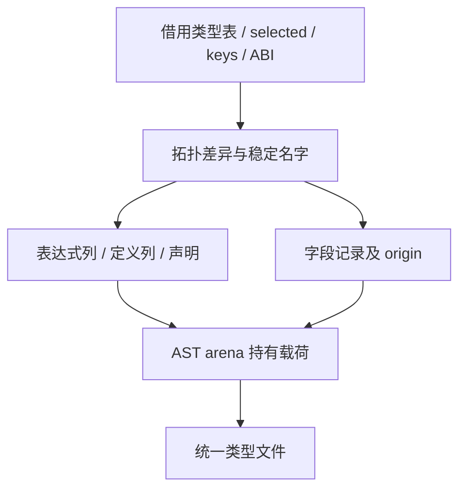

# 全量状态视图类型构造自举

## Intent：最终目标

将全量 state/view 类型定义、命名、origin 字段、声明去重和映射构造迁入 RX/ZX，
与已迁移的普通 ABI 定义衔接。保持原有类型布局、节点顺序、所有权和零运行库约束。

## Data：可用证据

旧 state_value/types.lower 复制 ABI 映射后，按子先父顺序构造类型。optional 总是
重新包裹 state 子类型；list 的 state 为 items/headered 记录，view 保持 ABI；
选中的 object/tuple 增加 origin 可空尾项。子 view 与 state 不同才生成独立 view
定义，否则发布别名。重复名字只去重声明，每个类型仍有自己的节点和映射。

最终真实生成产物、现有检查、阶段自编译和成本报告位于 `/tmp/zxc-state-types/`。

## Edges：边界与限制

- RX 连接差异与命名计划、结构化定义构造、字段物化；ZX 保留各阶段内聚算法。
- 复用 Expressions、Definitions 和 Field 记录，不构造 printer.Fields 同形对象。
- 保留原 selected/key 分析；按需 state/view 查询、Growth、Lower/AST 持有状态
  仍为后续迁移项，不宣称整个类型系统或整个编译器完成自举。
- State 名严格保持 SHA256(base bytes + 零分隔符 + key) 后的 value_ 小写十六进制。
- 字段范围和 ExprId 先以 u64 检查再窄化，维持原映射数组身份和导出可见性。
- 不新增测试用例、不放宽原断言、不用源码字符串生成 Zig 模块。

## Answer：交付格式与成功标准

交付 RX/ZX 全量 state/view 构造、表示适配、阶段一致、现有行为和实际受影响路径
性能证据，英文提交并推送。保留未通过的检查和未迁移职责，不以局部成功代替完成。

## 实现和所有权

view 差异按拓扑顺序计算：optional 继承子差异，选中的 list 与 ABI view 不同，
选中的 object/tuple 汇合直接子差异；未选中类型保持原 ABI 映射，不沿成员继续
传播。object 的 origin 初值为 null；tuple 只追加可空尾元素，没有对象字段默认值。

origin 名从 zx_origin 起，避开用户已有字段后选择首个 zx_origin_N。状态与视图
声明分别去重，两种前缀互不相交；重复名字仍构造节点。没有省略未变化的 view
别名，也没有给别名增加多余 identifier 节点。

普通 ABI 与 state/view 共用结构化列导入。前者继续按已有生命周期借用文本或
深复制；后者直接在 AST allocator 构造，再以 appendBorrowed 导入。列描述符
被复制，名字、tuple 数组和嵌套载荷保持到 AST 结束；普通字段名借用原 IR。

key 只创建 slice 描述符，指向原 keys[index]，不借用 for 按值副本。AST 不保存
局部 Input/Table 描述符或 key 指针。所有分配仍经过调用者 allocator，失败由
原 Lower arena 整体释放，不引入专用资源管理层。部分中间计划会保留到 AST
结束，这是明确的驻留取舍，不能仅凭静态复制减少断言内存收益。

construct.zx 超过 120 行，是内聚结构化构造状态机的评审信号。没有机械切片、
压缩语义空行或添加转发层来消除行数信号。

## 内存问题与根因闭环

首轮 CPU 持平，但冷 RSS 中位数 364.266→367.469 MiB。改为直接持有后，冷
CPU 3.30→3.28 s，RSS 却为 363.719→371.125 MiB。两批原始证据均保留，没有
用 CPU 改善掩盖驻留增长，也没有对同一源码重复计时挑选样本。

临时容量探针显示：2827 个类型、14890 个字段、2926 个成员计划、16353 个
表达式、4794 个声明；lower arena 构造前容量 1750320 字节，生成后
36414100 字节，导入后不再增加。它是 arena 容量，不是活跃字节或采样 RSS。

目标代码定位到 state_claimed 更新：先 push 声明产生保留旧 flags 的中间整状态，
随后写标记被保守判为非独占，调用 zxReserve(bool, ..., false)，逐次复制整表。
单独改变初始化没有消除它，故没有为该版本再做计时。

最终先保存 fresh_state 标量，无条件写标记，再按标量发布声明，保持 first-wins；
旧标记已为 true 时只写回 true。移动只影响私有临时数据，失败后整个 Lower
丢弃，没有外部状态副作用。先直接运行现有生成器检查目标代码，再重建：所有
bool reserve(false) 消失，仅保留两次初始化。最终产物再次核对此性质。

探针已移除。上述容量只属于中间版本，不冒充最终容量；最终内存表现另行实测。

## 最终验证

- compiler：23/23 步、372/372 项通过。
- ABI、原生运行、库链接/打包、Task、原生值边界：216/216 步、337/337 项通过，
  包含八个既有 Node 库消费驱动。
- 最终 stage 2/3：各 16/16 步；1751 个文件逐字节一致，仅排除 .zxc-inputs。
- 测量所用 eager 二进制与最终两轮二进制 SHA-256 完全一致：
  78c37e2d767a29d933a2abc634dbbdef9a3bc295b2df2f8dbb69b0625a2cbfdd。
- 共同 1579 个旧函数文件逐字节一致；8320 个共同类型定义不变，printer Source/State
  未变重。此源码证据不等同于机器码布局或所有场景的成本证明。
- 最后补齐两处属性简写，直接重新生成 1751 个文件全部字节相同；沿用等价证据，
  不为明显等价的写法重新计时。发布 CLI 在该源码上重新构建，26/26 步通过；日志为 final-published-dist.log。

### 未通过的补充检查

补充迭代组最初 214/268 步，已运行 241 项通过，12 步失败。三个原生值边界检查
只镜像 genz/src/zx，缺少 builder/node 及正式 imports。已改为完整源码镜像并
继承生产 genz imports，静态检查入口直接复制，不拼接 Zig；原有 35 项全部通过。
只修复检查接线，没有新增 test 块或改变预期。

另外九项 ArrayList(state_type_) 形态断言仍未通过，保留断言和失败。旧、新 CLI
对七个列迭代样例和一个模块迭代样例生成的文本逐字节相同，旧版本也不包含
这些缓冲区。该对照只使用现有样例的格式化临时副本；CLI 对照不等同于在旧版
完整复跑失败的 Bundle 驱动，原生 consumer 样例亦未单独完成旧基线复现。因此
这些证据是已有形态失配的线索，不能宣称九项都已解决或整组全绿。

## 最终成本证据

冻结 1653 个源文件、66 个入口，ReleaseSmall、resident=0，五对交替运行。
两侧可执行文件、缓存与输出路径等长，各用独立冷缓存后测热轮；前后校验输入
摘要，全部构建结束后计时。

| 五对中位数       |  修改前 |  修改后 |
| ---------------- | ------: | ------: |
| 冷墙钟 / ms      | 701.216 | 714.165 |
| 热墙钟 / ms      | 536.086 | 538.432 |
| 冷 CPU / s       |    3.28 |    3.30 |
| 热 CPU / s       |    2.23 |    2.23 |
| 冷峰值 RSS / MiB | 362.547 | 363.766 |
| 热峰值 RSS / MiB | 326.297 | 326.172 |

冷退休指令 45232490975→45326720118（约 +0.208%），热
31716616866→31727435881（约 +0.034%）；周期冷
13278830553→13368555014，热 9065490714→9060919388。

受影响的发射阶段为 206→206 ms，推导为 362→362 ms，写出为 38→46 ms。
写出差异解释了本批整轮墙钟差异的主要部分；写出实现未改、输出文件内容数量
相同，不能将整轮差异全部归因于本次发射，也不将整轮描述为提速或所有指标
严格零差异。冷 CPU 基线范围 3.26～3.31 s、新版 3.30～3.31 s；冷 RSS 基线
356.172～365.766 MiB、新版 354.297～365.250 MiB，已恢复重叠范围。

每对 1574 个输出逐字节相同，跨版本仅排除 .zxc-inputs；各版本冷/热输出包含
输入指纹也完全相同。未用测量噪声解释此前真实的全表复制缺陷。

## 证据和自我复核

`/tmp/zxc-state-types/` 中保存 eager-performance/{summary,counters,stages,outputs}.json、
accepted-fixedpoint.json、accepted-binaries.json、accepted-helpers.json、
style-equivalence.json、baseline-fixtures.json、memory-stderr.log、eager.log、
accepted-checks.log。中间批次、失败日志和容量探针日志保留，不提交缓存或探针。

曾将标记表复制误归因于一般临时数据生命周期，容量和实际目标代码才完成根因
闭环；后续先核对请求分配规模、所有权与生成代码，再调整分配策略。泛化的
field-sensitive 唯一性分析仍可能保守，本阶段只通过清晰等价数据流消除多余别名。

按需 state/view 查询、Growth、原生 Lower/AST 持有和未通过的形态检查仍待处理。
不以文件后缀、阶段一致或通过项总数代替完整自举和全部回归完成。
