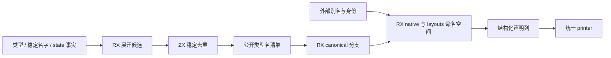
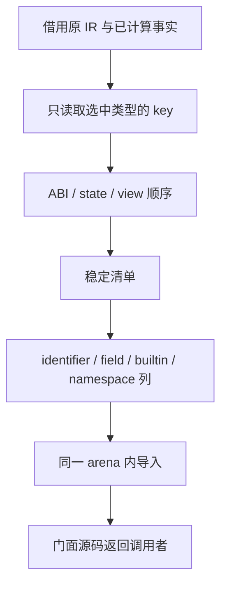

# 共享 ABI 公开接口生成自举

## Intent：最终目标

迁移共享 ABI 的公开类型名称枚举和门面 AST 构造，使应用、库及跨包原生模块
发布沿用同一 RX/ZX 规则。保留字节输出、稳定顺序、身份映射与零运行库约束。

## Data：可用证据

基线 bf82bbbb。正式 function_facts 已调用 state/select.rx，选择与 key 计算已
迁移；state_value/analysis.create 的原生主体主要为种子和独立辅助 API 保留，不能
因为文件仍存在就重复迁移正式路径。

正式 app/lib 发布仍调用 compiler/backends/zig/modules.typeNamesAnalyzed，按
TypeId 顺序构造 ABI/state/view 名并全局 first-wins；genz/zx/abi_view.render 仍
用原生 builder 构造 canonical 重导出及 native/layouts 身份命名空间。

## Edges：边界与限制

- RX 编排候选名称、稳定去重及门面各阶段，ZX 保留内聚集合和结构化 AST 算法。
- 复用已有 state/name、二分位置、声明列、namespace 原语与统一 printer。
- imported=false 不生成 canonical 导入和类型重导出，但两个 namespace 仍存在，
  包括 aliases 为空的情况；identity 与外部 specifier 不得混用。
- 稳定去重保留首次出现位置，不能排序最终公开接口；临时排序仅建立去重索引。
- 生成文本和嵌套载荷在打印前保持有效。名称清单需要返回给长生命周期调用者时，
  必须转交其 allocator；门面临时 AST 可在同一 arena 中借用直到 printer 完成。
- 不新增测试，不放宽断言；不新增源码模板、RawCode、运行库或专用解释层。
- 原生 state selection 种子、Lower/AST 持有和 source_abi 的别名收集仍不属于本次
  迁移，不以两个入口迁移宣称整个 ABI 子系统完成自举。

## Answer：交付格式与成功标准

交付正式发布路径中的 RX/ZX 名称清单与 AST 门面、既有消费者验证、阶段自编译、
受影响路径成本和完整产物对照；完成此独立职责后英文提交并推送。
证据放在 `/tmp/zxc-abi-publication/`，本文按实际结果更新。

## 执行记录

公开名称候选同时携带基础类型来源。去重以临时排序加二分建立索引，按原候选
顺序输出；先保存 fresh、写 claimed，再 push 输出，避免因旧状态别名复制标记表。
来源随 first-wins 一并保存。适配器继续借用原 ABI 名，只复制临时生成的 state/view
文本，并在部分分配失败时仅释放已经复制的文本。

正式 app/lib 调用把 batch.backing 作为查询工作区，避免临时 arena 依赖结果
arena。独立未带 backing 的旧辅助入口仍传其 allocator；不将这一回退的释放能力
描述成与正式路径相同。公开 compiler.zig API 不变，修改的是内部调用签名。

门面复用最小表达式列以及现有 constants/namespace 原语。成员声明先导入，
根声明后导入；两个 namespace 的范围只引用各自的成员。生成器和 AST 共享同一
临时 arena，打印结束后才释放，不复制临时载荷到已经结束的生命周期。
Alias 的字段描述符显式组装，避免假设宿主字段排列与生成 ABI 相同；不复制字符串
字节。canonical 条件阶段在独立 RX 模块显式返回，未把流程放进 ZX。

第一次 Task 内 Return 被现有 return_path 校验判为终止后续流程；调整 RX 层级
后通过。来源列改动中一次漏接被差异复核发现，补齐 ABI/state/view 三类 push 与
来源 push 的一一对应。未将中间版本作为最终产物证据。

最终当前 compiler 23/23 步、372/372 项通过。阶段一致、实际消费与成本验证进行中。

## 初轮成本与定向优化

构建隔离后，固定旧 1653 源文件、66 入口，五对交替冷/热生成。初轮冷发射
205→210 ms、热发射 101→102 ms；整轮冷 CPU 3.29→3.32 s，冷 RSS 中位数
357.047→363.719 MiB。五对 1574 个产物均一致。保留 performance/ 原始数据，
不将这组结果描述成无退化，也没有撤回迁移。

公开名称枚举逐个调用稀疏查询的 key 提取 helper，增加每个选中 key 的 32 次
push 和临时缓冲。该入口本来就遍历整张表，改为在独立工作区构造 slice 描述符
表，直接借用原 [32]u8 单元；循环使用指针捕获，避免描述符指向按值循环副本。
稀疏查询保留按需提取，未将其扩成全表成本。digest 大小在 state/const.zx 统一，
相关消费者直接导入。

优化版先直接运行已有生成器校验源码，再进入宿主构建。随后复核同输入产物和
受影响路径；不靠同一源码重复计时选择较好样本。

借用 key 版的第二批五对对照：冷 CPU 3.30→3.31 s、冷 RSS
358.734→354.391 MiB，冷退休指令增量缩至约 0.017%；冷发射仍为 207→210 ms，
热发射 100→102 ms。保留 borrowed-performance/，没有把驻留改善代替耗时门禁。

进一步把去重改为 ZX 开放寻址：非空输入分配 2N+1 个桶，保存原候选索引，
用完整字节比较解决碰撞；候选与来源只在同一 fresh 分支追加。空输入直接返回。
std:bytes.hash 直接调用 Zig 标准库 Wyhash(seed=0)，是通用标准库契约，不承担
编译器语义或状态。旧 pinned 工具的嵌入接口没有此新成员，因此从初始种子重新
构建工具：41/41 步、372/372 项通过，再用于后续阶段。

公开名称适配采用 BufferFirst，少量类型和空结果不必创建 arena 的后备页；
大输入继续使用独立 workspace。最终版重新校验产物与性能，阶段结果待补。

开放寻址版冷发射中位数恢复到 206→206 ms。跨版本产物不再完全相同：
types.zig 仅新增 std:bytes.hash 的 Input/Output/InputValue/OutputValue 声明；
.zxc-files 相应记录该文件的新摘要。没有按文件名直接忽略这两个文件。

为避免把标准库接口不同混入迁移成本，使用 bf82bbbb 的六个 Zig 包快照，仅替换
当前 bytes.d.zx 和 bytes.zig，构建同一 SDK 的基线。未创建分支或更改当前工作区
历史；快照位于 /tmp/zxc-abi-publication/sdk-baseline。该工具 34/34 步通过。
随后以此基线和最终工具比较，要求全部同输入产物一致，再测受影响路径。

最终标准库接口下，阶段 1→2 的 1778 个文件逐字节一致，只排除 .zxc-inputs。
阶段 3、同 SDK 性能与消费者回归继续收口。

## 最终验收与成本

- 初始种子构建新 hash 工具：41/41 步、372/372 项通过。
- 最终 stage 1/2/3 各 16/16 步，1778 个产物逐字节一致，只排除 .zxc-inputs。
  三轮 SHA-256 均为
  `247dc162bee310d51fad29f4bcbdeb52c206ac5e7b3300d79cc0a8b77a61412a`。
- 最终 dist 26/26 步通过，工作区 CLI 已更新。
- 核心消费者检查 86/86 步通过，含八组各 8 项借用值行为/失败检查，以及跨包原生
  库的发布、移位消费、再发布与回滚检查。最终标准库聚合检查见下文未通过项。
- 同一现有 native 项目，修改前后 20 个发布文件全部逐字节一致，包含门面、ABI、
  模块与清单；native-final-equivalence.json 保存对照。

同 SDK 快照的首次 stage 1 与 stage 2 有 355 个产物不同，包括循环字段布局。
其阶段 2/3 均为
`0b1dffed689739574c5e6df4b36b19c7e1922a29db83d368d8f8f62bbc1e2048`。
因此 same-sdk-performance/ 的推导加速数字不能作为收益，最终改用达到固定点的
基线。该校准不是为选择更好的样本，而是消除 seed/正式生成形态的差异。

最终固定点基线与最终工具五对交替运行，使用相同 SDK、冻结输入和配置。
fixed-sdk-performance/ 的第 1 对曾与尚未结束的 CLI 产物验证重叠，在查看计时
结果前排除；以第 2～6 对作为五个有效配对，excluded.json 记录原因。未删除
任何原始轮次。五对各 1574 个产物完全一致，冷/热产物连 .zxc-inputs 也相同。

| 有效五对中位数   |    基线 |    最终 |
| ---------------- | ------: | ------: |
| 冷发射 / ms      |     206 |     209 |
| 热发射 / ms      |     100 |     100 |
| 冷整轮墙钟 / ms  | 702.821 | 709.199 |
| 热整轮墙钟 / ms  | 541.562 | 537.331 |
| 冷 CPU / s       |    3.31 |    3.32 |
| 热 CPU / s       |    2.24 |    2.23 |
| 冷峰值 RSS / MiB | 356.063 | 359.766 |
| 热峰值 RSS / MiB | 326.813 | 326.844 |

冷退休指令 45411361485→45408908903，热 31731375306→31713396939；
周期分别为 13378805597→13379136580、9064611340→9063452375。
实际处理器工作未增加；冷发射墙钟仍有 3 ms 中位数差异，不宣称所有指标严格
零差异。冷 CPU 范围 3.30～3.31→3.28～3.35 s，冷 RSS 范围
354.313～365.078→354.094～365.828 MiB。保留该差异作为后续优化跟踪项。

另对现有 native 项目进行五对、每批 10 次 --no-cache 库发布，输入 16 个文件摘要
前后核对，均未改变；两版最终 20 个发布文件完全相同。批处理墙钟中位数
181.002→182.583 ms，CPU 均 0.18 s，峰值 RSS 指标均 17.188 MiB。
这是批处理命令的资源指标，不是整个进程树同时驻留，也不能宣称每次 CLI 的
实时 RSS 固定不变。该项目实际使用的接口与产物未改变，旧 CLI 未提供的新 hash
成员不进入其项目 ABI。原始记录在 cli-performance/。

## 未通过项与自我复核

最后误将新增 bytes 原语的验证扩大到 test-standard-resources 聚合入口，其
额外带入 URL、进程、HTTP 等检查。结果为 277/280 步、已执行 2848/2848 项
通过，唯一失败为 HTTP 应用 SIGKILL；相同命令的原生借用/发布消费者仍通过。
修改前 CLI 单独复跑同一 HTTP 驱动，也以同一 SIGKILL 失败。日志分别为
final-checks.log 和 http-baseline.log，不将聚合检查报绿，也不据此宣称定位了
HTTP 的根因。后续应先查看聚合依赖，按实际变更选择验证范围。

本次对性能的改动均保留实现，再依复制、驻留和算法证据优化：借用原 key、分离
工作区、只复制生成文本、开放寻址和小输入缓冲。没有撤回迁移以避开门禁；也
没有用某次较好数字掩盖早期退化、阶段基线错误和最终冷发射差异。

本阶段迁移公开名称及门面构造，未迁移所有原生状态或 source_abi 别名收集。
九项聚合循环值缓冲缺口、HTTP 共同失败和完整编译器自举仍未完成，目标继续。
