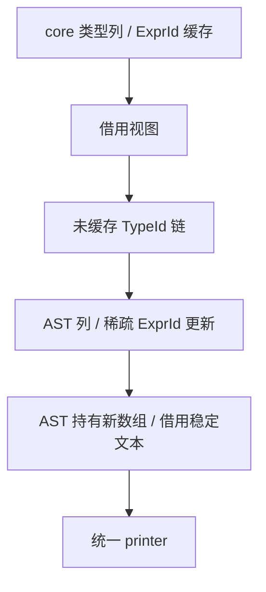

# 共享 ABI 类型构造自举

## Intent：最终目标

将共享类型文件引用模式下的完整按需 ABI 构造迁到 RX/ZX，覆盖全部类型类别，
不在每次查询时重建全表，保留原映射数组的身份与缓存。

## Data：可用证据

types.get 按 table.ptr 区分 ABI/state/view，调用后继续读取原数组。命名聚合、
enum 和 native reference 直接引用 zx_abi 名字，不展开成员；只有 optional、
list 与 Task.result 需要子类型 ExprId，Task.errors 直接读取错误集名字。
IR 语义校验已保证依赖拓扑，正式发射以有效 IR 为前提。

## Edges：边界与限制

- RX 连接依赖收集与构造；ZX 保留每阶段的内聚遍历与类型规则。
- 借用类型表及原缓存，仅返回新 AST 行与稀疏更新，不复制或替换全长映射。
- enum 保持值 ABI；object/tuple/native reference 保持 const pointer ABI。
- string 保持 const u8 slice；Task 保持 std.Io.Future 与明确的 error_union。
- 默认类型名、标量映射与错误名读取都来自 ZX；宿主只适配、导入及回写。
- 全量普通类型定义、state/view、Growth 与宿主 Lower/AST 状态仍待迁移。
- 不新增测试，用现有原生 ABI、库消费、任务和分配失败检查验收。

## Answer：交付格式与成功标准

交付共享 ABI 构造、宿主表示桥、产物及受影响路径性能证据，英文提交并推送。
这不构成整个类型生成或整个编译器自举完成的证明。

## 实现与资源边界

按需链只访问未缓存节点，遇到已缓存子类型或叶子即停止；逆序构造后一次回写
原数组。不会因查询一个类型而扫描全表。标量编号与 AST Primitive 编号不同，
显式映射；编码值集中在 core/type_table/const.zx，默认名前缀复用既有 const。

每个类型先以 u64 检查确切新增节点数，再转换起点、计算 u32 偏移，防止接近
ExprId 上限时先发生安全溢出。资源超限交给宿主报告 OutOfMemory。

所有列在平坦循环中追加，生成代码保留增长元数据。construct.zx 超过 120 行，
是该内聚构造状态机的评审信号；没有为行数压缩格式或机械碎片化。

临时分配直接使用平台 page_size_min 的栈缓冲。BufferFirstAllocator 超出容量
后才使用私有 Arena，退出统一释放。此前 Arena 套在 BufferFirst 外，即使短查询
也经过 Zig 0.17 Arena 的原子节点/游标路径；调整层次绕过了这部分小分配成本。
不设置依赖深度上限，也不回退到旧语义实现。最终 AST 和溢出分配仍可能使用
Arena，不能声称整个查询没有原子操作。

有 type_names 时，标识符和字段名来自原 IR 或静态常量，文本继续借用；错误名
数组复制结构，底层名字字节借用。没有 type_names 时，默认名字仍由深复制持有。
call_arguments 始终持有新数组。复制和失败清理使用相同借用策略，不释放借用字节。

导入器跳过已校验的空载荷列，避免为多数未使用的可变载荷列调用空深复制流程。
非空列仍执行完整类型、长度、偏移、容量和所有权处理。executeValue 与栈上列
描述符减少返回封装；所有新 AST 导入、整数映射回写均先于临时存储释放。

## 诊断与未采纳的解释

初版五对冷墙钟 712.718→720.464 ms；栈缓冲外套 Arena 的版本仍未收口。
先保留实现并优化，没有用恢复旧 ABI 路径作为最终方案。

临时 control 保留新入口和相同生成模块，只切换 ABI 查询入口；trace 只记录查询
次数。冷轮 13167 次（4044 次标量），热轮为零。不能把 `0 generated` 单独当作
未执行发射的证明；实际计数证实本场景热轮没有新查询。

既有生成源的比较也排除了旧 helper 字段变重：8235 个既有类型定义均字节相同，
只新增 43 个；252 个前端、10 个名称规划、31 个 lint helper 全部一致。共同
1568 个函数模块中 1566 个一致，另外两个仅 std:string.join wrapper 导入名变化。
未据此排除最终二进制布局差异，也未把热墙钟差异直接归因于某个新构造分支。

control 和 trace 均已从正式源码删除；对照构建及原始日志保留供审计，不提交
临时模式或探针，也不对同一源码重复计时挑选结果。

## 最终性能证据

固定 ReleaseSmall、工具链、resident=0、1653 个冻结源文件和 66 个入口。五对
交替运行，各用独立冷缓存后再测热缓存。两份可执行文件及输出/缓存路径均使用
等长 a/b 名称；所有构建完成后集中测量，执行前后校验输入摘要。

| 五组中位数       |  修改前 |  修改后 |
| ---------------- | ------: | ------: |
| 冷墙钟 / ms      | 703.906 | 703.392 |
| 热墙钟 / ms      | 538.355 | 536.031 |
| 冷 CPU / s       |    3.29 |    3.29 |
| 热 CPU / s       |    2.23 |    2.23 |
| 冷峰值 RSS / MiB | 364.078 | 356.031 |
| 热峰值 RSS / MiB | 326.625 | 326.594 |

冷退休指令 45147517370→45285198484（约 +0.30%），热
31689761035→31705669880（约 +0.05%）；周期冷
13325698376→13281114377，热 9033327519→9053647362。
该场景未见墙钟、CPU 或峰值 RSS 退化，但没有证明指令数不增加，不能称整轮
提速或证明所有场景严格零差异。RSS 在先前批次自身有 MiB 级波动，不把约
8 MiB 的中位数下降全部归因于本次优化。

## 产物与现有检查

同 std 布局的 control 旧查询与正式新查询，五组的 1574 个输出全部逐字节相同。
与 std 搬迁前基线相比，24 个标准库私有包装文件改名但内容相同；其余文件仅
对应导入引用和 .zxc-files 哈希变化。按清单位置验证全部包装，再仅替换这些
确切私有文件名后，其余代码全部相同。清单哈希变化与实际文件变化逐项一致，
每组冷热输出含输入指纹也完全一致。types.zig 原始内容相同。

最终实现的编译器检查为 23/23 步、372/372 检查通过；原生模块校验、原生执行、
公开库链接/消费及 ZX Task 集中检查为 208/208 步、302/302 聚合 Zig 检查通过，
另有八条公开库消费驱动成功。包含有默认名字的 emitBundle 路径、有限错误集、
共享映射及分配失败清理，没有新增用例或放宽预期。

最终 stage2、stage3 各 16/16 步成功；1736 个生成文件在只排除输入指纹后全部字节一致。最终 dist 构建 26/26 步成功。起点是已固定的上一
阶段编译器；测试包另使用初始 seed 路径，不把此链单独宣称为完整自举验收。
ReleaseSafe 的既有 Zig 编译崩溃、HTTP 应用在 std 搬迁前后均复现的 SIGKILL，
均未由本阶段解决，不宣称相关全套配置通过。

原始材料在 `/tmp/zxc-shared-abi/`：final-performance/summary.json、counters.json、
final-output-comparison.json、control-performance、trace、direct.log、direct-checks.log
以及 final-stage2.log、final-stage3.log、final-dist.log。中间版本数据仍保留。

## 自我核对

正式 ABI 查询不再执行旧类型分类或原生 plain 递归；seedAbi 仅在初始引导模式
使用。RX 显式连接依赖与构造，ZX 处理内聚算法。宿主表示适配及原生状态仍是
过渡依赖，不能把本阶段称为完整编译器自举。没有 RawCode、Zig 源码模板或
专用运行库；生成应用的执行形态由产物对照与现有行为检查约束。
