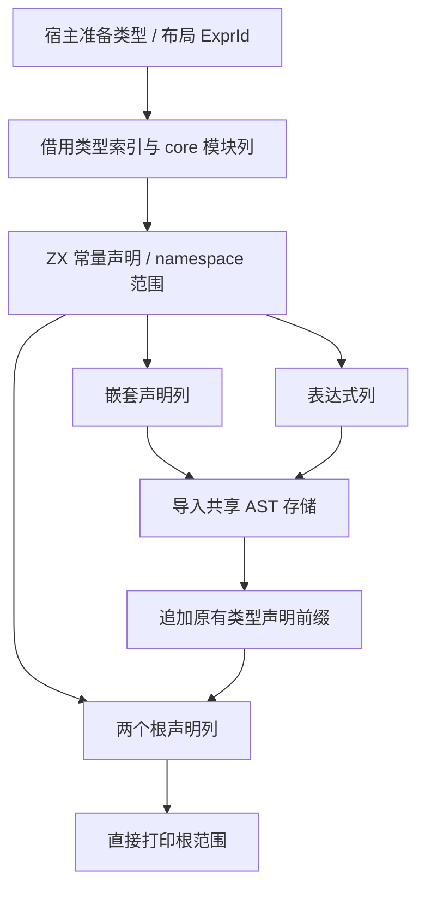

# 原生命名空间声明自举

## Intent：最终目标

将 type_bundle 中原生命名空间的声明 AST 构造移到 RX/ZX，延续已自举的分组规划。
函数签名、成员、布局及最终命名空间由源码构造结构化行，继续使用统一 printer。

## Data：可用证据

已有 node namespace_type 使用全局声明范围，行导入器可检查并导入声明列。
printer 已有声明枚举与列模型，类型表达式和布局表达式仍由 types.zig 准备。
现有打印入口只接受原生声明数组，导致生成的声明行缺少直接打印入口。

## Edges：边界与限制

- 新增常量声明与 namespace 通用构造器，不扩充 SIMD 携带的表达式列。
- RX 显式连接签名、成员、布局和外层发布；ZX 保留每阶段的内聚遍历。
- 宿主借用原有模块、函数与类型表达式索引列，导入后再释放 scratch。
- 新行中的名字只借用仍存活的 IR 或静态常量；原生类型声明前缀不复制整份 AST。
- 保留 seed 用于初始引导，类型/layout 构造及 Lower 状态仍为后续迁移范围。
- 不新增测试，复用现有原生 ABI、公开库消费与分配失败检查；完成后集中验证。

## Answer：交付格式与成功标准

交付结构化声明生成职责、通用已存储范围打印入口、产物与性能对照及阶段自编译。
完整阶段通过后英文提交并推送，不将过渡宿主表示适配宣称完整自举。

## 验收记录

首轮及借用优化后的编译器检查均为 23/23 步、372/372 检查通过。
原生模块校验、原生执行、公开库链接和统一库消费的集中检查为 111/111 步成功，
183/183 聚合 Zig 检查通过，另有八条公开库消费驱动成功。没有新增测试或调整预期。
最终批量版 stage2 与 stage3 均 16/16 步成功，1728 个生成文件逐字节一致，
仅排除输入指纹。最终 dist 为 26/26 步成功。最终源码的集中回归仍为 111/111 步、
183/183 聚合 Zig 检查与八条公开库消费驱动通过。修改的 14 个 RX/ZX 源文件格式
检查通过，没有新增测试或放宽预期。

## 实现与成本

新增常量声明六列与 namespace 四列构造器，复用原有枚举、行存储和统一导入器。
没有给 SIMD 表增加字段。native_declarations 的 RX 分别连接签名、类型/函数
成员、布局成员和两个外层 namespace 的发布；循环内部的索引与构造留在 ZX。
函数签名标签集中在该职责的 const.zx，导出名继续复用 core 的 export_name。

类型表达式准备后，宿主读取 expression/declaration 基址，借用 type/layout
索引数组。通用 node.view.slice 复用已有的布局与非穷尽枚举表示检查，不复制
ExprId 数组。嵌套声明先导入，再存储原有类型声明前缀，最后导入两个根声明。
renderStored 直接打印这个连续根范围，避免二次序列化或复制整份已有 AST。

首轮五对已有原生样例测量中，冷/热墙钟中位数为 10.905/9.769→10.852/9.757 ms；
冷峰值 RSS 23.422→23.484 MiB，热峰值持平。38 个生成文件全部一致。该证据
未显示墙钟增加，但存在 64 KiB 的冷峰值差，不能只报耗时略降。

确认新声明的名字只来自原始 IR 和生成模块中的静态常量，bytes.fromText 只是
借用。为这些行使用通用 appendBorrowed；原 append 仍深复制 scratch 中的新名字
和参数数组。借用接口仍检查列、标签、偏移及容量，复制列元素而不保留源列描述符。
它的前提是所有 slice payload 比目标存活更久；这里没有临时名字拼接或 fresh。
最终对照待全部构建结束后集中执行。

## 批量构造与正式测量

发现冷 RSS 增加后，没有撤回迁移。将逐条封装六列表的构造改为先收集结构化
Constant 记录，再由通用 constants.zx 在单个平坦循环中生成各列。生成代码的
六处 push 都保留增长元数据；收集循环中未见整表复制。Constant 记录本身仍逐项
分配，签名构造也仍有四个名字、四个值的临时数组，不能宣称完全零临时分配。

以下均为固定 ReleaseSmall、resident=0、输入摘要及工具链的五对测量；两个
版本交替运行，所有构建结束后集中执行。大输入复用 1653 个冻结源文件，原生
样例复用既有 32 函数、64 别名输入，不新增用例。测量对象为完整生成进程。

| 批量版五组中位数     |  修改前 |  修改后 |
| -------------------- | ------: | ------: |
| 原生样例冷 / ms      |  11.084 |  10.964 |
| 原生样例热 / ms      |   9.684 |   9.781 |
| 原生样例冷 RSS / MiB |  23.469 |  23.547 |
| 原生样例热 RSS / MiB |  22.281 |  22.438 |
| 大输入冷 / ms        | 706.637 | 701.589 |
| 大输入热 / ms        | 539.329 | 545.668 |
| 大输入冷 CPU / s     |    3.28 |    3.29 |
| 大输入热 CPU / s     |    2.23 |    2.24 |
| 大输入冷 RSS / MiB   | 363.500 | 354.969 |
| 大输入热 RSS / MiB   | 326.188 | 326.531 |

大输入冷退休指令 45171291067→45198687073，热 31698258741→31713161440，
差异约 0.06%/0.05%。原生样例冷指令 233956466→234175177，热
192836833→192788132。小输入 CPU 分辨率不足，不使用舍入后的零值判断收益。

上一版同输入中，大输入冷 RSS 中位数 356.141→364.438 MiB；该轮基线五个值
本身在 354.516–364.031 MiB 之间。因此不能把前后两个批次的约 8 MiB 中位数
反转全部归功于批量构造，也不能据波动就宣称内存严格无退化。保留逐样本记录。

热日志为 `0 generated, 1543 reused`，类型文件命中后不进入 pending 生成，也不
调用 type_bundle 和新的 RX 声明构造。故不能直接将热墙钟增加约 6.3 ms 归因
于本次构造算法，也不能跳过这项差异或将它自动解释成噪声。当前受影响冷路径
没有可见墙钟退化；完整生成进程的细小 CPU/RSS 差异及热墙钟仍作为未归因项。

38 个原生接口文件和 1574 个大输入文件，五组跨版本全部一致（只排除输入指纹）；
每组冷/热输出含指纹也全部一致。测量后仅删除了签名循环中未被读取的 base
状态字段；没有改变构造规则、遍历或分配方法，不为这项清理重复整轮计时。

原始日志及报告在 `/tmp/zxc-native-declarations/`。`initial-performance/`、
`performance/`、`broad-performance/` 保留中间版本；`batched-performance/`、
`batched-broad-performance/` 是批量版，每个目录包含 summary.json、counters.json
及各轮 stdout/stderr。`output-comparison.json` 记录全部产物对照。

## 自我核对与剩余边界

RX 负责真实阶段依赖；ZX 中仅保留每阶段的集合算法。声明名、导出顺序及签名
四项内容不再由正式原生分支构造。行导入、借用布局检查及类型表达式准备仍是
过渡桥，Lower/AST 宿主状态、普通类型与布局表达式还未迁移，完整自举未完成。

新路径没有 RawCode、源码模板或专用运行库；应用生成 Zig 的逐字节一致证明本次
没有改变其执行形态。不能据此将编译器侧的实际临时分配称为零成本，后续应继续
减少明确的对象/小数组分配。上一阶段 ReleaseSafe 的 Zig 编译崩溃仍未解决，
本次没有重复该已知失败的配置，也未宣称 ReleaseSafe 全部通过。

最终构建与检查日志：`batched.log`、`final-stage2.log`、`final-stage3.log`、
`final-fixedpoint.json`、`final-checks.log`、`final-dist.log`。原始 seed 构建路径由
现有测试包生成器使用；显式阶段链以阶段前固定编译器为起点，不把此链单独作为
从原始 seed 到完整最终编译器的验收证明。
