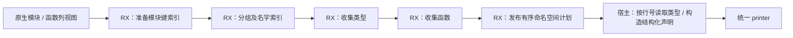
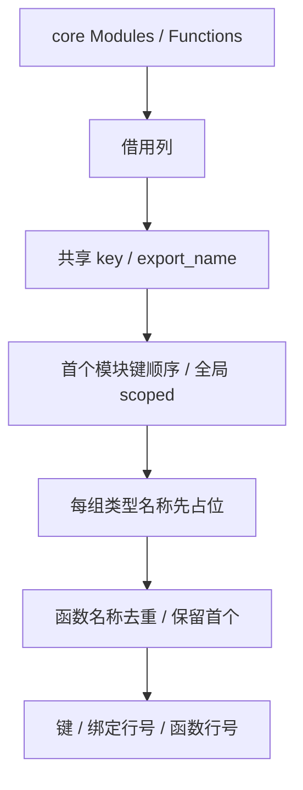

# 原生命名空间规划自举

## Intent：最终目标

将原生模块公开 ABI 的命名空间规划从 type_bundle.zig 移入 RX/ZX：按真实模块键
合并声明，保持类型优先、同名首项胜出和稳定顺序，保留空命名空间及 identity 规则。
本阶段完成整项规划职责；类型表达式、声明 AST 构造与宿主状态仍明确列为待迁移。

## Data：可用证据

现有原生实现先对所有模块做 identity 全局 OR，再按首次出现的 module.key 分组。
每组收集全部同键模块的类型，然后收集函数，共用名字集合。key 是 identity ??
specifier；exportName 是显式 export_name ?? member 最后一段，模块 ID 0 有效。
core 已有 Modules/Functions 列模型，IR 校验也已有相同的 ZX key/export_name 规则。

## Edges：边界与限制

- RX 表达分组、类型收集和函数收集；ZX 保留每项内聚的集合遍历。
- 复用 core 列模型与共享 key/export_name 规则，宿主借用列，不重组输入模块表。
- 规划只返回行号和原始键引用；在 scratch 释放前消费。生成 AST 引用的名字必须
  来自仍存活的输入或静态字面量，不保留 scratch 内新分配的字节。
- 保留 typeExpr/layoutExpr 顺序、原生/布局两套命名空间及现有结构化 AST/printer。
- seed 只用于最初引导；正式生成分支不得执行旧去重、分组或导出选择逻辑。
- 不新增测试，用现有编译、原生 ABI 和库消费检查；修改前固定编译器及输入，
  功能完成后集中对照产物、性能与缓存，不通过回退迁移掩盖性能成本。

## Answer：交付与成功标准

交付 RX 阶段图、ZX 规划规则、最小列适配、现有行为与全部产物证据及性能报告。
完成后使用英文规范提交并推送 master；不宣称完整编译器自举完成。

## 实现与成本约束

模块键与导出名的既有 ZX 规则移到 core/native_module_table，原 IR 校验、编译库
重绑定和新生成规划共用同一实现。没有复制规则。原生 type_bundle 的正式分支
借用 Modules/Functions 列，只执行一次规划，再按行号读取原始绑定及 TypeId。

分组阶段先建立排序后的模块键索引，再按原始模块顺序认领键；每组建立候选成员
名字的排序索引，类型与函数阶段以相同的二分定位和 claimed 标记去重。排序只
用于查找，输出顺序仍来自原始遍历；类型先认领、函数后认领，重复项仍由首项胜出。
scoped 的 OR 在去重前遍历全部原始行，空组和零模块的两项顶层命名空间仍保留。

初版线性名字查找有平方级字符串比较风险，已在收口前替换。随后检查生成代码发现
直接修改组对象会在每次 append 时丢失列表增长元数据；最终在每组内部使用平坦
循环状态，完成该组后才构造一次结果对象。布尔认领表在阶段入口通过 utils.map
取得私有浅副本，类型/函数列表的增长元数据在算法循环内保留。待正式测量证明
整体成本，不能仅凭代码形状宣称提速或无退化。

原生导出名校验改为原子 name 规则：共享 exportName 后校验文本，返回可空结果，
RX 继续表达 owner/name/effects/collision/compatibility 的短路顺序。该规则直接
借用已有 ExportContext；重组函数参数对象曾触发零字节 allocator 接口的 OOM，
已去掉这次组装，保持原校验零分配，不扩大缓冲区或放宽断言。

## 已确认的无关失败

首次集中检查中的 `unified bundle rejects missing public table before emission`
失败，与本轮规划没有因果关系：Release 构建在公开库发射边界跳过了库公开表
校验，而既有 header 规则要求非空 exports。相关门禁和测试与阶段前相同，
[此前记录](../2026-10-31/公开形状图规划自举.md)也记录过同一失败。

断言收到成功 Bundle 后提前退出引出的两个泄漏，不作为 namespace scratch
泄漏解释。此问题需要在公开库发射边界复用既有头部规则，后续单独修复；本阶段
不放宽测试，也不把 `test-library-link` 报告为全部通过。

## 最终验收

- `build-flat-stage1.log`：23/23 步成功，372/372 现有编译器检查通过。
- 最终 stage2、stage3 各 16/16 步成功；`fixedpoint.json` 核对 1712 个生成文件
  逐字节相同，仅排除输入指纹 `.zxc-inputs`。正式 dist 构建 26/26 步成功。
- `native-final-checks.log`：`test-native-module-checks`、`test-native-runtime`、
  `test-library-bundle` 共 90/90 步成功，137/137 聚合 Zig 检查通过，包含原始/
  链接/缓存的原生 ABI 执行、零分配导出校验和八条统一库消费驱动。
- 修改的 RX/ZX 格式检查与本次 diff 空白检查通过，没有添加或放宽测试。
- 版本对照的 1574 个大输入文件和 38 个原生接口文件全部一致；每对冷/热输出
  含指纹全部一致。七项磁盘/常驻/语义编辑/恢复/新增公开 ZX 根缓存对照通过。

## 正式性能数据

固定 ReleaseSmall、工具链、resident=0 和输入；全部构建结束后集中测量，没有
重测同版挑样本。大输入复用 1653 个冻结源文件，五对交替顺序；原生样例复用
已有 signatures/scenario 的 32 函数、64 别名组合，只做等价格式化，五对中三个
before-first、两个 after-first。测量前后均检查输入摘要不变。

| 五组中位数               |  修改前 |  修改后 |
| ------------------------ | ------: | ------: |
| 大输入冷 / ms            | 703.333 | 701.204 |
| 大输入热 / ms            | 535.043 | 542.863 |
| 大输入冷 CPU / s         |    3.28 |    3.28 |
| 大输入热 CPU / s         |    2.22 |    2.23 |
| 大输入冷峰值 RSS / MiB   | 364.063 | 363.797 |
| 大输入热峰值 RSS / MiB   | 326.359 | 325.969 |
| 原生样例冷 / ms          |  10.836 |  10.931 |
| 原生样例热 / ms          |   9.764 |   9.584 |
| 原生样例冷峰值 RSS / MiB |  23.391 |  23.438 |
| 原生样例热峰值 RSS / MiB |  22.266 |  22.266 |

大输入冷/热退休指令数分别为 45163036393→45162321810、
31683415290→31685856699（差异均小于 0.01%）。阶段中位数冷 infer/emit/write
为 363/202/41→364/205/36 ms，热为 362/100/36→363/100/42 ms。
热墙钟增加约 7.8 ms，样本中的 write 增加 6 ms，emit 持平；这些阶段中位数
不是逐样本因果归因，不能据此断言是文件系统噪声，也不能隐去增加。

原生样例冷退休指令数 233375690→232512948，热 191793433→191995066；
周期数冷 87337913→84171546，热 64466792→62958466。冷墙钟增加约 0.096 ms，
五个配对均略高；热配对差值中位数为 −0.011 ms。小输入 CPU 分辨率不足，未将
舍入后的零值作为收益。当前证据说明没有增加大量计算工作或全表复制，但不能
宣称所有场景严格零退化或整轮提速；保留写出与冷启动差异供后续有证据时跟进。

原始输入、版本、构建日志及报告均位于 `/tmp/zxc-native-namespaces/`，关键文件为
`performance/summary.json`、`positive/performance/summary.json`、
`broad-counters.json`、`positive-counters.json`、`phases.json`、
`output-comparison.json`、`fixedpoint.json`、`cache-checks/summary.json`。

## 自我核对与剩余边界

新的 RX 显式表达键索引、分组、类型、函数和发布阶段。平坦循环状态负责算法，
没有在 ZX 里隐藏整个模块的阶段调度。规划依赖 core 的共享源码规则，不回调
旧 Zig 去重逻辑；seed 仍供最初引导，不能把保留 seed 宣称为最终自举完成。

计划中的键只引用原始 IR 字节，namespace 名称来自静态 const；排序只重排字符串
描述符，未产生新的名字字节。宿主在 scratch 释放前消费行号，AST 中的 binding/
function 名仍从原始表读取，没有保留临时索引或位表，也没有复制原输入模块表。

整个 type_bundle 还没有自举：类型与布局表达式、namespace/signature 的声明 AST
构造、宿主 Lower 状态仍待迁移。本阶段只完成原生公开命名空间的规划职责。
公开库缺少导出表时的 Release 校验缺口仍待单独修复，完整目标继续。
