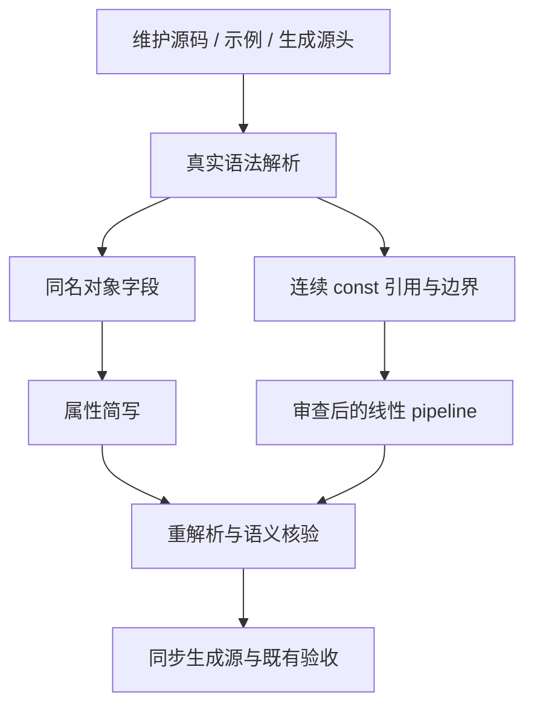

# 对象简写与线性管道对齐

## Intent：最终目标

按用户要求扫描并简化全部维护中的自有 ZX/RX 对象同名字段，并用 pipeline 消除
可安全合并的线性中间 const。补齐 `_ + value`、`_ / divisor` 等表达式管道阶段。
保留求值顺序、次数、作用域、短路、字段名称与覆盖语义，完成后提交推送。

## Data：可用证据

起点 40eae1a3。同名属性简写已被解析器与既有 20 项用例覆盖；此前仅对齐了近期
三个文件，范围不足。维护源码、示例和生成源头仍有显式重复，需要完整盘点。

现行 pipeline 分析器在原生与 ZX 两条路径都只允许 Call 作为阶段，用户举出的
算术阶段尚不能通过；占位符求值一次和 callback 边界检查已经存在，应复用而不重写。

## Edges：边界与限制

- 用真实 Parser AST 识别字段，只转换 name 与 Identifier 相同的对象值；不按文本
  全局替换，不修改类型字段或字符串正文。模板插值和 RX 属性按表达式独立解析。
- 保留属性间注释。专门对照显式/简写的四个 explicit 夹具、诊断原文、冻结历史
  快照不作为普通业务样式处理。生成夹具必须同步生成器，不只改产物。
- pipeline 候选限定连续 const、引用一次且作用域清楚的线性计算；不能把 lambda
  内的同名参数算作外层变量使用，也不能丢掉中间显式类型约束或改变惰性求值。
- 同名对象改写检查前后 AST；pipeline 扩展检查既有边界，并以实际迁移的源码进行
  语义与现有行为验收。不新增仓库测试或为测试改写编译器特例。
- 稳定身份自举仍有未提交实现，单独保留其范围；不能把半成品混入风格提交。

## Answer：交付与成功标准

交付覆盖清单、同名属性简写、与生成源头一致的夹具、表达式管道能力和经审查的
线性链改写。报告扫描/修改/保留数量及验证证据；不以仅修改几处代替全仓对齐。
无需对纯同名简写做性能对比；新管道降低若引入实际成本变化，再按风险测量。

## 属性简写已完成

真实 Parser/AST 扫描维护中的 3230 个 ZX/RX 文件，识别 708 文件、1947 处同名
字段；转换 704 文件、1943 处。所有维护生产文件均成功解析。转换后逐文件重解析，
忽略 span/depth 等位置元数据的 AST 摘要全部一致；注释与字段键保持不变。
报告 /tmp/zxc-source-style/maintained-before.json、changes.json、preserved.json。

只保留 object_construction/fields 下 bool/number/string/optional 四个 explicit
夹具，其任务是与 shorthand 对照。两处生成源同步修改：state_updates/source.ts
及 generate_standard.ts；对应 generate_state_updates、generate_standard 和
generate_object_fields 的 --check 均通过，未新增用例或生成入口依赖。

另外检查当前维护文档的 54 个 ZX/RX/XML 代码块，没有发现需要改写的同名字段。
其中 3 个标准库声明片段是上下文不完整的示例，已列入 docs-skipped.json；类型字段
不是对象值，不作同名属性处理。历史 docs 源码快照与用户原话保留证据原貌。

这项独立风格职责先提交；稳定身份自举仍留在工作区，其标准接口、注册及原生改动
未混入此提交。管道扫描和阶段能力扩展继续进行，不将候选数量当作已完成改写。
