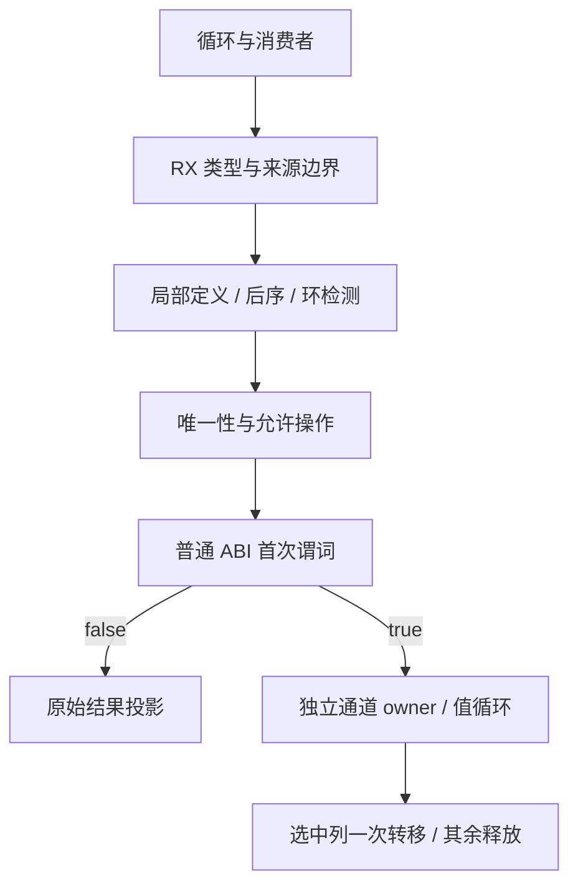
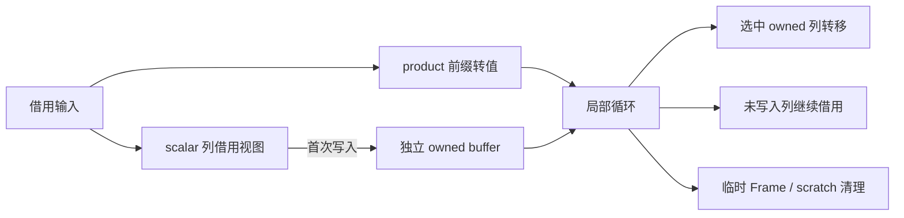

# 循环值缓冲与返回列所有权

## Intent：最终目标

完成 loop 的局部 product 值缓冲与返回标量列所有权，在 RX/ZX 中证明资格，
通过结构化节点生成普通 Zig；保留零轮身份、快照、错误顺序和清理，不新增运行库。

## Data：可用证据

基线 a93522e7。当前 inline_lists 无启用点，深布局拒绝 product 列表更新。
此前九项是 modular_loop/simple 与 loop_columns 的 direct、dual、borrowed、mixed、
consumer、nested、leaves、shrink。aggregate_loop 提供快照与资源补充检查。
旧试验仅实现 product 缓冲，缺少完整返回列转移，并有零轮整表转换退化，不能直接恢复。

## Edges：边界与限制

- 不新增测试；使用已有 source/library、OOM、输入不变、固定峰值和零轮身份检查。
- RX 显式编排来源收集、定义边后序、操作/唯一性与结果资格证明。
- 不能假定表达式编号就是依赖次序，须拒绝环、冲突定义及外部 product 捕获。
- 每通道独立 owner；product 值只留在循环内；返回列一次转移，重复投影共享结果。
- scalar/string/bool/optional 列保留借用前缀直到首次写入；零轮在转换前分支。
- 每次转移后设置错误清理；其他 owner 保持 defer 清理，不泄露也不释放借用内存。
- 旧版本快照、身份观察和整值逃逸不能通过强行原地更新来通过门禁。
- 先实现，再依据受影响路径实测优化，不因退化撤回功能。

## Answer：交付格式与成功标准

交付通用资格证明、值缓冲及返回列转移、正式接线和既有检查/成本证据。
完整职责收口后英文提交并推送；不将局部接线称为完整编译器自举。
证据保存 /tmp/zxc-loop-buffers。

## 实现与边界复核

- RX 依次执行类型资格、来源图、实际写入、定义边后序、操作与唯一性检查；
  ZX 保留图遍历与类型算法。表达式编号不作为拓扑次序，定义冲突与环均拒绝。
- RX/ZX 选择真正修改 product 列表的 loop owner。过渡适配器复用现有唯一性求解器，
  在独立 owner 假设下重算辅助事实，普通路径的唯一性事实不变。
- flags 的最后一位记录 loop 候选及操作唯一性，memo 升至 v15，旧记录不能复用。
  生成阶段先检查 loop 位，只读循环不会重复构造资格证明图或转换输入列表。
- 首次谓词按普通 ABI 求值；零轮直接投影原值。进入循环后才转换 product 前缀，
  product 元素按值保存；scalar 列直到首次写入才复制借用前缀。
- push/update 保留溢出、越界和求值顺序；pop 只缩短描述符，读取的元素按值保留。
- 返回列在原结果表达式的位置执行 toOwnedSlice；ready/owner/slice 记录支持后续读取
  与共享结果。转移失败、后续消费者失败和未选中通道分别执行对应清理。
- 循环体中新建列表、列表跨普通调用传递及身份观察，尚无完整缓冲证明时保留普通实现；
  不能将 fresh 列表错误复用为跨轮 owner。初始列表与已有 push/pop/update 已贯通。
- 既有形态检查改用 Zig AST 定位 executeIn、循环与 owner 变量，避免把类型引用误计为
  owner 或只检查入口 wrapper。没有新增用例；运行、输入不变、OOM 和峰值断言未放宽。

## 自编译证据

最终源码的 accepted-stage1/2/3 均构建成功（每轮 16/16）。三个二进制均为：

`ca2a2b45729019c3a5b0ee676fb21fdca36c7af8ca518345202dc5bda0081a49`

stage1/2 共 1821 个文件，仅 .zxc-inputs 的生成器身份不同；stage2/3 全部 1821 个文件
逐字节一致，未排除任何文件。资格收紧后，此前只读 imports 扫描的不必要缓冲已消除。

## 验收与成本

证据目录：`/tmp/zxc-loop-buffers/`。性能使用 compiler-performance 技能，基线 a93522e7，
工具链 Zig 0.17.0；同输入、同优化级别比较，不将自编译不动点替代行为验收。

最终 accepted-loops-safe 为 293/296 步成功、实际执行 452/452 项通过；唯一失败是
modular-loop-generation 的 Zig 编译 SEGV，该节点的三项缓存测试未执行，不能计作通过。
九项值缓冲形态门禁及 source/library 行为、OOM、输入不变、固定峰值检查均已执行。
CLI Small 版本 dist 为 26/26；最终 stack 源码与已有基准逐字节一致
（accepted-stack-equivalence.json），复用下列基准，不重复计时。

已有受影响路径基准使用原有 stack fixture 与既有调查 harness，50,000 次调用，
7 对交替顺序测量，Safe 模式；校验结果、输入未变及累计分配等于累计释放。
最终生成源码已经确认相同。

| 场景 / 指标         |            基线 |        值缓冲 |
| ------------------- | --------------: | ------------: |
| 零轮批次墙钟中位数  |        2.965 ms |      2.889 ms |
| 16 轮批次墙钟中位数 |      384.674 ms |     67.623 ms |
| 16 轮批次 CPU       |          0.37 s |        0.06 s |
| 零轮累计分配        |             0 B |           0 B |
| 16 轮累计分配并释放 | 5,143,000,000 B | 475,200,000 B |
| 进程峰值 RSS        |     2,097,152 B |   2,113,536 B |

累计分配是 50,000 次调用的总量，不是单次峰值。RSS 固定增加一页 16 KiB，不能声称
所有内存指标均无退化；16 轮的系统 peak memory footprint 从 1,425,792 B 降至
1,343,872 B，零轮则从 1,327,488 B 升至 1,343,872 B。产物增加 256 B，TEXT 增加
520 B。收益来自减少装箱与反复复制；固定驻留增量仍须保留为性能限制并继续优化。

生成器另做 5 对冷/暖交替测量，固定同一 91-entry manifest、源文件、SDK 与工具链，
无其他构建并发，输入摘要前后不变。各轮冷生成使用独立空缓存，暖态复用其输出与缓存。

| 生成器指标        |          基线 |          本次 |
| ----------------- | ------------: | ------------: |
| 冷生成墙钟中位数  |    857.801 ms |    855.035 ms |
| 冷生成 CPU 中位数 |        3.89 s |        3.90 s |
| 冷生成峰值 RSS    | 412,975,104 B | 417,955,840 B |
| 暖态墙钟中位数    |    566.081 ms |    568.029 ms |
| 暖态峰值 RSS      |   2,375,680 B |   2,408,448 B |

冷生成速度基本持平，峰值 RSS 增加 4.75 MiB，暖态增加 32 KiB；这不是性能要求已通过
的证据。功能实现先保存为可复核提交，性能收口仍进行中，继续定位辅助所有权证明的
临时内存与固定驻留开销，不通过撤回功能或更换基准掩盖增量。证据为
`generator-performance/summary.json` 与逐轮原始日志。

最终 native 文件仅补充仓库 spacer 要求的语义空行；此类格式变化复用既有行为和成本
证据，不重跑自编译与同一套检查。最终复核还将候选位读取统一为已有 Plan.get：有效计划读取完全相同，空计划保守返回
false，避免求解器放弃事实时直接索引空 flags。上述已验收输入均有有效计划，复用其
行为证据；没有扩大资格或增加分配。

## 生成器内存调查与重复入口收口

Arena 的三种临时方案都已撤回，不属于最终实现；循环值缓冲能力保留。
直接以 backing allocator 承载每次证明，RSS 中位数一轮下降约 7 MiB，CPU 从 3.91 s
增至 3.95 s；主线程和 worker 独立复用 arena 后，冷生成 CPU 为 3.91 s，但 RSS
414,908,416 B 与功能版 414,482,432 B 接近；只对主线程复用时，RSS 又高于同轮功能版。
这些差异不足以证明稳定收益，不能宣称父子 arena 已被证明是系统峰值增量的根因。
证据分别在 /tmp/zxc-loop-workspace 的 generator-performance、reused-performance、
final-performance 中。时间线采样显示峰值在生成阶段，但采样值不能替代系统峰值。

调查期间使用 Small 模式执行既有 aggregate-loop、module-generation、modular-loop：
125/125 + 123/123 项通过，其中包括此前 Safe 模式编译崩溃而未执行的 3 项循环缓存
恢复与分配失败测试。没有新增用例、修改断言，Safe 编译失败仍未解决。

进一步核对 entry.zig 与 entry_values.zig：当 aggregate 为 false 时，两处都调用同一个
lowering.function(..., false)，只改变函数名，重复构造完整函数体。最终改动只复用这类
入口：没有 tasks 且不需要 aggregate 值布局时，结构化生成公开函数别名
executeValue = executeIn；需要值布局或 tasks 的路径保持原有生成逻辑。

此条件来自原有实现分支，而不是猜测两个类型相同。参数、错误集合、Allocator/IO/
Process/Store 参数及求值顺序均继承同一个函数，调用方继续使用 executeValue。
最终 1821 个产物中，只有 28 个公开入口文件、.zxc-files 和 .zxc-inputs 改变。
逐一确认旧 executeValue 与 executeIn 除函数名外完全相同，且新文件仅将前者换成
公开别名；共减少 8,856 字节源码。文件清单路径不变，仅这 28 项摘要更新，其他源码
及共享 ABI 逐字节一致。证据：/tmp/zxc-entry-sharing/alias-transformations.json。

Small 调用验收：145/145 步、构建器跟踪的 123/123 项通过；另有 24 组外部 Zig 测试
各 5 项，共 120 项通过，覆盖 pointer/value 两种接口、零分配、source/library、错误
顺序及循环 OOM。Safe 为 120/120 项实际通过，仍有两项 Zig 编译 SEGV：循环缓存测试
和 predicate 生成工具。后者用 a935 的 genz 及完整未别名生成目录仍以 -11 复现，
不是只有别名版才失败；仍不等于完整历史 checkout 的回归证明。

最终 CLI Small dist 26/26，三轮 bootstrap 均 16/16，三个二进制完全相同：

`101030f53931390fd877e3d801ab23afd865ca7f7ae6b95284895f1f31850a57`

stage2/3 的 1821 个文件逐字节一致，未排除 marker。由于三轮工具字节一致，直接复用
stage1 的性能证据，不为同一二进制再计时。

5 对原基线 / 功能版 / 入口去重版对照中，功能版到去重版暖态 RSS 从 2,408,448 B
降到 2,375,680 B，回到原基线；冷生成 CPU 为 3.93 → 3.92 s，墙钟
878.053 → 881.534 ms，无明确速度收益。冷 RSS 中位数更高，但各版本都出现约
391/400 MiB 两档波动，不能继续用 5 轮中位数推断固定内存回归。

因此增加一次有明确假设的分布核对：无其他构建，固定同一输入，每版 20 轮冷生成，
随机顺序使用独立空缓存。对照的是 a935 原基线与最终版，不跨批次相减。

| 指标             |     a935 原基线 |          最终版 |
| ---------------- | --------------: | --------------: |
| 墙钟中位数       |      962.368 ms |      963.661 ms |
| CPU 中位数       |          4.05 s |          4.05 s |
| 峰值 RSS 均值    | 415,145,164.8 B | 413,973,708.8 B |
| 峰值 RSS 中位数  |   417,800,192 B |   413,794,304 B |
| 峰值 RSS 90 分位 |   419,069,952 B |   419,037,184 B |
| 最小值           |   407,994,368 B |   405,815,296 B |
| 最大值           |   420,020,224 B |   423,624,704 B |

此前“生成器固定增加 4.75 MiB”的归因不成立，当前分布没有稳定复现该增量；均值
下降约 1.12 MiB，90 分位接近。但最终版仍有单次更高峰值，不能宣称所有运行均不增加，
也不把均值降低当作已经解释了峰值来源。报告与输入摘要：
/tmp/zxc-entry-sharing/distribution/summary.json。应用 stack 的固定 16 KiB RSS 增量仍未
消除，不因生成器数据修正而撤销该记录。

本次只合入确定的入口去重，不合入未证明有收益的 arena 调整。入口 lowering 本身仍有
专用原生实现，这次不计作新增的完整自举职责迁移；后续继续迁移真实规则与状态。

## 失败边界与自我复核

modular-loop-generation 的 Zig 编译发生 SEGV。相同命令仅替换回 HEAD 的 genz 源码后
仍以 -11 退出；独立缓存、LLVM、测试过滤及局部错误集调整均未解决，未更改正式测试
来绕开它。Safe CLI 编译也出现同类崩溃，替换旧版 genz 后仍以 -11 退出。替换 genz
不是完整历史 checkout 的回归证据，因此只能确认该失败不以新增 genz 实现为必要条件，
不能宣称整个历史仓库 Safe 构建已通过。

唯一性求解器、IR 状态、结构化 Zig lowering 等仍有专用原生过渡依赖。本阶段完成的是
通用循环缓冲能力及其 RX/ZX 资格证明，完整编译器自举和全部性能限制仍未完成。
