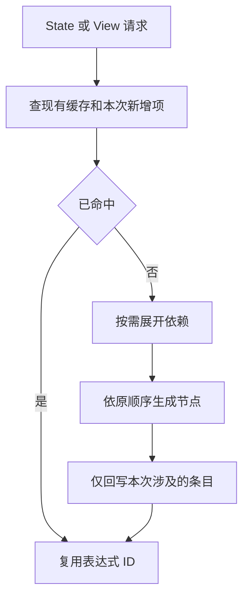

# 按需状态视图类型查询自举

## Intent：最终目标

将共享 ABI 文件中的按需 state/view 类型查询规则、依赖顺序与节点构造迁入
RX/ZX。保留原缓存身份、短路顺序、结构化 AST 和零运行库约束。先实现，再依据
实际成本优化；不以退化为理由撤回目标功能，也不以新增原生语义桥冒充自举。

## Data：可用证据

基线为 70c8564d。全量 ABI/state/view 定义和普通按需 ABI 已迁移；
`zx/types.zig` 的 state/view 仍递归决定别名、optional 包裹及首个差异字段。
查询只涉及少量类型，复制整个类型缓存会引入与程序总类型数相关的额外成本。

本轮也核对了旧聚合循环原型：它只有记录列表的局部值缓冲，没有当前九项门禁
要求的标量列 owner、结果转移及转移后的错误清理。不能直接恢复旧代码宣称解决；
九项继续登记，不改断言。完整功能还需 RX/ZX 来源和唯一性证明、局部表示与操作、
首谓词 guard、选中列一次转移，以及借用前缀转换成本优化。

## Edges：边界与限制

- RX 连接按需依赖计划与结构化构造，ZX 管理查询栈、本次新增项及节点 ID。
- 借用五张既有缓存，仅返回本次新增项；不复制或全量遍历缓存。
- view optional 先查询 child view、child state，再决定复用 state optional；
  selected object/tuple 按原字段顺序查询，发现首个差异立即停止。
- 普通 ABI 依赖与节点构造复用既有实现；种子保留原规则，正式 generated 分支
  不回调旧 state/view 语义。
- 过渡 Zig 仅借用列、提供临时 allocator、导入 AST 和回写原映射。Lower/AST
  所有状态和 state selection/key 分析仍待迁移，不宣称全编译器自举完成。
- 不新增测试；复用现有行为、所有权和分配失败检查，不放宽断言。

## Answer：交付格式与成功标准

交付真实正式路径上的 RX/ZX 查询实现、既有行为验证、stage 2/3 一致性与受影响
发射路径的同输入成本对照。每个可独立验收的完整职责提交英文 Git commit 并推送。
证据保存在 `/tmp/zxc-shared-state/`，结果完成后补充，不将计划视作通过。




## 实现与验证记录

查询计划用显式栈维护三类请求；每个步骤携带全局 AST 起点和已解析子节点。
ABI 步骤复用普通 ABI 构造，state/view 只构造 optional 或模块成员节点。
段内 payload offset 保持局部，导入时按列基址重定位，全局 ExprId 不重编号。
原来五张缓存保持身份，全部节点成功导入后再按新增 Entry 回写。

状态 key 表以扁平字节切片借用，每个确实需要命名的请求只提取自身 32 字节。
新增项不超过 8 个时使用有界线性查找，超过后建立开放寻址表，半载时扩容重建；
没有删除槽或外部缓存写入。索引只随本次查询增长，不按整个类型表分配。

首轮 compiler 372 项通过，真实冻结产物却发现动态名称悬空。根因为沿用了普通
ABI 的 borrow-text 导入，而 state/view 名经 SHA、十六进制与前缀构造，归临时
allocator 所有。已统一深复制本次查询段的载荷进入 AST allocator，不将缓冲栈
或 scratch 文本存入最终 AST。修复后 1574 个冻结产物逐字节与基线一致。

首轮失败产物和日志保留，不能以较窄的测试通过声称此路径已正确。稀疏索引版
compiler 再次通过 23/23 步、372/372 项；阶段自编译和补充验收进行中。

## 阶段一致与所有权复核

当前完整输入由修改前生成器与修改后 stage 1 分别生成，1763 个文件逐字节一致，
仅排除工具身份 `.zxc-inputs`。stage 2/3 各 16/16 步通过，同样 1763 个文件一致。
三轮可执行文件 SHA-256 均为
`05bad60f9a73539c8a9513e77fdfba1e4ede28af86fbc27e4214e6cb86afce22`。
证据为 source-equivalence.json、fixedpoint.json、binaries.json。

生成的 index 函数在探测后使用 constCast 原位写入桶；初始化 push 使用
zxReserve(..., true)，没有在逐项重建中 dupe 整个 buckets。此静态证据只排除
该复制形态，不代替整轮性能测量，也不声称开放寻址具有最坏情况常数复杂度。

plan 和 decide 超过默认 120 行 lint 信号，分别承载一个内聚查询状态机和依赖
决策；没有按行数机械切片或删除空行。标量起点、阶段序号和偏移是结构值；
key 大小、线性门槛、初始桶容量及模式数在职责 const.zx 中定义。

发布 CLI 的 dist 构建 26/26 步通过。补充命令为：

```sh
zig build test-native-generation test-native-borrowed-runtime \
  test-native-value-boundary test-value-return test-zx-tasks \
  test-library-link test-library-codec test-typed-try-native-abi \
  -Doptimize=ReleaseSmall -j2 --summary all
```

结果为 341/341 步、361/361 项通过，包含原生调用错误、借用输入、旧结果保留、
分配失败、共享 ABI 和 Task 路径；日志为 checks.log。没有新增测试或修改断言。

## 性能对照

构建全部结束后测量，固定 1653 源文件、66 入口、Zig 0.17、ReleaseSmall、
resident=0。两版复制到等长路径，独立冷缓存后测热缓存，共五对，交换执行顺序；
每轮前后核对冻结输入摘要。临时探针未进入源码。

| 五对中位数       |  修改前 |  修改后 |
| ---------------- | ------: | ------: |
| 冷发射 / ms      |     208 |     208 |
| 热发射 / ms      |     101 |     101 |
| 冷整轮墙钟 / ms  | 720.260 | 711.674 |
| 热整轮墙钟 / ms  | 542.695 | 546.403 |
| 冷 CPU / s       |    3.30 |    3.32 |
| 热 CPU / s       |    2.23 |    2.24 |
| 冷峰值 RSS / MiB | 363.453 | 364.406 |
| 热峰值 RSS / MiB | 326.609 | 326.406 |

冷退休指令 45269516247→45430233183，约 +0.355%；热
31696693035→31697088409，约 +0.00125%。周期分别为
13324710579→13383068783、9047175683→9067176397。

冷 CPU 范围 3.28～3.31→3.28～3.32 s；冷 RSS 范围
353.266～365.813→356.844～365.203 MiB。冷发射范围 206～212→206～210 ms，
热发射 100～103→100～103 ms。受影响发射阶段没有测得耗时退化，但不能将
整轮 CPU、退休指令或全部场景描述成严格零差异，也不能把冷墙钟变化宣传为提速。
本次迁移仍有少量临时查询与载荷所有权处理成本；后续应优先消除这些成本，不能靠
重复计时挑选更好样本。没有因这些差异撤回查询迁移。

每对 1574 个产物逐字节一致，只在跨版本对比时排除工具身份 .zxc-inputs；
各版本冷/热产物包含该指纹也完全相同。目标源码未改变，不为同一输出重复进行
无关的后端运行性能对比。性能原始记录为 performance/ 下的 summary.json、
counters.json、stages.json、outputs.json 和每轮日志。

## 自我复核与未完成项

最初仅依据 compiler 检查通过不足以覆盖共享文件的动态名字生命周期，真实产物
对照才暴露悬空。最终先修所有权，再用旧/新生成器和两轮自编译对照，不将损坏
版本用于性能结论。稀疏索引也从生成代码核对了原位更新，未仅凭算法名称断言成本。

本阶段交付的是按需查询规则、算法和结构化节点构造迁移。五张缓存及 Lower/AST
仍由原生持有；state selection/key、Growth 及其他专用原生语义仍需迁移。
九项聚合循环门禁的完整值缓冲能力尚未实现，本轮未重跑或放宽它们；沿用已定位
缺口的证据，不据本轮 361 项通过宣称整个仓库全绿或整个编译器完成自举。
