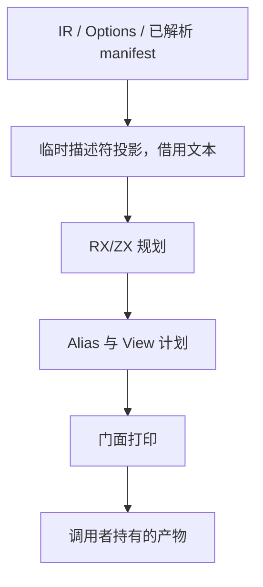

# 构建与发布 ABI 视图规划自举

## Intent：最终目标

将应用构建与库发布使用的 ABI 默认别名、逐 native 视图可见性及冲突规则迁入
RX/ZX。复用同一 Alias 类型、已有 ABI 门面构造与统一 printer，保持静态链接。

## Data：可用证据

基线 37a61aaa。实际入口为 packages/cli/src/cli/abi.zig 的 create 与
createLibrary；此前 source_abi 只覆盖普通 --out，不能替代本职责。
现有 native-aliases、native-packages、library-native-publish 覆盖实际消费。

## Edges：边界与限制

- CLI 合并所有匹配根的 scopes，无匹配时不回退全局配置；与普通 --out 不同。
- 缺失 aliases 跳过视图，显式空 aliases 仍生成视图。
- 配置 aliases 已经上游解析为身份，按实际 module key 过滤。
- 默认同名冲突排除整组；单视图标准别名同名异身份报错。
- 每个配置先检查标准别名，再检查视图名碰撞，保持配置次序。
- 同名 native_settings 保留最后匹配结果。
- 不新增测试。上游配置冲突拒绝不证明视图标准冲突分支；名称冲突无直接用例。
- CLI 保留原生 Options/manifest 表示投影与打印调用，明确为过渡依赖。

## Answer：交付格式与成功标准

交付后端共享规划 RX/ZX 及 CLI 正式接线，复用既有消费检查，核对输出与阶段
固定点，只测受影响路径；完成后英文提交并推送。证据存 /tmp/zxc-bundle-abi。

## 执行记录

已实现 root defaults、单视图 RX 分支、视图集合遍历、增量冲突标记与 CLI 接线。
scoped 入口守卫在投影 scopes/config 前运行，保留无 scoped 快速路径。
尚待编译、现有消费验证、性能及自我复核，不能将实现记录视为验收通过。

初版编译生成成功，compiler 23/23 步、372/372 项通过；CLI 编译暴露错误集列举
了该入口不会返回的 IntegerOverflow，已改为其实际错误集。未扩大错误兜底。

只读复核发现初版复用 source_abi 全量 unique，会把 R 个模块各 K 个重复别名的
默认集合过滤扩为约 O(R²K²)。已改为收集时按首项增量折叠，冲突标志与唯一项
对齐，保留约 O(RK²) 的原有扫描结构；最终 filter 线性排除已标记的项。
RX 也显式保留 scoped 判定，CLI 复用同一原子谓词提前避开无效描述符投影。
最终版本的直接生成预检为 89 entries、1834 modules，通过。

## 正式产物与自编译证据

最终 CLI dist 26/26 步通过。既有 native 库 source 夹具在同一临时项目目录分别用
基线与新 CLI 发布，全部 20 个文件逐字节一致，无排除项。

最终 stage 1/2/3 各 16/16 步通过；stage 1/2 比较只有 .zxc-inputs 不同，
该文件记录生成输入摘要（期间补充了源码语义空行），其余 1804 个文件一致。stage 2/3 的 1805 个文件全部一致，无排除项。
三轮 bootstrap 二进制均为
`247dc162bee310d51fad29f4bcbdeb52c206ac5e7b3300d79cc0a8b77a61412a`。
与上阶段相同；bootstrap 驱动不调用 CLI 的 ABI 视图规划，因此该摘要只证明
阶段稳定，不能替代真实 native 消费、发布产物对比及受影响路径的性能证据。

## 自我复核与剩余边界

单视图 RX 显式连接根归属、别名解析及名字校验，父 RX 表达 scoped 短路、默认
候选、视图集合、失败短路及最终过滤。集合循环保留在 ZX，没有新增运行库。
只读规则复核确认首项保留、冲突不可逆、匹配 scopes 与 root native 追加次序。

原生 CLI 仍负责 manifest/Options 到列与记录指针的投影、暂存区和门面打印接线；
目前 scoped 正路径还会重复一次轻量判定，并投影完整 scopes 的描述符。这些是
明确的成本与移除边界，不以生成产物相同宣称全编译器完成。输入文本借用，返回
文件的名称与路径在 scratch 释放前复制到调用者，避免悬挂引用；门面最终产物
仍由既有结构化构造器和统一 printer 生成。

既有上游 alias 配置拒绝不证明 planner 的标准别名冲突分支；名称碰撞、多个同根
scope、重复 setting 与不同默认身份的全部组合没有直接执行覆盖，仅完成源码
等价核对。已有九项 loop 值缓冲门禁、HTTP 聚合 SIGKILL 仍为此前未解决项。

## 现有消费与性能

最终 CLI 上直接执行现有三个检查入口：native-aliases 10/10、native-packages
4/4、library-native-publish 1/1 全部通过，包括实际对象 ABI、独立安装、再发布、
二进制及汇编失败回滚。未添加用例，也未重复无关 HTTP 聚合。

同一已冻结的 16 文件项目中，交错五组旧/新 CLI，每次 --no-cache 发布到同一路径，
预热后单次墙钟中位数 18.254 → 18.013 ms，峰值 RSS 中位数均 9.859 MiB。
最终发布目录仍是 20 文件逐字节一致。样本未显示可辨别的退化；不据此宣称所有
规模或冲突分支都无成本差异。
单次 /usr/bin/time CPU 读数大多为 0（精度不足，不表示没有 CPU 消耗），因此
仅补充每批 20 次发布的累计 CPU 对照；批次启动器的 RSS 不作为 CLI RSS。
性能输入摘要前后一致，原始报告在 /tmp/zxc-bundle-abi/performance 与 performance-cpu。

五组交错的每批 20 次发布结果：墙钟中位数 343.424 → 344.212 ms（约 +0.23%），
累计 CPU 中位数均 0.35 s；输入摘要未变。该批次包含 Python 启动器和子进程启动，
补充解决 CPU 分辨率问题，不作为单独规划器微基准。RSS 使用前述单 CLI 数据。
正式发布前后、阶段 2/3 及现有消费均已验证，收口阶段仅复核本次 diff 和格式，
不重复相同构建。全编译器目标继续进行，不标记完整自举完成。
