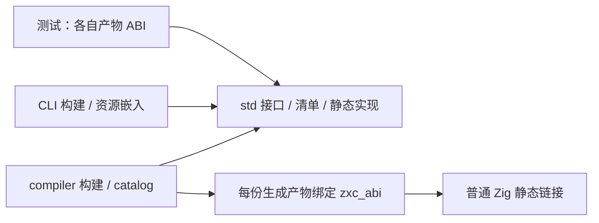
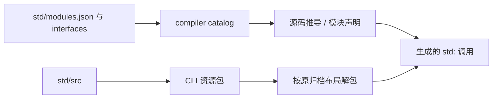

# 标准库独立包迁移

## Intent：最终目标

将 compiler/standard 整体迁入 packages/std，建立独立标准库包，保留 std: 公共语义。

## Data：可用证据

原目录包含原生静态实现、真实接口声明及 modules.json。compiler 构建 catalog，
CLI 嵌入实现，测试按各自 ABI 配置模块。它们不是 compiler 的语义实现。

## Edges：边界与限制

- Zig 保留内建 std 导入名，构建依赖和模块使用 zxc_std；目录与语言 std: 名称保持 std。
- std 不依赖 compiler 或 genz；catalog 结构化生成工具继续由 compiler 构建。
- 每份产物绑定自己的 zxc_abi，不修改共享模块实例覆盖其他 ABI。
- compiler.module("standard") 保留为兼容句柄，源码所有者改为 std 包。
- CLI 发行资源的 standard/src 归档路径及现有字段是内部资源契约，保持稳定。
- 更新当前构建、测试直接路径与文档，历史 docs 快照保留原始证据。
- 不新增测试，不对路径与包边界迁移进行性能对照。

## Answer：交付格式与成功标准

交付独立 Zig 包、正确依赖与发行资源接线，使用已有编译和标准库执行检查验收，
单独英文提交并推送。共享 ABI 的未提交工作保留，不能混入本次包迁移提交。

## 验收记录

独立包配置检查成功；迁移后的 compiler 构建 23/23 步、372/372 检查通过，
正式 dist 构建 26/26 步成功。原目录 106 个文件已全部迁入，迁移时源码和接口逐文件与 HEAD 核对相同。提交格式检查将两个旧枚举转换内建名统一为等价的 backingInt；
其余实现和接口内容不变，没有改变标准库算法。
README 更新包入口，另增加独立构建文件。
标准接口、资源、URL 原语、子进程、process context、RX IO、Store IO 及工具链
检查为 1307/1310 步成功，22657/22657 已执行 Zig 检查通过，唯一失败是 HTTP
驱动的应用收到 SIGKILL。单独重跑仍复现，不能报告全部通过。

工具链检查包含无相邻安装文件的隔离执行、冷缓存应用、热缓存标准库应用、
不完整缓存和标记校验，全部通过。使用搬迁前保留的 CLI（根缓存 c490c385b8b8b64c52c3a2b5218d0160）执行同一
HTTP 驱动，也在第一次应用执行时收到 SIGKILL；该代表性失败在路径搬迁前已
存在。本阶段不修改驱动、不放宽断言，也不把该项计为通过。

Zig 不允许依赖别名 std 覆盖内建模块，因此 Zig 构建依赖与导出使用 zxc_std；
packages/std 目录和语言 std: 导入名不变。compiler.module("standard") 继续按
原方法创建并绑定各自产物 ABI，未反复修改独立包的共享模块实例。

四个 URL 原语测试构建器只消费 std 源码，已移除不再使用的 compiler 参数，
不再通过编译器取得标准库路径。没有新增测试或改写预期。

日志位于 `/tmp/zxc-std-package/`：`compiler.log`、`dist.log`、`checks.log`、
`http-isolated.log`、`http-before-move.log`。最终发行资源在 formatter 后重新构建；
没有为等价枚举内建名规范化重复运行全部标准库行为检查。

## 自我核对

106 个原文件全部移动，未留下源码副本或旧路径符号链接。std 的依赖为空，
接口清单、原生实现及其资源现在同属独立包。compiler 构建与 seed 仍是其自身
工具职责，不因标准库独立而机械拆为 packages 下的额外包。保留的 compiler
标准模块句柄是按产物绑定的兼容入口，不再拥有标准库实现。
