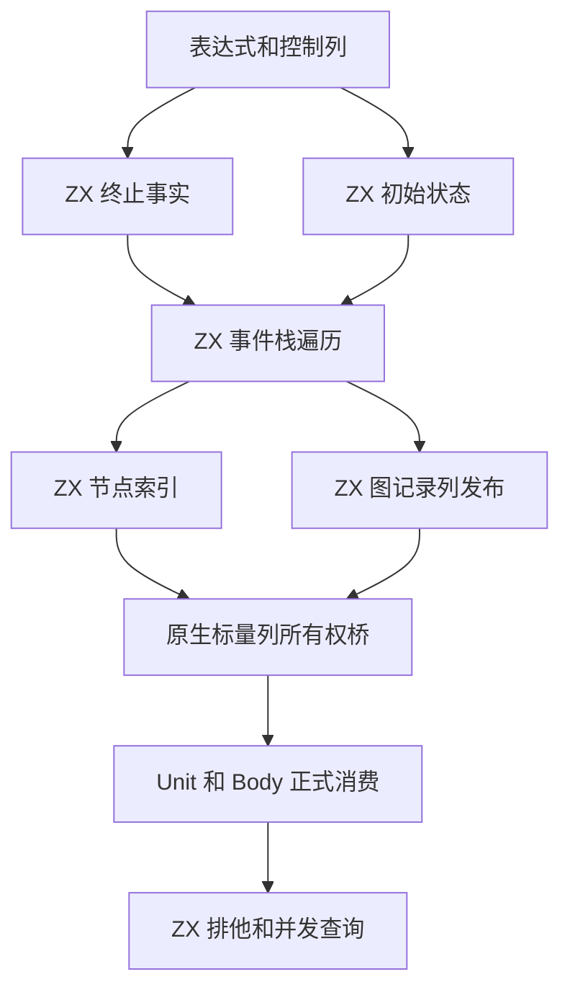
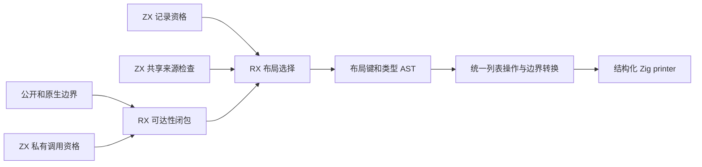

# 求值顺序元数据自举

## Intent：最终目标

将唯一性分析 Order 的求值顺序、定义来源、分支排他及并发边界规则迁入 RX/ZX。
Unit.analyze 与 Body.create 两个正式入口均使用新算法，保持原求值、共享和错误语义。
本文件按 IDEA 记录实现、验收与剩余边界；本阶段完成不代表整个编译器完成自举。

## Data：可用证据

### 实现与真实调用关系

- `analysis/uniqueness/order/build.rx` 编排控制块终止事实、初始化、事件遍历、节点
  索引和图发布。ZX 保存算法内部的循环、分支及追加式 Frame 栈；弹栈切换父索引，
  避免弹出后再追加引发历史复制。动作按同一主体 switch 分派，共用分支保留原动作。
- Node、Region、Edge、Defined、Repetition 表达各类元数据。遍历完成后，`nodes.zx`
  按表达式编号索引节点，`publish.zx` 一次将图记录转置为标量列，不在每个事件更新
  多组公开列。发布保留一个内聚算法，不保留只转发的微型模块。
- `apart.zx` 查共同区域祖先；`crosses_concurrent.zx` 遍历重复区域父链。正式查询
  来自 ZX，原生查询桥使用零容量分配器，不分配或转换整张表。
- `zx/uniqueness/order/generated.zig` 借用 IR 输入列，在 scratch arena 执行生成
  入口，复制最终标量列到长期存储。ownColumns 编译期拒绝非标量元素；Def 一次
  转为现有消费表示。两个正式构造入口均已切换，旧 seed 仅供初始引导。

### 配套的通用布局与生成改进

性能诊断显示逐条记录装箱及额外布局分析增加成本，因此从普通类型和使用关系修正，
不按 Order、文件路径、字段名或记录大小设置特例。

1. `records.zx` 识别标量、枚举、错误集合及可空叶子构成的记录，排除字符串、嵌套
   对象和动态字段。其顺序读取依赖类型表已有的子类型编号小于父类型编号契约，
   由 semantic/types/validation/row.zx 与 children.zx 校验。
2. `visible.rx` 计算公开、原生和非私有调用的类型可达性；Store、Task 结果和捕获、
   身份比较继续保留装箱。公开 List 或其记录元素可达时均排除紧凑布局。
3. `sharing.zx` / `shared.zx` 只扫描有关集合、更新、transform 和序列元素列。
   把已有对象转存到另一列表时保持引用共享；fresh 仅认直接对象构造及 Scope 结果。
4. 私有列表沿用 items/headered 与原有 frontier/唯一性证明，数组存放普通 ABI 记录
   字段，不存 origin；读取产生 origin=null，不保留指向增长前旧数组元素的指针。
   公开、共享及身份可见的列表继续使用记录指针 ABI。
5. 类型、缓存布局键、构造、索引、push/pop/update/concat/splice、transform、谓词及
   增长共用元素布局。非空边界转换保留 ZxHeader；空数组不分配。pop 仅在非空分支
   读取。输入转换保留子字段语句，row_layout 不走 origin 快捷分支。
6. 类型闭包入队即标记，用只追加队列和读取游标处理重复根与环；duplicates 复用
   u64 代际标记，written 直接遍历字段或可空子类型，消除逐函数整表初始化和临时数组。
7. Flow 对没有输入列表位置的函数跳过必然为空的 held/text_held/written 分析；仍先
   初始化或查询 memo，不跳过 Unit 对函数内部列表和更新的分析。
8. 常量标签、单主体 match 在标签同型且唯一时生成已有结构化 selection AST。
   最后一项比较留在 else 中，保留 fallback 并避免完整枚举的不可达 else；动态、
   重复、字符串、浮点标签保留原规则。inline_call 保留 switch 的 subject。
   标签去重使用字节域位集，稀疏和负整数使用哈希表，直接读取表达式列。

### 最终验证

| 范围             | 实际结果                                     | 本地证据                                              |
| ---------------- | -------------------------------------------- | ----------------------------------------------------- |
| 最终 stage 2 / 3 | 均 16/16 构建成功，二进制字节一致            | `/tmp/zxc-order/accepted-fixedpoint.json`             |
| 全生成文件       | 1852/1852 完全一致，包括工具身份文件         | 同上                                                  |
| 最终 CLI 安装    | 26/26 构建步骤成功                           | `/tmp/zxc-order/accepted-cli-dist.log`                |
| 最终定向回归     | 436/445 步，756/764 项通过，8 项容量断言失败 | `/tmp/zxc-order/selection-columns-checks.log`         |
| 全部修改源码     | 66 个文件通过格式或 Zig AST 检查             | `/tmp/zxc-order/selection-columns-source-checks.json` |
| Order 对照 seed  | 真实输入 3221 次构造全部一致                 | `/tmp/zxc-order/column-oracle-run.log`                |

stage 2 / 3 均为 4,112,944 字节，SHA256 均为
`4b4e86f211ba2c9ed3f96e8b0fb8f5efa1b44a3ff32338df59877a0b18fe4b30`。
逐项对照覆盖所有节点 time/finish、已访问节点 region/repeated、全部区域、边、定义、
结果和重复区域数据。seed 未访问节点的 region/loop 未初始化，不作为比较依据。

8 项失败均为 function-updates 的 flat/branch/chain/mixed × source/library 容量断言，
未放宽或删除。旧工具独立复现了 4 项 source 失败，证据是
`/tmp/zxc-order/fixtures/baseline-capacity.json`；未逐项独立重放旧工具的 4 项 library。
最终失败集合与先前一致，不能报告全绿。较早的 packed/header 版本为 1913/1921 项
通过，另有 24 个外部 Zig 批次共 864 项通过；这些不冒充最终版本全量验收或相加。

### 性能与固定累计基线

用户明确接受本轮 0.02 秒 CPU 差异及 0.1 秒以内耗时差异，又强调不能逐阶段忽略
小增量而累积退化。因此同时保留阶段变化、固定基线累计变化及增长趋势。
**固定基线不会随着本阶段提交重置；容差不是每阶段可重新领取的预算。**

累计锚点为提交 `ca03eb0011e3efd13221e1baefca7fcc10a1da77`。冻结工具为
`/tmp/zxc-state-queries/stage3/bin/zxc-bootstrap`，SHA256 为
`190997e74f6b1de8184fbd2b8d8b710a4365d4e44637ba9407d0ad06882a8f91`。

本轮使用相同 96 入口 manifest、源码、Zig 0.17 工具链及 Small 配置，关闭常驻生成器。
三对交替运行，计时不并发构建；冷生成各用新输出和函数缓存，随后测同目录热缓存。
仅以无参数运行预热程序启动。最终 stage 2/3 与测量工具 SHA256 一致，冻结输入仍
逐项一致；最终 diff 复核仅清理行末空白及文件末尾空行，故复用有效测量，不重复计时。

| 场景与指标     |      固定基线 |          当前 | 相对固定基线累计变化 |
| -------------- | ------------: | ------------: | -------------------: |
| 冷生成耗时     | 874.587542 ms | 879.498542 ms |            +4.911 ms |
| 冷生成 CPU     |        3.98 s |        4.00 s |              +0.02 s |
| 冷生成峰值 RSS | 425,885,696 B | 413,204,480 B |        −12,681,216 B |
| 热缓存耗时     |  38.819542 ms |  38.596042 ms |            −0.224 ms |
| 热缓存 CPU     |        0.05 s |        0.05 s |                    0 |
| 热缓存峰值 RSS |  16,924,672 B |  17,137,664 B |           +212,992 B |

报告为 `/tmp/zxc-order/dense-labels-performance/summary.json`，原始输入哈希表为
同目录 `inputs.json`。manifest SHA256 为
`35485f45eaa13fae03ad350bff5817bf5ec66d4051a07b8c693a50ffe7363aef`，
输入哈希表 SHA256 为
`e7bb76b803e0188d04101dec7e8c778f78ae8a465cd04def4376988cea66f109`。

后续阶段仍用此锚点和可比输入记录累计值，出现持续增长或累计接近、超过容差时
定位实际成本；不能仅以每次低于 0.1 秒判定通过。输入或配置改变时重新建立同输入
对照，并保留锚点和场景关系，不直接相减不同负载。当前仅有一个有效阶段数据点，
尚不能据此断言长期趋势。文档、格式或明显语义等价调整无需重新测量。

## Edges：边界与限制

- 保留对象 evaluation 优先、Match 条件优先、循环前后置顺序及 Task/Parallel 边界。
  静态分析遍历不等于运行时遇 return 就停止访问后续 IR。
- 保留块 first/len 视图、旧快照、共享、短路及求值次数；不引入专用运行库、模板、
  RawCode 或动态调度。所有目标代码通过既有结构化 AST 和统一 printer 输出。
- Order 逻辑已迁移，原生发布桥、Def 消费状态及 Sites、Function、Flow 等仍待迁移。
  常量 selection 资格与 match/inline_call 降低也仍是原生后端职责；固定点不能代替
  正式入口传递依赖审计，不能宣称完整职责或整个编译器均完成自举。
- shared.zx 和事件状态机的行数是 lint 评审信号；保持内聚算法，不机械碎片化。
- 不新增测试，复用既有检查；本地 /tmp 诊断仅供定位，未进入生产源码。

## Answer：交付格式与成功标准

本阶段交付 Order RX/ZX 构造与查询、两个正式入口接线、seed 隔离、通用私有标量
记录列表布局及本 IDEA 记录。相关回归无新增失败集合，最终固定点、CLI 安装和源码
检查已完成；性能按用户最新容差接受，并明确保留累计增长风险。阶段采用英文规范
提交并推送 master。整个自举目标继续 active。

### 后续工作与自我复核

不能把分配次数下降、源码使用 map/match、单次固定点或低于容差的小增量当成性能
长期不退化的证明。此前过宽的记录资格忽略跨数组共享，逐表达式检查又增加分析成本；
已收紧到真实来源和相关操作列。原生布局转换与所有权桥仍应继续迁移。

局部 Order 构造诊断为 seed 337,988 tick、新实现 1,639,711 tick，约 4.85 倍。
这是隔离构造路径的成本，不能用整轮可接受掩盖，也不把它报告成整轮 CPU 倍率。
现有 publish 生成代码有 17 个 while 和 17 处 zxReserve，普通 map 确实仍展开为 loop；
有界追加循环的一次分配优化尚未实现，也不阻塞本轮已获接受的阶段收口。

该后续优化须从普通 IR 证明稳定长度、计数器、单次追加、无中间观察或逃逸以及
回调安全边界，不能根据 std:utils 路径或字段名识别。保留零轮、旧快照、溢出、OOM
与返回状态；证明不足保留普通 loop，不恢复独立 map/reduce 语义或增加运行库。
