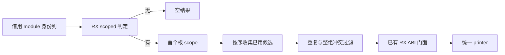
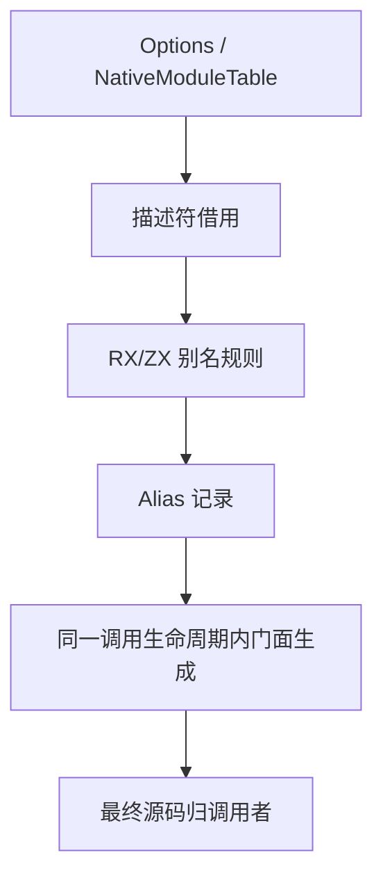

# 源文件 ABI 别名选择自举

## Intent：最终目标

把普通 CLI 源码发射路径的 scoped 身份判定、根包配置选择、候选别名及冲突过滤
迁入 RX/ZX，接续已有 ABI 门面构造，保持输出、身份隔离与零运行库约束。

## Data：可用证据

基线 b5098749。source_abi.render 由 verified_compile.render 调用，普通 CLI
`--out` 进入此路径；build 路径调用 CLI 自己的 abi.append，不可替代验收。
旧实现按 module 未绑定身份项、选中根包 interfaces、externals 顺序收集别名，
仅保留已存在的身份。重复同名同身份保留首个；同名异身份排除整组。

## Edges：边界与限制

- RX 明确表达 scoped 快速返回、根 scope 选择、候选与冲突过滤。
- ZX 保留有序集合算法，延用原比较语义和复杂度，不为了迁移另造命名机制。
- 根 scope 使用第一个 root 字节相同的项；没有匹配时保留默认配置。
- 复用 genz 的 Alias 类型与门面构造，生成器静态链接普通 Zig。
- 原生适配只组装 slice 描述符、借用原文本、管理临时 allocator 和表示返回值。
  仍属过渡桥；保留原种子分支，不宣称全部原生依赖消失。
- 不新增测试。现有 native-references-targets 确实进入普通 --out；其他 build
  检查不能单独证明本规则。未执行分支需明确记载，不冒充完整覆盖。

## Answer：交付格式与成功标准

交付正式调用路径上的 RX/ZX 选择模块、既有真实消费检查、阶段一致与受影响的
普通源码发射成本证据，完成职责后英文提交并推送。证据存 /tmp/zxc-source-aliases。

## 执行记录

初版 23/23 步、372/372 项通过，实际 native-references-targets 也为 41/41 步、
9/9 项通过。复核发现初版在 scoped 判定前投影全部 scope，改变了原无 scoped
快速空返回的分配成本，因此不按原样收口。

适配改为：复用 ZX scoped 原子谓词先做无分配入口判定；仅有 scoped 时借用根名
描述符，RX plan 选择首个根 scope；宿主按计划索引投影唯一选中的 sources，再
调用 RX select 连接候选及冲突过滤。native 不自行比较根或身份，不保存冲突规则。
plan 仍包含 scoped 分支，正路径的入口检查不成为唯一业务规则来源。

两个 RX 阶段之间保留宿主描述符投影：当前 Options 的原生结构尚未迁入 ZX，
无法直接把其含源码、实现句柄的完整数组作为同形 borrowed column 输入。
该数据表示桥与少量宿主接线仍是后续移除项，不能称整个发射入口已完成自举。
无 scoped 不投影 roots 或接口；有 scoped 不投影未选中的接口和 externals。
临时切片只借用原文本，输出别名在门面打印完成前有效。

最终计划版先直接运行已有生成器检查通过，再进行宿主构建。新 scope 的可空
游标补了显式类型上下文；未为该问题添加特例或放宽解析规则。
无关 HTTP 聚合检查及上阶段未变源码不重复运行。

复核最终桥确认：无 scoped 不创建 roots/bindings；有 scoped 只投影已选 sources。
正路径额外重复一次轻量 scoped 扫描，无文本复制或未选配置投影。默认配置回退、
首匹配索引和打印生命周期均与原规则一致。该重复扫描属于当前桥的成本，验收时
按普通 --out 实际路径测量，不使用未调用 source_abi 的 bootstrap 计时替代。

## 正式路径与阶段结果

最终 native-references-targets 为 41/41 步、9/9 项通过；每项确实先调用普通
--out，再执行已有 native/Wasm/WASI 消费与拒绝检查。另对这九个既有入口在同一
临时项目目录逐个运行前后工具，九对源码及 ABI 侧文件逐字节一致，没有新增用例。

stage 2/3 均 16/16 步，1791 个文件逐字节一致；跨工具只排除 .zxc-inputs。
三轮 bootstrap 二进制仍为
`247dc162bee310d51fad29f4bcbdeb52c206ac5e7b3300d79cc0a8b77a61412a`，
与上阶段相同：bootstrap 生成驱动本来不调用普通源码发射，不能以该摘要证明
本功能运行。真实接线证据是普通 CLI 检查和源码对照，性能也只测这一条路径。
最终 dist 为 26/26 步通过，工作区 CLI 已更新。

## 性能与验收边界

在无并发构建的同一临时项目中，冻结 13 个输入文件，前后 CLI 各预热一次，
五组交错执行；每组包含十次普通源码发射，包含 Python 启动器与进程启动成本。
批次墙钟中位数为 46.245 → 46.292 ms（约 +0.10%），CPU 中位数均为
0.03 s，报告的峰值 RSS 中位数均为 17.125 MiB。该样本未观察到可辨别的
退化，不用于断言所有输入或细粒度 alias 算法耗时完全相等。
最终源码、ABI 侧文件以及冻结输入摘要均一致。原始数据与脚本在
/tmp/zxc-source-aliases/performance，汇总在 performance.log。

现有九项检查确实执行普通发射，但没有直接断言所有根 scope 替换、默认回退、
未使用身份、同名同身份与同名异身份组合，以及全空身份快速路径。
这些分支完成了与旧实现的源码规则对照，不能将其写成已执行的分支覆盖。
未新增测试；后续若允许扩展覆盖，应以通用身份与 scope 组合验证这些规则。

自我复核：本阶段只迁移源文件 ABI 的选择规则，保留 Options 表示投影、宿主
接线和种子实现。全编译器仍有原生语义与状态待迁移；已有九项 loop 值缓冲门禁
及已知 HTTP 聚合 SIGKILL 不属于本阶段解决项，也未被上述通过结果覆盖。
