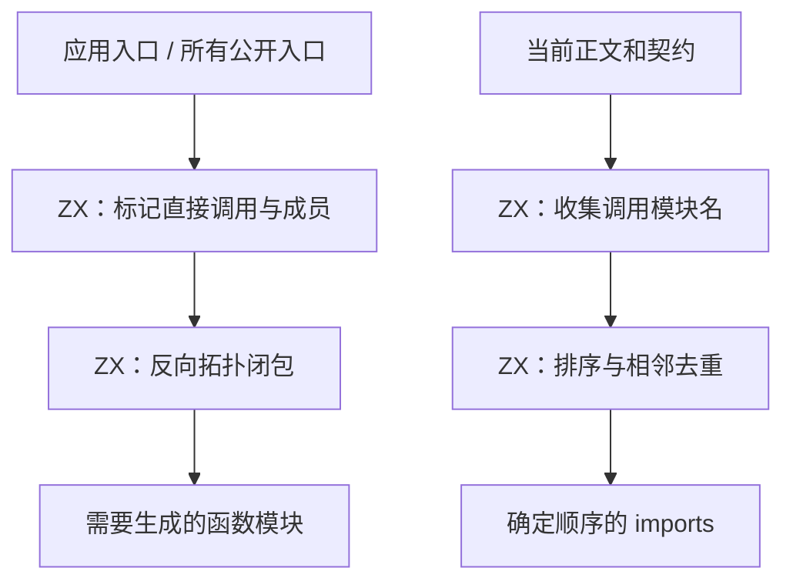

# 生成模块依赖图自举

## Intent：最终目标

将应用与统一库的生成模块选择、传递依赖、导入名集合及排序迁入 RX/ZX。
保持既有输出集合、顺序与契约调用边界，正式路径不再运行原生 references 算法。
完成完整职责及验收后英文提交并推送 master。

## Data：可用证据

起点 aff9decd。compiler/backends/zig/references.zig 为共同实现：reachable 在应用
入口标记后反向扫描拓扑函数表；库逐一标记公开入口及成员后做同样闭包；imports
扫描整份表达式表及契约，以实际函数模块名去重并按字节序排序。不能仅按函数 ID
去重，因为不同 ID 可以具有同一模块名。Task 内表达式已在整表中，不缩为可达表达式。

已有 ZX 列模型、loop、数组 sort 与字符串比较可复用，无需专用运行库或新增语法。
临时固定基线位于 /tmp/zxc-reference-graph；沿用已校验摘要的性能输入。

## Edges：边界与限制

- RX 负责根收集到闭包、引用收集到有序集合的阶段依赖；ZX 承担各集合算法。
- 输入表只借用列。结果 mask 与导入描述符归调用者拥有，不复制字符串正文。
- 库必须在所有公开入口处理完之后只求一次闭包，避免每个根都遍历函数全表。
- 不以恢复旧通道、放宽形态断言或新增测试换取通过。复用有效现有用例与全产物对照。
- 先实现，再依据同输入性能证据优化。排序去重与原散列表方案成本不同，必须实测，
  不预先宣称零开销；不得通过减少语义范围消除差异。
- native 列桥接、宿主流程和 seed 为过渡依赖；此阶段不等于完整编译器已自举。

## Answer：交付与成功标准

交付两个真实 RX 流程及原子 ZX 算法，应用、统一库、导入与缓存使用同一规则。
新旧约定产物一致、阶段自编译一致，有效既有行为检查通过，无稳定性能退化。
只提交本职责源码与本交接记录，日志和快照留在 /tmp。

## 实现与首次构建

新增 discover.rx 编排 roots → closure，imports.rx 编排 collect → order。ZX 扫描全部
正文与契约的 Call 行，逆序闭包保持既有拓扑约束，导入集合按最终名字字节排序去重。
库入口的非 intrinsic 成员同时参与该入口 imports 和全局闭包；不把全部 default
导出函数强制加入根集合。原 external 文件直接导入 native 模块的分支保持不变。

原 references 实现移到 genz/zx/references/seed.zig；正式入口统一调用生成的两个
RX 模块。桥借用表达式／契约列，scratch 结束前复制结果 mask 和字符串描述符。
字符串正文一直借用稳定 identities，未新增深复制。public_batches 全部初始化后才
建立 entry_roots 指针数组，随后同步求闭包。

只读审查未发现职责或生命周期遗漏。首次构建暴露库函数内既有 roots 名称冲突，已
改为 entry_roots；严格列适配器也拒绝 FunctionId enum 到 u32 的通用强转，现明确
验证 backing 为 u32 并借用该整数视图，不放宽通用列兼容规则。

修正后 stage1 为 23/23 步、372/372 检查通过，build-stage1-final.log；stage2
16/16 步成功，build-stage2.log。接下来以固定输入验收成本与完整产物，再验证应用／
统一库公开成员、依赖顺序及编译库消费。

## 完整产物与成本对照

五对固定输入已逐项比较：新旧每对 1574/1574 约定产物一致，仅排除工具身份
.zxc-inputs；新工具每对冷／热 1575/1575 完全一致，不排除文件。
all-output-comparisons.json 保留全部结果。stage2／stage3 的 1622/1622 约定产物
一致，stage-comparison.json；第三阶段 16/16 步成功，build-stage3.log。

七组缓存检查通过：磁盘热缓存、常驻初次与重复、语义编辑对照干净生成、恢复、新增
真实公开 ZX 根对照干净生成、移除根恢复。报告 cache-checks/summary.json。

performance/summary.json 保留五组交替样本，固定源码、工具链、优化模式与 resident=0；
测量期间无其他构建。冷／热墙钟中位数分别为 706.569→719.849 ms、545.608→543.621 ms。
冷总耗时增加约 1.9%，未隐去这项差异。CPU 中位数 3.28→3.29 s、2.24→2.23 s，
冷 CPU 样本平均值 3.286→3.288 s；峰值 RSS 中位数 364.531→363.547 MiB、
326.141→326.312 MiB。

分层核对：infer 冷／热均 369→369 ms；emit 冷 205→205 ms、热 100→100 ms；
write 冷 37→44 ms、热 40→38 ms。shared_generation 的 emitted 时间戳已在
emitLibraryFilesCachedConcurrent 返回之后；write 阶段只执行未修改的
shared_output.write，所有文件集合、顺序、字节及写出清单也已对照一致。
因此当前证据没有显示依赖图计算的稳定 CPU／内存或发射成本退化，冷墙钟差异主要
落在文件写出，完整端到端判断仍受 IO 波动限制。不把它宣传为性能收益，也不通过
重复同版本测量、修改并行度或改变计时范围取得更好数字。

排序去重会处理 E 次调用，而旧散列表先得到 U 个唯一名再排序。这是明确的算法
成本差异，不能凭产物一致否认。本轮真实编译器输入的 emit／CPU 没有稳定变差；
后续若重复调用密集场景出现实际热点，应在通用集合能力或明确集合算法中消除成本，
不得退回原生 references 规则或按函数名／路径特判。

## 行为验收

现有 test-rx-parallel、test-library-import 与 test-library-bundle 成功；合并命令
927/927 Zig 检查通过，1265/1267 构建步骤成功。唯一失败目标是
test-library-entry 的 Node 驱动，5 个发布案例都报 FileNotFound；环境中无 z3，
该组明确传入 --solver z3，尚未进入有效发布验收。

已在 /tmp/zxc-reference-graph/solver-env 安装真实 Z3 5.3.3（z3-solver 5.3.3.0），
不修改项目依赖。通过 ZXC_TEST_SOLVER 指向绝对路径，仅补跑这组失败检查；不重复
已通过用例。新 RX/ZX 均通过 fmt --check，最长 85 列，单文件不超过 70 行。

补齐求解器后，test-library-entry 为 41/41 步、5/5 发布入口案例通过，包含搬移后
ZX/RX 消费及直接 Zig 消费；library-entry-acceptance.log。前次 FileNotFound 已
确认是环境缺依赖，并未修改编译器或断言来绕过验证。其余已通过用例未重复执行。
根目录 dist 26/26 步成功，正式 zig-out/bin/zxc 已更新，install.log。

## 自我批判与剩余边界

这次把库公开成员的 imports 合并也纳入同一 RX/ZX 职责，避免只搬走公共 helper
而留下原生同义规则。额外根仅取真实成员，保留 default 入口的既有选择，真实源码
与调用关系已核对；正式应用／统一库路径均不再调用旧 references 算法。

成本判断以分层计时、CPU、RSS 和产物为依据，不把冷写出增加简单改写成“全程更快”。
集合排序方案的渐近差异仍明确记录，后续按实证优化；不为当前 IO 波动重测取幸运
中位数，也不改变并发或输出范围。源码、配置未变时复用本阶段的有效证据。

native 仍有输入列视图、结果拥有容器、宿主模块装配及 bootstrap seed；完整编译器
的 AST/IR、身份／缓存状态、发射逻辑和其他规则仍待迁移。本阶段完成不代表完整
自举达成，goal 保持继续。按英文规范提交并推送既有 master，不创建分支。
