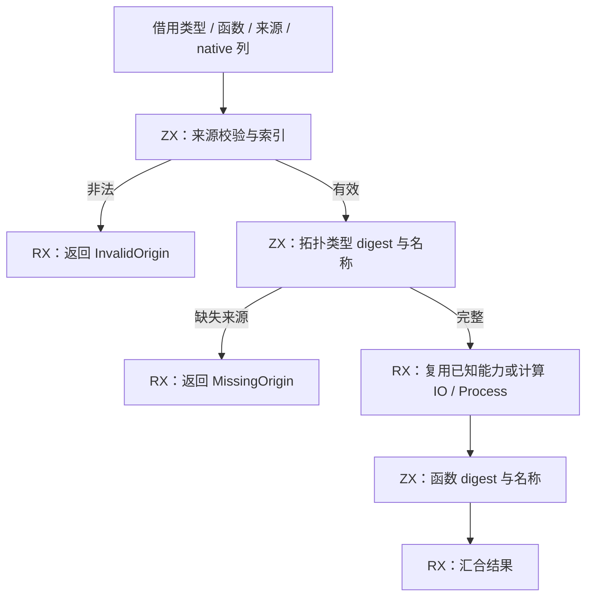
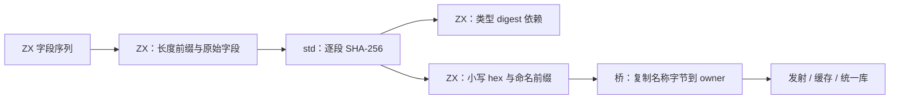

# 生成模块稳定身份自举

## Intent：最终目标

迁移 genz 的名义来源校验、类型身份哈希、函数身份哈希和模块命名规则，保持全部
字段顺序、错误优先级、输出字节和缓存身份。RX 表达先校验、类型命名、能力选择、
函数命名的真实阶段；ZX 实现规则。完成后英文提交并推送 master。

## Data：可用证据

起点 40eae1a3。compiler/backends/zig/names.zig 仍手写全部规则；应用、统一库、
Store 初值与 Gateway 均调用它。每个哈希字段为 u64 little-endian 字节长度加原始
字节；类型子节点使用原始 SHA-256 digest，函数身份不包含签名和函数正文。

错误顺序是 origins 全表形状 → 按来源顺序检查越界/重复/名称/native owner → 按
TypeId 顺序报告 MissingNominalOrigin。native owner 必须检查所有绑定：允许相同
key 多次出现，拒绝不同 key，至少一项绑定名称匹配。key 为 identity orelse specifier。

## Edges：边界与限制

- 复用 core 类型、函数、native 模块列模型；origins 的现有 borrow 不含 names，必须
  显式保留这列。不得把来源语义或字段 framing 藏进原生桥。
- std:bytes 的原始文本字节视图不校验 UTF-8、不分配；u64 LE 编码与分段 SHA-256
  是普通标准库能力，不能限定编译器输入。分段 hash 只逐段 update，字段 framing
  由 ZX 显式组装，不拼成完整临时字节串。
- 新标准接口不能用 manifest 覆盖内置 catalog；旧 stage0 无法引导。先以当前源码
  seed 建立新 catalog/ABI，然后继续 stage1 → stage2 → stage3。
- 临时分析由独立 workspace 支撑，输出名称归 owned allocator；不能把 scratch
  挂在输出 arena 上长期保留，也不能释放 scratch 后保留其字符串字节。
- 不新增测试。复用名义身份、原生引用、统一库与现有阶段构建，固定全部输入对照。

## Answer：交付与成功标准

交付真实 RX 阶段、ZX 规则、三个普通标准 primitive 及最小列/所有权桥。新旧固定
产物相同，缓存合法编辑/恢复与阶段产物一致；相关现有行为通过，无稳定性能退化。
先实现，再依照成本证据优化，不撤回迁移或放松边界来掩盖退化。

## 实现与阶段构建

正式规则位于 genz/analysis/names：analyze.rx 依次组织来源校验、类型命名、能力
选择和函数命名；capabilities.rx 表达已知能力的短路复用。ZX 分别处理来源索引、
原生 owner 校验、字段序列、字段 framing、拓扑类型 digest 与函数 digest。
类型名和函数名使用已有 domain/prefix，不把签名或正文混入函数身份。

原生 names 桥只借用列、管理 scratch 生命周期、转换错误及拥有输出名称字节。
旧实现迁至 names/seed.zig，仅供 generated_analysis=false 的初始引导。
应用、统一库、Store 和 Gateway 都接入同一正式入口。能力谓词复用现有 ZX 实现，
只将 IO/Process 输入收窄为函数列；facts.rx 同步更新，没有复制算法。

三个 std 原语为 fromText、encodeU64Le、sha256Parts。前者借用任意原始字节；
LE 编码和 hash 使用普通 Zig 标准库，不知道 compiler 的 domain、字段或 TypeId。
输出名称的描述符和字节必须在 scratch 释放前移入 owner，未把临时分析 arena
挂在输出 arena 上延长生命周期。

初次源码检查暴露并修正了常量初始化边界（数组不是 closed scalar）、u32/u64
宽度、optional 语义和值视图 ABI 问题。字符串和位置的可空取值使用 ??；native
owner 使用 found 明确区分未出现与空 key。桥接使用 canonical executeIn，而非
把 pointer 传给按值视图 executeValue。没有放宽类型规则或诊断要求。

build-stage1-abi.log：41/41 构建步骤、372/372 检查通过；stage2 和 stage3
各 16/16 步成功。stage-fixed-point.json 比较 stage1、stage2 分别生成的下一阶段
源码，1637/1637 约定产物完全相同，仅排除工具身份文件 .zxc-inputs。

## 固定输入的产物与成本

在 /tmp/zxc-stable-names/performance 保留五对交替冷／热原始样本，全部使用冻结
源码、相同 target/优化模式与 resident=0；测量时没有同时运行其他构建。before 为
feb6bb8a 对应 stage3，after 为本阶段 stage2。源码 digest 在测量前后均核对。

十对完整目录各比较 1575 文件，其中 1572 文件字节相同。三项预期差异逐项核查：

- types.zig 只增加三个标准原语的 Input/Output 及值视图声明；剥离这三个完整声明
  后，其余内容与旧版逐字相同，包括全部类型名称。
- .zxc-files 仅 types.zig 对应校验值改变，其他条目顺序与字节相同。
- .zxc-inputs 是工具/catalog 输入身份，按预期改变。

没有把整个 types.zig 排除后宣称全部相同。十份 raw compare 报告及
verified-differences.json 保留上述严格差异检查；全部函数文件与名称均相同。

冷墙钟中位数 701.445→710.013 ms（+1.22%），热 540.659→540.661 ms。
冷 CPU 3.27→3.30 s，热 2.23→2.23 s；峰值 RSS 冷 361.484→362.469 MiB，
热 326.297→326.391 MiB。infer 冷 366→378 ms、热 366→366 ms；emit 冷
205→204 ms、热 100→100 ms；write 冷 38→38 ms、热 38→41 ms。

没有把冷墙钟上升隐去，也不把热中位数相同解释成所有场景零成本。新规则主要执行
于 emit，当前样本没有显示发射计算的稳定退化；冷差异主要出现在 infer，热 infer
没有相同变化，晚期一对新旧样本也有额外波动。保持这些原始限制，不重复同版本
测量挑选中位数，不更改并发、缓存范围或输出形状来取好数字。

七项缓存检查均通过：磁盘热缓存、常驻初次/重复、合法语义编辑与冷生成对照、恢复、
增加真实公开 ZX 根与冷生成对照、移除公开根恢复。各对照保留所有 1575 文件，
不排除 .zxc-inputs。报告 cache-checks/summary.json，原始证据均位于
/tmp/zxc-stable-names。

## 行为验收与自我复核

现有 test-library-import、test-library-bundle、test-library-entry、
test-object-shorthand、test-nominal-origins、test-native-references-library 和
test-native-generation 全部通过。合并构建 150/150 步、66/66 Zig 检查通过，
另含 Node 驱动的 5/5 发布入口案例，以及搬移后的 ZX/RX/Zig 消费运行。
记录 acceptance.log。此命令首次误传 test 包不支持的 stage0 选项，尚未执行检查；
移除该选项后使用该包真实配置验收，未修改构建接口。Z3 使用上一阶段已安装环境。

新模块及相关能力源码 15 个 ZX/RX 文件的 formatter --check 全部通过。
fields.zx 为 144 行，是内聚的类型字段分类与遍历算法；超过默认 120 行 lint 信号，
本次评审后保持完整，没有为了行数拆出转发 helper 或压缩空行。没有新增仓库测试。

自我复核：原生 owner 仍验证全表和每个同 TypeId 绑定，shape 错误保持先于 missing；
原始文本字节不会被 UTF-8 校验改写。函数身份排除正文与签名，子类型 hash 使用原始
32 字节 digest，完整产物比较为这些边界提供真实输入证据，不能替代一般形式证明。

成本数字保留冷墙钟 +1.22% 的观测，未以输出正确替代性能判断。热缓存、CPU/RSS
和 emit 未显示稳定新增成本，当前没有按名称、路径或用例添加优化特例。后续出现
可复现热点时继续在 RX/ZX 或普通标准库能力内优化，不回退迁移。

本阶段迁移的是完整稳定命名规则。原生列适配、allocator/拥有容器、宿主模块装配与
初始 seed 仍是过渡依赖；编译器其他 AST/IR 状态、发射规则、缓存及所有权部分仍待
迁移。全局自举 goal 保持继续，不能因三阶段字节一致宣称整个编译器自举完成。

根目录 dist 26/26 步成功，正式 zig-out/bin/zxc 已更新，记录 install.log。
