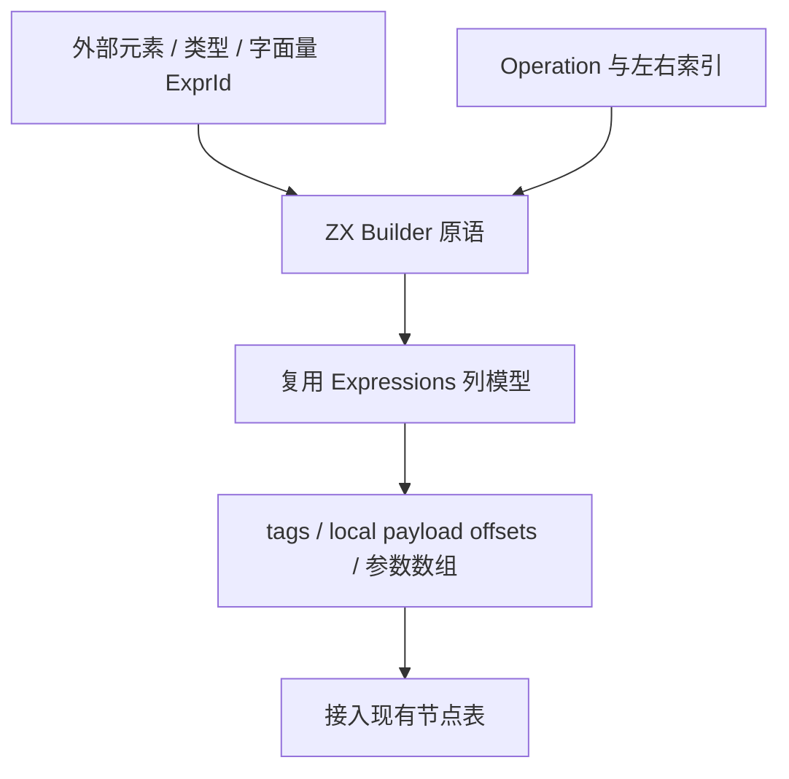

# 结构化表达式构造自举

## Intent：最终目标

将 SIMD 数学表达式节点构造从原生 switch/Builder 调用迁入 ZX；复用 printer 的完整
AST 列模型，并提供通用列片段导入适配，为后续发射迁移建立可用链路。RX 显示空表
初始化与节点构造，生成结果仍由统一 printer 输出。完整阶段验收后提交推送 master。

## Data：可用证据

起点 562adc5a。资格和后序数学计划已自举，但 simd/expression.zig 仍按 Operation
手写创建 unary/binary/splat/cast AST。printer/model/expressions.zx 已描述全部原生
表达式列，node/view.zig 已验证原生与生成视图的枚举/布局映射，无需另建专用 SIMD AST。

## Edges：边界与限制

- 不生成字符串源码，不使用 RawCode。所有输出为现有 AST 类型、字段、枚举及引用。
- 外部叶节点先由现有通用 literal 发射准备；节点操作数顺序与根保持后序计划语义。
- 片段只存新增列，不能复制整个已有 AST。global id 为现有表达式数加本地编号；
  payload offset 导入时统一加对应旧列长度。兼容现有 u32 数量上限和 OutOfMemory。
- 新列嵌套 slice 在 scratch 释放前接管；不得遗留悬空参数数组，也不能以保留整个
  scratch 到输出结束代替所有权处理。输入列与已有节点保持借用。
- 通用导入层只处理布局、列追加与拥有权，不认识 SIMD 运算；seed 保留原始构造。
- 不新增测试，复用现有三阶段自编译、目标 SIMD 和冻结输入/缓存证据；先实现再优化。

## Answer：交付与成功标准

交付可复用的 ZX AST 表达式构造原语、RX 构造流程、通用原生列接管适配以及实际
SIMD 消费者。真实生成产物一致，现有行为和缓存通过，无稳定计算成本退化。
本阶段不把 native字面量准备、完整向量循环发射或全 compiler 状态声明为已自举。

## 实现与所有权

ast/expressions 复用 printer 枚举和列名，提供 header、unary、binary、builtin 构造。
构造状态为所需九列的投影，不携带完整百余列描述符，输出仍是同一 AST 列协议。
header 保持 u32 容量边界；emit/build.rx 显示初始化与构造阶段，build.zx 仅遍历已
检查的后序数学计划。literal.zx 构造 Splat/As，未生成或拼接源码字符串。

原生先调用现有通用 self.expr 准备全部 literal，再读取全局 base；随后直到导入
结束不再追加其他原生表达式。ZX 根独立返回：identity 或标量 literal 可以只返回
已有叶节点，新增表为空也合法。输入计划非空由 accepted plan 保证，零新增 AST
节点不等于空数学计划。

node/import_rows 为通用布局适配，不认识 SIMD。复用 native→generated 枚举映射
校验，检查列、tag 数量和 offset，预留容量、完成嵌套 slice 复制后才提交表长度；
OOM 可能改变预留容量但不会半追加行。子 ExpressionId 已是全局编号，只重定位
各 payload offset；其他外部范围不自动改写。owned 复制新 builtin 参数等嵌套
数据到目标 allocator，成功释放外层临时描述符，失败清理已复制子项。scratch
释放后，结果不依赖其内存；已有 AST 与输入列没有深复制。

构建时修正了 RX Call 必填 in：空表构造使用空对象接口。泛型枚举布局检查沿用
既有 view.rows 的编译期分支额度，不改变运行期检查、并行度或优化模式。

## 阶段与行为验收

build-stage1-columns.log：41/41 步、372/372 既有检查通过；stage2、stage3
各 16/16 步成功。根目录 dist 26/26 步成功，正式 CLI 已更新。

沿用既有 SIMD safe 驱动，378/378 外层调用案例通过，包含 Node 特殊浮点与尾部、
WASM baseline/simd128 的结果和汇编要求，以及整数/filter/reduce/嵌套回退，
记录 simd-semantics-safe.log。未改测试、断言或新增案例。

f32/f64/fallback 的新输出与 562adc5a 阶段对应的有效基线逐字相同，各为
45676/45676/57682 字节；保留 fixtures-before、fixtures-after 与
simd-source-comparison.json。输入源码和工具链未变，基线证据复用，不重复生成
同版基线。新侧用当前 CLI 禁用缓存生成。

所有原始证据保存在 /tmp/zxc-simd-ast；后续成本与缓存结果在该阶段记录中追加。

## 完整产物、成本与缓存

stage-fixed-point.json：1668/1668 约定阶段产物相同，仅排除工具身份 .zxc-inputs。
编译器冻结输入和三个真实 SIMD 夹具各做五对交替冷/热测量，前后核对输入 digest，
固定 target、工具链、ReleaseSmall 和 resident=0；所有构建和行为检查终止后测量。
没有重复同版本取更好数字、扩大复制入口或改变并发配置。

大输入十对每对 1574/1574 约定文件相同，SIMD 十对每对 12/12 相同；仅排除工具
身份，完整类型、函数文件与写出清单均比较。两组 all-output-comparisons.json
保留全部结果。七项缓存检查也全部通过：磁盘热缓存、常驻初次/重复、合法语义编辑
对照干净生成与恢复、增加公开 ZX 根对照干净生成、移除根恢复；1575 文件无排除。

大输入墙钟中位数冷 697.428→702.047 ms（+0.66%），热 546.333→537.578 ms；
CPU 冷 3.28→3.27 s、热 2.23→2.23 s。峰值 RSS 冷 357.750→363.844 MiB，
热 326.297→326.313 MiB；冷 RSS 样本范围 353.063–363.969 与
355.797–365.156 MiB。infer 冷 365→365 ms、热 365→363 ms；emit 冷
203→205 ms、热 100→100 ms；write 冷 37→40 ms、热 44→37 ms。

实际 SIMD 冷墙钟 9.625→9.732 ms、热 8.605→8.681 ms；冷 RSS
15.672→15.688 MiB、热 13.031→13.063 MiB。CPU 低于本采样分辨率，不把报告
0 秒解释为无计算。大输入和 SIMD 原始样本分别在 performance、positive/performance。

数据没有证明所有场景严格零退化：冷总耗时、emit 及 RSS 中位数增加的观测全部保留，
两组墙钟差异较小，CPU 未增加，RSS 分布重叠，未据此宣称性能收益。构造只传九列
投影、只接管新节点的嵌套数据，已有 AST 未复制。后续有可复现分配/复制热点时，
在当前 ZX 构造和通用列适配内优化，不回退到手写数学节点构造。

## 自我复核与剩余边界

源码复核与真实运行一起覆盖外部 root、literal 准备顺序、全局 id、本地 offset、
枚举映射方向、列缺失拒绝、容量边界、OOM 提交顺序及嵌套 slice 生命周期。
未新增仓库测试；本次实际导入的投影为 Unary/Binary/Builtin，通用适配器未来被
其他 AST 类别消费时，还需对应行为和所有权验证，不能以泛型存在声称全类别已验收。

通用原生列接管与 owned helper 仍是过渡内存适配，native literal 准备、向量循环
AST 发射、其他 genz/host 发射器与编译器状态仍待迁移。这里完成的是结构化数学
表达式构造，不是整个 AST 存储或整个编译器自举。全局 goal 保持继续。

10 个新 ZX/RX 全部通过 formatter --check；相关文件通过 diff --check。
