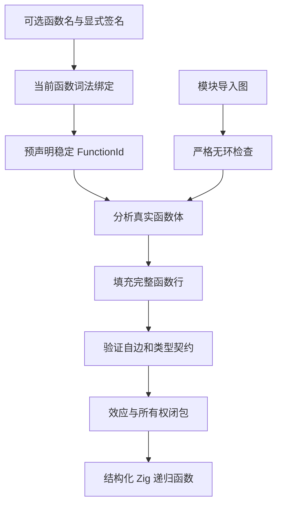
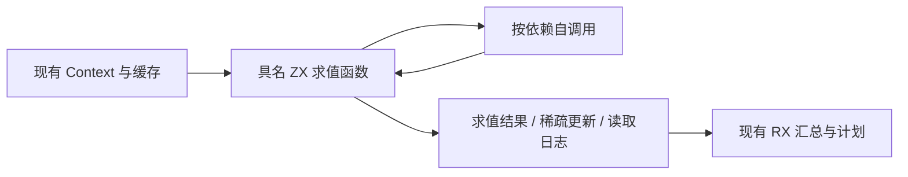
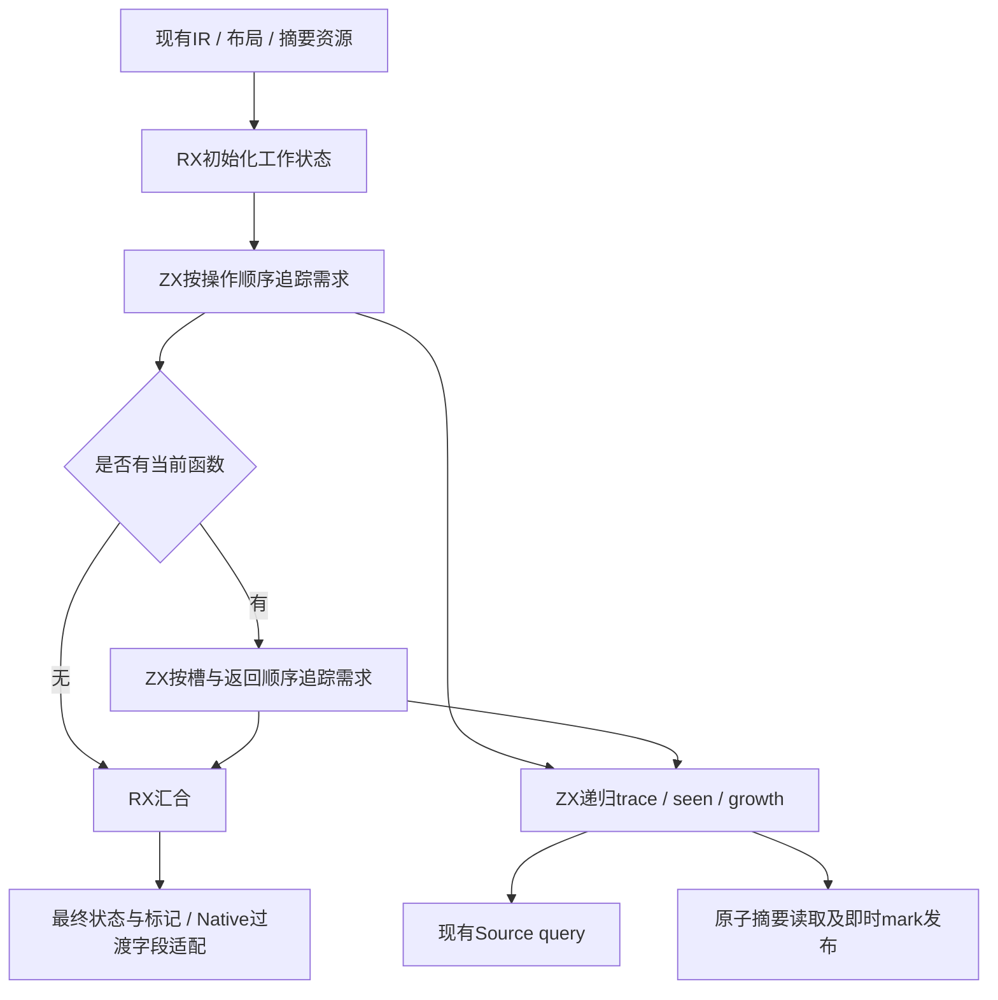
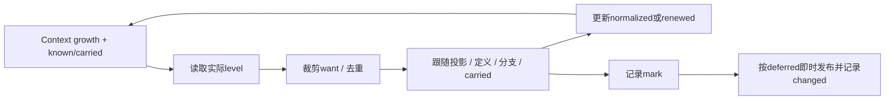
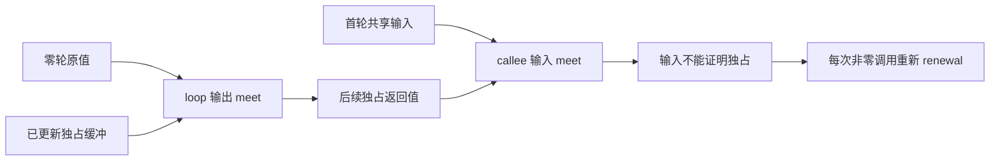

# ZX 具名默认函数与递归自举

## Intent：最终目标

补齐单个默认函数的文件内自递归能力，使内聚的递归算法可以直接由 ZX 表达，
再用真实槽位求值器验证它能否减少显式工作栈的成本。保留一个文件一个默认函数、
模块导入无环、普通 Zig 静态编译和现有值语义，不引入解释器或专用运行库。

拟采用现有 JavaScript 风格的可选函数名：

```zx
export default function evaluate(in: Input): Output {
    // 函数名是当前函数体内的词法调用绑定。
}
```

匿名写法继续有效。函数名不增加额外导出，也不要求调用方更改默认导入。
本阶段只开放本函数自边，不开放跨模块循环、互递归或一般前向调用。

## Data：可用证据

- 正式 parser/program/function.zx 明确要求 single anonymous default function，
  header/signature.zx 在 function 后直接接受左括号，没有函数名绑定。
- 正式 IR 的 validation/functions/forward.zx 和 seed_validate.zig 要求
  callee 小于当前函数下标；仅添加语法会在最终验证被拒绝。
- Project 在分析函数体之后才分配 FunctionId；root 最终又移除自己的函数行。
  自调用需要先有稳定签名与 ID，并在最终 root 保留可调用的真实函数体。
- genz/analysis/calls/expressions.zx、编译器纯度与并发查询依赖前缀归纳。
  不能只放宽验证器，否则纯自递归可能被误判为需要 IO、process、tasks。
- 错误集合已有 SCC 处理，uniqueness 已避免提前分析自调用体，发射请求按
  函数和变体去重；inline 已将递归调用视为超预算。逐项核对后复用。
- 当前 Source 求值器使用 Frame 数组和 step 循环。移除 Frame 往返后，CPU
  中位约 5.53→5.33s，但仍高于原 Native Function 的约 4.11s。递归能力的
  性能收益尚无证据，不能将全部差额直接归因于它。

## Edges：边界与限制

1. self 是函数体内的词法绑定，不是源码 import。不得伪造导入绕过 resolved
   admission，也不向模块图添加自导入边。
2. 签名必须仍由显式 Input/Output 确定。名字与现有绑定的冲突遵守正常作用域
   规则；不得通过按名字猜测类型或调用目标。
3. 分析期单独保留词法签名与稳定 ID，不向完成函数表插入占位行，也不伪装成
   external。真实函数体返回后才加入函数表；未完成体不进入校验、缓存或生成。
4. 只对有语义证明的属性把 self 边视为中性；本体和所有较早 callee 仍须检查。
   ownership、错误、状态和资源传播逐项核对，不能统一忽略自调用。
5. root 入口保留递归目标。复用普通 Call/Return 表达平台入口，避免复制同一
   算法为两份实现；不增加新的递归 IR opcode。
6. 所有后端都必须明确处理自边。Zig 后端输出普通递归函数；暂不支持递归的
   目标给出能力诊断，不能无限展开、漏掉调用或输出不完整产物。
7. 不新增仓库测试用例。使用实际求值器、已保存真实查询输入、现有回归和阶段
   自编译验证；不按文件名、函数名或固定输入编写生产特例。

## Answer：交付与成功标准

以一个完整功能阶段贯通解析、绑定、类型分析、IR、效应分析、链接、缓存及
结构化生成，集中验收后提交推送。不得把仅解析成功算作能力完成。

- 匿名默认函数的既有行为通过现有回归。
- 具名默认函数的自调用解析为同一稳定 FunctionId，输入输出、Store、错误与
  所有权契约保持有效，名字不泄漏为额外导出。
- 模块循环与真正的前向调用仍拒绝；自边不会造成分析或发射无限展开。
- 用真实 Source 槽位求值器消费该能力，比较值、缓存更新、读取日志、完整产物
  及阶段固定点，再按同输入计时评价整项 Function 迁移与固定累计基线。
- 若递归版本不能提速，保留已完成的通用能力与迁移职责，继续定位实际开销，
  不以回到旧 Native 实现作为性能验收。





## 当前状态（2026-11-04）

解析、词法绑定、显式端口、自调用 Call、Source 与 seed IR 门禁、纯度/资源/
并发汇总均已接通。Source body 阶段在 admission 之后派生调用绑定；Native
输入保留 Name.text 的权威性。普通导入仍由原 admission 校验，不伪造自导入。

分析期只为 ownership 提供 Borrowed 返回摘要与真实 stores；真实 body 返回后
再加入 FunctionStorage。错误查询遇到未完成 ID 返回未知，Task/Capture 继续
使用既有能力或有限错误集诊断，不把空函数体解释成无错误。完整函数表的错误
传播仍复用 SCC。模块循环、未来 callee、递归自动内联的限制保持有效。

### 函数表与缓存

- Project 在 snapshot 和 seed ownership 之前追加真实 body。
- standalone/resolved 分析若存在自调用，保留完整 own 行；扩展前缀只复制列，
  保留既有 descriptor 身份，避免破坏 shared context 的前缀校验。
- 混合 RX/ZX 链接原来把 program.functions 覆盖成旧 prefix，导致真实 visit
  body 无法链接；现保留新增后缀，并在共享表增长后重映射后缀 ID。
- artifact 的签名表只包含真实导入；有真实本体时，其独立局部 ID 约定为
  signatures.count。Source planner 独立登记 own 映射，不改变 imports/order/count。
  Record.own_function 保存需要保留的 global ID。restore/link 使用额外映射槽，
  remap 真实 body 后补齐完整表再验证；缓存协议由 v6 升至 v7。
- proof/FPGA 共用符号调用边界明确拒绝递归目标，保留原深度限制用于其他深链。

这些接线尚未通过完整缓存与现有回归验收，不宣称能力已交付。

### 真实消费者与证据

levels/visit.zx 已改为真正的具名自递归函数。每次递归只处理一个节点，循环
按原顺序处理子项；complete.zx 负责完成单节点结果、物化与稀疏缓存更新，
evaluate.zx 构造初始状态。保留读取日志、原始/物化查询和子项合并顺序。
旧 step.zx 暂留用于核对，验证收口后移除未使用的工作栈模型。

113 入口实际分析并生成递归函数成功；recursive-evaluator-producer 构建成功，
用其再次生成相同输入，2013/2013 文件逐字一致，仅排除 .zxc-inputs。
生成结果中已存在正常的 Zig 自调用与显式错误集，不依赖新的运行库。

证据位于 /tmp/zxc-function-levels：

- recursive-evaluator-generation.log
- recursive-evaluator-producer-build.log
- recursive-evaluator-stage2.log
- recursive-evaluator-stage2-comparison.json

完整生成采用每轮独立 cache/service，避免 resident 转发进程的 CPU 被误读为
整轮 CPU。recursion-full-paired-results.json 的三个成对结果：

| 实现 | CPU（秒）          | 中位数 |
| ---- | ------------------ | ------ |
| 迭代 | 5.31 / 5.65 / 5.54 | 5.54   |
| 递归 | 6.78 / 6.86 / 6.76 | 6.78   |

此前 recursion-paired-results.json 中后两轮复用了 resident，测到的是转发进程，
不能用这些 0 CPU 样本评价完整生成。上述独立 cache 结果才是本轮有效对照。
原 Native Function 固定参照约 4.11 秒，累计差距仍未解决，未重置验收基线。

### 正在处理的生成质量缺陷

真实递归生成代码在读取 metadata.usage.plan.slot_first 等路径时，先将整层
usage 转成内部值，再只取一条字段路径。递归放大了此成本；不能据此断言
语言递归本身必然更慢，也不能只通过撤回递归绕过它。

已实现并试测通用 projection storage：只读字段链沿 ABI 存储直接投影，在最终
字段确实需要内部表示时才转换；缓存、normalize/renew 与循环字段布局均保留。
实际递归模块由 28836 减至 19024 字节，2013/2013 阶段产物一致。但成对完整
生成 CPU 中位 7.09→7.07 秒，差异仅 0.02 秒且样本重叠，不能证明有性能收益。
因此只撤回该优化尝试，递归能力与消费者保留。记录：
projection-full-paired-results.json、projected-record-stage2-comparison.json。
不重复该尝试；下一步用带符号的真实递归产物采样定位主要开销。

根入口的重复本体处理已实现，尚未验收：source linker 用完整 Function 的
结构与 descriptor 身份核对已保留本体，再复用映射 ID；Project、standalone
及 artifact linker 的递归公开入口用普通 Call/Return IR 转发。artifact roots/
body 提取读取 Record.own_function 所指真实算法，避免把入口包装当作缓存本体。
普通匿名模块保持既有前缀快照；仅递归模块保留 own 行。

### 尚未完成

1. 对带符号的真实递归产物采样，找到迭代→递归退化的实际成本。
2. 验证公开入口转发与 source linker 本体复用，不按名称或文件路径猜测。
3. 缓存 extract/restore/link 的真实递归使用、合法编辑与恢复验证。
4. 现有 ownership/边界回归、seed 与正式分析路径、最终阶段固定点及性能验收。
5. 两处原有 Native/Source Function 产物差异、完整职责的状态桥迁移仍然未完成。

本阶段未提交；不以名字解析、局部接线或一次生成成功替代完整功能交付。

### 最新复核

四组既有回归已在 packages/test 正确入口执行，178/178 steps、336/336 tests
通过（self-recursion-related-checks.log）。覆盖普通 Native 边界、字段所有权、
缓存所有权和对象值返回；不把这些旧用例当作递归入口或全部缓存行为的证明。

采样证据 recursive-entry-mach-summary.json：1997 个运行态样本中，visit 为420、
memcpy 为230、instruction为124。该短窗口不是整轮收益比例；已有符号行归因
保存在 recursive-entry-attribution.log。热点包括子项循环状态和完成阶段传参。

据此把 visit 子项循环的多次叶赋值改为一次完整状态赋值，保留原字段求值依赖。
atomic-recursion-candidate 已构建，113入口再生成2013/2013文件一致，成对性能
尚未测量；不能提前声称收益。未提交的旧 step 和 Walk 类型仍待验证后清理。

额外入口验收使用真实 visit.zx 及同一清单的实际依赖，全部输入仅复制到 /tmp，
未添加仓库测试。直接 Project 分析在冷编译最终 IR 校验处被拒绝；临时探针确认
包装前的原始递归 body 同样被拒绝，因此不是仅公开入口包装造成。当前正在用
仅位于 /tmp 的生成内核探针定位具体拒绝阶段，不跳过最终 IR 校验。

生产 Project 临时探针已完整移除；原始源码保存并按原字节恢复。缓存验收必须
先解决此缺口再继续，不将冷编译失败样本当作缓存性能或正确性证据。

### 显式 loop environment 的实际缺口与修复

更细的 Source 校验探针定位到第28个函数 levels/want.zx，并非 visit 自边。
失败为 Reference：payload10→symbol5，而 callback 仅激活 symbol6；没有
OptionalValue 节点，nullable 假设已排除。源码核对确认 symbol5 是显式第三参数
保存的外层 loop_context。callback 的 Scope prologue 读取它，而两套 scope
validator 都先清空全部 active，因而拒绝编译器自己产生的合法 context 传输。

不能简单保留外层 active，也不以名称识别 loop_context。采用明确 IR 契约：
Iteration.environment_symbol 指定唯一的显式只读环境符号。Source 与 seed 的
callback 都先验证该符号在外层作用域有效，隔离普通捕获后只激活 state 参数
及这个环境。无 marker 的 callback 继续禁止所有外层引用。

字段已贯通 Native IR、表达式列、追加/读取/宽度及符号引用检查、Source/seed
loop 构造和 inlining 符号偏移。该 metadata 不增加应用运行层，现有 Scope
prologue 继续表达真实数据流；artifact 内部不改变单函数的 SymbolId，整列复制
保留该字段。仍需构建、阶段与直接入口/缓存验证，不能用源码核对代替通过。

explicit-environment-generated 已由现有 producer 完成113入口生成；新的 Native
与 Source schema producer 正在构建（explicit-environment-producer-build.log）。
临时探针仅在 /tmp/ir-validation-probe-generated 中，生产源码无探针。

首次新 schema 构建触发 columns.compatible 的 offset 检查：Native 表的新增列
插入位置未按既有字母顺序排列，和生成 ABI 的顺序不同。已把 Native
iteration_environment_symbols 移到 iteration_initials 之前，保留严格 ABI 检查，
未采用不安全 cast 或拷贝兜底。正在按同一 build 句柄结果继续构建。

### 直接入口与缓存已通过（新 environment schema）

recursion-cache-environment 使用真实 visit 及其52个传递模块，依次执行冷分析、
缓存命中、合法代码修改（内存副本中的 cursor 步长1→2）、恢复。计数为：

| 轮次 | 累计 analyzed | 累计 reused | uncacheable |
| ---- | ------------: | ----------: | ----------: |
| 冷   |            52 |           0 |           0 |
| 命中 |            52 |          52 |           0 |
| 修改 |            53 |         103 |           0 |
| 恢复 |            54 |         154 |           0 |

source/types 两份输出的冷、命中、恢复逐字相同；修改轮 source 不同，types相同。
证据 recursion-cache-environment.log、recursion-cache-comparison.json。直接递归
入口的 IR 拒绝已消除，前述失败记录保留用于解释根因，不再当作当前缺口。

进一步对52个真实模块执行 artifact 提取、codec encode/decode 与重新链接，
遇到 ConflictingInterface（recursion-cache-linked.log），尚未完成该验收。
不要把已经通过的内存缓存恢复等同于序列化重链接已通过。

只读复核发现 RX program/mapping.zig 手工重建 iteration 时会丢 marker，已按
同一 symbol 映射补齐；其他已审列、符号边界、seed/正式内联和 artifact复制
没有发现新的漏接。回调没有 marker 时仍隔离全部普通外层变量。

新增列使旧 bootstrap/constants 的固定 ABI 与 Native 表列数不同；后续回归
构建在此停止，不是语义测试失败。已运行现有 bootstrap-constant-seed 生成步骤，
使用已验证 producer 从源码再生28个 Zig文件并删除4个过时生成文件，未手改产物。
重跑六组既有回归：frontend、loop-policy、Native边界、字段/缓存所有权、值返回；
当前句柄7076，日志 explicit-environment-related-checks.log。

production源码无诊断探针；/tmp 的 errortrace 尝试仅给根模块启用追踪，依赖模块
仍关闭，未获得冲突调用栈，不把它当作已定位证据。下一步应直接定位 link/build、
link/members、link/native 的实际拒绝分支，避免重试同样无效的 errortrace 配置。

重跑结果：227/227 steps、7042/7042 tests通过，涵盖上述六组。Source与seed
环境能力接线、普通旧用例及命名规则没有在该范围内发现回归；这仍不替代模块
重链接冲突或整体性能的验收。7042来自 explicit-environment-related-checks.log。

### 序列化重链接的根因与结果

实际冲突定位在 link/build.zig 的类型导入比较：目标导出使用消费方本地名查找，
没有使用 dependency.source_names 中的原始名称。例如 Frame as Output 应在目标
查 Frame、在消费方查 Output。已修正这一行，未按具体模块/名字添加特例。

recursion-cache-linked-fixed 完成52个真实模块的提取、codec encode/decode、
静态重链接与最终IR校验；随后四轮冷/热/修改/恢复全部成功。重链接前后类型
编号发生重排，因此两个 bundle 并非字节相同；当前只声明重链接及IR校验通过，
不把编号变化直接当作完整运行行为一致的证明。相关日志与比较：
recursion-cache-linked-fixed.log、recursion-cache-linked-comparison.json。

增加运行四组既有 cache/link/artifact 回归，当前旧句柄9833仍在运行，不重启。
已观察的两个失败都来自测试fixture仍硬编码v4，而生产缓存此前已到v6、现在v7；
已让现有fixture统一引用 codec.marker，并将 marker 明确公开为格式标记。
没有新增测试用例。旧进程结束后只需重跑受fixture修改影响的 cache-codec，以及
实际未通过的目标；不要因等待或观察超时重启任务。

类型别名查找是可独立交付的既有缺陷；其余自递归/显式环境与Function迁移仍须
收口，不混淆已完成bug修复与未完成的性能验收。尚未提交任何当前阶段代码。

类型导入原名/别名解析的独立缺陷已提交并推送 f28d79f8，只包含 link/build.zig
的一行比较修正，未夹带其余 self/环境接线。现有 module-artifacts、semantic-cache、
link-boundaries 通过；同轮 cache-codec 两项旧v4fixture失败已修正，正在单独重跑，
句柄33177，日志 self-recursion-cache-codec-checks.log。不重复已通过的三组。

其余功能与Function迁移仍未提交；不因这个独立修复已推送就声称递归能力或
整体自举阶段已完成。默认目标、固定累计性能锚点与后续完整自举验收保持不变。

cache-codec 单独重跑完成：37/37 steps、39/39 tests通过（self-recursion-cache-codec-checks.log）。
当前无运行中的构建或测试；所有临时生产探针均已恢复。未测 atomic 完整状态赋值的
单独性能收益；原递归6.78秒与迭代5.54秒的差距不能用测试通过或独立bug提交掩盖。
下一步按同输入复测并直接对照 Native 求值算法，避免继续在已否定的投影优化上绕圈。

### 递归完成路径的复制收敛

2026-11-04，原 separate complete 每个未命中节点都传入 Context、Frame、
Updates、Reads，再返回 Output。将同一算法的完成逻辑放回 visit；没有改变
孩子顺序、缓存边界、索引次数、动态读取与物化。它是内聚算法的职责收敛，
不是按行数强拆或增加特殊内联规则。原 complete 暂供旧迭代实现核对。

113真实入口生成与新编译器再生成，排除身份文件后2012/2012产物一致。
三轮交错 CPU：before6.59/6.59/6.52s，after6.39/6.33/6.36s；中位6.59→6.36s。
同组墙钟中位1289→1269ms，RSS没有增长。保留这项改动，但没有消除整体
相对Native的退化，不把它当作Function阶段完成。证据均在/tmp/zxc-function-levels：
local-completion-stage-comparison.json、local-completion-paired-results.json。

下一项假设：常见单孩子节点仍经宽Frame循环状态写回，先处理首个孩子，
仅剩余孩子走原循环可减少该路径的状态搬运。仍需完整产物和同输入计时证明；
无收益就只恢复这项优化，不撤回具名递归或任何迁移职责。

首孩子剥离已否定并恢复：2012产物固定点一致，但无并发干扰的后两轮CPU
before6.36/6.32s，after6.88/6.89s，显著退化。首轮与阶段生成有重叠，
不纳入判断；后两轮已足以否定，不再补无效计时。证据first-child-paired-results.json。
保留上一项本地完成逻辑；不引入多一处self调用来改善这个问题。

下一项收窄为循环不变量：instruction确定的node、slot、operation和孩子布局
在遍历中从未改变，不应作为每次写回的Frame。将其作为显式只读环境，
loop只承载cursor、累积value和真实更新/读取。child仍共用原映射算法。

循环不变量调整通过：2012/2012固定点一致；三轮CPU before6.35/6.36/6.68s，
after6.31/6.32/6.32s，中位6.36→6.32s。结果只支持小幅下降，不按最后一轮
波动报告大收益。源码的Frame只读，循环只承载实际变化的数据，保留该调整。
child明确接收cursor；暂留核对的旧step同步传入，避免留下失效的历史源码。
证据hoisted-frame-stage-comparison.json、hoisted-frame-paired-results.json。

同轮还重建仅Function用原生算法的当前版本对照（其余Source和工具链完全相同，
旧buffer pass按当前executeValue签名适配；仅/tmp）。CPU4.16/4.09/4.07s，
中位4.09s；Source仍多2.23s，不满足阶段性能验收。首次Native墙钟有启动抖动，
不用于收益结论。完整产物对照重新确认：2份Zig有额外复制，另有清单及身份
文件变化，未消失。证据current-native-source-comparison.json。

只读规则复核未找到cache/Unknown/raw的确定语义偏差；原生carried哈希表顺序与
Source repetitions顺序不同，固定点应一致，但还不能证明它造成差异。新buffer
路径使用独立close创建状态，没有旧owned=self.*的浅拷贝缓存污染。以上是
排除结果，不是差异根因；不再重复已经通过的完整规则oracle。

本次改动后，正在刷新真实入口的缓存/codec/link诊断所用源码，并复用同一
四轮驱动检查当前visit，避免旧输入快照验证不到新的循环环境结构。

### 当前入口的缓存恢复与重链接实际执行

当前visit真实入口的51模块（移除complete依赖后从52降到51）、66函数完成
四轮：冷analyzed51/reused0；命中51/51；修改52/101；恢复53/151；
uncacheable始终0。source/types冷、命中、恢复逐字相同；合法步长修改改变
source而不改变types。51个artifact均完成codec encode/decode、link及最终IR校验。
证据hoisted-frame-cache-validation.log、hoisted-frame-cache-comparison.json。

此前重链接只验证IR、未验证执行的缺口，本轮进一步收窄：对冷bundle和重链接
bundle分别通过普通Zig后端构建，并回放既有三份真实冷查询45/57/67快照。
两种产物的完整结果（缓存更新、实际读取日志、返回值）逐字相同，输入均未修改。
三份值均为Deferred，67的更新索引仍为192/199/200/201/233。只补了新增IR环境列的
空marker及visit入口组装；没有伪造节点或针对快照修改生产逻辑。临时driver与
产物均在/tmp。证据linked-visit-replay-build.log、linked-visit-replay.log。
这证明上述真实回放行为，不扩张为所有输入的语义证明；类型编号仍重排。

### 本轮交接与自我复核

本轮有源码进展和新运行证据：保留本地完成逻辑及循环不变量收敛，否定并恢复
首孩子剥离；当前Source CPU约6.32s，原生同版本对照4.09s。固定累计锚点未重置。
完整Function阶段仍未满足性能与两份产物差异验收，未提交或推送当前迁移。
已有7042及39项回归证据适用于先前通用能力接线，本次只变ZX求值实现，不机械
重跑同一原生构建；本次实际运行新内核、113入口固定点与更新后的递归入口/codec。

需要警惕继续在Frame微调上绕圈：本轮只取得局部收益，完整差距远超容差。
下一步先界定剩余Native demand/trace和Source求值器之间的调用与状态边界，
复用已有查询/语义证据；完整迁移应移除逐查询Host状态适配，而不是优化专用
桥并把它算作最终自举。若遇到实际能力缺口，按AGENTS先完善通用能力。
不再复跑首孩子剥离、延后Frame、公共dense advance或ABI投影的已失败假设。

## 完整需求追踪迁移（2026-11-04）

Intent：迁入剩余Function demand/trace规则与状态演进，移除逐查询Host适配；
先实现完整职责再优化，不再依靠Frame微调推进整个目标。

Data：当前Native demand在每个trace节点调用Source level，反复组装Context、
把Growth哈希表转换为行、跨ABI提交稀疏缓存及reads。已有levels/query和AtomicRows
可在一次Source调用中接续状态并按原顺序读取、发布。现有输入IR与布局不需要
新语言语法；seen需要开放寻址集合，不能用线性扫描勉强替代原HashMap。

Edges：RX分别编排初始化、操作需求、返回需求及结果汇合；ZX保留递归及集合
算法。marked必须先记录再按deferred决定是否即时发布，不能统一延迟。保留
packed seen key、孩子次序、leaf/outer传播、carried续用和增长单调合并。
通用std:integer补充checked shiftLeft及标量hash；无编译器专用状态或运行库。
暂存Native接口仅传输字段与最终结果，记为未移除边界，不算完整自举。

Answer：完整贯通Source源码、Native调用点、生成入口和实际生成器后，集中进行
真实语料、既有行为、产物及受影响性能验收；差异未解或性能未过不提交阶段。





完整demand已接入当前Native调用点，并由Source控制growth、known、seen、marks、
reads与changed；Native仅在完整调用边界转换现有状态。开放寻址seen保留原packed
key，类型List判定使用直接类型，不误解包optional；object/tuple仍逐项检查命中，
Match保留arms→fallback次序。普通mark即时原子join/store，deferred只收集。

114真实入口已生成，新候选实际再生成2032/2032非身份产物一致。只替换demand
规则的同输入三轮CPU before6.56/6.54/6.52s，after6.53/6.52/6.42s，中位
6.54→6.52s，区间重叠，不报告稳定提速。整体Function相对原生的差距仍在。
证据demand-stage-comparison.json、demand-paired-results.json。基础能力生产器
第一次缺少新integer成员是/tmp旧catalog快照未刷新，已用既有standard-catalog
结构化生成器更新；未拼接Zig模块或放松接口检查。

现正构建仅/tmp的真实语料差分驱动：保留Source实际需求追踪，并从同一初始
状态运行旧Native需求规则（两者共用当前Source level），逐项对照known、growth、
marks、changed、reads和发布后的需求行；另运行独立deferred分叉。仅在诊断副本
关闭分析ahead以冻结实际保证值，不改变生产调度，不用该驱动计性能。

需求追踪差分完成：2293次真实pass、2293次独立deferred分叉、1,322,682条
实际读取均一致；known、normalized/renewed、grew、marks顺序、changed顺序与
发布后的inputs/outputs需求行均已比较。驱动只在/tmp冻结ahead，生产无探针。
证据demand-oracle.log；不把它当作并行性能报告。

新的调用关系证据改变下一步：正式generated_analysis路径的demand、settle和plan
现在全部在Source内部查询，Native Function.level/raw只剩seed旧方法的调用。
早期稀疏updates是为保护Native单次只读快照而保留的过渡，不再有正式消费者。
因此可统一为递归传递known的新版本，不再维护sparse/dense策略或共同advance。
这不同于已失败的早期双控制器：当时Native demand仍活跃，且额外共享advance；
现在先完成调用方迁移后移除过渡路径。仍须证明生成with原地写且无逐查询整表
复制，再检查产物和受影响性能；不放松不可变输入与公开value语义。

### 独占缓存与正式入口收敛

Source已统一递归传递known，移除Updates/Walk/Step模型、6个稀疏过渡文件和
Native逐查询执行/缓存桥，仅seed旧方法保留原Native算法。正式入口不再导出
已无调用方的function_level/function_cached；Native State从真实close接口获取。
生成visit的with为@constCast切片单点写，无dupe/renew；不可变公开输入的保护
仍由普通所有权分析承担，不能把私有入口的零复制推广成全部输入都可写。

112入口2024/2024固定点一致；三轮同输入CPU稀疏6.50/6.44/6.46s，独占
5.60/5.57/5.57s，中位6.46→5.57s。证据owned-cache-stage-comparison.json、
owned-cache-paired-results.json，保留此职责收敛。随后把最后的reached operations
筛选迁入ZX，并关闭仅seed需要的ExpressionRow副本分配；113入口生成和候选
构建完成、2027/2027固定点一致，尚未单独计时该收尾改动。

现有Native值边界/字段所有权/缓存所有权/值返回检查178/178步、336/336项通过，
日志function-complete-related-checks.log。通用shiftLeft/hash能力已独立提交并推送
0218b5e1，仅2个std文件17行，未夹带Function迁移。

直接visit入口更新为真实1838份ZX源码后，50模块、67函数完成冷/命中/修改/恢复
及codec/link。冷50/0，命中50/50，修改51/99，恢复52/148，uncacheable0；
source/types冷、命中、恢复相同，合法修改仅source改变。诊断驱动最初误把RX源码
传给ZX项目API导致contract拒绝，已按接口范围移除RX，未修改编译器做兜底。
冷/重链接两个bundle均经普通Zig编译，3份既有真实query快照完整结果逐字相同，
输入均未改变；证据owned-cache-project-validation.log、owned-cache-project-comparison.json、
owned-cache-linked-replay.log。所有探针及驱动只在/tmp。

### 已获得原生求值器的局部分歧现场

新的差分将参考方改为真正的Native level/raw，不再和Source level共用算法。
从同一初始known/carried/growth重建原生缓存及行描述，确定性重现旧两处复制中的
members.zx：fn891，Source grew=true、normalized={50:2,63:2}，Native grew=false、
normalized为空。证据owned-cache-oracle-2.log。之前2293次通过的是两者共用Source
level的demand规则对照，不能据此声称Source level已与Native一致。

当前只在/tmp生成副本及oracle副本增加预分配查询日志，无生产改动；记录两边
相同输入下各次level请求和值，下一步从首次分歧定位，不再跑未能保留差异的大型
快照或同一Source算法的重复对照。新探针owned-cache-query-probe已构建，运行
句柄由当前工具结果跟进，不因观察超时重启。

预分配查询日志保留分歧：两边19次level请求的node、slot、顺序和值全部相同，
均为Deferred4；但最终Source normalized={50:2,63:2}，Native为空。证据
owned-cache-query-probe.log。因此当前现场不能再归因为level返回值差异；后续
应检查wanted读取、linearAt、裁剪及normalize标记，而不是重做单查询重放。
正追加仅/tmp的Native trace wanted/current/flags/clipped日志以定位裁剪分歧。

追加std.debug.print的Native trace详细日志再次让差异消失：完整2289次pass及
2289次deferred分叉通过、1,321,920条reads一致（owned-cache-query-detail.log）。
日志可见wanted/current各位与clipped计算，但这是改变触发条件后的结果，不能
当修复或真实失败现场。预分配query日志版本仍稳定失败，保留该版本证据。

正在仅/tmp做单因素验证：去掉详细打印，保持原预分配query日志，仅把Native
trace的var packed Level两次字段赋值改成一次构造const Level，逻辑上等价；
检查是否是packed字段更新/生成形态引起的观察效应。生产与Source实现均未改变，
即使此探针通过也须进一步缩小并证明原因后才能修复，不能直接归罪LLVM。
构建owned-cache-constant-want，当前按工具返回句柄等待。

const Level构造单因素仍失败，19次查询依旧完全相同；已否定“仅packed字段写法”
可以解决问题的假设，未修改生产Native算法。证据owned-cache-constant-want.log。
扩充预分配事件到trace裁剪、leaf及normalize后，差异又消失，全2289pass与deferred
分叉通过（owned-cache-fixed-detail.log）。事件本身也会改变代码形态，不能因为
没有print就声称完全无观察效应。当前最强失败证据仍是原query-only日志版本。

只读复核无确定源码差异。已有真实冷快照中，目标50/63均为TupleField，对应
nodeRoot74/87的Usage均Observed，因此其normalize.unique应保持true。Snapshot与
本轮Sites尚未逐项配对，不能凭旧快照断言当前Native查表错误。后续最小新观察
应聚焦(root,slot,index,Usage tag,linear bool)或用不改二进制代码形态的方式观察。
避免再围绕已证明相同的level返回值和已否定的const重写重复构建。

另已确认一个具体生成成本：Read是4个标量字段，但当前两个Source读日志函数
每次push都会allocator.create(Read)再append指针，生成private Read[]仍为指针行；
Native日志则append内联Read。这是可复核的数据表示差异，不是通用语言缺少递归。
后续先用实际采样/计数确认总成本，再检查已有inlineStored与state_plan.selected
的适用条件，不能按Read名字做优化特例或跳过身份/ABI边界。

### 本轮最后状态

操作筛选ZX化及不再分配无消费者ExpressionRow之后，三轮同输入CPU：
before5.63/5.55/5.57s，after5.57/5.90/5.54s，中位均5.57s，未测出稳定
CPU收益；RSS中位约640→632MB。保留消除无用副本与最后筛选规则迁移，
不报告额外CPU提速。证据function-rows-paired-results.json。

本轮属于实际进展：完成demand/trace Source实现和差分、统一递归known缓存
（CPU约6.46→5.57s）、Source操作筛选与死rows分配移除、2027固定点、336既有
回归、当前公开入口不可变/缓存/codec运行证据，并推送std能力0218b5e1。
所有构建/测试/探针进程均已结束；生产源码无诊断探针，git diff --check通过。

完整目标保持active。不能把需求追踪逻辑已迁移说成完整compiler或Function
职责最终验收：还存在Native状态/调度桥，整体累计CPU差距及两份生成复制差异
未消除，相关迁移未提交。下一次优先从可复核的Read行表示成本和最小失败现场
推进；完整记录有观察效应，禁止以“日志后通过”认定修复、重复同样打印试验或
在尚未证明根因时归罪LLVM。已有有效证据不重跑；变更风险变化才补对应验证。

## 当前成本复核（2026-11-04，后续轮次）

Intent：优先消除可量化的表示与复制成本，不改算法、调度或安全语义。
Data：113实际入口新计数：level日志4,765,706次create，demand日志673,235次，
合计5,438,941次；该诊断仅计数，不计性能。新Mach采样1687个运行PC，visit241、
instruction151、memcpy162、两个arena分配函数合计19。样本不换算总CPU比例。
证据read-allocation-count.log、function-current-profile-summary.json。Mach映像0是
注入库，解析已按真正的executable mach_image基址定位，原all-external解析无效。

Edges：Read符合标量record分类，但公开ABI暴露[]*Read，visible闭包强制装箱；
只放宽selected会复制非空输入并把逐项装箱推迟出口。通用缺口是元素布局独立于
record boxed/value选择，且能借用公开指针列表并有安全的出口转换。身份比较、
共享记录、Native/Store/Task等现有排除仍须保留；不按Read名字特殊处理，不临时
发明tuple裸索引或编码字节去伪装语言能力，也不把544万次直接称为CPU热点。

Answer：先验证instruction热点的小范围源头改动：Frame原在visit创建，再作为
完整输入传给唯一消费方instruction；改成传原Request，在instruction内创建。
同一构造、同一算法，减少宽参数与对应临时值，不增新语法/内联规则。先检查
生成与完整产物，再同输入计时；无收益只恢复该优化，不撤回已实现迁移。

Frame 在 instruction 内创建的改动已保留：完整2027产物固定点通过，成对CPU
中位5.53→5.44s，证据 local-frame-stage-comparison.json 与
local-frame-paired-results.json。随后尝试统一 instruction 的两层分派为一次
match，固定点仍2027一致，但三组配对CPU中位5.45→5.91s；已仅恢复这次
分派改写，保留Frame局部创建及所有自举实现。证据
switch-instruction-stage-comparison.json、switch-instruction-paired-results.json。
禁止再凭分支数量推测收益；下一步回到数据表示成本和已有明确正确性分歧。

直接借用 slot_first/symbols 的 metadata 试验：2027固定点通过，但三组配对
CPU中位5.45→5.45s，没有可辨收益；已恢复全部该试验代码，不保留重复索引
字段。证据 direct-layout-stage-comparison.json、direct-layout-paired-results.json。
带符号的 query-only oracle 仍复现fn891相同分歧，已保存query-symbols-candidate
及执行日志；lldb启动后止于系统调试服务，未取得运行时分支数据，已终止本次
调试进程。没有据此更改生产语义或认定LLVM缺陷。后续不再重复这两种局部改写。

## 通用能力已独立交付（2026-11-04）

具名自递归与显式loop环境能力已从暂存区导出独立快照验收并提交459e285b；
该提交不包含Function求值器迁移、core.columns借用视图、Source state/frozen
优化、iteration/assignment或optional scalar改动。详细IDEA验收记录见
../2026-11-04/递归与循环环境能力验收.md。独立快照7450既有回归通过，真实
50模块缓存/codec/link及3项实际递归输入不可变重放通过。同冻结HEAD源码前后
1937产物完全一致；配对CPU中位4.48→4.50s、wall1.018→1.029s，容差内且
不重置固定累计锚点。此为通用能力交付，完整Function迁移继续保留未提交。

新增缺口证据：独立能力快照seed→正式生成1939文件中515差异，HEAD对照1937
文件同样515差异，已见loop_fields及状态表示不同，不能仅凭数量相同认定
完全同因。不要把这次比较说成固定点通过；已有Function Source→Source 2027
固定点证据是另一种检查。后续需对正式生成器的传递依赖和最终阶段链继续验收。

/tmp新增证据以language-capability-命名；两个冻结快照分别为
language-capability-snapshot与language-head-snapshot。源码暂存快照先构建34/34
步成功，再运行缓存及7450回归；最后配对计时，无并行构建。提交hook仅改48个
Zig文件空白，保留字符串/字符/注释的词法比较无非空白差异，见
language-capability-format-review.json，无需因此重跑性能或完整回归。

459e285b 推送尚未成功：origin/master仍0218b5e1，本地master ahead1。GitHub SSH
返回Permission denied(publickey)；当前agent无identity，keychain无现有identity。
独立ssh -T曾成功认证，但git实际ssh trace仍在同一公钥预认证时拒绝；显式私钥
及官方443传输亦拒绝。未修改远程、凭据或SSH配置。不要宣称已推送，不反复
无证据重试认证；下一轮可在认证状态变化后重试，同时继续Function未完成工作。
本轮无构建、测试、调试或计时任务仍在运行，临时ssh-add观察已终止。

## 已解决两处差异的根因（2026-11-04）

本轮实际进展：cf7785d7已提交原生TraceRequest修复，详细IDEA记录见
../2026-11-04/原生需求追踪参数覆盖修复.md。trace六参数版本的AArch64入口
outlining用x4保存LR，覆盖了repeat参数；只改诊断副本两条指令即让完整oracle
通过，再以普通请求对象源码编译也通过：2289actual+2289deferred、1321920reads
及增长/known/marks/changed逐项一致。无需继续猜测Level计算、packed写法或加
更详细日志；长期“观察即消失”的根因已有机器码单因素证据。

request-abi-native-control仅将当前genz副本Function.generated_analysis置false，
其余代码不变；完整113入口生成与local-frame-generated的2027文件完全相同，
排除仅.zxc-inputs。旧两处复制差异是参考机器码丢repeat造成，不应回改Source
合法增长副本。证据request-abi-native-comparison.json。生产不包含二进制补丁、
临时探针或按寄存器/路径硬编码；Native修复在HEAD，Function迁移WIP仍完整保留。

无并行任务的正确参考配对：Native4.20/4.17/4.15s，Source5.44/5.44/5.43s；
中位4.17→5.44s，差1.27CPU秒，墙钟约0.965→1.139s，仍未达标。证据
correct-reference-paired-results.json。这是同113输入的正确性可比参考，不重置
固定累计锚点ca03eb0011e3efd13221e1baefca7fcc10a1da77。

独立Native修复快照trace-request-snapshot构建34/34步骤通过。此次针对性回归
1212/1220项通过，8项为function-updates flat/branch/chain/mixed各source/library
的容量预算失败；修复前独立生成的8组源码+ABI与失败产物逐字相同，已证明未由
本次参数收束引入（updates-request-comparison.json）。另6编译失败是
test-function-analysis旧lanes/flow路径及旧buffers/transfers接口，不是新的
TraceRequest编译失败。保留失败与预算，未修改任何测试。只读agent已有最小
迁移建议：checks转接正式genz.import_table；fixture用Basis.create+六参数
analyze，比较公开facts/uniqueness而非整个Self；nested校验slots/flow/plans；
不恢复废弃Lane抽象，Program必须继续存活。

下一步主线应移除Source求值器的Frame解释式传递：具名自递归已补齐，当前
visit仍无条件创建52BFrame并通过instruction/child和通用cursor循环执行单子项。
这是早期显式栈迁移留下的表示工作；应按Native递归算法水平表达，保留原始/
物化查询、缓存、读取顺序及RX固定点编排。不要重复已失败的统一match、直接
metadata索引、first-child剥离或宽参数微调。完整消除Frame需要核对所有kind与
定义规则，以已修正的Native参考做完整语义和产物验收，再测受影响路径。

推送再次被Permission denied(publickey)拒绝，本地master领先origin/master2个
提交（459e285b、cf7785d7）。未改认证或远程，不应声称已推送；认证失败不妨碍
继续本地自举工作。当前所有构建/测量/探针已结束，暂存区为空，git diff --check
通过；附件仍未暂存。

## 直接递归求值替换Frame（进行中）

Intent：利用已具备的自递归，按原生递归算法表达原子求值；去除每个非缓存节点
52BFrame构造、instruction/child转换和统一cursor循环，不改变RX关闭/汇总/
追踪/计划阶段图。Data：直接版本113入口生成成功，可达模块2020→2013，旧8个
Frame辅助文件不再可达，新complete负责共同的结果物化与缓存写回。Edges：所有
子查询仍是非raw；Match仍fallback→arms，二分支和条件循环仍保留原顺序；
known/reads沿原子算法显式传递；以修正后的Native参考核查全部产物与实际差分。
Answer：构建新候选，先验正确性及固定点，再配对计时；未达到原生累计标准前
不把整个Function迁移算作交付。直接visitor为内聚递归算法，超过120行作为lint
评审信号，保留语义空行，不机械拆成互相依赖的文件或重新创造另一种Frame。

### 直接递归后的描述符借用（进行中）

Intent：保留直接递归迁移，消除能证明来源于只读输入的局部别名所触发的描述符复制。
Data：frameless-flat-stage-comparison.json 的 2020 文件全部一致；但交错三轮 CPU
5.47/5.47/5.50 → 6.42/6.38/6.43 秒，尚未达到性能标准。signal 采样及同次构建
反汇编确认 visitor 每次非缓存查询将表达式表描述符复制 1424 字节，递归栈帧约
16 KB。该复制对应 `const expressions = context.metadata.expressions`；context
本身取自输入，现有直接 inputProjection 判定不能沿 context 的 const 绑定继续追踪。

Edges：仅沿唯一 const 绑定及 field/tuple_field/optional_value/reference 路径证明
输入来源；多重绑定、调用、构造、索引及前向依赖不扩大证明范围。保留已有的
state_active、非私有布局和生命周期门禁，不增加新的运行时指针语义。
Answer：输入别名分析以一次线性遍历完成并按函数缓存，先核查生成的 expressions
恢复 *const ABI 指针，再完成二阶段一致性、实际性能和已有所有权回归。不能将
源码体积缩小或编译成功算作性能达标。探针二进制与采样不进入生产产物。

### 输入别名借用已验收并推送（2026-11-04）

本轮为实质进展：75207c20 提交通用输入别名借用。新 helper 按唯一绑定与
表达式依赖证明输入来源，保留既有布局门禁；生成 visitor 的 expressions
恢复 *const ABI 指针。此前 1424 B 逐查询描述符复制确有机器码证据，
不是仅凭长生成源码推测。七组现有回归 319/319 步、576/576 项通过；
产物固定点 2020/2020 相同。详见已提交的
../2026-11-04/输入别名借用与递归求值优化.md（IDEA）。

同一当前 113 输入、Small、resident=0、独立缓存且无并行构建的交错三轮：
修复前 6.46/6.40/6.43 CPU 秒，修复后 5.18/5.18/5.17，中位 6.43→5.18；
墙钟中位 1305.48→1128.11 ms，RSS 区间重叠。原记录
input-alias-paired-results.json 及六份单轮报告完整保留。

进一步只将当前 genz 副本 Function.generated_analysis=false，其他通用生成器
与已生成内核相同，构建 input-alias-native-control：与 input-alias-candidate
生成的 2020 个非指纹产物全部一致（input-alias-native-comparison.json）。
这比 Source→Source 固定点更强地核对了实际原生算法，仍不替代最终依赖审计。
原生三轮 CPU 4.25/4.19/4.17，Source 5.18/5.19/5.18，中位 4.19→5.18，
仍差 0.99 秒；墙钟中位 977.91→1120.91 ms。原生第一轮墙钟 4185 ms 的
异常值保留，不删样本或据此宣称 Source 更快。证据
input-alias-native-paired-results.json。累计锚点仍 ca03eb0011e3efd13221e1baefca7fcc10a1da77。

GitHub 认证本轮恢复，git push 成功：0218b5e1..75207c20 master→master；
包含 459e285b、cf7785d7、f385ada1、75207c20，当前本地与 origin/master 一致。
不要再沿用此前 SSH 阻塞状态。当前测量/构建/检查均已按原句柄确认结束，
暂存区为空，git diff --check 通过。附件未暂存。

直接递归的整项 Function 迁移仍在 WIP，并未撤回；不能因局部优化与产物相同
就提交它为完整交付。输入别名分析本身暂留 Native，随生成器整体迁移；下一轮
以 0.99 秒真实剩余差距为对象，不能重试已无收益的 Frame、宽 ABI、统一 match
或私有输入指针实验。最终仍需修复旧 function-analysis 夹具、既有容量预算失败、
Seed→Source 515 项历史差异、传递原生依赖审计及完整阶段自编译。

### 旧函数分析夹具恢复（2026-11-04）

Intent：恢复被旧 Lane/Flow 路径阻断的完整 Function analysis 回归入口，保持当前
公开语义、独立事实生命周期、真实嵌套列表及分配失败检查。Data：build 原先只
导入 zx，且引用已删除的 lanes.zig 与 buffer_call/analysis/flow.zig；fixture
仍消费 buffers/transfers/allocated 和双参数 analyze。已改为正式 genz 导入表、
Basis.create 与六参数 analyze，逐项比较当前公开事实与 Basis；不比较独立缓存
entry_summaries 的地址。nested 实例改查实际 slots/path、held/written 及全零
flags/空 renewals，运行时继续检查输入/结果 identity、无写入与零分配。

Edges：删除 4 项仅覆盖已删除 Lane.copy 的测试及其专属 fixture，删除 resources
中对应的重复 Lane OOM 测试；真实 nested OOM、独立 Owned 生命周期及 single/
shared 生成执行均保留，没有复活弃用接口或新增用例。Slots.path 产物由 Owned
arena 持有；不对 generated executeIn 的内部 header slice 直接 allocator.free。
拆分生成需用 Unit.regular 为 pointer ABI 调用保留 call，不能仅生成 value variant。

Answer：当前原句柄 84148 返回 0，test-function-analysis 最终 58/58 步、49/49 项
通过，日志 current-function-analysis-fixed-checks.log；首轮失败日志保留为
current-function-analysis-checks.log。只改验收夹具及构建接线，按规则不做性能比较。
自我复核：本次恢复的是整项现有门禁，不等于 Function 自举性能已收口；下一步
继续处理上轮同输入 Source 5.18 / Native 4.19 CPU 秒的差距。新的 input-alias-profile
已构建成功，当前没有后台构建，采样须在检查结束后再执行。

函数夹具阶段已提交并推送 972e51d4（75207c20..972e51d4 master→master），
当前本地与 origin/master 一致。此提交只有 build/tests；未提交未收口的自举 WIP。

### 剩余开销与条件唯一性缺口

本轮在所有回归结束后对同一113输入实际采样，Source 与 Native 带符号二进制均
正常完成；日志 input-alias-signal-summary.json 与
input-alias-native-signal-summary.json。Source 3884样本中memcpy 1362、
visitor106、complete35；Native3320样本中memcpy975、raw26。Source中大复制
调用者dupe__func_2986位于Ahead分析结果保留（读取日志）；Native对应dupe为
2967。短采样只能定位，不能把样本比例或不同执行调度次数当绝对CPU归因。
新prologues日志确认visitor仍有约14KB栈帧，但未据此重试已有失败的宽参数/
private input pointer尝试。所有采样及符号构建句柄已确认结束。

只读audit定位8项function-updates容量失败的直接生成成本：flat/branch每次
patch实际更新前zxRenew一次，17轮=17份整表；chain每轮调用两次，34份；
mixed每次分别准备values/mirror，2轮4份。len65537按容量131072分配，每份
1048592字节，mixed四份仅payload/header已4194368字节，达到严格容量上界。
内层list_update已经constCast原地写，不能继续在那条分支找不存在的复制。

缺口并非简单header复用：state_value/list.zig的私有描述符只有items/headered，
ZxHeader的capacity/committed只能证明append frontier，不能证明独占可写。
summary/publish.zx把同callee所有callsite/轮次输入meet成一行；levels/visit.zx
对前测loop输出carried.meet(initial)以保留零轮身份。这两处均正确保守，但丢失
“已执行更新的返回值为独占缓冲，零轮仍借用原值”的条件关系，导致后续调用
无法证明可直接续用。不能将zxRenew的false改true，不能凭headered跳复制，
也不能通过无条件沿loop.initial回溯需求让零轮产生复制。



下一步先保留现有真实用例为最小能力需求，设计并补齐通用条件唯一性表达及
跨调用传递，再用于迁移与消除重复entry renewal。静态证明与必要的普通Zig
值表示必须一起核对，不能机械增加一个unique位就认定安全。成功标准同时含
flat/branch/chain/mixed容量预算、captured/duplicate/escape快照隔离、零轮identity、
Source/library等价及真实编译器CPU固定基线；不得降低预算或新增专用运行层。
这项能力尚未实现，8项容量失败仍未解决，整体自举也未完成。

### 传递输入别名事实已自举（2026-11-04）

48d08412 完成 input_aliases.expressions 的正式规则迁移：RX连接bindings收集与
origins传播，ZX各自执行一个内聚集合算法（65/56行）；Native正式分支仅借用列
并调用生成模块，旧算法仅为seed。locals.zig 的直接 inputProjection 快速判定
仍待迁移，不能把这次称作全部借用资格规则已Source。详细IDEA记录已更新到
../2026-11-04/输入别名借用与递归求值优化.md。

原生与Source事实分析在114相同入口的交错三轮CPU中位都是5.17秒；墙钟
1100.79→1109.48ms，RSS中位637878272→635191296字节，保留上一轮消除复制的
收益。两工具均保留同一求值器WIP；这不是Native求值器4.19秒与Source5.18秒的
整项差距已消除。固定累计锚点不变。

Source→Source 2025文件全部相同。临时oracle逐次执行旧seed及新Source规则，
101次实际调用累计25179表达式事实逐位一致；oracle生成的2025文件也相同。
分别见input-alias-source-stage-comparison.json、input-alias-source-oracle.log、
input-alias-source-oracle-comparison.json；临时计数器/比较未进入生产。
正式compiler构建31/31步通过；八组既有门禁363/363步、625/625项通过，见
input-alias-source-official-build.log及input-alias-source-related-checks.log。

本轮先检验了更小的现有能力路径：仅在/tmp scalar-list-inline-probe-genz关闭
Source inline prepare、移除Native productList选择门禁，保留supported与4096
成本。flat确实完成IR内联，但zxRenew仍在外层每轮执行，既有capacity用例仍
失败（scalar-list-inline-flat-capacity.log），因此未改生产内联策略，未对其余
模式重复无用试验。这个结果表明仅内联并不保留所需条件所有权，不能据此宣称
支持或扩大优化范围。该探针和源副本仍在/tmp，未提交。

下一步应处理条件唯一性或继续消除正式路径中的具体Native规则，不能重复此内联
试验，也不能凭headered跳复制。Function直接递归迁移、8项容量失败、Seed/Source
历史515差异、最终传递依赖审计仍未收口。当前所有句柄均已确认完成；暂存区为空，
附件未暂存，未创建分支。

### Knowledge 位合并与 Type 路径对齐（2026-11-04）

本轮复核旧记录后未重复 Read 布局放宽：公开 ABI 的 []*Read 可见性仍是独立
能力缺口，不能只改 selected；静态复合常量也需要完整的常量树、Source 求值、
物化、深复制、缓存比较及静态列表生成支持，不能只放开 closure 的 List 判断。

对 meet 做了有界的等价位合并尝试，复用现有 encode/decode 与具名 code 常量。
2033 文件固定点一致；三轮交错 CPU 中位数原 5.50、新 5.50 秒，没有收益，
只恢复 meet 优化，保持所有自举实现。const 与 encode 也与试验前逐字节相同。
证据为 /tmp/zxc-function-levels/knowledge-bits-stage-comparison.json、
knowledge-bits-paired-results.json、knowledge-bits-attempt.zx；不再重复该改写。

用户新增要求 Type.from 省略 ./，并统一所有已有写法。现有 Type Schema、
source_graph/rx_edges 和 type_imports 已共用 FunctionReference/resolveFunctionPath，
本地 bare 路径原本可用；因此按最小范围改源码、已有夹具和文档，不重复实现解析。
已改 178 文件 234 处，其中 5 个 RX 文件属于尚未提交的 Function 迁移；它们也已
在本地对齐，随对应完整阶段提交，不混入纯格式提交。

AGENTS、RX 开发约定、应用编码约定与 README 已明确默认省略前导 ./ 和 .zx，
父目录 ../ 保留；用户原话追加到唯一 JSONL，历史原话不改写。
115 入口生成 2033 文件与修改前全部一致，仅源码指纹更新；不做性能计时。
语法/依赖门禁 31/31 步、39/39 项通过；RX 推导的 138 项全部通过。磁盘项目
CLI 的 9 项中 6 项通过，3 项因现有诊断文本断言不匹配失败：缺失 ZX 依赖和
删除传递导入当前输出路径加 FileNotFound，旧断言要求导入者位置；越界路径当前
提示 must stay within the project root，旧断言只匹配 escapes/outside/invalid path。
失败夹具均不含 Type 声明，本次没有修改 CLI 实现或夹具；不靠放宽断言通过格式
阶段。日志 type-from-project-checks.log，后续独立定位诊断契约。

CLI 诊断后续已收口：RX collection 现在与普通 ZX sources.readImports 一样，
对非入口 ZX 依赖的 FileNotFound 保留缺失输入，让统一 source_graph 在导入处
产生 module 诊断；入口、RX 和其他 I/O 错误行为不变，watch 仍先记录缺失路径。
rx_edges 统一为已有“越界或非法模块路径”的诊断措辞。未放宽测试、未新增用例。
原句柄 4408 返回 0：test-rx-project-cli/test-rx-cli 总计 49/49 构建步骤通过，
包含磁盘项目 9、基础 CLI/应用 State 8、Store 路径 16、watch 恢复 1 项 Node 检查；
日志 rx-dependency-diagnostics-checks.log。仅错误路径与措辞变化，不做性能比较。
提交 1dd8ac6a，未将其他自举 WIP 或附件带入提交。

用户最新数组排版/TS-like/管道/元组要求已记录到唯一 JSONL。
数组 >=2 元素强制垂直已提交 d9dc0915，2,060 源文件幂等、55 项现有检查通过，
115 入口的 2,032 个 Zig 文件格式化前后完全一致；未做格式性能计时。
管道扫描 1,842 文件得到 826 候选，改写 179 个一次性 loop 投影绑定与一个编码链，
提交 fee76d47。首次暴露 scalar scope 漏用栈上对象策略，已补齐 scope.zig 与普通
const 的同等策略；两个零分配查询断言恢复。前端 313、函数分析 49、借用视图 28、
原生值边界 35 项共 425 项检查通过，2,032 个 Zig 文件阶段自编译一致。
既有 foreign self-recursion 断言在改写前也失败，已按具名默认函数递归契约对齐。
三组同输入交替 CPU 中位数 5.24→5.21s、wall 1143.47→1128.82ms、RSS 基本持平；
未见本阶段退化，累计仍按固定基线，不能宣称完整 Function 迁移已经过性能门禁。
数组与管道阶段记录见 docs/2026-11-04/数组方法与垂直排版对齐.md。
map/reduce 仍未开始方法/返回值迁移：用户强调元组，但旧文档和实现均为单值，已发
必要的异步槽位确认（现有 [新列表,业务值] 协议 vs 结果首槽）；当前尚无回复。
此前 Function 自举 WIP 与 8 项严格容量问题保留，不纳入上述提交。

数组回调方法与元组阶段已收口，提交 fa20e960：map/filter=[结果数组,void]，
reduce=[原数组,累计值]，移除 std:utils.map/reduce；every/some 保留 bool，原有
push/pop/sort/reverse/splice/concat 二元协议不变，with 仍是 TS 式不可变替换。
按用户再次强调与现有全局协议自行对齐，不再等待之前的槽位提问。
80 个活动源文件 150 调用及旧夹具、20 个生成器已迁移；scope 先包装整个元组再
投影会破坏循环布局，晚期后端消除尝试已移除。最终分析阶段消费常量槽位并保留
全部源/实参/迭代求值；完整返回仍构造标准 tuple。Index 帧 node/output_hint/target
保持16B，max_u32 的保留ID边界与 IndexTarget/IndexValue 状态流经只读audit核对。
独立暂存副本排除了 Function WIP：313前端、421数组/容量检查全过（235/235步）；
Native回调16项、工作区10组运行门禁与20生成器一致性也已验证。stage2→3与最后
索引帧阶段固定点均2034个Zig文件一致。记录见2026-11-04/数组方法与垂直排版对齐。
最终三组前后CPU中位5.19→5.20s（+0.01）、wall1115.97→1107.95ms、
RSS649707520→648822784；快照2032文件与真实改动前产物一致。保留所有失败证据，
不用较好尝试代替最终结果；累计锚点仍固定，Function整体约1s差距及8项旧容量门禁
仍未解决，本阶段无混入旧WIP。frozen.zx暂存的是HEAD算法的API改写，工作区WIP保留。
后续容量能力只读建议：私有callValue按Slots带可转移独占凭据输入/输出旁路，
不是仅检查headered或只加输入位。first-condition guard保持零轮identity；返回路径
要传出实际renew/复用后的条件凭据。Source必须完整追源与别名裁剪，不能直接用
对Field/OptionalValue恒true的demand/linear局部规则。尚未开始此方案的代码实现。

### 连续记录值视图已提交（2026-11-04）

78c27c46 已推送 origin/master。完整 IDEA 与图、边界和证据在
../2026-11-04/标量记录数组的连续值视图.md。未将 Function WIP 带入提交，提交钩子后
未提交 tracked diff 与提交前备份逐字节相同；钩子仅为两份 Zig 源码补空行。

通用能力已贯通 Source full/shared 类型生成、Native fallback 和 View 双向借用；
普通 ABI 仍为指针数组，真实产物现在有18种连续对象行视图。只移除 output/type
export 的入站可见性，把 program/exported input、native双向等保护保留；重复输出
检查深入 List。boxed父字段与consumer仅对inlineStored走真正转换，key升v4。
Read仍被公开plan入口的State输入保护，仍是[]*Read；不能将18种视图算作Read
分配已消除。不要直接去掉visible门禁或盲目把Read标成selected。

工作区538相关Debug检查、424 Small运行检查通过；不含WIP的暂存副本313前端、
340运行检查通过。115入口stage2→3的2034 Zig一致，所有性能after输出也相同。
三轮交错CPU5.26/5.23/5.22→5.18/5.19/5.17，中位5.23→5.18s；wall1125.986→
1119.244ms，RSS652263424→643842048B。固定累计锚点仍不变，Function约1s差距
及8项条件唯一性容量问题未解决。没有新增测试或改变正式构建模式。

默认Debug CLI两次SEGV，no-emit通过，LLVM同样崩溃；逐模块fstrip的Debug成功，
现有原生缓存与跨库别名Node各1项通过，Small完整组也通过。历史栈偏移相近但
不是根因证明。不要重复所有构建或宣称默认Debug已修复。临时句柄已全部完成。
最新工具/tmp/zxc-function-levels/inline-record-views-stage2-candidate，命令为
inline-record-views-stage2-command.log；输入inline-record-views-manifest.json。
性能与验证日志统一inline-record-views-前缀。暂存区为空，附件未暂存，未创建分支。

### 条件唯一性能力正在实现（2026-11-04）

78c27c46之后新增未提交能力，IDEA记录为../2026-11-04/跨调用条件唯一性.md。
私有StateList增加exclusive（仍24B），Source transfer/qualify按真实槽位和Sites/
concurrent裁剪；call参数、return、loop initial/next及fields借用路径接齐。
真实renew/normalize复制授予；headered&&exclusive才跳renew，零轮guard不变。
三列fields含exclusive；列表view/普通ABI不发布凭据。memo升v16、state key升v5，
clone/ahead/replay/磁盘同步；copyPlan曾漏新列已修复，sentinel索引已转usize避免BUS。

旧8容量失败已全部解决：test-function-updates Small130/130步352/352项通过，
conditional-ownership-capacity-growth.log。mixed最终靠Source capability/growth
区分可追加函数与固定写入函数，private/module renewal对后者精确容量，append的
几何因子不变。原mixed仪器5506204B>4194368B，见conditional-mixed-inspect。
Source growth遇native/self/forward/task/parallel或roots=null保守true。

352之后又补了collection target裁剪（空concat/pop不能泄漏过期E）、legacy Reduce
initial/next清除，并新增直接list_update动态复用及push/concat授予（已只读audit）：
静态in_place优先，选中state list且H&&E才动态写，否则复制；flags.grow静态H仍保留。
frontier仅len==0或旧E授予，lazy的!H分支真实fresh才授予。最终行为需要复验，
不能拿前一个352覆盖最新两份Native改动。当前代码不要再变动，先取得完整结果。

前端313通过；最新dynamic stage2→3的2039 Zig及其他2040非指纹文件完全一致。
最新tool /tmp/zxc-function-levels/conditional-ownership-dynamic-stage2-candidate，
对应命令conditional-ownership-dynamic-stage2-command.log；manifest仍inline-record-
views-manifest.json（115入口），measure-conditional-ownership.py已准备未运行。
旧growth-candidate不包含最新动态with/push逻辑，不要用于最终性能报告。

10组Small相关检查句柄88855已运行约18分钟，确认活跃且在逐个编译tasks/typed
try等现有检查；原句柄等待，不重启。其他生成/构建句柄均已结束。最新动态改动
发生在此轮相关门禁运行中，因此它结束后应在源码稳定时增量复验受影响组，并
检查失败而非假定全通过；计时必须等所有构建停止。尚未做本能力性能对照。
尚未提交本能力（暂存为空），也未宣称Function整项CPU约1s差距已关闭。
Source资格目前依赖未提交Function levels Context/aggregate等，若需独立能力提交
应先正确分离通用规则与bridge；不能把未通过累计性能的Function WIP顺带提交。

旧相关句柄88855随后0退出：483/483步1008/1008项通过。代码稳定后已启动受影响
9组最终增量复验，原句柄52665（沿句柄等待），日志
conditional-ownership-final-related-checks.log；不要重复启动。测量在两构建间无后台
构建时进行，CPU中位5.22→5.73s（+0.51），wall1115.421→1228.591ms，RSS+34.6MB。
报告conditional-ownership-paired-results.json；能力及Source保留，未提交、未过性能。
当前不再改代码，先有证据定位新transfer资格计算/额外AST成本；考虑统计未消费的
资格查询（如scalar返回的callee）或按完整DAG缓存，不能只调裸常数迎合预算。
只读audit确认Known.with原本已静态原地，新动态分支没介入指定4核心路径；Read
仍逐条create。visit中request.pick立即spread又有8B临时装箱，生成文件6e8e37…:678，
可评估通用投影消除。不要把它直接猜成0.51s增量根因。详细IDEA文档已补全部结果。

最终复验52665曾1261/1261通过；三态1212项、位图/筛选/Metadata版551项、入站517项均通过。
最新tool为conditional-metadata-candidate，源conditional-metadata-stage1与stage2的
2039 Zig及2040非指纹文件全同，不必为相同源码再构建。详细IDEA为../2026-11-04/跨调用条件唯一性.md。
v6三态、v17位图；1774计划5082975槽逐位等价，缓存9.91→5.75MB，new allowed427819。
资格仅略过scalar/enum/error调用无renew参数，RX接最终renewals.flags；551项及全产物一致。
进程内Mach采样可运行；fstrip无Source名不可归因，fno-strip诊断两边2040产物全同。
before无aggregate独立符号、after有且50个样本；visit源均1调用，新增qualify为第二调用者。
只收aggregate为Metadata输入（80→24B）未获CPU收益；原子接口保留，不当优化成功。
通用私有State引用已提交推送f27616c1，HEAD=origin/master；独立32代码文件快照156步/212项全过，不含Function/conditional WIP。
Source资格与v7类型身份、完整/按需const指针、function级存储、ABI/View转换和origin复制已贯通，IDEA见../2026-11-04/私有状态引用.md。
正式环境字段已是*const完整State；当前WIP ownership裁剪也先复制layout，此文件仍未提交，不能覆盖其联动。
有效工具private-state-reference-stage2-candidate（模块stage2），stage2→3全部2044非指纹文件一致，6次计时产物各自匹配对应固定点。
同当前115入口CPU三对5.77/5.72/5.71→5.71/5.64/5.56，中位5.72→5.64；wall1269.05→1258.58ms，RSS未见收益，累计缺口仍未闭。
六组最终561/564，剩余3项及leaks为borrowed列释放遗漏；修复后对应35项全过，独立提交212项亦全过。旧loop初值断言3→4只留WIP中。
Read Snapshot4文件、完整Function Source、条件能力与growth仍未提交；want短路无稳定收益已撤回，不重试相同方向。
全部句柄结束、暂存空，无新分支或测试；固定ca03eb…锚点不变，继续定位真实剩余成本，完整自举与seed→1→2→3未完成。
