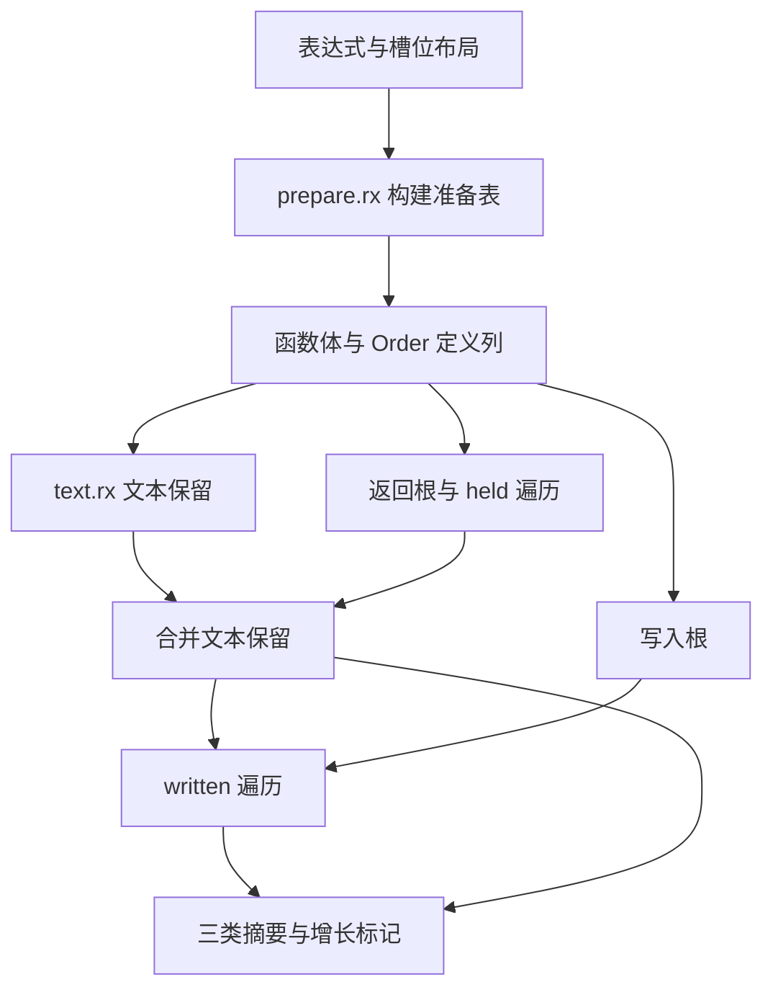
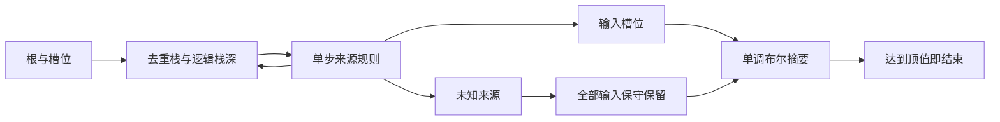

# 函数体输入来源分析自举

## Intent：最终目标

将 Flow 的函数体准备、返回输入来源、文本输入保留、更新写入来源和工作列表状态
迁入 RX/ZX。RX 显式编排阶段，ZX 实现内聚算法；保留普通 Zig 静态编译和零运行库边界。

本阶段逻辑迁移与正式接线完成。调用图固定点、缓存、线程调度及后续 Function 规则
仍是待迁移原生职责，不能据此宣称编译器或完整 Flow 已完成自举。

## Data：可用证据

### 实现与数据流

正式入口新增 prepare.rx、analyze.rx。Body 的前缀、变换元素映射和对象成员索引由
ZX 构建；analyze.rx 连接文本保留、返回来源、保留合并和写入来源。来源分派、根收集、
去重工作列表均为 ZX；旧算法仅留在 seed 引导路径，正式路径不调用旧来源规则。

保留递归函数的中间增长语义：held 遍历的自身调用读取本轮 reached；文本遍历读取
原始 held；written 遍历读取合并文本后的 held。其他被调用函数继续读取摘要矩阵。

Order 直接保留生成的定义列，删除列到原生 union 的全量转换；仍需旧接口的调用方
按需解码。原生桥只借用布局、发布结果、管理调用方 allocator 创建的复用 arena。
复制结果后才重置 arena，不让临时结果逃逸。

### 正确性与可运行结果

| 检查                                   | 实际结果                                                                     |
| -------------------------------------- | ---------------------------------------------------------------------------- |
| 真实语料逐次新旧对照                   | 1534 次函数体分析，210175 个表达式，113210 个输入槽位                        |
| 比较内容                               | 三类摘要、changed、槽位前缀、元素映射、每个对象的 canonical 成员映射全部一致 |
| seed 构建 stage1                       | 34/34 步成功                                                                 |
| stage1 构建 stage2、stage2 构建 stage3 | 各 16/16 步成功                                                              |
| stage2 与 stage3 可执行文件            | 均为 4144992 B，SHA256 相同                                                  |
| 阶段生成文件对照                       | 1912 个文件，仅输入身份文件 .zxc-inputs 不同，1911 个生成源码一致            |
| 上阶段与本阶段生成文件对照             | 同上，无额外文件                                                             |
| 正式 dist 安装                         | 26/26 步成功，根目录 CLI 已更新                                              |
| 相关现有回归                           | 369/371 项通过，245/248 构建步骤成功                                         |
| 修改源码格式与静态检查                 | 33 个文件通过；git diff --check 通过                                         |

阶段二、三与性能测量工具的 SHA256 均为：

`c2a0fe9493ca24d40e88579d2c84692e2cf40c67fb9166effc54fd2379b6bf88`

两项失败是 source/library 的既有 reverse 容量断言
“owned primitive map reverse avoids a second complete payload buffer”。source 路线
在上阶段 CLI 独立复现相同容量；library 路线已有上阶段失败记录，未另行回放。
未放宽断言。上阶段其余 16 项容量/别名失败未重跑，不宣称已修复。

另修正已有 initial ownership 检查器：优先检查实际 executeIn 函数，兼容 execute，
并将 zxRenew 识别为复制。八项旧失败均在上阶段原生算法基线复现；修正后相关检查
128/128 项、86/86 步通过。owned 仍要求无复制且有转移，shared 仍要求存在复制。
本阶段没有新增测试用例。

本地证据均位于 /tmp/zxc-flow/，不提交临时日志、探针和报告：

- final-oracle-summary.json、terminal-oracle-genz/：隔离语义对照，探针不进入仓库。
- final-fixedpoint.json、final-output-equivalence.json：阶段和全部源码对照。
- final-stage1.log、final-stage2.log、final-stage3.log、final-dist.log：构建记录。
- final-checks.log、shape-final-checks.log、baseline-shape-summary.json：回归与旧失败复现。
- final-source-checks.json：源码检查。

### 性能：固定累计基线与扩展语料分别记录

累计锚点固定为 ca03eb0011e3efd13221e1baefca7fcc10a1da77，不随提交重置；阶段基线
为 0bdf6f09595911824aad8bc028e366ca1cf82611。同源码、同工具链、同入口和缓存边界，
三轮交替运行，冷输出与函数缓存独立，热测量复用各自输出，关闭常驻服务。

固定 96 入口累计对照：

| 指标     |    固定锚点 |      上阶段 |      本阶段 |
| -------- | ----------: | ----------: | ----------: |
| 冷 CPU   |      4.16 s |      4.15 s |      4.18 s |
| 冷耗时   |  905.239 ms |  906.387 ms |  935.572 ms |
| 峰值 RSS | 421855232 B | 413384704 B | 408256512 B |
| 热 CPU   |      0.05 s |      0.05 s |      0.05 s |
| 热耗时   |   39.491 ms |   39.543 ms |   39.422 ms |

累计 CPU 增加 0.02 s、冷耗时增加 30.33 ms，位于用户接受容差边缘；单阶段 CPU
增加 0.03 s。峰值 RSS 降低约 13.6 MB。证据：performance-terminal/summary.json。

完整 102 入口对照：

| 指标     |      上阶段 |      本阶段 |      变化 |
| -------- | ----------: | ----------: | --------: |
| 冷 CPU   |      4.26 s |      4.30 s |   +0.04 s |
| 冷耗时   |  944.019 ms |  970.557 ms | +26.54 ms |
| 峰值 RSS | 426655744 B | 427606016 B | +950272 B |
| 热 CPU   |      0.05 s |      0.05 s |         0 |
| 热耗时   |   39.888 ms |   39.954 ms | +0.066 ms |

证据：performance-full/summary.json。旧累计锚点不支持扩展语料所需语法，不能伪造
102 入口的累计对照。固定 96 入口仍作为连续锚点，完整 102 入口额外暴露阶段成本。
不能将本阶段描述为所有路径性能持平，也不能将新增语料的 0.04 s 隐藏或清零。

初次迁移固定语料 CPU 为 4.32 s，经过以下实质优化降至 4.18 s：复用栈槽，避免每次
pop 收缩；对象 canonical 成员直接候选命中或二分定位；在摘要达到 lattice 顶值时
终止遍历。对象字段范围可能重叠，因此每个 payload 独立构建索引，前缀使用 u64；
二分保留零宽成员与非源码顺序语义。顶值早停只省略不可能增加任何摘要位的工作。

强制内联、静态转发列及早期成员循环调整没有可靠收益，均已撤回这些优化尝试。
细粒度探针明显增加耗时，只用调用次数定位，不把探针时间占比当作整轮 CPU 收益。
最终测量没有探针，测量工具与最终 stage2/3 哈希一致，不重复无变化的测量。

## Edges：边界与限制

- 本阶段在固定累计容差边缘收口，扩展语料仍有明确阶段开销；不宣称零退化。
  后续必须继续使用同一累计锚点、保留扩展场景，不能反复领取 0.02 s 或 0.1 s 预算。
- 调用图固定点、memo 哈希与缓存、线程资源管理、Function 分析仍待迁移；阶段产物
  一致不能代替最终正式入口传递依赖审计。
- 保留所有安全和所有权边界，不通过关闭检查、复制专用运行库或回调 seed 来提速。
- 语义对照覆盖当前真实语料，不构成任意 IR 的形式证明；未新增资源失败专项验证。
- 已知容量失败保持可见，不能以主体检查通过代替全仓库通过。

## Answer：交付与自我复核

交付正式 RX 阶段编排、ZX 准备与来源算法、最小原生生命周期桥、现有检查器修复和
本 IDEA 记录；按完整职责提交并推送 master。全量来源对照、正式 dist 与阶段固定点
已通过。性能从初次迁移的明显增长收敛到固定累计容差边缘，保留所有增长证据。

复核真实调用关系后，算法确已迁移，原生桥仍是过渡边界。不能把 Body 的完成延伸为
整个 Flow、Function 或编译器自举完成；后续优化和迁移均沿同一性能账本继续。
