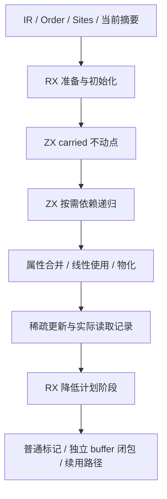
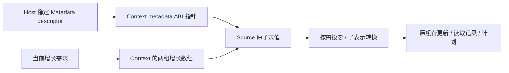
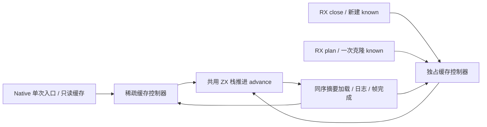
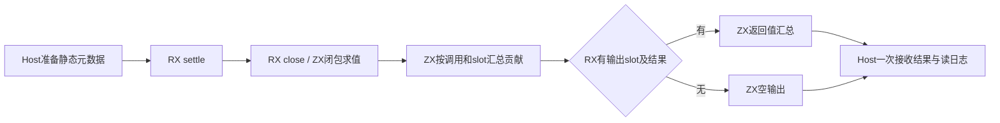

# 函数槽位求值器自举

## Intent：最终目标

将 Function 的按需槽位求值、缓存、循环 carried 最大不动点、完整降低计划与
汇总阶段的真实编排迁入 RX/ZX，保持原有行为和性能。先实现再优化，不撤回自举。完整职责通过验收后
使用英文规范提交并推送；通用增长优化 4ae0a2f5、空字面量优化 9d5a3296 已独立提交；Function 自举阶段尚未提交。

全编译器自举目标不变：所有自有语义与状态迁入 RX/ZX，最终必须做传递依赖审计
和 seed→stage1→stage2→stage3。该阶段不是完整自举完成的替代标准。

## Data：可用证据

当前实现、验证与全部失败实验记录见[实验记录](函数槽位求值器自举实验记录.md)。
该记录保留原始报告位置和反例，后续不要重试其中已经否定的同一假设。

2026-11-04：Function demand/trace与操作筛选已迁入ZX，RX编排操作/返回需求；
正式查询已去掉稀疏updates与Native逐查询桥，统一传递known新版本。113入口
2027/2027固定点一致，最新CPU约5.57s，仍高于约4.1s原生参照，尚未验收。
336项相关回归通过；50模块真实入口缓存/codec重链接及3份查询执行回放通过，
公开输入未被修改。通用shiftLeft/hash已单独提交并推送0218b5e1。
已取得members.zx的同输入分歧：两边19次level请求/值均相同，Source仍多两项
normalize；详细记录会改变触发，不能归因为已修复或简单packed字段写法。
完整证据和下一步见[具名默认函数与递归自举](ZX具名默认函数与递归自举.md)。
以下为引入递归前的原始对照与固定参照记录，不代表当前最终验收。

当前实际语料为 113 入口（清掉两个从未提交的临时汇总入口后）；计时显式
ZXC_RESIDENT_GENERATOR=0，Small配置，每样本新输出和缓存，测试/构建退出后
交错运行。固定累计锚点仍为ca03eb0011e3efd13221e1baefca7fcc10a1da77，未重置容差。

| 实现                             | 同输入三轮 CPU       | 中位数 |
| -------------------------------- | -------------------- | -----: |
| 仅Function使用原Native算法的参考 | 4.16 / 4.11 / 4.10 s | 4.11 s |
| 当前Source求值/计划/完整RX汇总   | 5.50 / 5.49 / 5.55 s | 5.50 s |

证据/tmp/zxc-function-levels/function-settlement-final-results.json。当前整项Function
迁移仍多1.39s CPU，未满足性能要求。该参考仅/tmp副本关闭Function的generated_analysis，
其余源码、生成内核、113入口及工具链相同；生产完整迁移保留。不能以本轮局部
两项优化的收益代替整项对照。首轮Native wall启动抖动，不报告其墙钟回退作为收益。

当前2010文件阶段固定点全部一致，但与原Native Function仍有两份Zig差异及清单
指纹差异；均已保留，不宣称产物兼容通过。现有Native边界/所有权/值返回回归
191/191步、363/363测试通过；之后只收掉未使用的内部入口与桥，清理后的完整
Source producer已构建并完成2010文件固定点验证。未安装CLI、未提交Function阶段。

## Edges：边界与限制

- 必须按依赖访问：Reference 可指向后生成的定义，不能按 ExprId 单次前向求值；
  当前用具名递归表达这项算法，不要求保留手工帧栈。
- 按需读取正在发布的原子摘要，保留孩子次序、缓存边界、物化和读取记录顺序。
- 不新增测试，不用浏览器；运行既有检查及真实语料 oracle。
- Zig 通过结构化 AST 与统一 printer 输出，不引入运行库或原始源码片段节点。
- Native ABI header、原生 Flow 总控、Function demand 及状态桥仍是过渡
  边界；Source 求值逻辑迁移有效，不代表这些职责已经完成。
- Metadata 目前由 Host 组装；后续移除桥时必须重新核验表示与性能，不能依赖
  Metadata 永远不被 Source 构造来宣称最终自举完成。
- 当前 oracle 稳定摘要并关闭其 Native 预分析并行，不替代生产并发回归。

## Answer：交付与成功标准

交付 Source 求值与计划、RX 真实编排、必要通用原语、正式接线及可复核证据。
须同时通过语义、生命周期、生产并发、产物、阶段链与固定累计性能；当前未达到
完整阶段标准，尚未安装或提交推送。

## 当前保留的实现

1. Source 按需求值已改为具名递归与稀疏 updates，known/carried 保持只读输入；
   旧帧栈实现暂留核对，能力和性能均未收口。
2. close.rx 显式连接 repetitions、initialize、settle；plan.rx 连接普通标记、
   独立 buffer 闭包与 renewals。原生只传输 header、发布标量和拥有最终输出。
3. Source 共用 optional scalar 分类；普通 ABI 只读局部别名保持受限门禁。
4. 私有循环赋值先完整求 RHS、快照所有有语义叶字段，再写回，不搬运整份状态。
5. columns.borrow 保留真实且稳定的 ABI origin，原 view 的快照语义不变；借用
   重建只发生在 origin 为空时，局部 header 存储覆盖整个同步调用。
6. Knowledge meet 直接处理枚举，避免与三布尔 Level 反复转换，保持同一代数。
7. frozen 只对未构造 object 自身保留引用，子类型保留各自表示。公开、原生、
   Task、Store、identity、duplicate 深闭包不放松；Source/seed 同时补记 Parallel
   构造事实。旧 written 固定点 helper 已删除。
8. Context 分为固定 Metadata 与 normalized/renewed。Borrowed 自身持有真实
   metadata、layout、usage、descriptor，init 后不得移动；修改 Context 的 Source
   对象表达式清除根 origin，未修改 Metadata 指针继续有效。

## 已完成的当前候选验证

- metadata-stage2-candidate 完整编译通过；三 Native 适配点也成功编译 stage1 旧
  按值表示，实际覆盖指针/值两类引导输入。
- metadata-output-comparison.json：1,996 个非指纹产物固定点全部一致。
- metadata-oracle-full.log：1,854 计划、223,304 标记、40 续用路径、2,728,135
  读取、3,712,229 查询和 11,314 闭包与参考一致。
- metadata-related-checks-fixed.log：366/366 步、558/558 项通过，覆盖值边界、
  字段所有权、值返回、缓存、ZX Task 与 RX Parallel。
- header 生命周期只读审查未发现逃逸：append 拷贝列/字符串；shared_state 在
  函数内消费 request 并深复制 segments；plan 不保存临时 State header。
- git diff --check 通过。CLI 旧安装 formatter 不认识现有 import type 别名；
  没有为旧工具改契约，正式 generator 内建源码校验已通过。

## 明确不保留的最近尝试

| 尝试                            | 结果与决定                           |
| ------------------------------- | ------------------------------------ |
| 叶节点重复 index 复用           | 8.34→8.37 s，恢复原源码              |
| 热点私有指针入参                | 临时 8.34→8.25 s，不扩展生产调用约定 |
| aggregate/projection 收窄输入   | 8.25→8.80 s，四文件按字节恢复        |
| query 临时栈分配器              | 8.20→8.24 s，不进入生产              |
| bounds/overflow cold hint       | 8.28→8.29 s，不扩展 AST/打印器       |
| 52 B ABI Frame 行改 64 B 私有行 | 6.71→6.80 s，RSS 增，不推广生成器    |

私有行探针虽有 1,996 产物一致证据，但没有性能收益。其余早期分类缓存、额外
内联、局部输入别名、fused/direct 状态机、padding 等失败证据均在实验记录中。

## 当前执行与下一步

当前保留 Source 求值/完整计划与 Metadata/借用/缓存复用优化。最新独立优化
候选为空列表字面量，已减少 CPU，尚待相关现有回归和 oracle 收口。4ae0a2f5
列表增长优化已推送；下面的实验细节按时间保留，不能把历史“正在运行”当成
当前仍在运行的证据。

最终阶段链、固定 96 入口累计对照、正式 CLI 安装和完整自举依赖审计仍未完成。

## 当前候选重新采样与增长检查

metadata-profile 已完成；独立 Mach 采样 1,954 点中 evaluate 为 243，memcpy 为
132。evaluate 机器码实际为 9,052 B，原枚举候选为 17,040 B；不把样本比例换算
为精确 CPU 占比。证据 metadata-mach-full.log、metadata-mach-summary.json、
metadata-evaluate-asm.txt。

新成本在 zxReserve：54 个函数内 PC 样本，另有调用序言/尾声与 header 检查的
outlined 样本（7481 48、5525 22、3587 22、715 19）；unknowns 自身 41，
其恢复寄存器的 outlined 尾声另有 33。该证据指向每次原地 append 仍调用含分配
慢路径的函数，不再归因为整份 Metadata 复制。

已按结构化 AST 实现 inline zxReserve 的复用检查与普通 zxAllocate 的分配/复制
分离；条件、count=0、header 对齐、OOM与旧快照保护保持原状。只读审查无具体
偏差，声明聚合没有依赖原数组长度 4 的其他入口。producer 构建通过，正在生成
候选；尚无新收益结论，不因强制 inline 本身宣称改进。

增长拆分候选已构建，1,996 个非指纹产物固定点一致。相同输入、无后台构建的
三轮 CPU：原 Metadata 6.73 / 6.66 / 6.74 s，拆分后 5.87 / 5.92 / 5.95 s，
中位数 6.73→5.92 s；墙钟中位数约 1265→1151 ms。RSS 范围重叠，中位约
429.7→437.7 MB，不由单一峰值解释泄漏。证据 reserve-split-paired-results.json、
reserve-split-output-comparison.json。生成差异仅 types.zig 与 .zxc-files 内容索引。

随后核对发现 utils.map 仍按既定规则降为 push loop，不能直接声称“改成map就
一次分配”；未实施原先设想的 map/slice 改写。实际更直接的 Source 职责是让
settle 清空上一轮 known，而不是按长度重建另一个增长列表。已添加 invalidate
原子循环，用普通字段索引赋值重置缓存；正常 Source 所有权规则负责保留快照，
不放宽借用写入。initialize 仍保留首次 unknowns 分配。正在验证真实生成形态，
若仍整表复制或无收益，不以“看起来复用”宣称达标。

## 缓存清空候选的具体证据

缓存清空候选已构建通过，生成模块直接逐项写原 known；没有 reserve、renew 或
分配。候选再次生成同一语料后，1,997 个非指纹产物完全一致，证据
invalidate-output-comparison.json。只读审查确认当前私有调用链没有随后读取旧
known 的消费者；initialize 本次新建缓冲区，settle 的循环上下文虽保留输入 State，
实际只读取 context/repetitions。该结论不替代后续新增快照消费者时的所有权检查。

六项受影响的现有增长/所有权检查正由 packages/test 运行，句柄 12161；首次误在
compiler 包执行时没有该 step，并未实际运行测试，修正后的日志为
invalidate-growth-related-checks-fixed.log。语义 oracle 正按句柄 97721 构建。
待这些构建退出后再运行交错的 Source/原生计时，避免构建负载污染。

语义 oracle 已通过：1,855 plans、223,337 flags、40 renewals、2,728,135 reads、
3,712,234 queries、11,317 closures 一致（invalidate-oracle-full.log）。
当前回归发现 reverse-capacity 两项失败与 iterate-buffer 的分配量等值失败。
reverse 已用旧 helper 对照生成并执行同一现有测试，旧新都分配 79,096 B、
容量 79,024 B；应用生成源码完全相同，只有 ABI 中 reserve 拆分不同，因而不是
此次 helper 拆分引入，但仍属于待处理的历史分配门禁，不能记为全部通过。
正在核验 iterate 对照；当前未进行正式计时。

分配对照的进一步结论：旧 CLI 的 flat/branch/switch/two_fields 同样分别为
8,448→6,534 B、26,944→22,398 B，direct 的现有断言通过。它们不能证明每轮
发生列表复制，生成代码的循环内没有 renew/alloc；Arena backing 总量相等不是
列表复制量相等。reverse 产物也已直接原地 reverse，空间来自 map 的逐项 push。
更紧总空间需要通用的已知长度 append 循环容量规划，不能按 fixture 特判。

branch 未写入时却入口提前 renew 则是真实旧缺口（count≤3 或 enabled=false），
不能删除保持输入指针的断言。该问题位于唯一性准备与实际首写之间，须以通用
语义单独解决。当前不修改测试、不用历史共同失败冒充本阶段通过。

现有回归已经结束：447/455 steps、798/806 tests，8 个失败对应 reverse 的两条
容量断言、iterate 的四条 Arena 字节等值断言与 branch 两条未写入身份断言。
loop-call 的带调试输出 w 行不是测试失败；四个其他 step 成功。源于当前整体
状态的未解决项仍明确保留，不将 806 项标为全通过。

无后台构建的三轮交错计时：原 split 5.99 / 5.94 / 5.89 s，invalidate 为
5.86 / 5.87 / 5.83 s，原生为 4.32 / 4.31 / 4.30 s；CPU 中位数
5.94→5.86 s，小幅收益约 0.08 s，距原生仍约 1.55 s。证据
invalidate-paired-results.json。新候选墙钟中位数 1151 ms、RSS 中位约
439 MB；不声称有稳定 RSS 改善。仍继续优化、未提交 Function 阶段。

列表增长优化已作为完整独立职责提交 4ae0a2f5（perf(genz): inline list buffer reuse checks），仅含 growth.zig，未夹带未验收的 Function 迁移。提交前钩子格式化通过。已成功推送 origin/master（ecf62771→4ae0a2f5）。

新采样 invalidate-mach-summary.json 显示 evaluate 254 个 PC、memcpy 188、
aggregate 49、index 40；原 reserve 序言热点消退。evaluate 机器码约 9,648 B，
栈约 4.6 KiB，热点分布在 Frame 准备、更新列表 append 与状态回写，仍需根据
具体动态成本决定下一项改动，不能用未验证的预分类或缓存重试代替诊断。

旧 CLI 的 branch 完整 6 项现有检查也已独立结束：3 通过、3 失败，精确复现
首写两项输入指针失败及分配字节等值失败（iterate-before-branch-full.log）。
不是仅凭静态阅读推断其历史存在。

本轮属于实际进展：保留 Source 缓存复用并取得完整 oracle/固定点证据，完成
独立增长优化提交和推送；全目标保持 active，Function 自举的约 1.55 s CPU 差距
与完整阶段链、累计固定锚点门禁仍未消除。下一步应从新样本和生成循环的动态
工作量选择改动；不得复跑旧预分类/整表缓存尝试而不说明新证据如何消除其失败原因。

## 先查缓存，再准备 Frame

本轮复用既有动态计数：约 3,800 万 lookup 中 146 万直接命中 known；min/max
过滤已省去约 89% 无效扫描，不再重测同一范围或新增查找索引。新假设来自当前
evaluate 的 Frame 准备热点：step 在查询缓存之前先选择/构造完整 Frame，而该
路径只需要 Request 的 node/slot/raw。将纯缓存查询移到 Frame 准备前，命中时
直接返回；未命中才准备帧。请求数、index 次数、孩子顺序与摘要读取时机不变。
这不同于已失败的 kind 预分类或整表 instruction 缓存，没有增加字段与预处理。

cache-first-generated 已生成；只改 step.zx，候选按原句柄等待构建。验收先检查
同输入产物与实际 CPU，有收益才保留；不因源码看起来简洁就声称性能通过。

cache-first 候选完成：1,997 个非指纹产物固定点一致；三轮交错 CPU 基线
5.89 / 5.84 / 5.84 s、候选 5.82 / 5.81 / 6.00 s，中位 5.84→5.82，
区间重叠，没有稳定收益，已按备份原字节恢复 step.zx。证据
cache-first-paired-results.json。该重排不再重试，也不为它扩展回归或 ABI。

下一步检查私有 Frame/Walk 等只在值表示之间流动的类型，是否仍携带无法使用的
ABI origin 字段。目标是证明字段不可观察后消除无用状态，而不是此前已失败的
ABI 数组 52 B 改 64 B 或仅对齐 padding。先做隔离形态与成本证据，不直接
放松表示转换、公开接口或身份约束。

Frame origin 恒 null 探针：编译通过、1,997 个产物一致；CPU 5.85→5.82 s，
区间重叠，未推广。随后仅 /tmp 扩到同类 Walk/Step/Environment 的自身 origin；
4 型闭合调用链只读审查均无非空来源，子对象 origin 不消除。新探针已构建，
不按类型名称将此规则写入生产。

## 独占缓存与稀疏更新的职责边界

Intent：消除 Source 内部查询不必要的稀疏 updates 和重复列表增长，维持原生
单次入口的只读快照语义；不回撤迁移。Data：plan.initialize 已 map 克隆 known
一次，close.initialize 新建 known；二者内部查询均可消费当前版本。历史 fullState
失败在公开单次入口被反复复制整表，不代表私有独占路径也必须走 sparse。
Edges：推进孩子、完成父帧、动态摘要加载与读取日志只保留一份算法；不引入
运行时策略/动态分派、专用原生原语、重置后的性能基线或无界隐藏修改。
Answer：共用 advance 原子状态机，sparse 控制器继续服务 Native 单次查询，dense
控制器仅服务已拥有缓存的 Source close/plan。先证明生成 .with 原地写且不逐次
复制，再做 oracle、产物和受影响性能验收；在后续 Native 批次职责迁移后移除
临时 sparse 入口。

共用 advance、sparse/dense 控制器及 Source close/plan 接线已实现，生成通过：
112 entries / 1,996 modules。关键形态已证实：dense.step 无 dupe、无 renew，
known.with 实际为 @constCast 原地索引写；dense.evaluate 也没有循环入口 renew。
私有路径没有逐查询克隆 known，保护 Native 单次输入的 sparse 路径继续存在。
原 apply helper 已无消费者并删除。完整候选正在构建，尚不声明收益或正确性
验收通过。

4 型 origin 探针最终 CPU 5.87→5.77 s、1,997 产物一致（originless-walk-paired-
results.json），说明有小幅成本，但生产推广还需通用来源分析。当前优先解决更
根本的内部稀疏策略开销，不按私有类型名称固化此探针；全部修改仅保留在 /tmp。

候选与 oracle 均已构建并成功执行。2,000 个非指纹产物固定点一致；oracle
1,858 plans / 223,470 flags / 40 renewals / 2,736,685 reads / 3,722,762 queries /
11,348 closures 全部一致。证据 dense-output-comparison.json、dense-oracle-full.log。
最初 Transition 同时含 Cursor 和 completed Request，触发 Request 重复类型的
保守装箱，Native 入口编译暴露了表示变化；已把完成信息改为 node?/slot/raw
标量，恢复请求值表示，没有新增 Native 兼容层或放松 identity 规则。

正式两候选交错计时正运行，构建和 oracle 均已退出；计时前 Source 已冻结。

正式交错 CPU：原 invalidate 5.86 / 5.83 / 5.84 s，dense 为 6.55 / 6.55 /
6.56 s（dense-paired-results.json），明显退化，当前不能验收。原地写入形态
不足以证明整个策略更快。保留功能先定位新成本：共用 advance 现在有两个
调用者，Small 的函数共享可能增加大量状态传递。仅 /tmp/dense-inline-generated
将 advance.callValue 标为 inline 做单因素探针，生产不加入路径特例或广泛
内联规则；同时构建本候选带符号版本，若探针无收益则据新采样调整。

带符号采样证实 advance 保留独立函数，313 个 PC 命中，新增状态传递确实存在；
没有额外堆装箱或 known COW。只强制内联 advance 后，三轮对照中位数
原5.82 / dense6.54 / inline6.24 s，仍退化（dense-inline-paired-results.json），
2,000 产物一致。此优化重构已恢复为 dense-before-source 的原字节版本，删除
仅本尝试新增的 Cursor/advance/dense/sparse 文件，保留完整原 RX/ZX 求值迁移。
不会继续通过内联规则、兼容层或类型特例修补这个失败策略。

下一项成本是字面量空列表：当前每次查询创建 pending/indices/values，需核对
生成代码是否仍调用 allocator.dupe(empty)。只有证实通用空值可直接打印且保持
空列表的身份、错误及 header 约束，才做最小生成器改动。

已确认普通 aggregate.sequenceMode 对空列表仍调用 allocator.dupe；本地成熟
iteration_value/list.zig 已对空列表直接打印地址。Zig 0.17 Allocator.allocBytesAligned
在 byte_count=0 时直接返回空指针标记，不分配或失败，free 的 len=0 同样直接
返回。当前最小改动使普通空字面量采用现有深值路径的静态空数组，非空仍 dupe；
private list headered=false 与首个 push 的新缓冲规则不变，全部由结构化 AST 打印。
producer 已构建通过，正在生成候选。尚无新性能或语义验收结论。

只读审查确认空字面量没有具体安全反例：无元素存储、正确对齐、header=false，
列表不支持身份比较；自定义 Native 可读取ptr，但未见要求保留 allocator 空哨兵
数值的契约。描述必须准确：旧 dupe(empty) 没有实际 heap 分配，本改动消除的是
函数调用及处理路径，不是减少实际空列表分配字节。候选已构建通过。

空值候选已完成固定点：1,997 个非指纹产物一致，368 个 Source 生成文件的
变化仅属空字面量路径。三轮 CPU 基线 5.94 / 5.84 / 5.78 s，候选
5.63 / 5.69 / 5.67 s，中位 5.84→5.67 s（empty-paired-results.json）；
墙钟中位约 1135→1109 ms，RSS 范围重叠，不声称稳定内存下降。保留此最小
改动，正在补跑现有 object append / cached ownership / Native value boundary /
value return 检查与完整 oracle；未新增测试。通过后作为独立生成职责提交。

空字面量最终验收通过：268/268 steps、555/555 tests，覆盖 object append、
cached ownership、Native value boundary、value return；完整 oracle 为
1,855 plans / 223,337 flags / 40 renewals / 2,728,135 reads / 3,712,234 queries /
11,317 closures 一致。证据 empty-related-checks.log、empty-oracle-full.log。
已独立提交并推送 9d5a3296，提交前格式化通过。未夹带 Function
迁移或临时探针。先前八项共同失败仍另记，555 项通过不覆盖或解决它们。

本轮实际进展：完成通用空字面量生成改动、实测和已有回归验收，并提交；排除
cache-first、共同 dense 控制器和仅内联 advance 的失败方向。私有 origin 的
临时探针有约 0.10 s 收益但尚无生产通用来源分析，不作为已实现功能。全目标
继续 active，尚未完成 Function 阶段、seed 链、固定锚点门禁和完整依赖迁移。

## 输出与参数贡献的真实迁移

Intent：将 Function.output 与 arguments 的完整循环、合并和发布时机迁入 RX/ZX，
不只搬一条计算。Data：三个正式调用点中两个主线程路径会立即合并 inputs，
Ahead 路径 deferred=true 仅收集贡献。递归输入可能在后续槽位被读取，不能把
普通路径改为全部计算后统一提交。原 Source query 迁到 levels/query 供 plan 与
summary 共用，算法不复制。

Edges：新增的是通用 std:bytes.AtomicRows 借用资源及带边界检查的单字节原子
load/store，不承载编译器语义、不复制字节；行形状与描述符在调用中稳定。Host
明确提供可写行，Source 不能把普通不可变字面量变成可写内存。窄化 u8 通过
通用 std:integer.narrowByte。Native 临时保留 ABI header、工作队列容器发布，
不把这些过渡状态桥计为完整自举。无新测试，使用既有回归和扩展 oracle。

Answer：RX 初始化独立缓存再调用 ZX 汇总核；参数逐槽 query→meet→原子store→
changed，deferred 分支跳过发布。完整贯通普通/递归/延迟模式、并发读取、
日志/贡献顺序、缓存和产物后验收，仍受累计固定性能锚点约束。

输出汇总与普通/延迟贡献核已落到 Source，共用 query 已移到 levels 下；没有
新增 Native 合并规则。接线中发现已有 opaque 访问器禁止标注 concurrent，
保持该硬约束，四个 AtomicRows 访问器不作 Source 并发承诺。当前调用不经过
Source Parallel；Native Ahead 的 deferred 分支只读稳定行形状，底层单元访问
为原子操作。Host 仍须保证表形状与描述符生命周期。最终若把 Ahead 调度迁入
Source Parallel，必须先补通用共享资源能力证明，不能据此视为并发自举完成。

首次 Native 接线编译揭示 opaque ABI 是擦除后的引用，不能按实际 struct 初始化。
已按既有 Host reference ABI 处理：AtomicRows 绑定稳定的可写二维 byte-slice
描述符地址，std 访问器仅恢复通用 slice 视图；Host 直接借用 summaries.input
现有描述符，不另建包装结构或复制行。没有给 genz 引入 std 模块反向依赖。
Byte 单元的尺寸/对齐与 Level 现有原子 load/store 表示一致。

无查询短路已在 RX 显式表达：无 call 时 arguments 直接返回原 known；无 return
或零输出槽时 outputs 仅构建所需空/None 结果，不复制 known。调用筛选保留
原 operations 顺序。仅真正进入查询核时 snapshot；不未经证明共享可写缓存。

114 入口、2,002 模块的新候选 Native 构建和实际生成均通过。与同源旧控制
summary-producer 的 2,014 个非输入指纹文件对照，有两个 Zig 文件出现额外
renew/copy（以及清单指纹变化）；不能据生成成功或大多数文件一致验收。
串行逐步 oracle 已核对 7,223 次 outputs/arguments 的值、known、发布读取日志、
贡献、changed 顺序及发布后输入；1,866 plans / 224,018 flags / 40 renewals /
2,730,249 reads / 3,714,398 queries / 11,354 closures 一致。
该版本关闭 Ahead，deferred 覆盖为零；正补同一真实语料的独立 deferred 分叉
对照，并刷新 oracle 中与对照无关的生产文件，避免陈旧副本污染产物比较。
现阶段只证明串行控制语义，不能声称并行产物或性能已通过。

刷新 oracle 非插桩文件后，串行产物完整 2,014/2,014 一致。额外独立 deferred
分叉在真实语料中也完成 7,223 组参数与输出对照，合计 7,417,121 queries、
5,455,971 reads，一致。未通过并发计时去替代值/日志/缓存逐项核对。
发现旧 Ahead 确定缺口：unit.analyze 已完成 close 才设置 reads 指针，close
得到的 known/carried 可在后续命中缓存，导致当时读取的 Input/Output 不在
最终 read-set 内；dirty 不替代 take 的 read-set 校验。已通过可空日志参数将
记录时机提前到 Function 构造、close 之前，串行与 planned 路径仍传 null。
需要实测证明此缺口与两份产物差异的因果关系，不能仅按推测报告已解决。

提前记录 close 后，两个并行产物差异仍存在，不能归因为已找到的唯一缺口。
同样采用修复后记录时机、但使用旧 Native 汇总循环的对照与串行 2,014 文件
全部一致，差异仍随新汇总及其时序出现。临时并行 oracle 将每次实际读取的值
冻结给旧循环重算（同一单元读出不同值则不作为稳定比较），16,162 次通过、
4 次不稳定跳过。此结果排除稳定读取条件下的局部值/日志/缓存差异；进一步
在 Ahead.take 接受结果后、主线程提交前用当前完整状态重算，核对真正被接受
的贡献、输出、marks、grew 和增长集合。所有插桩仅 /tmp，不进入生产路径。

接受点重算及主线程立即发布独立快照对照也通过：take oracle 34,350 次、
含立即模式 oracle 34,476 次，无不稳定跳过。插桩后的完整并行产物同样
2,014/2,014 一致；未插桩候选仍存在两个差异，说明插桩已改变触发条件。
不继续堆更重的对照：下一步单独切换输出汇总/参数汇总以定位最小差异路径，
生产继续保留完整迁移。计时尚未开始，避免在构建/插桩同时运行时取无效数据。

单因素定位：只启用 Source.output 与只在普通路径启用 Source.arguments，
各自完整产物 2,014/2,014 一致；差异随后台 deferred Source.arguments 出现。
正式无插桩三轮对照已完成（summary-paired-results.json）：使用相同 114 输入、
记录修复、工具链及 fresh cache/output，Native 控制 CPU 中位约 5.61 s，
完整 Source 中位约 5.87 s，约 +0.26 s，不满足性能要求。尚不能提交本迁移。
正在记录串行提交事件的键/结果指纹，用首次不同事件定位真实全局差异；
不继续重复已经通过的逐次局部求值对照。此前累计固定锚点仍有效、未重置。

轻量提交事件记录成功保留差异。两版各 16,989 个事件，首次分歧在7405：
Demand fn884、相同缓存键869c1c71…，Source后台结果新增normalized=2且
marks=0；对应 compiled/validation/exports/members.zx。全部前序settled值
及顺序一致，避免误把“随新Summary时序出现”当成其贡献值错误。
此函数无自调用、输出bool，marks=0，排除本次deferred发布分支语义差异。
Source close在实际读值冻结条件下比较record=true/false，10,339组known与
carried一致（summary-close-oracle-full.log）。接下来核对Demand中单次level
在两种记录模式下是否仍保持事实与缓存一致；没有重跑先前相同的完整oracle。

Demand 单次level的record true/false对照9,948次通过，排除日志开关改变
该路径数学事实。尝试Demand去掉Ahead、按原工作队列顺序执行，完整产物仍
保留相同两个差异，未解决问题，已恢复原Root字节版本，未撤回RX/ZX实现。
此次对照基线拷贝时Zig已截断输出文件，得到空可执行文件，相关
summary-ordered-paired-results.json整组无效，不报告CPU收益；任务专用脚本
后续应同时验证文件非空与bootstrap阶段摘要，不能只接受exit0。

当前不能断言Ahead协议是根因。第一差异只是发生在需求阶段；相同输出摘要
不能证明Sites等静态事实相同。下一步在首次分歧事件记录Sites.states与plan列
指纹，对齐实际输入。已有record/闭包/局部汇总对照不再重复执行。

两份轻量facts trace均保留差异，3,800个Demand提交的Sites.states及plan所有
标量列指纹完全一致。首次7405两版origin均为Ahead，不是主线程与后台选择
不同；原先对origin的猜测被否定。当前进一步给Ahead.Demanded增加仅临时诊断
字段，记录需求规则执行前的input、全output、known、carried四项指纹，再在
接受点统一打印，避免逐查询重算改变触发。脚本build-summary-start-trace.py。
生产Root已恢复原调度，未保留顺序实验。summary-candidate二进制仍是该已放弃
顺序实验的版本，后续正式构建必须从当前源码重新构建，不能误作生产候选。

首次7405两版起始input、全部output、known、carried指纹也完全一致；
8358（core/symbol_table/append）相同。差异发生在同样的闭包事实之后。
尚未覆盖的直接输入为Function.operations及动态plural demands。新Summary
筛选operations，而Demand重用该列表，因此下一步先验证筛选没有意外改变
原列表：将operations内容加入已证明相同的carried指纹后再比较。未声称根因。

最后一轮上下文快照补齐了实际rows、Expressions、Order nodes/regions/edges/
definitions/def_loop/repeated/parents/concurrent、Slots与完整类型表、symbols、
held/written/effects、grew、traced初态与两张增长map，7405处也全部相同。
动态需求的found.reads fn74 slot0=2且当前=2，完整encoded字节、callee列表
{74,86,0}也一致。继续堆全程序hash已不能缩小问题，转为单查询快照重放。
添加Function规则记录会让Native控制也新增两个normalize，差异消失；这不是
修复证据。State根origin的正常链全为null、Frame row_value也明确清origin，
不凭猜测修改这些契约或把origin全局关闭。

已得到3份真正冷查询45/57/67的普通ABI输入，约6MB，全部位于
/tmp/zxc-function-levels/query-snapshots-source。query-capture和query-replay
均构建并实际运行成功。查询67独立重放在Arena/SMP两种allocator均为Deferred4，
更新索引192/199/200/201/233的值均为Deferred，输入前后JSON完全不变。
后续用此最小重放路径定位求值/快照/别名，不重复完整编译器的大型局部oracle。
生产没有加入任何快照、按文件匹配或专用诊断逻辑；全部工具和数据仅/tmp。

std字节原语作为可独立消费的完整通用职责收口：保留现有bytes接口，新添单字节
原子读、Host借用二维可写字节行的显式opaque接口、边界检查与u8窄化。它不包含
编译器规则或自有状态，不分配/复制资源，不作opaque并发能力承诺。正在跑已有
Native引用IR及值边界检查；不把这个独立标准库交付计作Function迁移验收。

## 本次交付与能力核对

Intent：先区分语言能力缺口、生成质量缺陷和实现错误；确认必要能力之后再收口
Function 迁移，保持已有实现，不以额外原生桥或复制代替通用语言能力。

Data：seed 临时 IR 只传共享类型表而遗漏原生模块 owner 表，现已一并传递；
原有 Native 引用 IR 与值边界检查 49/49 步、62/62 测试全部通过。
修复 167cee2d 和通用 std 字节原语 fd2e0740 均已推送 master。
日志 /tmp/zxc-function-levels/summary-native-boundary-fixed.log。
两项不改变既有算法，不额外重复计时；这些证据不覆盖尚未验收的 Function 迁移。

Edges：普通 ZX 输入不可变、集合具有值语义，不直接照搬 Zig 可变指针代码。
已具备的 loop、工作栈、枚举、列表复用与静态 ABI 不重复发明语法。Host 原子
共享行用显式通用 std 契约；专用 Function 元数据与状态桥仍是待移除过渡。
map(identity) 克隆缓存确实存在，但其是否为必要快照、是否触发额外逐次复制，
必须看生命周期和生成语句，不能未经证明就宣称语言缺少 move 或可变引用。

Answer：按“原实现语义/成本 → ZX 表达 → 实际 Zig → 缺口归类 → 修复与验收”
核对当前职责；通用能力可独立交付，整项迁移仍需并发正确性、产物及累计性能证据。
query-capture 的完整 Source 产物 members 指纹为 b9d44e383e908a27，与 Native
控制相同；插桩会改变触发条件，单查询快照不能直接当作未插桩失败现场。
其查询45/57/67独立重放均为 Deferred4，输入未变；不再据此推断生产 trace 必然
新增 normalize。当前两处差异的根因仍未证实，不归为正常迁移代价。

能力核对后的实际修正：summary/initialize 与 plan/initialize 的缓存复制使用已有
空列表 concat。map(identity) 原生成逐项 push/reserve，concat 版本已生成一次
reserve + memcpy，保留普通值语义、类型和独占新缓冲区，不新增语法或原生桥。
summary-bulk-generation.log 完整 114 入口生成通过；正在构建相同原生源码、
不同生成内核的 before/after，再集中比较实际输出与成本。尚无性能收益结论。

packed Level 诊断已完成：/tmp 中 trace/normalize 改为一次完整构造，Source
members 指纹仍1c64c3356a406a81、Native控制仍b9d44e383e908a27，差异未消除。
不将部分位写入猜测变成生产修复；该实验不再重复。

## 函数汇总的完整 RX 编排

Intent：将一次 settlement 的 close → 参数贡献 → 返回值汇总保持在同一个 RX/ZX
调用链，减少 Native ABI 往返；由 RX 显式表达阶段依赖与无结果短路。

Data：缓存批量复制隔离内核只改变两个初始化模块、types错误集和清单；三轮
CPU中位5.85→5.69s，全部2014产物一致。首轮wall分别3.96/1.70s，明显启动抖动，
不据此报告墙钟收益；后两轮约1.13→1.11s。报告summary-bulk-paired-results.json。
现有公共executeValue桥将私有列表包装展开为slice，再以headered=false进入下次
调用；独立arguments/outputs因只读输入需重新取得可更新缓存。

Edges：普通ZX输入仍不可变，不新增owned输入或隐式共享可变引用。Source close
创建缓存，贡献与输出阶段接续唯一新版本。所有原子摘要读取保留日志，普通模式
按callee/slot顺序即时发布，后台模式仍只收集；原生桥仅适配一次完整调用。
现有独立求值/汇总入口保留兼容，不代表最终Native依赖已清除。

Answer：增加settle.rx、接通主线程/后台/重放三条settled路径；初始化与close
拆开，让真实编排属于RX。完整产物、已有回归、阶段链及累计性能仍须验收。

完整 settlement 第一版已生成/构建/运行，115入口共2017产物与原分段Source完全
一致；并发正确性差异仍保留，未据“改为RX”宣称解决。实际emit从约462ms升至
1659ms（两次生成并行运行，不能作为正式性能比较，但足以提示额外工作）。
发现阶段context仍携带整个State，RX后续空输出还引用close原State，迫使缓存
快照跨更新保留。按真实读取收窄ArgumentSource/ReturnSource只携带carried，
known与reads只通过Working接续；empty_output只接受count并返回levels。
这不是新增所有权语法，而是去除不需要的旧版本引用，下一版检查真实生成形态。

收窄版 settlement 已完整生成、构建及真实运行；2017/2017 产物与相同115入口的
旧分段流程一致。正式交错三轮CPU before5.64/5.64/5.65、after5.53/5.52/5.76s，
中位5.64→5.53s。after末轮有抖动，不将单次最佳值当收益；报告
summary-settlement-paired-results.json、summary-settlement-narrow-comparison.json。
该对照只证明本次完整RX编排改进，不替代原Native evaluator及固定累计锚点验收。
目前正在运行已有Native引用/值边界/字段所有权/缓存所有权/值返回五项回归。

现有五项回归完成：191/191步、363/363测试通过，日志
summary-settlement-related-checks.log。完整RX汇总保留，未撤回功能。
已收掉从未提交的分段arguments/returns入口及其缓存克隆helper，删除对应Native
桥和构建入口；Native旧输出/贡献算法仅供seed分支使用，不保留重复Source入口。
根清单现为113入口，已用前版Source producer完整生成下一阶段；正在构建清理后
Source producer与仅Function回到旧Native算法的参考，以区分整项Function迁移的
成本。此临时参考只在/tmp，不更改或撤回生产实现。清理后的阶段链待比对。

最终边界核对：仅Function改回旧Native算法的参考构建成功；113入口三轮
Native4.16/4.11/4.10s、Source5.50/5.49/5.55s，整项差1.39s仍未达标。
同轮2010产物中2007相同，仍是members/append两份Zig和.zxc-files不同，不能
以局部汇总增量接近零取代完整Function阶段验收。当前Source固定点2010/2010
一致，只证明阶段稳定，不消除与参考的差异。

自我复核：本轮有效成果为复用concat批量复制、完整RX汇总及删除临时桥，
同时取得现有回归和固定点证据；未证明全部Function语义等价，也未证明无性能
回退。后续先对当前整项1.39s差额重新定位受影响热点，复用旧实验否定结论，
不重复全上下文hash或同一逐查询oracle；仍需解决两处额外增长复制的根因。

## 当前热点与输入借用修正

Intent：以当前完整汇总路径的热点决定下一步，不重复旧全表hash或已否定的
Context输入收窄实验；保留完整自举。

Data：系统sample在目标退出后超时，未得到样本，不据其下结论。复用/tmp已有
Mach线程采样器，对本轮带符号构建取得1709个PC/LR样本，热点为evaluate、
aggregate、index与memcpy。采样只定位，不当作CPU收益。报告
summary-settlement-mach-summary.json。

聚合/投影只返回子查询Request，不再传回整份Frame；与旧实验“缩小1120B
Context输入”不同，本轮保持Context、去掉Frame往返。三轮CPU5.56/5.53/5.52
→5.38/5.28/5.33s，中位5.53→5.33；2010/2010产物一致。首轮after墙钟启动
抖动3.12s，不宣称稳定墙钟收益。报告child-selection-paired-results.json、
child-selection-comparison.json。生产保留该语义职责收窄。

Edges：aggregate入口实际有Expressions整份约1408B复制；局部expressions除字段
投影外还作为只读实参交给object_member，旧projected-only判定因此未借用。
修正限定state_active、无需私有表示的ABI对象，且来源仅为函数不可变输入符号0
上的field/tuple_field/optional_value路径。不接受列表索引、普通局部别名或
可变loop状态根；不扩大已失败的广泛局部借用试验。输入ABI描述符在同步调用内
不可变并有效，跳过快照保留同一只读指针，不改变对象/集合值语义。

Answer：先构建新producer，再生成新内核，确认整表复制真正消失；随后对受影响
路径做产物/性能及现有借用边界回归。当前还不能报告这项生成器修正的收益。

不可变输入借用已收口并独立提交47273097（scope + value_call/locals两个文件），
不包含未验收的Function迁移。生成aggregate局部expressions现为*const ABI表，
不再复制整份1408B描述符。相同Source前后CPU中位5.33→5.33s，未测出额外提速；
保留是为修复不必要的描述符复制，不报告虚构CPU收益。2010/2010产物一致，
现有Native值边界/字段所有权/缓存所有权/值返回178/178步、336/336测试通过。
报告input-borrow-paired-results.json、input-borrow-comparison.json、
input-borrow-related-checks.log。

临时HEAD隔离编译未通过，错误来自把现有新生成内核与HEAD旧shared_state和
iteration_owners ABI适配器混用；该隔离不能当作已验证证据，未为它修补生产旧
语义或撤回迁移。独立修正只调用HEAD已有state_plan/projected_symbols/projections
接口，没有依赖新增Function状态桥；真实工作树构建与上述回归已验证。

下一项隔离为延后Frame构造：step原先在查询缓存前建立完整Frame，现以已有
walk.request直接查缓存，只在未命中/恢复时创建或加载Frame。该调整保留缓存
查询顺序、求值次数、错误和短路；与已失败的index-once（复用索引）不同，本轮
不改变索引次数，只去掉命中路径的帧构造和宽状态合流。113入口生成已通过，
late-frame-candidate构建中；未取得计时与产物证据前不报告收益。

延后Frame构造已完成：三轮before5.35/5.33/5.32s、after5.36/5.30/5.51s，
中位5.33→5.36s，无收益且超出单次CPU容差；产物仍全部一致。已按
late-frame-before.zx字节恢复step，未撤回任何自举职责。报告
late-frame-paired-results.json；不再重复此假设。

下一项通用能力已按IDEA记录于[ZX具名默认函数与递归自举](ZX具名默认函数与递归自举.md)。
已实现可选默认函数名的解析/AST传递，并用实际evaluate具名函数完成113入口
往返，2010/2010产物一致；自调用绑定、IR自边、效应闭包及递归生成尚未完成，
不能当作递归功能交付。未运行重复全仓性能；下一步先贯通完整能力，再由实际
求值器消费和集中验证。原Function迁移、两处额外复制及累计门禁继续保留。
