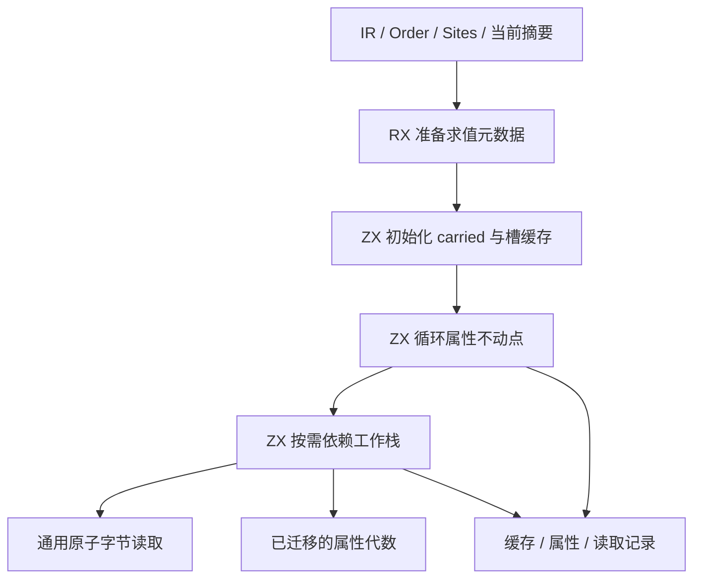
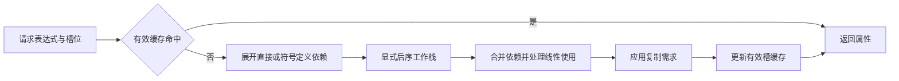
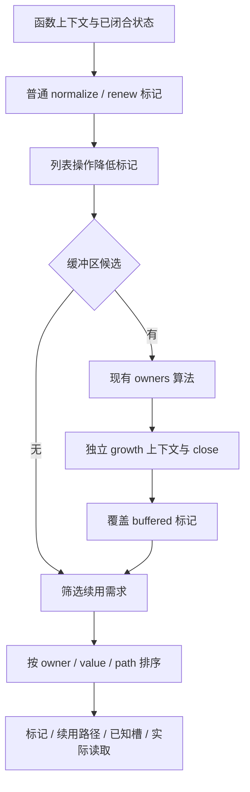

# 函数槽位求值器自举实验记录

## Intent：最终目标

将 Function 的表达式槽求值、缓存、循环 carried 最大不动点及完整降低计划迁入
RX/ZX；保留按需求值、原子摘要读取及读取记录。完整计划包含普通标记、独立
缓冲区闭包及续用路径，不能仅生成元数据后由原生继续执行同一求值语义。
本阶段完成后再提交推送，性能先实现再优化，累计基线仍为 ca03eb00。

## Data：可用证据

阶段前提交 ecf62771。属性代数已迁移；Function.close/level/raw/definition/node
仍是原生求值器，flags、demand、arguments、output 共同消费它。

直接表达式孩子的编号小于父表达式，但 Reference→定义值没有这个保证。独立只读
分析定位到正式 utils callback 降低：旧 callback.body 的引用绑定到后来生成的
捕获/参数投影。因此必须使用依赖工作栈，不能按 ExprId 做单次前向动态规划。

## Edges：边界与限制

- 后台分析读取正在发布的摘要，不能改成普通非原子读取；只记录实际读取的槽。
- 不预先求所有槽来掩盖接口问题，避免改变按需读取和增长需求更新时机。
- raw 不新增缓存；有效值保留原缓存边界及越界槽回退。
- 先贯通真实正式路径，再基于受影响路径优化；不因为首次性能差而撤回迁移。
- 不新增仓库测试，不运行浏览器；使用真实语料对照、既有回归和阶段自编译。
- 整体 Flow 总控、Function demand/arguments 编排及状态桥仍需后续迁移，不把本阶段
  或生成产物一致当作全编译器自举完成。

## Answer：交付与成功标准

交付 Source 求值器、RX 初始化编排、必要的通用平台原语、正式接线与本 IDEA 记录。
语义、并发读取、内存生命周期、真实产物及固定累计性能全部验证后提交推送。
当前开始实现，尚未取得验收结论。

## 实施证据与当前缺口

- 已实现按需依赖工作栈、raw/effective 分层、缓存边界、carried 初始化及不动点。
  RX 显式连接循环元数据、初始化和求解。正式 Function.close/level/raw 已接入，
  原生旧算法仅用于 seed；平台适配仍为过渡边界。
- 原子读取使用通用 `std:bytes.loadAtomic`，低三位解码保留 packed Level 的填充
  位语义；读取记录由 Source 产生，原生只发布结构化结果。
- 首次真实运行暴露 optional scalar 的调用参数装箱：普通调用生成器未像已有
  entry/scalar 一样剥离 Optional。已提取共享 Source 标量分类规则，修正借用判定，
  保持 pure 与未缓存门禁，不放开 optional aggregate/list。用于打破初次构建环的
  临时 producer 只带同一规则的 seed 修正；不进入正式代码或性能基线。
- 首个真实 row 模块生成成功，所有产物仅输入指纹不同。
- 串行隔离对照通过完整 111 入口，3,724,554 次实际请求、11,280 次 closure 的
  属性和 carried 结果与旧算法一致。并行即时比较会在两次求值之间读到不同的
  正在发布的摘要，因此首次并行 carried 差异不当作语义结论；并发读取记录仍待
  单独验收。探针不进入仓库。
- 第一版受影响路径诊断：冷生成 CPU 35.59 s、墙钟 5.523 s、峰值 RSS
  4377411584 B，明显未达到性能要求，不能提交或宣称阶段完成。
- “known 写入反复复制整表”的假设被实际生成代码否定：旧版 resume 已原地写。
  额外 map 克隆试验反而达到 306.96 s CPU、7376535552 B RSS，已完全撤回；
  求值器迁移保留。此试验未先核对生成表示，属于可避免的验证浪费。
- 实际确认 Frame 逐项装箱。已缩减 finish/materialize 的标量接口，避免将完整
  Frame 标为 visible；列表插入处显式展开标量字段，满足现有 fresh object 证明。
  不修改或放宽 private-record 安全门禁，待生成表示、分配计数和性能结果证明。

本地证据目录 `/tmp/zxc-function-levels/`：`oracle-detailed-full.log`、
`diagnostic-full.json`、`diagnostic-private.json`、各候选构建日志。当前尚未做最终
阶段链、相关回归和安装；先解决已确认的性能缺口，再集中验收。

分配计数进一步消除了猜测：原生 Context 快照累计申请约 6.85 MB；Source close
累计申请约 39.9 GB、query 约 134.8 GB，均不是峰值 RSS。内联 Frame 后 CPU
仍为 34.66 s，不能将其单独当作根因已解决。实际 evaluate 入口存在 known 整表
renew，出口存在 carried 外层描述符整表 renew；Context 的矩阵字段是借用原切片，
不能误称为每步复制底层数组。

当前改为：只读基表和 carried 放在不可变求值环境中，工作栈只维护本次计算的
稀疏索引/属性更新与读取记录；查询不再返回或改写整张基表。Source 内部不动点
将更新应用到自己持有的缓存，原生公开桥也只按 Source 输出的索引和值发布。
这保留按需求值、同一次查询中的 DAG 缓存及调用之间的缓存，不预求全部节点。
稀疏更新版已完成候选构建；下述诊断仍未达到性能门禁，不据设计意图宣称达标。

### 当前收口缺口：性能仍未通过

本轮沿用上述 IDEA 交付与验收边界，没有新增阶段或重置累计基线。

- 稀疏更新版：CPU 13.80 s，RSS 489,766,912 B；整表更新的退化已明显收敛。
- 循环六个字段赋值改为一次整个状态替换，生成的六次重建已消失；诊断 CPU
  13.83 s，未体现可辨收益，仅保留更直接的等价写法。
- 试过无孩子节点直接求值分支。当前版本通过 3,709,314 次查询及 11,270 次
  closure 的串行新旧对照，1,983 个产物中仅 `.zxc-inputs` 摘要不同；但诊断 CPU
  15.94 s，比修改前更慢，已经撤回该优化。没有撤回 RX/ZX 求值迁移。
- 分配计数的真实含义：delta query 累计约 8,026 万次、5.51 GB，close 约
  7,908 万次、5.52 GB；这些均是 requested 字节而非 RSS。52 B 是初始 Frame，
  432/848 B 对应工作栈容量，不能误称为 Context 对象分配。
- 更精确的生成代码证据：`want` 的 loop 初始状态和 readonly 上下文分别装箱
  16/24 B，`lookup` 也装箱 16 B。原因是字段投影未把第三参数形成的 Scope
  包装转入已有值路径。`lower.projection` 已让 Scope 复用 `value_call.expression`
  的 Scope 支持，保留缓存、normalize、renew、state 等既有保护。
- 自编译传播后，两个函数的生成代码 `create`、`alloc` 均为 0；scope-stage2
  构建成功。诊断 CPU 13.19 s（user 12.43 + system 0.76），RSS 462,307,328 B，
  wall 2.890 s；与旧算法约 4.31 s CPU 相比仍有明显退化。所有数字是单次诊断，
  不是最终统计验收，不能提交或宣布本阶段完成。

证据：`/tmp/zxc-function-levels/diagnostic-state.json`、`diagnostic-leaf.json`、
`diagnostic-leaf-reference.json`、`leaf-oracle-full.log`、`leaf-output-comparison.json`、
`delta-counts-full.log`、`scope-generated/`、`scope-stage2-build.log`、
`diagnostic-scope.json`。叶节点优化已经撤回，不能把该版本的对照当作最终候选的
最终验收。Scope 的生成形态变化也还需随最终候选完成既有回归和阶段一致性验证。

一次针对真实冷生成 PID 的 2 秒 sample 超时，没有产生 sample.txt；只留下
`scope-profile/target.json`。不得据此声称已取得热点栈或百分比。下一个待证伪
假设是依赖遍历中按值传递 Context 及描述符的成本；先确认真实生成路径及开销，
不靠静态文件体积直接断言热点，也不重复已消除的 want/lookup 分配检查。

自我复核：叶节点快速路径是失败优化，已删除；Scope 修正的目标分配已消除，但
不足以消除整体退化。当前缺口明确是运行成本，尚未运行最终完整回归、正式 seed
阶段链或安装，也没有创建当前阶段的 git commit 或推送。

### 工作栈收拢与读取记录核对

本轮是有实现变化及新验证证据的推进；仍未完成阶段验收，未提交推送。

临时产物仅给 start/resume/instruction 三个值函数强制 inline，诊断 CPU 13.50 s，
没有可辨收益；不据此全面改 ABI 或强制内联所有函数。产物位于
`/tmp/zxc-function-levels/inline-probe-generated/`，生产代码没有这类硬编码。

系统 sample 不可用后，临时生成代码加入逐函数计数及 mach 时钟探针，跳过
comptime。记录带有探针和线程调度开销，不能换算为原版 CPU 占比；工作线程
尚未刷新的尾部计数也可能遗漏。`timing-probe-full.log` 给出该次实际运行：
start 74,108,427 次、resume 67,387,831 次、instruction 36,019,819 次、
materialize 36,019,761 次。静态状态机确认有效值未命中后另压 raw 帧、完成后再
弹回原帧，确实存在多余控制往返；此前对 Context 复制比例的猜测没有成立证据。

先试合并 raw/有效帧、另加 complete 函数，串行对照通过 3,709,087 次查询及
11,279 次闭包，但 CPU 14.87 s，额外调用边界未带来收益。随后收拢为一个
117 行的 `step.zx`，统一启动、子结果返回和完成；删除 Phase、start、resume、
complete，保留相同缓存边界、求值次序、meet、物化和日志。CPU 降为 10.18 s
（user 9.41 + system 0.77），RSS 444,268,544 B，emit 1,097 ms。

只读别名的通用改进也已落实：函数体和 Scope 共用 `value_call.locals.borrowed`。
仅在 state 模式、对象不使用私有值表示、引用确实只被投影、表达式原本返回现有
ABI 指针时保留该指针；完整快照、整体返回、Task 捕获及私有列表行不放宽。
缓存、normalize/renew 和索引检查继续由原 self.expr 路径处理。最初只接 Scope
的版本未覆盖热点函数体；补齐后，instruction 的生成代码已由完整表达式表副本
变为 `*const` 指针。两阶段传播后的诊断 CPU 10.10 s（user 9.34 + system 0.76），
RSS 449,363,968 B，emit 1,082 ms；这项别名变化单独未显示可辨运行收益，不能
把已消除的静态副本夸大为整体热点已解决。

当前版本额外强制开启查询记录，逐次同时运行旧 evaluator，核对值、carried 闭包，
以及读取条数、表、函数、槽位、属性和顺序。完整真实 111 入口通过：
3,701,856 次查询、11,253 次闭包、2,714,208 条读取。证据为
`read-oracle-full.log`；探针只在 `/tmp` 克隆中，关闭该克隆内部唯一性分析的
并行工作表，稳定摘要上的一致性不替代最终生产并发回归。

现行候选 `/tmp/zxc-function-levels/borrowed-candidate`，构建日志
`borrowed-candidate-build.log`；当前 Source 产物为 `borrowed-generated/`。
诊断报告 `diagnostic-step.json`、`diagnostic-alias.json`、
`diagnostic-borrowed.json`。这些是单次定位数据，基线仍约 4.3 s CPU，
累计锚点仍为 ca03eb00。最终 seed 阶段链、相关 570 项回归、安装和推送尚未执行。

下一条实现路径是按需复用纯 IR/布局分类信息，不能继续重复试同样的复制或内联
假设。instruction 的分派、成员偏移和分支形状只依赖函数拥有的不可变 IR、定义、
布局、并发区域及输入输出宽度；carried 属性、输入输出摘要值、复制需求和记录
开关仍须动态处理。必须先去掉 instruction 中 carried 的值读取，再缓存纯分类，
不缓存 raw 属性，不提前遍历全部槽或提前做原子读取。键可复用有效槽的稠密索引，
缓存寿命限定在该 Function；无有效槽仍按原路径分类。

结构应区分只读 Instruction 与私有 Frame：Instruction 存操作、依赖和动态读取
来源，Frame 存请求、游标及当前聚合值并引用 Instruction。不要把完整 Frame 暴露
到公开 State，避免重新触发盒装列表。缓存可随 Source State 持有，并按现有稀疏
更新发布；跨 close/bufferFlags 复用前必须核对上下文静态性和别名，不能直接把
共享旧缓存当成独占可写数组。以上缓存尚未实现，也尚无收益证明。

### 分类缓存实验：未保留

纯分类已实际分离过 carried、原子摘要与 growth demand；按有效槽延迟缓存，
没有提前读取摘要。稳定摘要对照通过 3,704,645 次查询、11,269 次闭包和
2,716,040 条读取；代码审计没有发现跨 IR 复用或缓存动态属性。Native close
复制缓存指针数组，隔离 bufferFlags 的 owned 副本；共享的指令对象只读。

但诊断显示该优化成本超过收益，不能作为自举交付：

- Instruction 可空对象直接放进 Frame 时，超出现有标量记录行的内联范围。
  evaluate/step 重新逐帧 create，CPU 18.04 s，RSS 3,031,203,840 B。
- Frame 改为位置枚举与整数索引，只引用共享表或当前查询指令池，入口及转移
  的帧分配消失。串行对照通过 3,704,654 次查询和相同 2,716,040 条读取；
  CPU 17.33 s，RSS 2,899,705,856 B，仍未通过。
- 本地池与发布更新分开，发布键恢复非空 u64；单独去掉可空分支没有消除
  apply_instructions 的整表 renew，该假设已被生成代码否定。
- 初始化直接借用缓存参数导致写入时复制整表。Source 初始化重新 map 构造
  自有索引表后，apply_instructions 的 renew 由 1 变为 0；稳定摘要对照通过
  3,702,653 次查询、11,262 次闭包和 2,714,935 条读取。CPU 14.79 s、
  RSS 493,076,480 B，内存恢复但仍慢于未加分类缓存的 10.10 s。

因此删除本轮额外分类缓存，恢复只持 known/carried/reads 的 Source 求值状态，
保留 RX/ZX 求值迁移、单帧状态机、通用 Scope 投影及只读别名改进。不能将该
删除说成撤回自举。没有测量命中率，不把失败原因进一步断言为低命中率或 owned
副本频繁创建；Native bufferFlags 实际每次调用只创建一个 owned 副本。

实验完整源代码与 Native 桥快照在 `/tmp/zxc-function-levels/` 的
`instruction-cache-source-snapshot/`、`instruction-cache-native-snapshot.zig`；
产物及测量为 `instruction-generated/`、`instruction-indexed-generated/`、
`instruction-owned-generated/`、`diagnostic-instruction*.json` 和相应 oracle 日志。
当前仓库不包含这套缓存模型和桥接字段，不重复尝试同样的缓存结构。

当前转向更小的热路径：当 normalized/renewed 都为空时，普通查询直接保留 raw
属性，省掉物化调用及其上下文转换；原子读取、finish、缓存写入和有需求时的
materialize 保持同一顺序。候选为 `demanded-candidate`；语义和性能验证进行中。

### 现行版本：保留两条等价热路径

分类缓存已删除；现行候选是 `/tmp/zxc-function-levels/passive-candidate`，
Source 为 `passive-generated/`，真实编译命令 `passive-command.log`，构建日志
`passive-build.log`。Native 桥已恢复不带 instructions 字段的版本。

1. normalized/renewed 都为空时，普通请求省略 materialize 调用及上下文转换。
   demanded-oracle 在当前真实入口通过 3,701,856 次查询、11,253 次闭包和
   2,714,208 条读取。单次诊断 CPU 9.56 s，RSS 446,251,008 B，emit 1,002 ms。
2. Pass/Read 且原属性没有 unique 位时，finish 的唯一可能变化不成立，直接保留
   原属性；Read 的实际原子读取仍在该判断之前。有 unique 或 Written/Push/Concat
   的请求继续执行原 finish。passive-oracle 通过相同查询、闭包及读取条数与逐条
   内容/顺序对照。单次诊断 CPU 8.81 s（user 8.08 + system 0.73），
   RSS 437,452,800 B，wall 2.216 s，emit 909 ms。

证据为 `demanded-oracle-full.log`、`passive-oracle-full.log`、
`diagnostic-demanded.json`、`diagnostic-passive.json`。这些仍是定位用单次诊断，
不能替代最终统计性能门禁；固定累计锚点未改变，参考算法约 4.3 s CPU。

本轮完成的是真实分类缓存实验、失败原因核验与删除，以及两条已测得收益的
等价分支简化；自举求值器没有回退。完整回归、生产并发验证、正式 seed 的
stage1/2/3、安装及阶段提交推送仍未执行，先消除剩余运行成本。

后续不要重新加入已经删除的分类缓存或重复验证相同内联/描述符假设。可考察
私有且不逃逸的依赖工作栈的分配成本：当前每次查询的 Frame[] 初值与增长副本
仍分配；应先隔离验证再设计通用局部栈缓冲规则，不能按模块名/字段名特判，
不能让 Source 输出的 updates/reads 借用已结束的栈。该方案尚未实现或测量。

### 停止微调，贯通完整计划消费方

工作栈初始缓冲探针只改 `/tmp` 生成产物，生命周期审查未发现 Frame 逃逸，但
实测 CPU 9.28 s，没有优于现行 8.81 s，因此不加入生产生成器。仅强制内联标准
整数扩宽转发函数的探针为 8.87 s，同样无可辨收益，不加入生产规则。macOS
sample 在两个有界窗口均未输出可用采样；已经终止，不重复相同的采样调用。
证据为 `diagnostic-stack-probe.json`、`stack-probe-comparison.json`、
`diagnostic-primitive-probe.json` 和 `sample-long-generation.log`。

继续围绕单次查询加分支已没有足够证据，改为实现完整的 Function 降低计划。
这既移除真实的原生消费语义，也让计划内查询共用一个 Source 上下文，不再每个
槽位从宿主进入 Source。后者尚未测出整体收益，不能当作已确认的性能根因。

- `plan/plan.rx` 表达普通标记、buffer 子计划和续用筛选的先后关系。
- `plan/buffers.rx` 表达候选过滤、owners、独立上下文、close 及 buffered 标记。
- ZX 保留内聚的集合算法、操作分类与路径转换；不把完整计划藏进 ZX 总控。
- 普通 known/carried 与 buffered close 隔离，后者只合并标记和真实读取。
- 四组正式调用合并为 `analysis.plan(allocator)`；Source 临时数据使用 Function
  workspace，交付 flags、renewals 及每个 path 深复制到调用方 allocator，保持
  Ahead 的 keep 生命周期，不能把 scratch 指针传出 worker。
- 续用筛选仍按原 growth 迭代顺序求值，筛选后再排序，不改变原子读取顺序。
  原有槽布局按对象/元组成员深度优先编号，每个 List 只占一个槽，Optional
  透明，因此同一 owner 内 slot 顺序就是 path 数值字典序。排序键改排为
  owner / value / slot，不能直接排序 value 位在最高位的原 renewal key。

当前完整计划刚完成正式接线，源码生成与语义核对进行中；不计为已验收，不提交。
仍需解决既有求值器的性能差距，基线没有重置，最终门禁没有放宽。

完整计划的首次候选 `plan-candidate` 已完成 112 入口生成；1,996 项文件中，
1,995 项与先前生成器相同，差异只有 `.zxc-inputs`。单次定位数据为 CPU
8.97 s（user 8.21 + system 0.76），RSS 448,331,776 B，emit 933 ms。
输入新增一个真实入口，不能直接与 111 入口的 8.81 s 相减或声称收益。
证据为 `plan-generation.log`、`diagnostic-plan.json`、`plan-output-comparison.json`。

只读审查未发现 plan 的条件、排序或生命周期缺陷；明确新增成本是每个计划对
known 的一次自有复制，不能把它遗漏在性能验收之外。严格探针已经比较标记与
续用结果，但首次读取序列核对失败；正在定位具体内容及闭包顺序，尚无通过结论。

读取差异的具体诊断为 function=904、225 节点、24 条读取中第一条：Source
读取 input slot 0，旧 Zig 参考读取 slot 3，二者值都是 Deferred。参考探针直接
使用了 HEAD 的 Native carried 哈希遍历；它没有代表计划接入前已迁移的 Source
close 生产顺序。正在改为对照“原生 flags/bufferFlags/renewals 调度 + 已迁移的
Source close/evaluate”，并比较完整 known、flags、renewals 与实际读取序列；
旧 evaluator 的逐查询结果对照仍保留，不能通过忽略读取顺序让探针通过。

另一个具体生成证据是 `levels/usage.zx` 的 Context 局部仍被按值复制。已有
只读别名规则在普通 ABI 标量返回函数被 `!state_active` 提前排除；原 ABI 对象
本来是稳定指针，只投影的用途已由共享 projections 分析证明。最小修正只把
拒绝条件改为 `state_active && represented(type_id)`，保留产品类型、来源种类、
完整快照/整体返回/Task 捕获限制及原 expr 缓存和 normalize/renew 路径。
生成表示和实际收益尚待两阶段传播后核对，不把静态副本当成已确认的运行热点。

ABI 别名修正的第一次传播已完成：`abi-alias-producer` 生成
`abi-alias-generated/`，usage 的局部已为 `*const Context = in.context`，共有
52 个 Zig 文件变化。该数字只是生成表示证据，不是 CPU 收益；最终运行候选仍需
使用这些新产物构建。未改变目标、优化模式、输入清单或性能累计锚点。

完整计划的对照已通过。隔离探针以接入前的生产调度（Native 标记/续用流程，
Source close/evaluate）为参考，逐项比较 known 缓存、flags、renewals 及实际读取
条数、内容和顺序；查询仍同时对照旧 evaluator。完整真实 112 入口结果：

- 1,853 个计划、223,364 个标记、40 条续用路径一致。
- 2,728,067 条实际读取及顺序一致。
- 3,714,871 次查询、11,319 次闭包计算一致。

证据为 `plan-oracle-current.log`；探针只在 `/tmp`，稳定摘要下串行运行，不能
替代最终生产并发回归。正式 Function 已删除旧 bufferLoop/bufferFlags 总控，
原生只保留 seed 的普通标记/续用算法与临时表示适配，不重复维护正式缓冲区规则。
当前正在使用已消除 ABI 副本的新 Source 产物构建运行候选；尚未有其性能结果。

ABI 别名扩展已撤回：二阶段候选 `abi-alias-candidate` 实测 CPU 9.01 s（user
8.25 + system 0.76）、RSS 446,726,144 B、emit 926 ms，与同一 112 入口的
8.97 s 无可辨收益。生成副本减少不能代替运行收益；现行 borrowed 规则恢复
原来的 state_active 边界。证据 `diagnostic-abi-alias.json`，不重复同一试验。

当前只针对一项明确的重复分配：evaluate 用非空 Frame 字面量构造 pending，
生成代码先 allocator.dupe 单元素，再在 loop 前 zxRenew 成可增长缓冲区。
改为复用现有 push，从空 Walk 入栈第一个请求；读取、求值、缓存及依赖处理不变。
`empty-stack-generated/` 已没有 loop 前的 zxRenew，原先的非空 Frame dupe
变为空列表（零元素）构造。候选正在构建，尚未有语义与性能结论。

空栈 push 初始化也未保留：单次 CPU 9.64 s（user 8.87 + system 0.77）、
RSS 443,858,944 B、emit 1,019 ms，较同输入 8.97 s 更慢。实际生成所有代码
一致，差异只有输入指纹；这只能证明该语料的输出一致，不能把减少一次分配
当作整体提速。证据 `diagnostic-empty-stack.json`、
`empty-stack-output-comparison.json`。已恢复原单 Frame 初始化，不重复这一试验。

当前保留的新增成果是完整 Source 降低计划、正式四处调用及旧 Native 缓冲区
总控删除；两项无收益优化均撤回。最新已知现行计划候选的定位 CPU 约 8.97 s，
仍高于约 4.3 s 旧算法参考。阶段仍未验收、未提交推送；完整回归、生产并发验证、
正式 seed 阶段链及固定累计基线门禁均未执行。不能把本轮计划迁移或真实生成成功
报告为全编译器自举完成。

### 基于实际工作量重新定位

上一轮保留完整计划迁移，属于实质进展；本轮没有重试已失败的分类缓存、ABI
别名扩展或工作栈初始化。通过独立 `zig run` 对当前真实 types.zig 执行 @sizeOf：
Context 1,120 B、Environment 1,176 B、Walk 128 B、Step 1,312 B、栈元素 Frame
52 B。尺寸只是布局证据，不能直接换算为实际 memcpy 或 CPU 占比。

仅在 `/tmp/step-inline-generated/` 强制内联新合并的 step.callValue，旧
start/resume/instruction 内联设置不动；该调用边未被先前实验覆盖。112 入口
单次诊断 CPU 10.05 s（user 9.26 + system 0.79）、RSS 442,859,520 B、emit
1,110 ms，未优于 8.97 s，故不写入生产内联规则。1,995 项代码产物一致，
只有输入指纹不同。证据 `diagnostic-step-inline.json`、
`step-inline-output-comparison.json`，不重复该假设。

有针对性的稀疏查找计数探针完成同一 112 入口：37,650,635 次 lookup，其中
1,414,809 次直接命中已有 known；累计扫描 251,953,398 个位置，输入 delta
长度累计 270,357,852，最大单次 164。探针仅统计工作量，其原子计数会扰动线程
时机，emit 计时不能作为性能样本。证据 `lookup-count-full.log`。

下一项候选是为查询内 delta 维护准确的位置区间，查询在区间外时直接判定未命中。
它不会缓存动态摘要、不提前读取或改变缓存发布，只能省去必然失败的线性查找。
先统计实际可跳过的扫描量，再决定是否加入区间字段，避免仅凭假设扩大状态。

区间计数探针完成同一真实 112 入口：38,147,475 次 lookup、1,458,193 次已知值
命中，累计扫描 241,284,934 项，其中区间排除可跳过 215,327,054 项（89.24%）。
并发轮次会受探针计数扰动，不能把它与上一计数轮的绝对次数相减。bounds 次数
包含零长度情形，以 saved_scans 作为有效工作量指标。原日志
`lookup-bounds-count-full.log`，没有把探针耗时用于验收。

据此新增 Updates.min_index/max_index：空集初始化为 0，首次追加设置 min，
max 从非负初值更新；每次追加保持全部有效位置的准确区间。lookup 仍先返回
已有 known，只有未知且位置超出区间时返回 Unknown；内部范围仍按原顺序扫描。
不新增缓存层、不缓存摘要、不提前读取、不改变发布时机。只读审查确认 Updates
仅由 evaluate/step 创建；正式生成入口的输入没有 Updates，apply/settle/plan 及
Native 发布继续消费相同 indices/values，未发现漏初始化或不可信边界输入。

`range-generated/` 已完成真实 112 入口生成，正式候选正在构建；范围过滤的
正确性和实际性能尚未取得最终结论，不计为已验收。

区间候选 `range-candidate` 首次诊断 CPU 8.90 s（user 8.12 + system 0.78）、
RSS 444,219,392 B、emit 893 ms；1,995 项代码与参考生成器一致，只有输入指纹
不同。Source 新增区间字段也改变了被编译语料，不能把与旧 8.97 s 的差值当成
严格收益，需要同一当前 Source 对照。证据 `diagnostic-range.json`、
`range-output-comparison.json`。区间变化暂保留等待对照，不声明性能通过。

继续使用仅覆盖 Native 边界的计时探针，区分 Context 准备、缓存查询、Source
求值、close 和完整 plan；不再给上千个 Source helper 全部加计时。探针在
`boundary-profile-genz/`，首次编译遇到 Zig 0.17 Enum 反射字段名变化，已依据
本机 std/lang.zig 改用 field_names；该构建失败不计为性能或语义结果。

Native 边界探针完成：Context 约 490 万 tick，cache 约 113 万，execute 约
5,345 万（内含 Source eval 约 4,606 万），close 约 5,734 万，plan 约 74 万。
细化轮得到 initialize 约 692 万、settle 约 5,248 万、全部 Source query 约
8,209 万；Native scalar 分类只有 2,685 次、976 tick。tick 含调度与探针开销，
嵌套指标不可相加，不换算成整体 CPU 占比。证据 `boundary-profile-full.log`、
`boundary-detail-full.log`。主要路径仍是求值；不再围绕 cache 入口、元数据
准备或 scalar 分类制造优化分支。

当前按完整查询流程重构工作栈，只保存等待子结果的父帧。Walk 新增 request，
初值 pending=[]、depth=0；未 ready 时只分类当前 request，若有孩子才保存帧
并继续第一个孩子；ready 时折叠父帧并取下一个孩子或完成父帧。叶子及缓存命中
直接返回值，根叶子无需 Frame 数组分配。分类仍一次、子序与后序发布保持原序，
区别于已撤回的“先分类一次，非叶子再进入旧流程重复分类”的捷径。

该重构修改 model/evaluate/step 并移除不再需要的 push 模块；不是增加专用原语
或运行库。`parents-generated/` 已完成 112 入口，evaluate 生成代码无非空 Frame
字面量、无 loop 前 zxRenew。运行候选正在构建，尚未有正确性及收益结论。

父节点栈对照通过：1,853 个计划、223,424 个标记、39 条续用路径，2,727,333 条
读取，3,711,454 次查询及 11,308 次闭包一致（`parents-oracle-full.log`）。
首次 CPU 8.87 s、RSS 440,303,616 B，收益仍有限；不把静态分配减少称为整体达标。
同一当前 112 入口的旧实现 `producer-api` 为 CPU 4.33 s、emit 270 ms、RSS
434,978,816 B（`diagnostic-current-reference.json`），原差距得到同输入确认。

进一步省掉直通属性的往返表示转换：新增 unique 谓词，Pass/Read 直接保留
Knowledge，只在线性条件不成立时清除 unique 对应枚举位；Written/Push/Concat
继续原代数。Unknown 的独立 finish 行为仍保留。首次 CPU 8.79 s、RSS
447,135,744 B，代码产物一致但改善小；证据 `diagnostic-tags.json`、
`tags-output-comparison.json`，尚需严格同输入统计和语义对照。

机器码只读核对确认 memcpy 为二进制内 compiler_rt.memcpyFast，大块复制使用
48 B SIMD 主循环，排除“大块字节循环”假设。存在固定 1,600 B、1,080 B 等
真实复制调用，但 stripped 二进制无法映射到具体 Source 函数，因此不能把它们
直接称为 Context 热点。未发现对应未剥离对象，不能复用其他轮对象地址归属。

当前实现受限的 private 输入字段借用。与已撤回的普通 ABI 借用扩展不同，它面向
state-layout 的实际值：Source `value/input_projection.zx` 证明 field/tuple_field
链直接来自输入符号；Native 仅做布局门禁和结构化 AST 左值确认。预先准备并登记
声明 AST，再逆序降低引用，避免先生成 dereference 使用、后发现无法取址的错误。

- 仅在真正私有函数参数域启用；拒绝 public view、Task、未选中的父布局及类型
  不一致。暂不通过局部别名链扩展证明范围。
- 任一投影有 cache、normalize 或 renew 时保留原路径，不绕过已有处理。
- AST 必须是 rooted-in-input 的真实字段左值；绑定成 *const state-layout，
  引用时明确解引用，整体使用和返回仍得到原按值数据，不暴露新增指针。
- 独立映射按语义作用域准备/恢复；函数变体、contract predicate 和 Task worker
  克隆清空映射和域资格，保留既有 state_symbols，不混入 stack_symbols。
- 新规则的语义谓词由 ZX 执行；Native seed 留相同初始引导规则。没有增加专用
  运行库或用户语法；Native 预备/恢复、布局和 AST 适配仍为待迁移生成器职责。

113 入口初始生成已通过，正式 producer 在构建。首次 Native 编译发现新适配器
传入可写 ExpressionTable 指针，与通用 columns.pointer 的只读契约冲突；已改为
显式 const Lower 投影，没有放宽 columns 的校验。当前尚无该优化的运行结果。

private 输入借用已传播到 125 个生成文件：step 的 Walk 和 1,120 B Context
实际绑定成指向 in 字段的 *const private-layout；整份候选 Native 编译成功。
首次 CPU 8.72 s。随后同一当前 113 入口交错三轮，以未启用该规则的 tags 为
对照：tags CPU 8.69 / 9.22 / 9.13 s，private-input 9.17 / 9.49 / 9.15 s。
中位数 9.13 → 9.17 s，没有稳定收益；两轮还更慢。静态复制减少不能替代运行
收益，因此完整撤回新借用规则及其 Source 入口、适配器、别名映射和三个 clone
接线；此前已验证的普通 ABI/narrow state 借用逻辑及求值器迁移保留。

证据 `diagnostic-private-input.json`、`paired-private-results.json`；实验源码/
产物留在 `/tmp/zxc-function-levels/`，仓库恢复到 `private-input-backup/` 所存
该尝试之前的 Native 文件。没有为该规则新增测试或进行阶段提交，不再重试。

### 聚合成员选择：减少算法内的重复查询

实际聚合计数为 9,046,175 次查询、40,153,191 次字段迭代，输入字段长度累计
67,710,806，最大 88 字段（`aggregate-count-full.log`）。当前每次字段迭代都
调用 member 并查询 counts，循环还携带完整 Frame；Native 旧 node 也线扫，
但其 member 为简单内联数组访问，Source 原写法付出了额外调用和状态成本。

已改为一次类型定位：使用已有 slots/locate 在单调前缀 offsets 中定位 slot 的
类型成员，再调用 member 一次。tuple 直接按该位置取 sequence；object 仍按
原实际存储顺序寻找第一个相同 index，查询循环只保存位置及可空值，不携带 Frame。
先保留 count=0 返回，再检查空 offsets、类型总槽上界和选中成员的范围。

正确性边界来自既有构造与验证：slots/layout.zx 产生按成员累加的单调偏移，
locate 取最后一个 <=slot 的起点，正确跳过零宽成员；Optional 经 unwrapped
透明处理。canonical/rules/objects.zx 要求完整、合法、无重复字段，但不要求
顺序；core/expression_table/append/object.zx 保留原顺序，因此没有把成员号
当对象存储位置。新 object_member 保留首匹配，也兼容旧稀疏/乱序/重复裸字段
的正常匹配结果。tuple 另守实际成员数量，保留稀疏裸表返回 None 的行为。
这些证明依赖 Slots 构造的一致前缀表，不把任意伪造的 Layout/counts 当可信输入。

当前 located-generated 已生成，新候选正在构建，尚未宣称语义和性能通过。

成员定位改写的真实语料对照已完成：1,854 个计划、223,467 个标记、39 条续用
路径、2,727,509 条读取、3,711,632 次查询及 11,312 次闭包一致，证据为
`/tmp/zxc-function-levels/located-oracle-full.log`。这验证的是既有串行 oracle
语义范围，不代替生产并发、完整回归和阶段自编译。

首次运行 CPU 8.86 s、wall 3.49 s、RSS 433,602,560 B，生成源码对照除输入
指纹外一致。单轮没有证明成员定位优化有稳定收益，更没有消除当前 4.33 s →
8.86 s 的迁移性能差距；本阶段仍未验收、未提交。证据 `diagnostic-located.json`
及 `located-output-comparison.json`。不以改动看似更快为理由宣布性能达标。

只读生成代码审计发现另一项真实成本：levels/read 每次 record=true 都先
`allocator.create(Read)`，再把指针追加进数组，Native publish 又复制到原生
读取日志。Read 虽全为标量字段，但作为公开 Output/State 的可见对象被 ABI
装箱。普通 tuple 同样按指针表示，不能靠改写 tuple 消除；四条标量列会引入
额外 push 和并行数组维护，不作为当前修复。尚未取得逐次分配计数或耗时归因，
不能将这项成本称为性能差距的主因，也未开始修改通用 ABI。

### 低频采样与复制归因

上一轮通过最新语义对照，本轮从该证据继续，没有重跑同一 oracle。临时生成产物
只对 evaluate/step/instruction/lookup 等 12 个函数做每线程每 1024 次一次的时钟
采样，见 `sampled-levels-full.log`。同轮累计采样 tick：evaluate 172,799、step
92,699、instruction 39,186、read 2,288；指标嵌套不可相加，探针改变内联和调度，
且为 mach 时钟而非 CPU 时间，不用这些数字推断正式版的精确占比。

隔离的 step 输入环境引用实验只修改 `/tmp` 生成表示：Environment 改只读指针，
调用点直接引用循环外 environment，不再构造循环内整份副本。候选 CPU 8.79 s
（user 8.04 + system 0.75），与 located 8.86 s 相近，没有证明收益；未将该 ABI
实验接入生产源码，不据静态复制减少扩展此设计。证据
`diagnostic-step-env-reference.json`、`build-step-env-reference.py`。

系统 sample 两次失败后，改用临时 C 构造器安装 SIGPROF/ITIMER_PROF 信号采样。
处理器只从本次 ucontext 保存 PC/LR 到预分配表，原子领取槽位，无分配/打印；
结束后才输出。新探针不修改任何 Source 函数，不逐函数插入分支，优化模式仍是
small。临时链接 libc 会改变 std.start 的默认 GPA，后续有符号版本显式恢复
init.gpa=smp_allocator；IO/符号和信号差异仍属于该诊断限制，正式计时只使用无
探针候选。

第一次信号采样成功记录 4,972 个样本，2,077 个 PC 落在该二进制 compiler_rt
memcpy。该次仅在最终参数附加 -fno-strip，不足以覆盖各 -M 的显式 strip 和
small 默认 strip，因此尚不能映射 Source，不能使用其他构建地址代替。
同一二进制按本轮 image base 归一后的前五 memcpy LR 为：

| LR          | 样本 | 已核实复制尺寸 |
| ----------- | ---: | -------------- |
| 0x1000c3b50 | 1106 | 动态 12×N      |
| 0x10002ebc4 |  358 | 动态 N 字节    |
| 0x10002ec78 |  153 | 动态 4×N       |
| 0x1000b73a8 |   52 | 固定 96 B      |
| 0x1002c429c |   51 | 动态 8×N       |

前五占 memcpy 样本 82.81%。最大项是批量复制，不是固定大型 Context 搬运；
12×N 也不能仅凭尺寸认作 Read[]。反汇编逐点跟过 outlined thunk 的 tail call。
当前已按每个 -M 前显式 -fno-strip 修正符号构建，完成后必须重新采本次地址；
该进程仍在构建，不重启。证据均在 `/tmp/zxc-function-levels/`。

后续证据修正了上述 SIGPROF 归因：每个模块都保留符号后，memcpy 最大组来自
Ahead 任务最终 keep.dupe(Read, reads.items)。隔离实现把读取日志直接积累到
keep arena，再交付原切片；CPU 8.83 s（8.09+0.74），与 8.86 s 相近，无收益，
已经完整撤回。没有保留新 Managed 容器或分配策略。证据
`diagnostic-retained-reads.json`。SIGPROF 为进程 CPU 定时器，信号可能送到其他
可接收线程，样本分布不能直接代表各工作线程的 CPU 成本；之前“memcpy 优先”
的判断证据不足，后续不再据这些占比扩展优化。

已用仅位于 /tmp 的 Mach 诊断 dylib 在进程内部采样：独立 pthread 枚举任务线程，
只对 TH_STATE_RUNNING 且非采样线程执行 suspend/get_state/resume；保存 PC/LR，
采样期间不分配普通堆内存、不打印。正常性能候选不加载此 dylib。采样结束后才
输出 image 映射。注入时 image 0 是诊断 dylib，必须按 image 路径定位实际主程序，
不能默认用 image 0 的基址，也不能跨构建复用 PC。第一次错误基址导致全标成
external，修正后使用 `mach-images-full.log` 与同轮 `symbol-profile` 重新定位。

有效 Mach 样本 2,705 个：evaluate 713、memcpy 265、root.settle 125，其他 Source
函数和 outlined 代码分散。诊断仍受采样、符号、libc 及调度影响，不是正式 CPU
占比。生成源码、符号、反汇编和采样地址均为同轮构建；证据
`mach-profile-summary.json`、`evaluate-hot-pcs.json`、`locate-evaluate-samples.py`。

只读核对确认 evaluate 已内联 Step：机器码 17,360 B，栈帧 13,088 B（保存寄存器
96 B、局部 12,992 B）。两个循环状态搬运区间有 66+58 个样本，反复以 4B+3B
读写多个 7B 片段。不是此前猜测的固定 Context memcpy。沿用环境引用变体，
仅把 Step 标为 noinline 的隔离对照 CPU 11.92 s（11.15+0.77），比引用变体的
8.79 s 更差；此方向失败，不接入生产，也不再尝试该拆分。证据
`diagnostic-step-env-noinline.json`。

当前尺寸探针确认 Walk 为 168 B；pending/reads 及 Updates.indices/values 四个
私有列表描述符各 24 B，slice 占 16 B、headered 占 1 B，尾部有 7 B padding。
Request 也有 7 B 尾部 padding。正在隔离检查显式初始化私有列表 padding 是否
能消除无语义字节在循环中的搬运：只改临时 types.zig 的 182 个私有列表类型，
生产源码未改，尚无收益结论。若无有效收益同样不保留。

私有列表 padding 显式归零的隔离候选已完成：CPU 8.97 s（8.20+0.77），wall
3.59 s、RSS 440,532,992 B，未显示收益。此修改仅存在于临时生成目录，没有
接入生产类型生成或更改 ABI/key；不继续扩展到其他对象 padding。证据
`diagnostic-zero-padding.json`。输入环境引用、保留 arena 日志、noinline、padding
这四项均未保留生产修改，求值器和完整计划的 RX/ZX 迁移继续保留。

本轮自我核对：取得了系统 sample 失败后可复用的同进程逐线程采样方法，也确认
了 SIGPROF 偏线程导致的错误优先级；但没有减少正式候选 CPU，不能称为性能
修复或阶段完成。Source evaluate 的主要成本和循环状态搬运已有真实机器码
定位，接下来的实现应减少求值循环本身的工作量；不再试同一类参数别名、强制
内联/拆分、padding 或读取日志分配微调。正式候选仍以 located 为准，已验证的
语义证据不变，最终完整回归、阶段自编译、累计性能和提交推送仍未完成。

### 循环状态赋值的通用降低

本轮先实现了连续父帧归并：Step 仅展开新请求，unwind 在内部连续完成父帧，
complete 负责物化和缓存，descend 保存父帧。静态审计确认 cache-hit、raw、读取
顺序、meet/cursor/depth 与旧实现相同，新 helper 没有逐对象 create 或整表 renew。
但候选 CPU 13.25 s（12.48+0.77），明显更慢；完整撤回该算法改写，原 Source
求值器保留。证据 `diagnostic-fused.json`、`fused-generation.log`。

优化模式对照同时使用 Fast 构建旧 Native 与当前 Source 实现。初次 Fast 构建
都因 Zig 进程 SIGSEGV 退出，没有运行样本；显式为每个模块保留原 Small 对应的
strip 策略后构建成功。尚未定位崩溃原因，不能归因于某个 LLVM pass。关闭常驻
生成器后的同输入诊断为：Small Native 4.31 s / Source 8.69 s，Fast Native
3.12 s / Source 6.18 s。两个模式均明显退化，因此生产优化模式没有更改，不用
跨模式数字规避性能门禁。证据 `diagnostic-*-isolated.json`。

本轮发现部分此前临时 measure 命令未显式设置 ZXC_RESIDENT_GENERATOR=0，
measure 脚本本身不会关闭常驻生成器。此后生成/计时/回归统一显式关闭，按当前
进程记录清理已启动的本任务临时 resident；新一轮计时期间没有后台构建。重新
确认的 Small CPU 差距与此前接近，但墙钟受常驻启动/后台工作影响，不能把此前
临时墙钟当作最终门禁证据。

又试过将 Step 内联回 evaluate 源码，并只给变化的 state 字段赋值，让前端直接
看到字段更新。生成器仍将其归为整体状态更新，CPU 9.26 s；已恢复源码。
之后把 Read 专用的 table/function_index 从所有 Frame 中去掉，读取时从只读 IR
恢复；有效内部路径等价，但 CPU 8.82 s，亦已恢复原布局。两项均未保留。
证据 `diagnostic-direct.json`、`diagnostic-compact.json`。

更直接的隔离实验只修改临时生成代码中的循环赋值：完整求出 RHS，快照所有有
语义的叶字段，再写回同一个局部 state；不搬运 padding。三轮交替、同 Small
配置及同一当前 112 入口：

| 轮次 | 原赋值 CPU | 字段赋值 CPU |
| ---- | ---------: | -----------: |
| 1    |     8.74 s |       8.52 s |
| 2    |     8.59 s |       8.36 s |
| 3    |     8.63 s |       8.38 s |

中位数 8.63 → 8.38 s；这是可复核的改善，仍未消除与原实现的差距。证据
`field-paired-results.json`。不是通过布局改名、padding 初始化或强制内联获得。

已在 genz 的结构化 AST 发射器实现通用 iteration/assignment.zig：只有普通私有
selected_state 使用，deep 和自定义 loop_fields 分支保持自身物理布局。递归
私有 object/tuple/list，list 只处理 items/headered；保留对象和元组 origin；
optional、native/ABI 指针等按整值叶处理。所有 RHS 与叶快照都在任何目标写入
之前完成，因此保留交换、同源目标 alias、IO/异步及错误顺序。没有新增运行库
或原始 Zig 语句节点；这是仍待后续迁移的 Native AST 适配层中的机械发射。

通用实现经只读审计未发现边界偏离；producer 构建和 112 入口生成成功，evaluate
已没有整体 state_5 赋值。完整候选正在构建/验收，相关六组既有回归按原进程
41518 等待；未新增测试，不根据临时手工生成代码的收益直接宣布通用实现达标。

通用发射器已经完成正式 producer 与完整候选构建（field-producer 与
field-generic-candidate）；生成语料保持 112 入口、1,991 模块、1,769 函数文件。
新产物的独立语义 oracle 全部通过：1,854 个计划、223,467 个标记、39 条续用
路径、2,727,509 条读取、3,711,632 次查询及 11,312 次闭包一致，证据
`field-generic-oracle-full.log`。该 oracle 稳定摘要并关闭原生预分析并发，因此仍
不代替生产并发与完整阶段自编译。

Source 算法回滚亦已按字节核对：step/evaluate 与 fused-source-before 一致；
model/frame/instruction/definition/read 与 compact-source-before 一致。当前保留
的新代码只有通用 AST 字段赋值规则，不混入失败的 Source 算法改写。

六组相关既有回归仍在原 exec 会话 41518 运行，根构建进程 PID 4349；最近检查
确认仍有其子 Zig 编译任务执行，未重启。候选本身已构建成功，但不能在回归
编译占用 CPU 时做正式性能对照；下一步先等待该进程汇总，再测通用候选整体
性能与生成结果一致性。临时单循环字段赋值的中位数不当作通用实现最终验收。

六组既有回归已结束：314/314 步、570/570 项通过，原 exec 41518 返回 0；
`field-generic-related-checks.log` 为最终汇总。期间出现的 capacity stderr/failed
command 文本与历史日志一致，未将它们误报为最终失败，也未重启同一任务。

关闭常驻生成器、所有编译结束后的通用候选交错三轮 CPU：原版 8.65 / 8.69 /
8.73 s，通用字段发射 8.37 / 8.39 / 8.32 s，中位数 8.69 → 8.37 s。RSS 中位
约 434.4 → 446.1 MB，三轮范围存在重叠；不以单轮峰值解释为泄漏。墙钟中位
约 1547.6 → 1505.2 ms。证据 `generic-paired-results.json` 与六份原始 measure
报告。通用候选单轮先前 8.51 s 不作最终统计。

producer 生成的 1,996 个非指纹产物与通用候选重新生成的产物全部一致，只有
输入指纹作了显式排除；证据 `field-generic-output-comparison.json`。这是通用
优化的有效结果，仍不是完整 seed→stage1→stage2→stage3 验收。

当前保留通用 AST 字段赋值优化；全部失败的 Source 算法、优化模式和布局实验
均已撤回。与阶段前 Native 同输入约 4.31 s 相比仍有显著 CPU 差距，所以完整
函数槽位/计划自举阶段仍未提交推送，固定累计基线没有更换。

后续已完成但尚未实施的只读边界核对：definitions、usage.plan、usage.nodes、
usage.regions 的 Native 源类型均来自生成公开 ABI，descriptor 位于稳定的
Unit.passes/lasting 存储中。现有 columns.view 复制 metadata header 且清除
zx_origin；若要保留稳定 ABI 源指针，应新增明确借用契约，不改变原 view 的
快照语义，并让 borrow.lower 的 ABI 重建只发生在 origin==null 分支。指针必须
来自真实源 descriptor，不能取 view 局部 source 副本地址；context/usage/layout
当前临时组装，不能直接伪造 origin。这一方向尚未实现、没有收益结论。

### ABI 原指针复用与按需重建（进行中）

Intent：在不撤回 Source 求值器的前提下，消除已存在稳定 ABI descriptor 时的
重复重建；此改动不改变原 columns.view 的快照语义。

Data：新增 columns.borrow，要求源为真实、只读且覆盖全部消费寿命的 descriptor
指针。递归转换仅从原指针保留 origin，非指针子值不伪造 origin。生成器的
borrow.lower 将递归重建放入 origin 为空的分支，临时槽位仍在外层存储中声明。
函数适配器使用同一 Borrowed 实例持有 descriptor、layout、usage，init 后不移动。
close、execute、plan 三个消费者的实际调用关系已完成只读审计，未发现指针逃逸；
Source 重建修改后的 context/usage 时清空根 origin，不复用旧 descriptor。

Edges：这是 Native ABI 传输层的过渡优化，不算新增自举职责完成。Borrowed 在
消费结束前不能按值复制、返回或重新初始化；原 view 保持不变。单轮 8.24 秒不作
收益结论。新路径尚未完成相关既有回归和完整阶段自编译。

Answer：正式交替三轮、相同 112 入口、Small 配置、关闭 resident 且无并行构建：

| 轮次 | 字段赋值候选 CPU | ABI 借用候选 CPU |
| ---- | ---------------: | ---------------: |
| 1    |           8.50 s |           8.35 s |
| 2    |           8.37 s |           8.29 s |
| 3    |           8.37 s |           8.32 s |

中位数 8.37 → 8.32 s；墙钟中位数 1507.3 → 1485.2 ms；峰值 RSS 中位数约
445.4 → 443.0 MB。证据 origin-paired-results.json 与六份原始报告。候选重新
生成与 producer 的 1,996 个非指纹文件全部一致，证据 origin-output-comparison.json。
收益很小，不能据此视为消除了原实现约 4.31 秒到当前约 8.32 秒的显著退化。
完整函数阶段尚未验收、提交或推送，固定累计锚点不变。

### 消除叶节点重复槽索引（待性能结论）

只读核对与独立审计均确认：step 在非 raw、缓存未命中且没有孩子的请求中，
开始和发布时两次以完全相同参数调用 index。该函数只读固定 slot_first 并计算
位置；finish/materialize 不改变这张表。

已将首次结果保存为 requested_slot，新请求的缓存查询与叶节点发布复用它；
ready 父帧仍在原完成位置计算 index，raw 不调用 index。没有增加 Frame 字段，
没有提前原子读取、改变孩子顺序或延后发布。命中仍立即返回，null 仍不发布。

112 入口生成通过；1,996 个非指纹产物中仅 step 的 Zig 文件及 .zxc-files 内容
索引变化，其余 1,994 文件一致。证据 index-once-expected-diff.json。当前正在
构建 index-once-candidate，尚无性能或最终语义验收结论。

另有临时产物诊断 pointer-input-probe：只改变热点私有函数的输入调用约定，
公共 executeValue 保持按值接口。这与已撤回的局部输入投影别名不同，但目前
仍只是调用边界假设；不改生产生成器，不据构建通过宣称收益。若没有可辨收益，
删除这一尝试，不重试相同方向。所有测量待当前回归与构建终止后隔离执行。

根 descriptor 借用的独立 oracle 已完成：1,854 个计划、223,480 个标记、39 条
续用路径、2,727,509 条读取、3,711,632 次查询与 11,312 次闭包一致，证据
origin-oracle-full.log。该临时 clone 已换成生产 Borrowed 适配器，不能再沿用
之前“不覆盖新根 descriptor”的限制；仍关闭其原生预分析并行并稳定摘要，因此
不替代生产并发回归。ABI 指针调用约定临时探针也已完成真实语料生成，与同输入
1,996 个非指纹文件全部一致，尚未取得隔离计时。

新借用路径的六组既有回归最终通过：314/314 步、570/570 项，原 exec 会话
27433 返回 0，证据 origin-related-checks.log。检查的是新通用借用与根 descriptor
存储路径；不把它代替之后 index-once 算法改动的独立 oracle。日志中的 capacity
stderr 为既有诊断输出，最终汇总为成功。

index-once 与指针入参的三轮隔离对照结束，证据 index-pointer-paired-results.json：
原根借用候选 8.34 / 8.28 / 8.37 s，中位数 8.34；index-once 8.44 / 8.37 /
8.33 s，中位数 8.37；临时 pointer-input 8.24 / 8.25 / 8.26 s，中位数 8.25。
索引复用两轮更慢、没有稳定收益，已按字节恢复 step，不继续投入其语义 oracle；
index-once-oracle 构建成功，但未运行，不能记作语义对照通过。pointer-input 的
小幅收益只覆盖四个热点调用边界，不据此改变整个生成器的调用约定；临时产物
不进入仓库，也不把局部试验当作生产优化已完成。

下一项有生成代码证据的冗余是累积子结果时的 Knowledge→Level→meet→Knowledge
往返；实际 step 需要多份临时 ABI descriptor 和 origin 处理。当前试行在枚举上
直接计算同一属性代数，不引入原生业务实现。先核验实际语料和收益，再决定是否
保留；不能据减少源码调用数推断整体性能。

枚举合并实现已生成并构建成功：112 入口、1,992 模块、1,770 函数文件。合并
保持原 meet 的三条规则：headered 为双方都有；unique 为双方都有；deferred
仅在结果不 headered 且任一侧原有 headered/deferred 时成立。Unknown 按旧
value 解码为无属性处理；不额外保留非规范的 HeaderedDeferred/AllDeferred。
step 与 settle 共用该私有枚举代数，不增加原生算法或运行库。

三轮同输入隔离 CPU，原根借用候选 8.46 / 8.25 / 8.32 s，直接枚举合并
8.32 / 8.25 / 8.15 s，中位数 8.32 → 8.25 s，改善小。墙钟候选首轮
3,395 ms 明显高于其余两轮约 1,519 / 1,488 ms，不能据 CPU 较少声称墙钟
稳定改善。RSS 范围重叠。证据 enum-meet-paired-results.json。独立语义 oracle
已构建，尚待完整运行；当前不是最终性能门禁结论。

继续核对真实接口：aggregate 只消费 Expressions、Layout、counts 与 Frame；
projection 只消费 Expressions、Layout、Frame、target 与 index，二者却接收
整个约 1,120 B Context。旧 Mach 样本曾在这两个函数入口的复制路径取样，
所以本轮将这两个受控内部输入收窄到既有类型，更新全部三个调用位置，不新增
状态层或转发函数。112 入口生成已通过，narrow-input 候选正在构建。生成器与
Source 求值迁移保持不变，先验证实际成本再判断是否保留。

直接枚举合并的实际语料 oracle 已通过：1,855 个计划、223,561 个标记、39 条
续用路径、2,727,623 条读取、3,710,620 次查询、11,315 次闭包一致，证据
enum-meet-oracle-full.log。此前 570 项回归不自动当作这一新代数实现的检查。

收窄 aggregate/projection 输入的三轮 CPU 为 8.83 / 8.76 / 8.80 s；同输入
直接枚举候选为 8.33 / 8.25 / 8.16 s，中位数 8.25 → 8.80 s，明确退化。
已按 narrow-input-before 原字节恢复四个文件，不把“传入字段少了”误认为收益。
证据 narrow-input-paired-results.json。没有修改生成器来强行保留该实验。

剩余查询分配可作独立的生命周期隔离：Native execute 只将 Source updates 的
枚举写入既有 known，并将 reads 值发布到宿主持有的日志。pending/updates/reads
分配都可在该调用返回前消费完；known/carried 是原借用基表，不由 query 创建。
当前仅在 /tmp/query-scratch-genz 诊断 clone 中给整个 query 配置 Zig 标准库
BufferFirstAllocator（8 KiB 临时栈，容量不足仍用原 arena），并在发布后/错误
返回时清空 state.reads，禁止保留栈切片。close/plan 中会逃逸的分配不改。
这与此前仅将 pending 初始 renew 放入 1 KiB FBA 的失败实验不同；仍需计时与
语义/寿命核验才能决定后续，不作为新的原生业务语义或最终自举边界。

整个 query 的临时栈分配器诊断亦未达收益条件：三轮原枚举候选 CPU 8.27 /
8.20 / 8.14 s，临时栈候选 8.27 / 8.16 / 8.24 s，中位数 8.20 → 8.24 s。
RSS 中位数约 445.4 → 447.1 MB。证据 query-scratch-paired-results.json。
1,997 个非指纹产物全部一致，且独立只读审查未发现 updates/reads 生命周期
问题；但这些不能替代运行收益。该尝试只在 /tmp clone 中，不移入生产，不再
围绕同一临时分配器方案重复调缓冲大小。

当前真正保留的仍是原 Source 求值/计划迁移、通用字段赋值、明确 ABI 借用及
直接 Knowledge 合并；index-once、输入收窄、私有指针输入和 query 栈缓冲没有
进入生产。开始重新采样当前枚举候选：只保留 Small 配置，构建未剥离调试信息
的 enum-profile，不链接信号探针、不替换 main/GPA，用已有独立 Mach collector
在 /tmp 外挂采样，不将采样开销作为正式性能数据。后续按新热点调整，不继续
无证据试同一类复制、参数与分配器改动。

新的枚举候选 Mach 采样共定位 evaluate 568 个 PC 样本、memcpy 244；样本是
运行线程位置，不换算为正式 CPU 百分比。evaluate 机器码 17,040 B，栈帧约
13 KiB。高频地址仍包含 Frame 小字段搬运和多处 spill/reload，不能再把所有
7 B 的重叠加载都解释为 padding。证据 enum-mach-full.log、enum-mach-summary.json、
enum-evaluate-hot-pcs.json 与 enum-evaluate-asm.txt。该次未改 main/GPA，不用
旧信号采样的 allocator 政策归因。

另以临时生成产物给标准 bounds/overflow 返回加 cold hint，三轮原候选 CPU
8.28 / 8.38 / 8.26 s，提示候选 8.29 / 8.33 / 8.14 s，中位数 8.28 → 8.29 s，
没有稳定收益；不扩展节点/打印器来保留此尝试。证据 cold-guards-paired-results.json。

新的结构性缺口已由源码确认：shared_generation 将全部公开入口合并为同一个
Program，而 frozen 规则把“子类型在任何函数中被构造”传递为父记录需要按值展开。
因此 Host 提供的只读元数据也会因其他入口构造同形子类型而膨胀；不是靠单个
函数缩参数或调分配器能消除的问题。Lower.projectedField 已有 boxed parent 到
selected child 的转换路径。下一步核对只读父记录可否仅 boxed 自身，保留子类型
各自表示，再把函数固定 Metadata 与每次变化的 normalized/renewed 分开。
此方向涉及表示安全，先做边界审查，不以旧样本或新命名直接宣称收益。

### 固定元数据引用与记录表示隔离（实现中）

Intent：消除无关入口对子类型的构造导致 Host 只读父记录展开的耦合，避免每次
求值阶段都搬运整份 metadata；保留 Source 算法、持久数组语义和原子读取。

Data：全部 bootstrap 公开入口在 shared_generation.zig:67 合成一个 Program，
frozen 旧算法从任何已构造子记录向上传播 written 并对父记录执行深 boxing。
Lower.projectedField:355 已支持 ABI 父记录到私有 child 的转换。新规则只对
本类型未被构造的 object 设置 boxed 自身，子类型由原有独立规则决定。

Edges：comparison/identity、native、Task、Store、duplicate 仍用原深闭包。
list 的私有 inline Row 仍受 visible 深闭包保护；不放松 ABI 列表借用门禁。
独立审计发现 Parallel 也能构造 Object，已在 Source constructed 与 seed 同时
补记该事实；Capture 只合成 Tuple，AwaitTask 由 Task 边界保护，contracts
全部表达式表已纳入 constructed。不能把“没有 Object 字面量”直接当完整证明。

Answer：Context 现在只持有 Metadata、normalized、renewed；Metadata 复用原
所有字段类型，仅 Host 组装，Source 不构造它。Native Borrowed 持有 metadata、
layout、usage、descriptor 的真实稳定存储，不引入运行库。所有 Source 与 RX
消费方已对齐，stage1 producer 构建和完整 112 入口生成通过。stage1 仍使用旧
表示生成的求值器；正由它生成 stage2，待 Source 新规则传播后才检查布局及性能。

现有 CLI 安装产物的 formatter 不支持本阶段已经使用的 import type 命名别名，
在 initialize.zx 拒绝语法；未为旧工具改源码契约。正式 generator 的内建源码
校验已通过当前输入。后续使用当前构建工具完成格式化，不据旧 CLI 错误判断
Source 编译失败。

stage2 生成成功，类型声明实际显示 Context.metadata 从 value_Metadata 变成
*const ABI_Metadata；不是只改名称或适配器。stage2 完整候选正在原 exec 45450
构建。构建/验证完成前，不把预期 Context 缩小或旧版本 CPU 当本方案收益。
Source frozen 的旧 written 固定点 helper 已无引用，随规则简化删除，seed 同步
删除深写入传播；没有新增父对象包装函数。开始六组既有回归，覆盖 Native 值
边界、字段所有权、值返回、缓存、ZX Task 与 RX Parallel；不新增测试。

stage2 首次构建在三个 Native ABI 适配点失败：origin production append、shared
state types 与 Function plan 假定 executeValue 输入总是 struct；新规则使其只读
根输入成为 ABI pointer。已按真实 fn 参数类型在编译期选择根 header 的指针/值，
对子 bindings、origin、abi、context/state 同样使用真实字段类型，不增加运行时
判断或改变 executeValue 契约。这也保留与旧 seed 按值产物的引导兼容。

修复后 stage2 候选完整编译通过（原 exec 64190 返回 0）；第一次六组回归因
上述共同编译错误退出，不能报为测试断言失败或通过。尚需在修复后重新执行。
当前无后台构建，开始同输入交错比较旧枚举 Source 候选、新 metadata 候选及旧
Native reference；只在测得结果后评价收益。相关 Native 适配仍属于过渡边界。

三组同输入交错对照完成（metadata-paired-results.json）：旧枚举 Source CPU
8.37 / 8.12 / 8.37 s，中位数 8.37；新 metadata 候选 6.62 / 6.67 / 6.66 s，
中位数 6.66；旧 Native reference 4.28 / 4.28 / 4.27 s，中位数 4.28。结构性
改动带来可辨改善，仍有约 2.38 s 差距，不能提交为性能已通过的完整阶段。
新候选首次执行墙钟 3029 ms，后两轮 1250 / 1230 ms；保留首次启动记录，
不把它和后两轮或已启动的旧二进制混成稳定墙钟收益。RSS 三轮范围与旧版重叠。

新候选重新生成的 1,996 个非指纹文件与 stage2 producer 生成全部一致，证据
metadata-output-comparison.json。原生 ABI 三适配点又成功编译了 stage1 旧按值
表示（原 exec 79687 返回 0），因此编译覆盖实际存在的指针与按值两种引导输入。
metadata oracle 已在补齐 clone 内同一 shared_state 适配后成功构建并开始运行；
修复后的六组既有回归沿原 exec 80117 继续，当前仍有其子 Zig 进程执行。

metadata oracle 全部通过：1,854 个计划、223,304 个标记、40 条续用路径、
2,728,135 条读取、3,712,229 次查询及 11,314 次闭包一致。证据
metadata-oracle-full.log；仍在稳定摘要/非生产并发 oracle 条件下，不替代既有
并发回归。独立只读审查亦未发现三 Native header 适配中的指针逃逸：append
只拷贝列和字符串；shared_state 只在函数内消费 request、深复制 segments；plan
只发布 slice 数据、标记和路径，不保存临时 State/Metadata header。

后续仅做私有行布局诊断：当前 pending 在内部存 52 B ABI Frame 行，读取要
重排为含 origin 的 64 B 私有 Frame，写回再去掉 origin；新采样的细碎 Frame
搬运与此表示边界对应。/tmp/private-rows-probe-generated 仅把该私有 Frame
列表改用同一私有值布局，未改生产、未放松 public/native/Task/identity 可见性
门禁，构建已通过。先取实际产物及隔离计时，再考虑通用元素读写实现；不能
把 64 B 对齐或减少转换源码直接视为收益。先前 list header padding 的失败
实验不等同于这次有语义字段布局重排，但结果仍可能无收益。

修复后的六组回归结束：原 exec 80117 返回 0，366/366 步、558/558 项通过，
证据 metadata-related-checks-fixed.log。该集合加入 Task/Parallel 并覆盖值边界、
字段所有权、值返回和缓存，与先前六组 570 项的选择不同，不混写数量。
私有行临时探针亦生成 1,996 个完全一致的非指纹文件，证据
private-rows-probe-comparison.json；仍未改生产，正在无后台构建条件下交替计时。

私有 Frame 行统一布局探针三轮结束：原 metadata 候选 CPU 6.87 / 6.71 / 6.68 s，
64 B 私有行候选 6.80 / 6.72 / 6.83 s，中位数 6.71 → 6.80 s，RSS 中位数
约 428.5 → 438.4 MB。证据 private-rows-paired-results.json。没有稳定收益，
不推广到通用元素生成器，不改变生产的 52 B 行。布局减少转换不等于更省成本。

自我复核：本轮真正有显著收益的是 Source 只读父记录与 Metadata 的职责/表示
隔离；参数收窄、指针入参、分配器、冷分支提示和私有行探针不能当作交付。
正式函数阶段仍未通过 4.28 s 的同输入 Native 对照，更未完成固定累计锚点的
最终验收、seed 阶段链和安装，不能提交推送为完整阶段。下一步重新采样当前
6.66 s 候选，而不是沿用 metadata 改动前的热点归因或重试上述失败方向。

本记录截至 Metadata 候选验证；当前状态与后续执行见[主记录](函数槽位求值器自举.md)。
