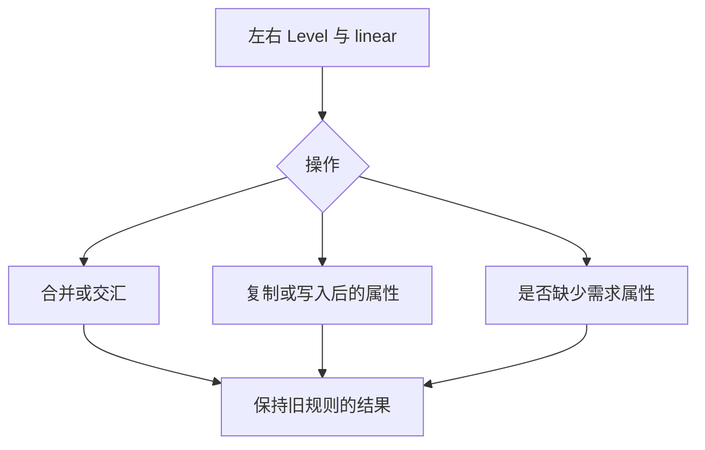

# 列表能力代数自举

## Intent：最终目标

将列表 headered / unique / deferred 的完整属性代数迁入 ZX，作为后续 Function
求值器迁移的共享语义源。包含 join、meet、lacks、materialized、written 和基础值。
保持原子访问、packed ABI、全部输入语义与固定累计性能锚点。

## Data：可用证据

迁移前 Level.join/meet 位于原生 level.zig，其余三条规则分散在 Function。它们只依赖三个
布尔属性和 linear，不依赖 IR、Sites 或可变摘要。只读独立复核确认可作为完整职责
迁移；全部 8 种 u3 编码都必须保留，不能预先 canonicalize。

### 规则与产物

- 新规则经统一 genz 生成；值接口在编译期以零容量 allocator 求值，生成小表。
  正式运行期不解释 Source，不调用生成规则，不分配或复制列表。
- 常量保留在 `const.zx`。当前 ZX 只支持闭合标量 const 初始化，因此基础 Level
  由这个文件中的纯函数返回；没有为本阶段扩展复合 const 或增加原生语义。
- 331 个完整输入比较通过：3 个基础值、64 个 join、64 个 meet、64 个 lacks、
  128 个 materialized 和 8 个 written。全部 8 种编码参与比较，使用明确 panic。
  这是本地隔离诊断，不新增仓库测试文件。
- 独立只读复核确认非 canonical deferred 保留、正式/seed 分界和调用替换正确。
  materialized 仅依赖 want.unique，表的其他输入维度依原规则等价压缩。
- 6 个 ZX 文件 lint 通过。meet 的续行缩进按既有 formatter 对齐，纯格式调整不
  重新计时。
- 固定 96 入口共 1857 个文件、完整 107 入口共 1938 个文件，前后都仅
  `.zxc-inputs` 不同；分别 1856、1937 个其余产物完全一致，没有额外文件。
- 性能候选 4145040 B，比阶段前增加 128 B；SHA-256 为
  `4683d2cc7c1775b03412252454f2cb3db984871cb18197147118c7f9e1d47e00`。

### 阶段自编译

seed → stage1 为 34/34 步，stage2、stage3 各 16/16 步。stage2/3 与上述性能
候选二进制哈希、大小相同，1938 个生成产物仅 `.zxc-inputs` 不同；因此复用
候选计时，不重复性能验证。证据为 `fixedpoint.json` 与 `stage1/2/3.log`。

### 既有回归与安装

相关既有回归 570/570 项、314/314 步通过，覆盖 loop 来源、初值所有权、原生值
边界、字段所有权、值返回及缓存所有权。CLI 安装 26/26 步通过。日志中的容量
诊断 stderr 和 failed command 提示不是最终测试失败，按真实汇总与退出码验收。
证据为 `related-checks.log`、`dist.log`。没有运行整仓全部测试，不宣称此前其他
capacity/alias/reverse 失败已修复。

### 性能

按 compiler-performance skill，三轮交替测量中位数。冷输出与函数缓存各自隔离，
热运行复用对应缓存；关闭常驻缓存，没有并行构建或探针干扰。两个基线均为原始
冻结二进制，没有重建兼容版本；固定累计锚点仍是 ca03eb00。

| 固定 96 入口 | 累计 ca03eb00 | 阶段前 44cbab32 |      本阶段 |
| ------------ | ------------: | --------------: | ----------: |
| 冷 CPU       |        4.17 s |          4.10 s |      4.06 s |
| 冷墙钟       |    903.147 ms |      897.696 ms |  882.218 ms |
| 冷峰值 RSS   |   425279488 B |     416825344 B | 419069952 B |
| 热 CPU       |        0.05 s |          0.05 s |      0.05 s |
| 热墙钟       |     40.125 ms |       39.783 ms |   40.028 ms |

累计冷 CPU 减少 0.11 s，阶段减少 0.04 s；冷墙钟累计减少约 20.9 ms。
峰值 RSS 比累计基线低，比阶段前高约 2.14 MiB（0.54%），不宣称所有内存下降。

| 完整 107 入口 | 阶段前 44cbab32 |      本阶段 |
| ------------- | --------------: | ----------: |
| 冷 CPU        |          4.21 s |      4.21 s |
| 冷墙钟        |      925.714 ms |  922.734 ms |
| 冷峰值 RSS    |     426917888 B | 430555136 B |
| 热 CPU        |          0.05 s |      0.05 s |
| 热墙钟        |       40.155 ms |   40.081 ms |

完整语料 CPU 相同，冷墙钟减少约 3.0 ms，峰值 RSS 高约 3.47 MiB（0.85%）。
规则本身在运行期只访问静态表，没有新增堆工作区；峰值波动仍如实保留。

原始证据位于 `/tmp/zxc-level/`：`oracle-run.log`、`source-checks.json`、
`output-equivalence.json`、`performance-fixed/summary.json`、
`performance-full/summary.json`。日志与 JSON 不提交。

## Edges：边界与限制

- 原生保留 packed 编码适配与原子访问；Source 负责本阶段全部属性规则。
  查表的编译期接线仍是过渡适配，后续整体 Source 状态模型应替代该专用边界。
- 种子路径保留旧规则，仅正式路径使用生成规则；不宣称 Function 求值器已完成。
- 不新增测试，用有限完整输入对照、既有回归、实际生成产物及自编译验收。
- 查表有数据读取成本，先实现，再测受影响路径；退化时优化表示，不撤回语义迁移。
- 固定累计锚点 ca03eb00 不重置，阶段前为 44cbab32。

## Answer：交付与自我复核

本阶段实现与验收完成：Source 属性代数、正式编译期接线、全部输入语义对照、
生成产物对照、固定累计性能、阶段自编译、既有回归和 CLI 安装均有上述证据。
按阶段约定使用英文规范提交并推送，不将此阶段等同于 Function 整体自举完成。

自我复核：最初使用对象指针接口进行编译期求值，allocator 返回的指针不能在
这里解引用；改用既有值接口解决，没有新增生成器特例。没有仅凭静态查表就断言
性能无损，实际保留了 CPU、墙钟和 RSS 对照。完整 8 状态比较证明当前语义，
不证明整个求值器或并发流程；这两部分仍需后续迁移与验收。
