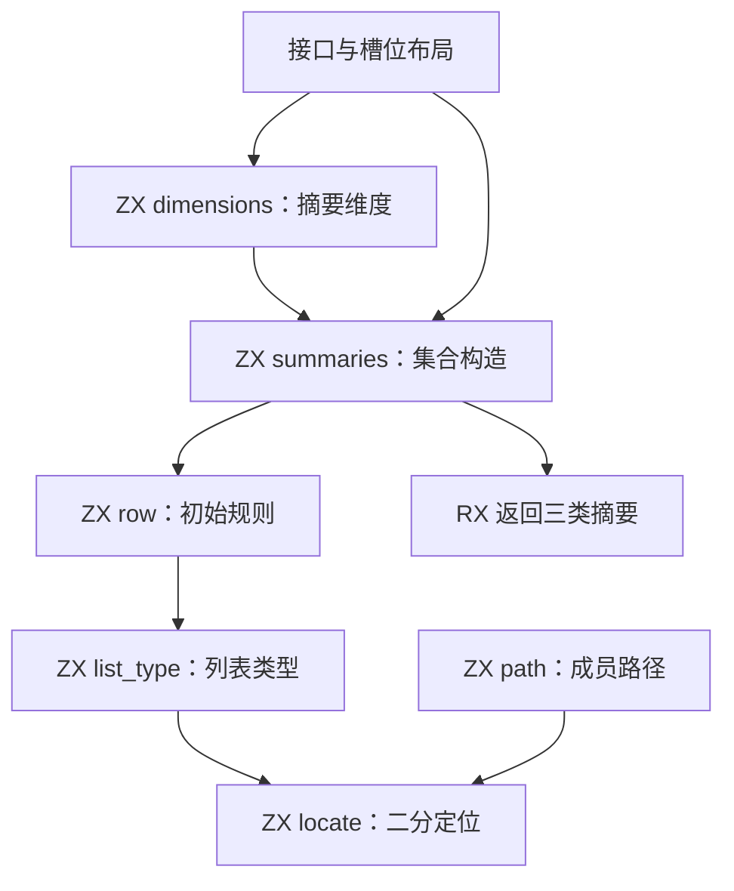
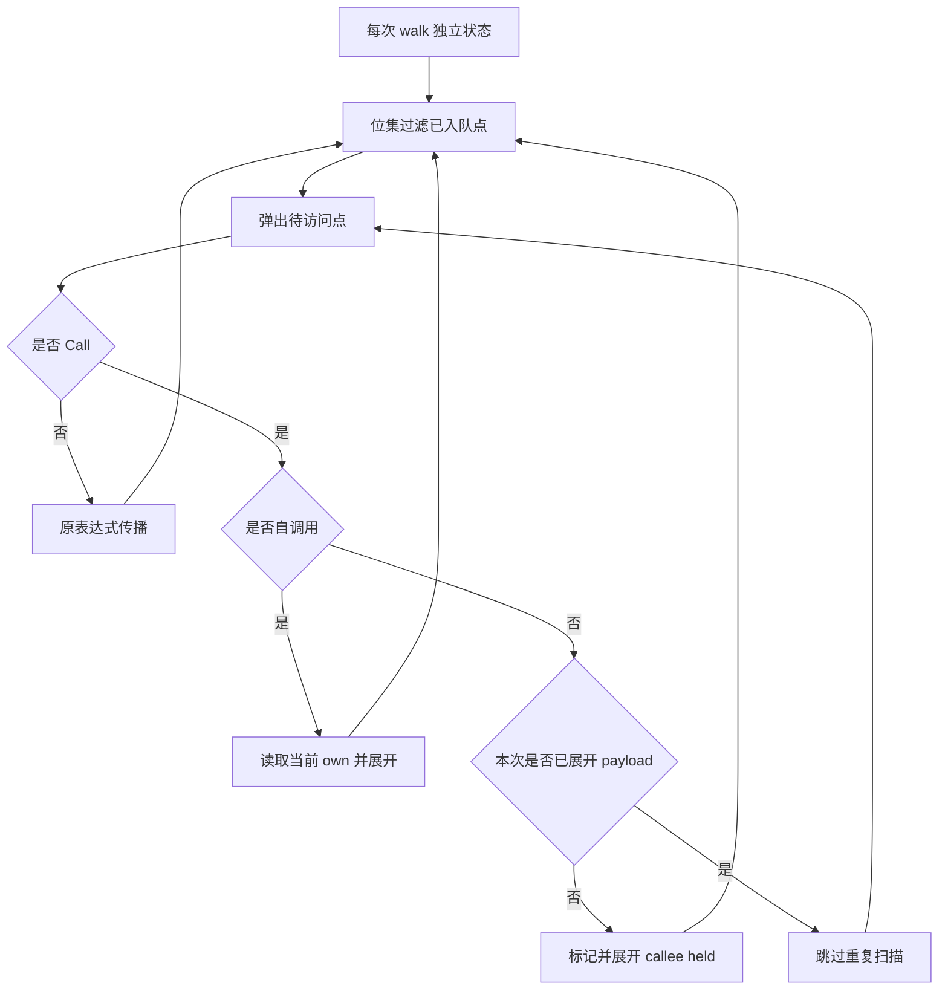

# 初始摘要与槽位查询自举

## Intent：最终目标

将 Flow 初始摘要和类型槽位查询迁入 RX/ZX，保持语义、零成本约束及累计性能。
阶段基线为 `8d427e26`，固定累计锚点仍为 `ca03eb00`，容差不随提交重置。

## Data：可用证据

### 最终实现

- `flow/initial/build.rx` 显式连接维度计算与初始摘要构造；ZX 分别承担维度提取、
  单函数规则和集合构造。
- `slots/list_type.zx`、`path.zx` 共用 `locate.zx` 二分定位，保留可空透明、零宽
  成员及 canonical 索引语义。最终列表类型查询使用零容量 allocator，意外分配
  明确失败；路径查询仅分配返回路径。
- 函数体访问表改为 `u64[]` 位集；通用位操作由 `std:integer` 提供，索引、去重
  和更新规则仍在 ZX，词宽常量位于所属 `const.zx`。
- 非自调用在每次 walk 首次实际弹出时展开一次，不再按输出槽位重复扫描 callee
  的 held 输入。自调用始终重新读取动态 own；各遍历和固定点重跑独立创建标记。

去重依据：单次 walk 内非自身 callee 摘要稳定；同一 payload 的参数和 callee
相同，传播不依赖输出 slot。首次弹出已将全部相关输入点加入永久 visited 集合，
后续只会重复入队同样的点。不能提前在入队时标记，否则改变首次展开顺序；自调用
own 会变化，不能去重。Text/Held/Written 和固定点重跑不共享标记。

### 行为与构建

- 隔离真实语料对照：1754 个函数的三类初始摘要、3618 个类型的 210744 个有效
  槽位之最终列表类型与完整路径，均与原生算法一致。
- 函数体对照覆盖 1542 个函数体、210973 个表达式、113372 个输入槽位；三类
  摘要及 changed 一致。使用显式不匹配 panic；探针不进入仓库。
- 相关既有回归 **570/570 项、314/314 步通过**，覆盖 loop 来源、初值所有权、
  原生值边界、字段所有权、值返回和缓存所有权；未新增测试。
- seed → stage1：34/34 步；stage2、stage3：各 16/16 步；CLI 安装：26/26 步。
- stage2/3 均为 4144912 B，SHA-256 均为
  `5c507f3d88ff4ead61c7c54827903d4a68654051df9a4a345aa0ad5042a825d6`。
  1929 个产物仅 `.zxc-inputs` 元数据不同。
- 16 个本次 RX/ZX 实现文件检查通过。独立 lint 不支持 `.d.zx`，integer 声明
  通过实际 catalog 构建及调用验证，不将此工具限制误报为实现回归。

没有运行整仓全部测试，也未解决此前其他 capacity/alias/reverse 失败；上述通过
范围不代表完整回归全绿或整个自举完成。

### 性能

按 compiler-performance skill 测量受影响生成路径：三轮交替，独立冷输出与函数
缓存，热运行复用各自缓存，常驻缓存关闭，无并行构建或探针。下表为中位数。
计时候选与最终 stage2/3 哈希相同，复用有效证据，不重复计时。

固定 96 入口使用原始冻结二进制，保留累计锚点：

| 指标       | 累计 ca03eb00 | 阶段前 8d427e26 |      本阶段 |
| ---------- | ------------: | --------------: | ----------: |
| 冷 CPU     |        4.15 s |          4.19 s |      4.07 s |
| 冷墙钟     |    903.518 ms |      933.035 ms |  885.502 ms |
| 冷峰值 RSS |   423739392 B |     411975680 B | 410435584 B |
| 热 CPU     |        0.05 s |          0.05 s |      0.05 s |
| 热墙钟     |     39.942 ms |       39.953 ms |   39.841 ms |

累计冷 CPU 减少 0.08 s，较阶段前减少 0.12 s，不以局部基线掩盖累计变化。

完整 105 入口含新增整数 API，旧冻结工具无法解析。参考工具仅更新标准库接口
catalog，保留 `8d427e26` 的 GenZ 实现和生成模块；它是接口兼容参考，不能称为
原始冻结二进制。固定 96 入口的累计测量没有替换参考工具。

| 指标       | 阶段前＋接口兼容 |      本阶段 |
| ---------- | ---------------: | ----------: |
| 冷 CPU     |           4.30 s |      4.20 s |
| 冷墙钟     |       964.101 ms |  912.633 ms |
| 冷峰值 RSS |      430407680 B | 431292416 B |
| 热 CPU     |           0.05 s |      0.05 s |
| 热墙钟     |        39.936 ms |   39.823 ms |

完整语料峰值 RSS 增加 884736 B（约 0.2%），不宣称所有内存指标下降。
固定 96 入口的 1857 个文件仅输入清单、文件清单与 `types.zig` 不同：类型差异
为新增整数 API 绑定及 `{u64, u64}` 类型。完整 105 入口的 1929 个文件仅
`.zxc-inputs` 不同，其余 1928 个生成源文件完全一致。

本地证据位于 `/tmp/zxc-initial/`，不提交日志和 JSON：

- `performance-dedup-fixed/summary.json`、`performance-dedup-full/summary.json`
- `dedup-output-equivalence.json`、`dedup-oracle-summary.json`
- `final-ready-fixedpoint.json`、`final-source-checks.json`
- `final-related-checks.log`、`final-stage2-ready.log`、`final-stage3-ready.log`
- `final-dist-ready.log`、`before-std-api-description.json`

## Edges：边界与限制

- 旧初始化和查询仅保留为 seed；正式规则来自 RX/ZX。原生桥仍负责输入借用、
  类型适配、结果发布和生命周期，尚待移除。
- 外部函数输出含文本时保守保留全部输入；其他输出按列表类型身份判断，written
  初始为空。保持错误边界和所有权证明。
- Flow 调用图固定点、缓存和线程调度，以及 Function 原生状态仍未迁移。反复
  调用 RX 模块的通用编排能力仍需补齐，不能把总控藏回 ZX 宣称完成。
- 位操作是普通静态 Zig 标准库边界，不引入编译器专用运行库或动态调度层。

## Answer：交付与自我复核

本阶段交付初始摘要 RX 编排、槽位查询 ZX 算法、正式接线及遍历去重优化；相关
回归、阶段自编译、安装和累计性能均已验收，按约定英文提交并推送。

本轮曾误选 seed 阶段计时，并误用未启用的 seed 规则推断正式记录布局；相关
数字和推断已作废。访问表跨阶段复用、成员路由预计算、origin 备用转换优化及
临时 inline 均未提供可信收益，已撤回，保留迁移成果。最终针对实际重复的
callee 扫描修复。后续先核实正式生成表示，用候选工具定位成本，功能收口后集中
执行阶段链和安装；相同源码及二进制复用已有证据，避免重复构建和无收益试验。
