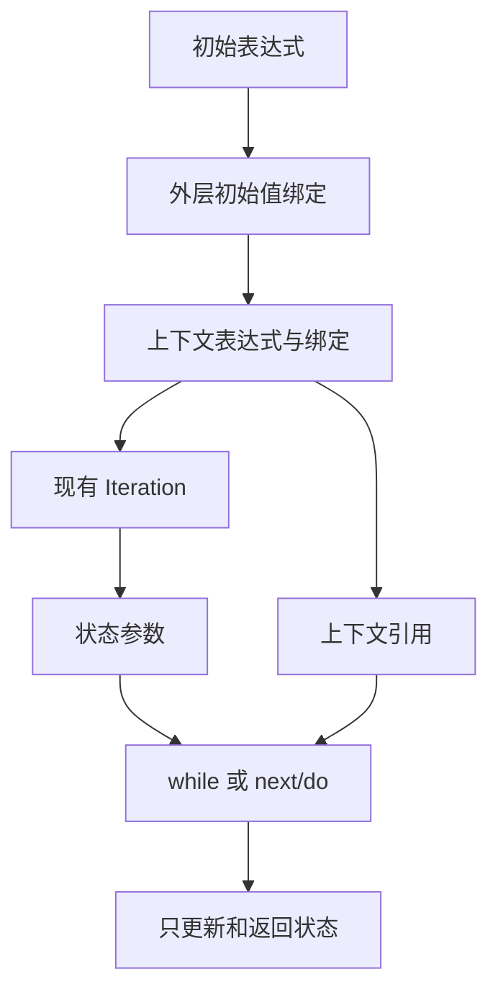
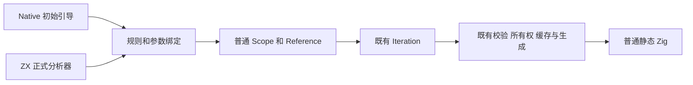

# 循环只读上下文

## Intent：最终目标

支持 `loop(initial, policy, context)`，让回调以第二个显式参数读取不可变上下文，
循环输出仍只有状态。保持两参数调用及禁止隐式捕获的现有契约。

动因是 Sites 自举的热路径：不可变输入被迫放进循环状态，与栈、游标和结果一起
经过每次状态更新。不能通过放开隐式捕获或专用原生接口规避问题。

## Data：可用证据

现有 native iteration/root.zig 与 ZX analyzer/iteration/rules.zx 仅接受两个参数；
callback.zx 只绑定一个参数，其他外部名字被 scope_floor 隔离。移出元数据的尝试
被实际编译拒绝，错误为 callbacks cannot capture outer bindings。

复用现有 Scope/Reference/Iteration IR。初始值与上下文在外层 Scope 按顺序绑定一次；
两个回调分别通过内部 Scope 将显式上下文参数绑定到同一外层引用。不增加 IR 字段、
序列化格式、运行库或动态调度。

## Edges：边界与限制

- 三参数调用的回调可只声明状态，或同时声明状态和上下文；两参数调用仍只允许状态。
- 上下文表达式在初始表达式之后、进入循环之前求值一次，包括循环零次执行的情况。
- 上下文不能是 void。上下文参数不可作为状态更新目标；隐式外部捕获继续拒绝。
- 通过普通引用和作用域保留旧快照、别名、Task 及错误传播规则；不凭空构造指向短命
  局部记录的 origin，不以更改所有权语义换取性能。
- 不新增测试；使用真实 Sites 上下文、自编译和既有循环/别名/分支回归核验。
- 解析器与 formatter 已能表示多参数回调和普通调用参数，新增能力在分析和作用域降低。

## Answer：交付格式与成功标准

交付 native seed 与 ZX 分析的一致上下文绑定、正式 Sites 使用、公开语法说明，
并集中核对生成行为与阶段自编译。性能仍以固定可比基线累计验收；旧版本能够执行的
96 入口场景保留原工具，对要求新语法的全场景明确记录兼容前端的比较边界。

Native seed 与 ZX 正式分析器已实现，Sites 追踪及三态分类已使用第三参数。
已通过 native seed → stage1 → stage2 → stage3、真实语料对照和格式检查；
扩大既有回归为 1199/1215 项通过，16 项容量/指针复用失败保留，详见同日 Sites 记录。
最终全入口性能与产物对照完成，与 Sites 阶段一起提交和推送。

初版将多个可选标量放入每个 IterationFrame，放大所有普通循环的分析状态。
同一 96 入口的 CPU 从固定基线 4.11 s 增至 4.88 s，峰值 RSS 增至约 504 MB，
证据为 /tmp/zxc-sites/performance-context。不能将功能可编译视为零成本。

改为单个可选 Readonly 记录后，普通循环只增加一个可选记录引用；Sites 只把栈、
游标和结果放入状态，其他元数据通过显式上下文读取。三轮同输入累计 CPU 为
4.12 → 4.13 s，耗时 890.018333 → 906.644250 ms，峰值 RSS
421036032 → 403079168 B，证据为 /tmp/zxc-sites/performance-isolated-context。

生成器同时修正现有 renew 路径的表示判断：已处于状态值表示的对象不再按指针
解引用，续用缓冲区与所有权检查保持不变。这是通用表示修正，没有新增上下文 IR。

## 自我复核

三参数循环是解决显式不可变依赖的通用能力；它不使隐式捕获合法，也不代表所有
记录传递都已无复制。仅普通状态 IR 与 Zig 静态生成仍须接受真实语料行为对照、
所有权回归及累计性能约束。未新增或放宽运行库、专用自举接口和安全检查。
