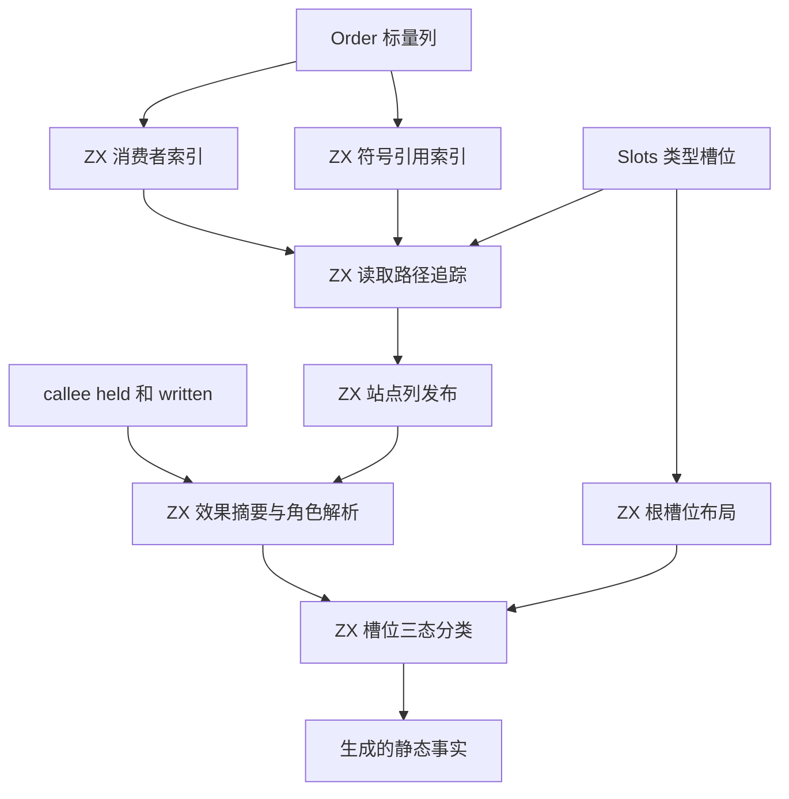
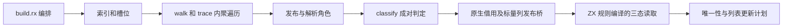

# 读取路径与线性使用判定自举

## Intent：最终目标

将 Sites 的消费者/符号引用索引、聚合与投影路径追踪、读取站点和根槽位布局、
线性使用及纯观察判定迁入 RX/ZX。正式调用不回到旧原生规则。
按 IDEA 记录实现和证据；不将临时发布桥视为整个唯一性分析完成自举。

## Data：可用证据

正式入口为 genz/src/zx/uniqueness/root.zig 的 Unit.analyze，Sites.create 构建
读取路径，Function 的 linear/observed 查询决定输入和循环状态的更新资格。
原 sites.zig 的 347 行规则已隔离至 sites/seed.zig；正式生成配置只调用 RX/ZX 结果。
Order 和 Slots 的既有类型、顺序与布局事实直接复用。

RX 编排索引、槽位、追踪、发布和分类；集合算法保留在 ZX。
帧池与父索引代替原生递归，bind 引用逆序入栈，保持原 DFS 顺序。
每个符号引用按表达式的实际类型计算槽位，不假设等于符号声明类型。

## Edges：边界与限制

- 保留最深区域、最近四个分支、同 edge/delta 替代路径、投影区间和有符号偏移。
- 保留 callee mayHold/mayMutate 的越界保守判定、循环归属及观察先后次序。
- 不做路径/名称特例，不改变共享、旧快照、短路、OOM 或 zero runtime 约束。
- 分类状态由 ZX 构造，移除原生 memo；布局之外的槽位仍走原有保守查询规则。
- 读取使用由 ZX 三态谓词在 comptime 生成的布尔表；通用查询用零容量分配器执行。
- 不新增测试，不修改既有容量、指针复用和所有权断言。
- 固定累计锚点 ca03eb00 不随提交重置；同时报告单阶段变化。

## Answer：交付格式与成功标准

交付真实 RX 编排、ZX 算法、正式接线、seed 隔离、公开循环能力与可复核证据。
验收后英文规范提交并推送 master，完整自举目标仍为 active。

### 实现与通用能力

- effects.zx 根据 held/written 计算统一角色；resolve_roles.zx 只在整个站点区间
  均可证明时解析 Argument，混合或越界槽位继续按原规则判定。
- classify.zx 将循环归属、分支排他和先后关系提到槽位循环外；Observed/Linear/Shared
  三态保留观察含义。当前消费槽位均已 Shared 后停止该站点的成对扫描。
- 消费者索引提前排除 evaluation 边，空消费者不入帧池；站点 edge 改为原 Order 边号，
  保持同一性的双射。对照检查显式复建旧分组位置至原边号的排列，未忽略边身份。
- 栈帧按深度复用，游标独立于 Frame，避免每步记录装箱。只有 fresh 标量记录替换
  放开既有私有值数组资格；共享对象、公开接口、原生、Store、Task 与身份边界不变。
- 支持 loop(initial, policy, context)，详见同日《循环只读上下文》。状态只承载栈、
  游标和结果，元数据由第二个显式回调参数读取；仍禁止隐式捕获。
- 标准整数增加 widenSigned(u32) → i64 和 narrowSigned(i64) → u32，后者保留
  IntegerOverflow。它们不含编译器规则，投影偏移使用有符号宽值。
- 修正 value_call 的 renew 表示判断：状态值不再被当作指针解引用，保留续用与所有权。

### 语义、固定点与源码检查

最终隔离对照覆盖 1758 次构造、214988 个表达式、128653 个站点及 10391056 次
linear/observed 查询，全部一致。检查 first、slot_first、站点标量与有效 arms，
以及边号排列；优化后的角色列以每根每槽位的最终两项查询核验。
证据：/tmp/zxc-sites/final-oracle-summary.json、context-oracle-run.log。
临时探针只在 /tmp/zxc-sites/context-oracle-genz，不进入生产代码。
同前端旧 Sites 的完整 100 入口生成结果与当前全部 1884 个源码文件一致，
仅 .zxc-inputs 的工具身份变化，无额外文件；证据为
/tmp/zxc-sites/reviewed-output-equivalence.json。最终性能轮次的同输入输出再次对齐，
无额外执行一次内容生成。

复核后 native seed 构建 reviewed-stage1，34/34 步成功；stage1 → stage2 → stage3
逐级构建，stage2/3 各 16/16 步成功。二进制均 4126944 字节，SHA256 均为
c13527069af1ef4ef30001630cb3f956013105754ed5ebf8bca4e5ffe043fc7a。
全部 1884 个生成源码文件一致，仅 .zxc-inputs 的前级工具身份不同，无额外文件；
证据：/tmp/zxc-sites/reviewed-fixedpoint.json。构建期间无原生源码修改。
复核后的 CLI dist 安装构建 26/26 步成功，见 reviewed-dist.log。

43 个修改或新增 ZX/RX/Zig 文件全部通过格式或 AST 检查；声明接口由实际构建验证。
证据：/tmp/zxc-sites/final-source-checks.json。最终扩大回归为 711/728 步、1199/1215 项通过，16 项失败，见
/tmp/zxc-sites/final-checks.log。没有修改失败断言，不报告全绿。

### 性能证据与累计基线

每轮冻结同一源码和清单，无并发构建，关闭常驻生成器，独立冷缓存并交替运行三轮。
不同入口数量的版本不能直接相减；以下历史报告内各自有同输入的旧算法对照。

| 历史版本           | 同输入旧算法 CPU → 新实现 CPU | 证据目录 /tmp/zxc-sites/ |
| ------------------ | ----------------------------- | ------------------------ |
| 初版，98 入口      | 4.05 → 4.96 s                 | performance              |
| 游标分列，98 入口  | 4.07 → 4.84 s                 | performance-packed       |
| 批量三态，99 入口  | 4.07 → 4.65 s                 | performance-bulk         |
| 保留短路，99 入口  | 4.08 → 4.46 s                 | performance-active       |
| 效果摘要，100 入口 | 4.09 → 4.41 s                 | performance-effects      |

上述版本当时均未通过。初版约 1.276 GB 是累计 arena 容量，不是 RSS；游标分列、
帧池复用与 fresh 值布局解决了记录重建。微函数探针只用调用次数，不将含探针的
计时当作整轮比例；系统 sample 没有有效输出，未用于判断热点。

最终累计场景保留原 96 入口，Sites 新语法不在其可达源码内；它仍由实际的新
Sites 实现分析这组真实语料。直接使用原 ca03eb00 和 1703a9a3 二进制，不刷新
固定锚点算法、声明目录或前端。早期较大清单曾为新标准声明刷新目录的兼容工具，
不用于最终累计结论。

| 最终 96 入口    | 冷 CPU | 冷耗时        | 峰值 RSS    | 热 CPU / 耗时         |
| --------------- | ------ | ------------- | ----------- | --------------------- |
| 固定 ca03eb00   | 4.12 s | 890.018333 ms | 421036032 B | 0.05 s / 38.921584 ms |
| 上阶段 1703a9a3 | 4.20 s | 906.070291 ms | 412811264 B | 0.05 s / 39.165417 ms |
| 当前            | 4.13 s | 906.644250 ms | 403079168 B | 0.05 s / 39.116625 ms |

累计 CPU +0.01 s、耗时 +16.625917 ms，当前处于用户接受的范围；单阶段 CPU
下降 0.07 s。容差不是下一阶段的新增预算，后续继续相对同一固定锚点检查。
证据：/tmp/zxc-sites/performance-isolated-context/summary.json。
最终 100 入口使用相同复核后前端和标准目录，仅 GenZ 替换为上阶段 Sites 算法。
before 同时保留通用 renew 表示修正，不包含新 Sites 或效果算法；构建命令见
/tmp/zxc-sites/reviewed-baseline-command.json。这项局部对照不替代固定累计锚点。

| 最终 100 入口  | 冷 CPU | 冷耗时        | 峰值 RSS    | 热 CPU / 耗时         |
| -------------- | ------ | ------------- | ----------- | --------------------- |
| 同前端旧 Sites | 4.27 s | 933.062250 ms | 421511168 B | 0.05 s / 40.477542 ms |
| 当前 Sites     | 4.20 s | 929.871917 ms | 421740544 B | 0.05 s / 40.308500 ms |

CPU 下降 0.07 s、耗时下降约 3.19 ms，RSS 差约 224 KiB，热 CPU 相同。
证据：/tmp/zxc-sites/performance-final-full/summary.json。所有轮次结束后源码指纹一致。

### 自我复核

固定点与真实语料对照不能单独证明完整自举。Sites 标量列发布/借用桥、
整体 Function/Flow 及其他专用原生状态仍须迁移；原生 Summaries 保留原有职责，
新增效果分类本身来自 ZX。没有因性能回退迁移，也没有删除保守规则或安全检查。

扩大回归发现的 flat/branch/switch/two_fields 容量和指针复用问题已由旧 CLI
逐项复现，共 6 项；direct 对照通过。证据目录为 /tmp/zxc-sites/baseline-iterate-*，
旧 CLI SHA256 为 7b806fcb44ebd7fff67676e32c13dbefebdeb711639291e45e892d13ee139b37。
另 8 项为上阶段已记录的 function-updates flat/branch/chain/mixed × source/library
容量失败，失败集合不变。reverse 的 source/library 各 1 项容量失败；旧 CLI 的
source 路线复现相同 allocated=79096、capacity=79024、payload=16384，证据为
/tmp/zxc-sites/baseline-reverse/run.log。reverse 的旧 library 路线没有单独重跑。
这些问题尚未改为通过，不能用一致产物或语料对照声称整个仓库无缺陷。

最终 diff 复核补齐了两处新语法错误报告的一致性：native seed 的非 lambda
诊断与正式分析器一致；void 上下文的位置取原第三参数节点，而非最后访问的子节点。
只改失败分支，复用已完成的热路径性能与行为证据，不重跑整组 1215 项回归；
阶段自编译和最终全入口产物比较使用复核后源码。

本阶段已完成验收，提交和推送后继续整体自举；16 项已有或旧工具可复现的问题仍待修复。
