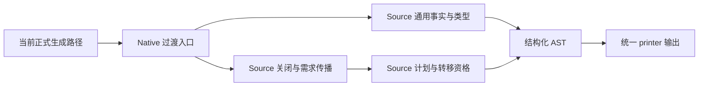
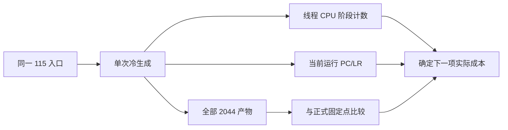
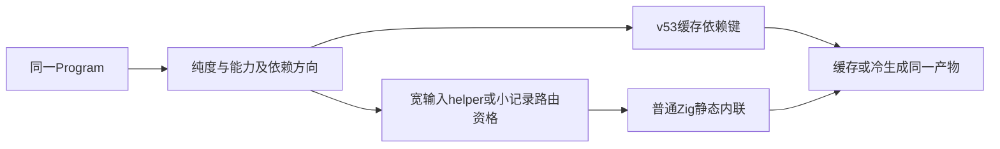
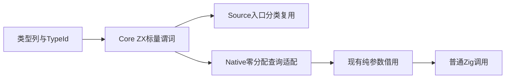

# Source 求值剩余成本

## Intent

保留已实现的 Source Function 求值、条件唯一性与通用 State 借用，关闭剩余累计
性能差距。按当前实际成本选择下一项改动，不重复已否定的表示微调。

## Data

已提交推送 f27616c1。通用 State 引用的独立快照 212 项通过，集成固定点为
2044 文件；完整 Function/条件能力仍在工作区，不将其视为整个目标已交付。
详细旧证据见《跨调用条件唯一性》和《私有状态引用》。

本轮局部别名实验将私有 State 输入的对象字段绑定为 const 指针，普通参数和
结果消费仍显式解引用。首版 564/564 检查通过；收窄到含 State 子值的对象后，
Context 命中、简单 Request 保持按值；受影响复验 84/84 通过，两代 2044 文件
一致。三组 CPU before5.65/5.61/5.64、after5.63/5.57/5.64s，中位5.64→5.63s；
wall1259.202→1252.059ms，RSS658210816→662437888B。样本重叠，未获稳定收益。
六次计时的全部输出均与各自固定点相同，证据为 state-local-alias-*。

已仅恢复该局部别名尝试的五个旧文件并删除新增 input_alias 模块，保留 f27616c1
和全部先前迁移 WIP。后续不重试同一局部指针绑定，不为小差距反复计时。

## Edges

固定累计锚点仍为 ca03eb0011e3efd13221e1baefca7fcc10a1da77。
不撤回迁移、不放松不可变/身份/并发语义、不增加专用运行库或原生语义桥。
只测受影响路径，不新增测试。诊断副本和输出位于 /tmp，不作为正式实现提交。

新的诊断区分线程自身 CPU 与墙钟：CLOCK_THREAD_CPUTIME_ID 记录同步阶段
inclusive CPU；嵌套阶段不能相加，时钟与计数本身也有成本。Mach 的 PC/LR 样本
只定位热点，不从样本比例推导整轮 CPU 或精确收益。探针工具不参加性能门禁。

## Answer

current-cost-profile 副本仅插入阶段时钟，保留当前生产算法、分配和生成模块。
记录 settlement、demand、plan、Borrowed.init、publish、facts、shared types，
以及 Source initialize/unknowns/invalidate/settle/transfer/buffer flags 等入口。
19 个标签的定义在 current-cost-profile-labels.json。

诊断任务均已完成。首个 current-cost-profile 仅 Source 探针生效：构建命令的
-Mgenz 使用相对路径，未被绝对路径替换命中。修正后 current-cost-profile-full
实际包含 Native 与 Source 两组探针；两次输出均与正式 2044 文件固定点一致。

完整探针记录：Native summary.settle 9191 次、1401.65ms；Source close 13482 次、
925.89ms，其中 settle 835.91ms。initialize 83.24ms、unknowns 70.74ms、invalidate
37.71ms；transfer 69.26ms。Borrowed.init 17709 次仅 3.37ms，borrowing.collect
0.64ms，不应继续优化这些非主要成本。所有时间均为 inclusive 线程 CPU。
Source-only 的运行样本定位到 visit、complete、aggregate，不把样本比例当成收益。

下一项假设：aggregate 对象字段映射的线性扫描可用索引位置命中减少遍历；只在该
位置索引确实匹配时直接返回，其余保持扫描。canonical/expressions/rules/objects.zx
验证字段范围、完整数量与唯一性，因此合法 IR 不会出现重复字段改变首匹配语义。
该尝试仍需同输入产物、既有回归和实际 CPU 证据，不能据静态代码认定收益。

对象字段位置命中已通过 338/338 既有检查（168/168 构建步骤），两代与六次正式
计时产物均为 2044 文件完全一致。交错三组 CPU5.64/5.62/5.66 →5.56/5.60/5.56s，
中位5.64→5.56s；wall1254.04→1235.78ms，RSS661438464→658145280B，保留尝试。
该文件属于尚未完整收口的 Function 迁移，不单独制造不完整提交。

完整采样进一步定位 visit 入口；实际机器码每次递归分配约 0x3220 字节栈帧。
生成代码对 metadata.usage.plan.slot_first 先重建整个 usage 的私有表示，再选择
最终字段；这些中间转换只从 ABI 借用，不能提供新所有权。下一项生成器修正仅对
连续字段投影沿原 ABI 链读取，在最终消费字段转换；已缓存、normalize/renew
及特殊循环布局保持现有路径，不改变求值次数或原始对象身份。

只读审查发现首版 raw 锚点使用 expr 会绕过原 projection 对值函数、scope、迭代的
layout 分派，可能新增对象装箱；已改为共用原 projection，避免用省中间转换换来
根分配。最初构建与回归不代表修正版，按完成句柄后再补验对应变动。

扩展验收首次 363/363 检查通过，但 product-transfer 9 条生成路线共同卡在既有
格式自检：7 个夹具仍是旧内联对象/长 RX 属性。已用现有 formatter 从源码对齐，
保留原格式/120 行/数值/容量断言，不新增用例。修正版重跑六组回归；另从 HEAD
提取两项生成器变动，在不含 Function/条件迁移 WIP 的独立快照核验依赖完整性。

修正版六组原命令已结束：388/388 运行检查通过，但 product-transfer 的 object、
nested、retained_target、growth 四路旧文本计数仍失败（期望2/2/1/1，实为0）。
冻结当前输入、生成模块及原生源码，仅恢复 lower 的本轮变动重建 before 工具：
四路完全相同失败，生成 source/types 与 after 逐字节一致，排除本轮投影造成。

四路已写出的真实产物直接运行既有 root 与 capacity_test 共22项全部通过；两种
容量模式 initial/first/long 均4526204字节，smaller_payload262168字节，预算未改。
旧 `.fromOwnedSlice` 文本次数既不能识别私有 State 的缓冲传递，也只扫描已变为
wrapper 的 execute，移除该过时代理和仅供其使用的 slots 表；保留格式、IR、全部
运行语义、分配失败和实际容量检查。原构建命令仍需重跑收口，不能把直接运行说成
原 gate 已通过。

最终投影对照三组 CPU before5.58/5.57/5.56、after5.59/5.57/5.56s，中位均5.57s；
wall1239.49→1241.44ms，RSS655491072→659128320B。全部计时产物与各自2044文件
固定点一致。虽然57文件减少236519字节、ABI不变，未证明实际执行收益；这些中间
转换很可能已由 Zig 消除，不能将源码缩短误报成性能提升。按技能要求，仅撤回本轮
raw 投影 helper 与 lower 变动，保留迁移、字段位置命中和真实回归修复。独立快照的
200项通过是该已撤回尝试的证据，不用于证明最终代码已通过某项新增功能。

撤回投影后，原 test-product-transfer 命令在当前迁移工作区收口：71/71步骤、
47/47检查通过，两个容量结果仍为相同4526204/262168字节。实际容量预算与输入
不变，无新增用例。独立 HEAD 快照已恢复原 lower、删除投影 helper，仅应用这10个
回归维护文件，另跑同一47项以确认本阶段提交不依赖未提交的迁移。

独立 HEAD 快照的同一命令也完成71/71步骤、47/47检查，容量数字一致。提交范围
仅这10个回归维护文件和本 IDEA 进度记录，不包含 Function/条件唯一性迁移或已撤回
的投影优化。该范围没有生产性能变化，不另为格式和回归维护重复计时。

后续判据：不再尝试同类局部指针别名或仅缩短生成源码的投影改写。下一步先取得
visit 总次数、缓存命中次数与节点分布，对照 Native 缓存入口和实际机器码，确认
是否是递归调用边界/缓存快路径成本；计数探针不用于报告运行收益。缺少这项证据
前不再增加表示优化。完整 Source Function 收口、固定累计基线和最终传递依赖
审计仍未完成，保留目标。

本轮查询计数诊断完成：当前实际路径 total40260374、hit2204439（5.48%），raw87；
Source settlement 内34979866次，Native旧核心34869342次，差0.32%。后者临时关闭
整项Function的generated_analysis，也失去Source transfer/buffer_flags；其1264个
输出差异明确保留，不能用来做正确性或整轮性能对照。该探针只支持：主要查询数量
并未因遍历顺序差异出现数量级放大。Source两份探针全部2044输出一致。

Source缓存未命中节点集中于Reference/Field/Object；缓存命中快路径不是优先项。
同时确认initialize写Unknown后settle首轮再次invalidate，存在重复整表写入；尚不
把小初始化开销当成主要差距。下一项可证伪诊断：仅在临时生成副本将complete标为
Zig inline，观察常量operation等调用点字段能否消除大记录传递；不按函数名在生产
增加规则。只有真实收益和正确性成立才设计通用成本资格及结构化生成。

临时complete内联诊断三组 before5.60/5.50/5.52、after5.24/5.17/5.16s，中位5.52
→5.17s；六次2044文件均与正式固定点一致。wall中位1209.31→1170.65ms，首个
after2966.734ms异常保留；RSS654688256→665763840B，不能宣称内存收益。

开始实现通用有界记录 helper 内联资格：Source entry分析选择纯、无IO/process/Task、
无契约、无循环/transform的短函数，输入为较宽对象、输出为较小对象；调用依赖严格
在当前Function之前，排除自递归及前向环。预算是成本启发，不作语义证明。Native
仅传递当前Function编号并消费Source布尔资格，原有Function.inlined与printer输出
inline token，未增加源码模板或新运行库。Native seed保守不内联，旧Source旗标的
引导代仍不启用本能力。

通用规则实际选中43个函数，含complete；S2→3全部2045个非输入指纹文件一致。
工作区与独立HEAD+10文件快照的六组既有回归均271/271步骤、351/351检查通过。
后者不含Function/条件迁移、scalar分类扩展或growth能力。两者验证范围包括函数
事实与实际执行、值返回/借用/循环初值，以及模块缓存的复用、替换与资源回收。

缓存除升级v53外，函数引用键增加callee相对owner的先后关系与IO/process/Task
能力，复用原pure/local及类型/主体/契约信息。只哈希相对关系，不因ID整体平移
机械失效。临时源码副本在complete中加入永不执行的普通loop使其失去内联资格：
热缓存仅4文件重生成、1961复用，与冷生成2045文件完全一致；恢复原文后1965
文件全部复用，全部输出恢复一致。原仓库源码未被该编辑修改。

正式同输入三对CPU before5.60/5.52/5.57、after5.20/5.20/5.20s，中位5.57→5.20s，
wall1228.047→1179.126ms。六次全部2045输出均与各自固定点一致。RSS中位
651935744→662142976B，不能宣称内存改善。二进制4993568→5084000字节。

针对RSS疑点，临时Root副本只包装Resident.gpa，不改变算法或生命周期，记录请求
分配量，不把它称为全进程物理驻留：alloc调用均18180；累计请求1345476676→
1345679748字节（+203072），未释放请求峰值1221605535→1221605841（+306），
保留请求432949185→432949491（+306）。两份探针全部输出仍与各自固定点一致。
未发现与RSS差值相当的堆请求增长；机器码的visit栈帧0x3220→0x3470（+592字节），
内联存在正常的栈/代码体积成本，不把CPU收益说成所有内存指标都下降。最终累计
验收仍保留RSS趋势，不用单阶段数字覆盖全目标差距。

阶段提交仅通用内联资格、结构化生成接线与缓存完整性；所有生产规则来自RX/ZX，
没有针对函数名、路径或输入样例的特殊处理。字段位置命中仍随未收口Function迁移
保留。自我复核：固定点与351项检查证明本能力的相应范围，不能替代最终传递依赖
审计；Source Function及条件能力仍未提交，固定累计基线不重置。

继续核对实际调用接口：projection只使用Context.metadata，却传整个Context；member
只使用Layout列，却收到完整私有Layout值。改为共同接收已有的只读Metadata引用，
避免在高频调用边界打包不需要的描述符。只读数据仍借用原owner，不改字段/类型
索引算法及边界错误。涉及所有projection/member调用方，完整保留同一Metadata。

同时移动settle的invalidate：初始化已生成全Unknown，首轮直接查询；某轮changed
为真时才在该轮结束后清表供下一轮使用。唯一调用者close.rx显式先initialize，
没有跨轮查询或原Known快照观察；最终未变化轮的查询缓存仍随结果返回。

已用当前支持具名递归函数的CLI格式化本次七个Source文件；旧zig-out/bin/zxc的
fmt不支持该语法，不将旧二进制误认为新源码不合法。第一次接线遗漏demand/trace
直接member调用，编译前已补齐；先前失败日志保留，不放宽任何检查。

Metadata接口实测projection输入88→32字节，member输入96→24字节；七文件调整
后S1→2全部2045文件一致，六组既有检查343/343步骤、841/841项通过。CPU三对
before5.24/5.21/5.20、after5.10/5.12/5.15s，中位5.21→5.12；wall1185.94→
1160.07ms，RSS664453120→662667264B。六次全部2045产物均与对应固定点一致，
保留本次Source优化。它属于尚未完整收口的Function迁移，不制造缺依赖提交。

继续收口既有共用标量分类：Entry.scalar原规则已递归处理Optional，Native调用方
却仅识别直接scalar/enum/error_set，导致Nullable scalar调用不走纯参数借用分支。
core/type_table/scalar.zx统一此谓词，Entry复用；Native仅通过零容量allocator调用
Source查询，seed保留保守原生引导。独立HEAD快照只增加这六个文件，不包含Function
/条件迁移、Metadata收窄或growth能力；其回归与该查询的实际CPU影响另行核验。

共用分类独立快照也完成271/271步骤、351/351项检查。配套Source与Native完整构建，
原生零容量allocator查询实际执行通过，没有引入同职责的生产Native分类规则。
代码生成的50文件变化来自Nullable scalar纯调用参数改用现有借用路径，保留所有
原有可空标量、枚举、对象借用和失败清理检查，不改公共返回值与错误约定。

该调用路径专项三对CPU before5.19/5.07/5.12、after5.13/5.12/5.13s，中位5.12→
5.13s，样本重叠且差0.01s，属于既定容差内，不宣称提速；wall1166.59→1168.59ms，
首个before3235.53ms异常保留。RSS中位661258240→664764416B，样本范围明显重叠。
六次2045产物均与各自版本一致；after复用Metadata阶段固定点。累计锚点仍为
ca03eb0011e3efd13221e1baefca7fcc10a1da77，不把本次小差异当作新的可累积预算。

本次可独立提交范围为共用类型谓词、Source消费者复用、包与引导入口，以及Native
薄适配和一个调用点；其余Function/条件能力和七文件Metadata调整继续留在工作区。
该职责是分类规则已迁移及Nullable scalar借用接线完成，不代表完整类型系统状态或
整个编译器已经自举。未新增测试用例，未重置性能基线。

18141cc8已推送，通用标量分类提交后六文件与独立验证树非空行一致（仅formatter
空行变化），工作区保留原Function和条件迁移。新的current-hot2采样1546个运行
PC：visit176、aggregate24、memcpy129，member已不在主要热点；样本只作定位，
不是CPU占比。全部2045输出仍与Metadata固定点一致。

下一项临时诊断：仅对生成副本的aggregate/projection/member强制inline，检查
中间Request/成员结果记录的ABI成本。三者没有自递归；不按名字在生产选择。若
收益成立，再用Source的通用结构/预算规则决定是否支持小记录及可空记录路由。

路由临时inline三对CPU5.23/5.14/5.13→5.08/5.05/5.00s，中位5.14→5.05；全部
2045产物一致。该证据尚不作为生产规则交付：现有通用策略没有小记录/可空记录
选择，扩大策略需另看编译体积和分配，避免按三个名字硬编码。

只读审查从memcpy调用者找到确定重复：ownership/facts/rewrite完成复合节点后
cache，然后再进一轮find读取刚写入值，才完成帧。本次用resolved与complete区分
下钻/完成，公共末尾执行pop/rewind/父追加，缓存仍先完成；真正重复子树命中不变。
Forest是只追加的DAG，缓存值就是当前完成结果，没有重编号或新状态语义。

同职责Fact编码集中到const.zx，保留Copy0/Owned1/Loaned2/Borrowed3/Moved4及
product起点5（与State枚举声明顺序不同，不能直接按枚举序号替换）。uniform/summary
按同一主体match，其余编码消费处显式导入，结构性索引/步长仍为原值。

生成两代2045产物一致。六组首次运行遇5个旧裸map/reduce测试片段，尚未进入
所有权断言，改为数组方法与显式元组投影；原5项预期不变。独立快照首轮481/486，
补跑失败的field-facts后27/27通过；工作区补跑同样通过，首版六组共486项通过。

首版完成标志重构的正式CPU中位均5.15s（before5.17/5.15/5.14，after5.15/5.16/
5.11），没有可辨收益，不能把静态少一轮直接说成提速。已改更小的同一职责实现：
保留原分支，只记进入本轮的stack depth；唯一下钻分支会增加depth，其余路径当前
frame已完成，统一末尾在depth未增加时pop。无需额外resolved/count/index预读取，
避免为已知完成路径新增森林查表。该后续变更必须补验，不能复用首版计时结论。

第二版栈深判据经只读审查，唯一改变深度的成功路径为child push；缓存及分配错误
仍在弹帧前传播。工作区与独立快照均235/235步骤、486/486检查通过；S1→2全部
2045个Zig产物相同，只有记录生成器身份的.zxc-inputs不同并单独排除。

第二版三对CPU before5.20/5.14/5.14，after5.14/5.16/5.10s，中位仍5.14→5.14；
wall1186.25→1181.33ms，RSS661651456→664109056B。六次各2045个产物均与
各自参考一致。没有可辨CPU收益，且RSS中位增加，因此停止该方向，不继续微调。
两版循环优化都已撤回；恢复控制流程经反向替换常量并去空白后与原文件完全一致。
这不是撤回Source迁移；Function、条件能力及已验证的Metadata优化仍留在工作区。

本次最终仅交付Fact语义常量与九处消费对齐、uniform/summary同主体match，以及
两份现有fixture的五处旧map/reduce调用修正。所有编码值及match映射已由两套
486项检查覆盖；恢复的循环控制是既有原实现，不把试验计时冒充最终常量改写收益。
纯常量命名与等价match不再重复性能对照，复用已有语义及原控制流程证据。
没有新增测试、改变断言、创建分支或提交未完成的Function迁移。

证据位于/tmp/zxc-function-levels：fact-depth-{working,independent}-checks.log、
fact-depth-stage-code-comparison.json、fact-depth-paired-results.json、
fact-depth-paired-comparison.json；初版日志同样保留。自查：静态减少循环不能替代
整轮成本证据；不保留无收益的重构，也不将局部完成宣称完整自举通过。

通用小记录路由资格实施：保留宽输入原策略，新增输入对象最多4字段、结果为最多
4个标量字段的对象（允许外层Optional），复用core标量分类；字段为聚合时拒绝。
两条路径共用192表达式预算、无自有循环/任务/并发、无契约和副作用、callee严格
小于owner的约束。资格规则在ZX中实现，RX仍负责入口能力与副作用编排。
该范围包含所有匹配结构的函数，不引用Function求值器文件名或路径。

缓存只读核对确认：已有TypeId递归摘要覆盖Optional/对象字段/标量分类，表达式和
契约、callee方向已有键；生成器摘要负责实现变化失效，不增加无关数值owner键。
先构建真实Source生成器、检查选择规模及两代产物，再集中运行既有受影响回归和
同输入性能对照。若扩大资格导致后端体积或运行成本退化，撤回本优化尝试。

新增规则从43个扩大到69个候选，增加26个；S1→2的26处差异均仅为callValue的
inline标记。三个先前诊断热点均在新增集合内。S2→3的2046个产物全部一致，
正式生成器二进制5084496→5066896字节；体积数字不代表运行性能结论。

复制当前四个Source根到临时目录，对projection加入不执行的普通loop，使其失去
有界资格；热缓存2生成1964复用，与冷生成2046产物完全相同，且恰有该函数失去
inline。恢复后0生成1966复用，全部产物回到修改前。原仓库源码未作该探针修改。

独立快照六组初验833/841通过，8项function-updates容量失败；不能归因于新规则。
正在使用独立快照HEAD原资格仅补跑该组，确认是否为缺少尚未提交Function迁移的
共同基线问题。工作区同六组仍在原进程执行；保留全部原失败记录，不降低容量预算。

独立原资格补跑function-updates为344/352通过，仍是flat/branch/chain/mixed的
source/library共8项容量失败；与新资格失败集合逐项相同。独立快照其余489项通过，
新资格整套833/841通过，未引入新增失败。工作区包含尚未提交的Function/条件迁移，
本轮343/343步骤、841/841项全部通过。独立基线的容量问题仍属完整迁移收口范围，
不能把它隐藏为“独立快照全绿”，也不通过改容量上限规避。

正式隔离三对CPU before5.16/5.14/5.17，after5.04/5.02/5.01s，中位5.16→5.02s；
wall1180.81→1180.19ms，基本持平，首轮before1291.48ms保留。RSS中位662437888
→663224320B，范围before657227776–662634496、after660717568–664633344B
重叠，不宣称内存改善。六次2046个产物均与对应参考完全一致，资格变化仅26个
inline标记；保留本次通用优化。最终Source只有三个文件，不新增原生规则或测试。

最终证据：routing-policy-selection.json、routing-policy-stage-comparison.json、
routing-policy-cache-edit-comparison.json、routing-policy-common-failures.json、
routing-policy-{working,independent}-checks.log、
routing-policy-independent-before-updates.log、routing-policy-paired-results.json及
routing-policy-paired-comparison.json，均在/tmp/zxc-function-levels。

自查：诊断三函数不是生产名单；生产资格由类型形状、能力和有界调用图统一决定。
本阶段减少CPU而未证明墙钟或RSS改善，不能把三项指标混用。完整自举仍需继续迁移
及最终传递依赖和seed→1→2→3核对；固定累计锚点ca03eb0011e3efd13221e1baefca7fcc10a1da77
不变，本次5.02s仍未消除相对约4.11s Native记录的差距，不宣称整体性能门禁通过。

2026-11-05继续Function收口。使用最新routing-policy生成物重新构建带Mach探针的
临时生成器routing-hot；生成2046产物与正式S3一致。采样中visit168、root.settle66、
memcpy132，visit仍为主要单函数热点；样本只用于定位，不能当作CPU占比。

只读逐分支对照发现Reference的emptyList元数据在递归之前提前读取；Native先得
结果，仅unique为true时才因&&短路读取。最小Source调整保留reference默认empty
为false，只在Value/Part递归结果返回后，对Value且unique结果检查目标是否为空。
Input/Carried/Condition原来均不属于Value，保持false；原子读、递归、complete缓存
发布和materialize顺序不变，空列表仍先于usage获得唯一性豁免。
该内部改动属于尚未收口的Function迁移，不另造缺依赖提交。先看真实产物及实际
成本，只有有收益才集中补现有相关回归；不为每个无收益尝试重复整套验收。

延后empty检查的三对CPU5.16/5.14/5.11→5.15/5.11/5.07s，中位5.14→5.11，范围
重叠且收益弱；六次产物均与各自参考2046文件一致。未继续为此微调或重复计时，
已恢复该visit调整，保留此前已验证的Function实现和通用inline优化。

Function提交边界只读审查确认：close、settle、demand、plan和操作收集均已正式
转入五个Source入口；Function/{levels,summary,demand,plan,operations}.zig仍负责
ABI/表示及结果发布。旧level/raw/trace只在generated_analysis=false引导路径使用。
unchanged/replay/applyMark仍由正式Ahead/Root调用，是后续全局缓存接受、摘要重放
与工作队列迁移范围；本阶段不能称function.zig已只剩ABI，更不能称全局自举完成。

审查发现实际遗漏：Native ownership.eligible读取Plan.transfers与slot_first，决定
生成代码是否清除exclusive，但fingerprint.plan只包含flags及renewals。已将两列
以带长度的连续字节写入指纹，复用批量hash避免逐元素包装，并升v54隔离旧键。
同一工具内资格事实变化现在参与失效；生成器摘要变化不能替代这个输入依赖。

按先实现再优化原则，集中收口Function级逻辑迁移及必要的conditional/State/growth
消费接线；累计性能差距作为仍未完成的目标保留，不让微调反复阻止完整职责验收。
本轮完整既有packages/test test门禁已启动（small，-j6），不新增测试、不修改期望
或容量阈值。继续核对真实增量/冷生成及恢复、串行并行和阶段固定点；最终只对
完整职责提交，原生全局调度和最终性能门禁继续明确列为未完成。

完整回归已暴露旧合同对齐项：scanner元数据清单遗漏Pipeline/As；semantic持久
缓存断言仍要求module.v3，实际源码及落盘均为module.v7；目录index已支持但CLI、
project、resolve三份旧断言仍要求拒绝；process service缺显式void入口契约。
本轮仅修正这些既有断言/清单及fixture，保留原调用图、后缀/环/包边界诊断和容量
阈值，不新增命名测试。scanner原5项通过，持久缓存原5项通过，CLI导入14项及
process原46项通过；原生目录解析的旧拒绝断言也需同步，补跑该失败组。

Safe CLI后端SIGSEGV在全新HEAD导出中同样出现，原命令和对照日志保留；不是本轮
Function变更新增。完整回归还有内部Source模板/类型解析CLI未声明core包的问题，
以及高负载HTTP进程SIGKILL，尚未排除，不将整套验收报告为通过。
product-transfer日志中的w及stderr诊断是过程报告，不能在总结果前误计为失败。

复用现有borrowed.zx作只读诊断，Source和library两路flags相同且renewals均为0：
重复first别名使transfers12288→0，slot_first不变；second由列表改标量使transfers
12288→64、slot_first由4/6/.../18变2/3/.../9。两种编辑均完成热/冷6文件一致及
恢复一致。诊断只在/tmp修改副本，未修改既有测试源。编辑本身也改变body/type，
不能把它宣称为同旧key碰撞反例；本次hash修正由实际消费者依赖及完整Plan输入
保证，证据边界明确。

目录正向断言发现原生module_path.index存在32字节临时数组泄漏：Source path.join
的列表字面量经executeValue分配到普通caller allocator，caller只释放返回字符串。
修复既有ABI边界：临时arena持有Source中间分配，返回路径复制到caller拥有的结果，
defer释放临时资源。Source路径语义不变，不新增原生规则/运行库；这仍是待移除的
原生表示边界，不宣称全编译器数据零复制已完成。

适配初版catch分支未显式return error，局部result保留error union导致编译错误；
已修正并冻结源码补跑。完整回归当时仍在执行，后续报告必须区分这些构建失败，
复用已通过行为检查而补跑受影响失败步骤，不能把旧过程失败当最终结果或直接丢弃。

未迁移HEAD Small从全新git归档构建成功；同样复现RX compiled Store发布的
ConflictingFunction和Store initial lint断言失败。HEAD Safe同样后端SIGSEGV。
基线日志为function-closure-head-{small-build,safe-build,rx-compiled,lint-rx}.log；
这些共同问题仍需处理，但不归因为本次Function规则迁移。此前实现和性能欠账不撤回。

目录适配修复最终通过工作区73/73步骤、11/11检查，CLI14项通过且无泄漏。
仅从HEAD加入该适配与七份既有fixture/断言的独立副本，四组90/90步骤、29/29
检查通过；另外Node报告导入14、持久缓存5及process46项通过，保留各报告口径，
不把构建统计和Node重复累加。工作区与该副本八个文件逐字节相同。

本次独立可提交范围为目录路径生命周期修复及合同对齐；fingerprint v54和完整
Function/conditional/State/growth迁移仍在工作区，不随这次小范围职责提交。
完整门禁原句柄63253仍活跃，已通过结果保留，未完成/失败步骤继续核对。
验证日志contract-lifetime-independent-checks.log、function-closure-import-owned-final.log、
function-closure-scanner-fixed.log、function-closure-persistent-fixed-final.log、
function-closure-process-fixed.log，均位于/tmp/zxc-function-levels。

2026-11-05循环缓冲收口：完整回归与独立HEAD的test-iterate-buffer均60/66通过、
同6项失败，另有旧日志完全同值。branch仅index<count决定入轮，enabled且index>=3
才写入；现有iteration提前renew导致1/2轮及disabled仍复制。不能将其归为本轮
Source迁移新增退化。短长分配不等尚需验证，不能凭字节差直接宣称每轮复制。

复用已完成的HEAD验证副本，覆盖当前116个WIP文件后用作隔离原型，原安装HEAD
binary保持不变；完整回归63253继续在主工作区执行。原型只改三个Native lowering
文件：选中StateList的循环携带标记guarded，跳过对应入轮renew；list_update对这种
原本in_place的操作检查实际storage，非exclusive时首次写入才分配header，之后
复用。非StateList及深层buffer原路径保留，已有transfer/clip继续处理别名与快照。
未加入新测试/阈值，先使用现有66项迭代检查验证，再决定是否应用到主工作区。

原型被否定并从隔离副本恢复，主工作区从未应用。只读审查发现三处完整性缺口：
selected_state不安装deep的iteration_value context，guard未被读取；只保护ListUpdate
却跳过所有StateList叶子的renew，reverse/sort/pop/push仍可误信in_place/header；
独立callee也可因旧All摘要直接写输入，调用点未必有第二次renew。原型实际构建虽
完成，但现有11个fixture均在CLI校验IR阶段失败，说明影响了编译器自身的数据。
不能靠接一根context指针或只通过branch用例将它宣称为修复。

能力缺口是物理storage许可必须在每个消费边界与抽象摘要匹配，包括集合变更和
跨ABI调用；在贯通该能力前保留当前安全的提前准备，不牺牲不可变性换惰性复制。
本次证据已改变下一步：停止局部skip-renew原型，不为它继续生成/调试更多小变体；
先集中收口已完成的Function逻辑迁移与缓存依赖，再处理该通用许可能力及剩余成本。
既有6项loop失败仍明确保留，不改阈值，也不将其冒充Source迁移新增退化。

完整回归另暴露program_pure把limit当self的旧漏洞：functions/calls允许target==limit，
函数内恰是self ID，但顶层程序的limit是表长，导致空表call0及call==count误被当纯。
已复用genz同类成熟做法：可选self_function与limit分离，仅functions/analyze显式
传当前函数index；顶层调用省略self，保持无身份上下文，不放行越界。原两项越界
断言保留；旧“拒绝纯自递归”的既有断言改为当前已支持的纯自递归结果。
不新增用例，集中补run test-function-effects及相关有效IR范围。

递归身份修复两套环境均36/36步骤、40/40检查通过；原两项无效IR调用断言未改，
forward/out-of-range/Store/Task边界保留，唯一对齐的旧断言是已支持的纯自递归。
独立副本不包含Function/conditional/growth迁移，三个文件与工作区逐字节相同。
证据function-effects-self-identity-{checks,independent}.log。该修复可独立提交，
不以它代替完整Function迁移和累计性能验收。已更新现有IDEA交接记录，无新测试。

## Function逻辑迁移提交收口

集中六组最终验收207/207步骤、363/363检查通过：function-analysis、实际静态链接
runtime、loop-call-origins、cached-ownership、field-ownership、module-generation。
包含缓存资源/OOM范围。验证启动后116个实现/夹具文件未变；当前完整Source两代
2046产物相同。此前841项相关行为与486项所有权检查按其范围复用，不重复累加。

完整test句柄63253仍在运行，总结果不算通过；已确认的共同基线问题和旧过程构建
失败继续保留。已纠正的scanner/barrel/process/cache及purity问题各有独立通过证据。
loop6项原失败和被否定的隔离原型都没有通过改阈值、跳过或忽略来处理。

本次提交完成“函数体级求值、需求追踪与计划生成逻辑已迁入RX/ZX”：五个正式Source
入口注册，Level/Read/Request/State/Growth等规则及状态由Source定义，RX表达阶段
连接。Native保留POD/ABI借用和发布适配及旧seed实现；正式Ahead/Root仍调用
unchanged/replay/applyMark，属于下一项全局调度与摘要重放迁移，不能称全闭包自举。

本提交包含conditional StateList三态及transfer/slot_first消费联动；它们是保持现有
不可变与容量行为的必要接线。memo v17保存新列，生成指纹v54显式涵盖新列。
借用的Native表示边界仍是过渡，不把静态链接、零临时分配或Source后缀当最终完成。

按用户“先实现、再优化”保留并提交已贯通职责，累计性能门禁不随功能提交宣告通过。
最近有效完整生成对照约5.02s，固定Native锚点约4.11s，差距仍在；新purity修复后
两代产物已核对，但完整回归编译未结束，不在其干扰下制造新的正式计时。
后续继续优化及迁移，不撤回Source实现，也不重置累计锚点或把微小容差重复累加。

最终证据：function-closure-final-related-checks.log、function-closure-current-fixedpoint-
comparison.json、function-closure-cache-comparison.json及function-plan-facts.json，
均在/tmp/zxc-function-levels。此前实际Source语义编辑的增量/冷生成和恢复证据一并
保留。完整编译器仍待传递依赖审计和严格seed→1→2→3最终验收。

## 全局读集校验逻辑迁移

Intent：把Ahead接受后台结果前的读集一致性判断迁入普通RX/ZX，继续缩小全局
调度对Native语义的依赖；不把本项等同于Root调度、摘要重放或完整自举完成。

Data：Native Read是连续记录，普通Source对象数组入站仍是指针数组，不能直接
强转；每条记录只读table、function、slot和packed Level。摘要四张表的形状在
校验期间稳定，单元通过现有std:bytes AtomicRows按monotonic读取。

Edges：借用现有记录的只读字节视图；ABI适配仅提供size/offset/endian和按Native
枚举序排列的四张表，不新增Read专用原生读取器，不逐项装箱或复制。std:bytes
补通用readU32，支持显式大小端、非对齐读取和越界错误。packed Level比较沿用
Source decode屏蔽未使用的高位；遇到首个不一致立即停止，不再读取后续摘要。
空记录返回true。Native入口使用零容量分配器暴露意外分配，而不隐藏分配成本。
记录布局仍来自Native，属于过渡表示；最终仍须迁移读集状态的持有和全局调度。

Answer：正式generated_analysis路径接入reads/check.rx及unchanged.zx；保留seed
旧路径。复用现有function-analysis行为与资源检查，检查实际生成代码和两代产物，
完整回归结束后才做受影响路径性能对照。初次构建的两个
ABI编译错误已修复：Zig 0.17枚举反射使用field_names/field_values；opaque指针
使用生成的具体元素类型，不能直接赋值anyopaque指针数组。最终相关检查句柄
88893已成功结束，58/58步骤、49/49既有检查通过，包括资源/OOM范围。

正式新生成器已成功生成116入口、2042模块。仅把Native读集判断恢复为HEAD的
独立对照生成器，在相同Source输入下产生的2051个文件全部相同；`.zxc-inputs`
仅是工具/输入身份摘要，不属于源码产物，显式排除。Source再构建第二代并生成
第三代，同样2051文件全部相同。新入口使用零容量FBA贯通真实完整生成路径，
未出现意外分配错误。不是仅凭静态签名推断零分配，也不把固定点当最终自举完成。

证据为reads-migration-checks-abi-fixed.log、reads-baseline-output-comparison-excluded.json、
reads-fixedpoint-comparison.json，均在/tmp/zxc-function-levels；生成器命令及临时
Native基线副本同目录保存。未新增测试用例，未调整既有断言或容量预算。

自我复核：这项交付迁移的是完整读集判断算法，尚未迁移Native持有读集的状态
模型、Root/Ahead队列和摘要重放。std:bytes.readU32仅执行通用二进制读取；布局
适配也仍是显式过渡依赖，不把它描述为最终零桥接架构。完整回归63253现已结束，
7432/7750构建步骤成功（73个直接步骤失败，另有传递失败），106214/106247
运行检查通过、33项失败；不能将相关检查通过冒充完整回归通过。失败日志保留
构建期间已修复问题，后续按实际失败范围复验，不重跑整套。

读集迁移已提交推送3c958253。完整回归结束后、确认无活动构建，先对初始引导
生成模块构建的新旧读集工具做三组交错冷生成：CPU before6.88/6.84/6.84s，
after6.83/6.85/6.85s，中位6.84→6.85s；wall1560.78→1583.93ms，
MaxRSS840450048→837632000B。样本重叠，没有可辨别CPU变化，不宣称提速。
六次计时各自2051产物与Source固定点全部相同，均显式仅排除`.zxc-inputs`。
本组生成模块来自初始引导，不与此前约5.02s的Source稳定生成模块混算；继续
构建同一Source固定点的新旧读集工具，作为正式自举路径的局部对照。

稳定Source生成模块的正式局部对照：CPU before5.08/5.01/5.02s，
after5.06/5.05/5.06s，中位5.02→5.06s；wall1178.20→1169.53ms，
MaxRSS659144704→661307392B。before首次wall2971.24ms为离群项，CPU5.08s；
不删样本、不把wall中位改善当CPU无退化。六次2051输出均与固定点完全相同。
CPU约0.04s增加列为待解决成本，不按单次微小容差永久豁免；固定累计Native锚点
ca03eb0011e3efd13221e1baefca7fcc10a1da77不变，仍未通过最终性能门禁。

一次受控优化尝试把Source decode两次枚举分派改成直接比较andBits后的低位，
复用packed_mask；仅unchanged生成函数、类型声明排序和文件摘要变化。构建完成
后用相同稳定Source模块/相同当前输入做三组交错：CPU before5.07/5.02/5.09s，
after5.10/5.07/5.07s，中位5.07→5.07s；wall1180.06→1180.89ms，
MaxRSS658505728→659636224B。六次2051产物各自与同输入固定点相同。无稳定
收益，已只恢复本项Source文件到3c958253，保留完整迁移，不再重复微调此表达式。
该组基线波动也说明不能把首组0.04s直接当精确归因，但仍保留其成本欠账。

证据reads-fixedpoint-paired-results.json、reads-fixedpoint-paired-*-comparison.json、
reads-mask-paired-results.json及对应六份比较报告，均位于/tmp/zxc-function-levels。
当前源码精确恢复至已通过49项及两代固定点的提交；无需为完全相同的输入重构建。

完整回归分类初步证据：73个直接失败中43个是编译失败，其中11个为运行过程中
已修复的module_path错误返回，32个因新增读集入口后旧构建图缺少新import。
这是主agent在完整回归尚未结束时修改Native依赖所造成的验证不一致，不能算作
一致源码快照上的语义失败，也不能据此忽略；下一轮冻结源码、按受影响scope补验。
另有6个CLI装载失败、12个Node失败及12个Zig运行失败（共33个测试失败）。
仅复用已完成且输入未变的通过证据，实际剩余问题继续修复，不重跑整个7750步骤。

只读审查已生成/tmp/zxc-function-levels/full-final-failure-audit.md，列出全部73个
直接失败及日志行号。下一轮先定位test-type-merge的20项未归因失败；URL两路
将fixtures目录误当suite而读取不存在cases.zx，primitive-libraries在切换cwd后
仍执行相对CLI路径，均有静态证据。SIMD debug位置、Store发布/回滚与lint、HTTP
SIGKILL仍需分别处理。旧图32个编译失败对应的10组补验范围已列入该清单。
