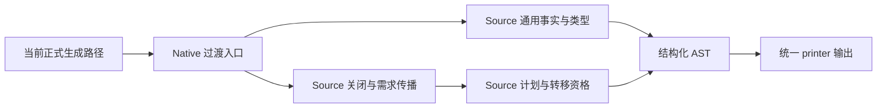
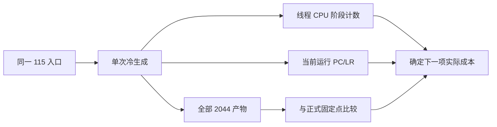

# Source 求值剩余成本

## Intent

保留已实现的 Source Function 求值、条件唯一性与通用 State 借用，关闭剩余累计
性能差距。按当前实际成本选择下一项改动，不重复已否定的表示微调。

## Data

已提交推送 f27616c1。通用 State 引用的独立快照 212 项通过，集成固定点为
2044 文件；完整 Function/条件能力仍在工作区，不将其视为整个目标已交付。
详细旧证据见《跨调用条件唯一性》和《私有状态引用》。

本轮局部别名实验将私有 State 输入的对象字段绑定为 const 指针，普通参数和
结果消费仍显式解引用。首版 564/564 检查通过；收窄到含 State 子值的对象后，
Context 命中、简单 Request 保持按值；受影响复验 84/84 通过，两代 2044 文件
一致。三组 CPU before5.65/5.61/5.64、after5.63/5.57/5.64s，中位5.64→5.63s；
wall1259.202→1252.059ms，RSS658210816→662437888B。样本重叠，未获稳定收益。
六次计时的全部输出均与各自固定点相同，证据为 state-local-alias-*。

已仅恢复该局部别名尝试的五个旧文件并删除新增 input_alias 模块，保留 f27616c1
和全部先前迁移 WIP。后续不重试同一局部指针绑定，不为小差距反复计时。

## Edges

固定累计锚点仍为 ca03eb0011e3efd13221e1baefca7fcc10a1da77。
不撤回迁移、不放松不可变/身份/并发语义、不增加专用运行库或原生语义桥。
只测受影响路径，不新增测试。诊断副本和输出位于 /tmp，不作为正式实现提交。

新的诊断区分线程自身 CPU 与墙钟：CLOCK_THREAD_CPUTIME_ID 记录同步阶段
inclusive CPU；嵌套阶段不能相加，时钟与计数本身也有成本。Mach 的 PC/LR 样本
只定位热点，不从样本比例推导整轮 CPU 或精确收益。探针工具不参加性能门禁。

## Answer

current-cost-profile 副本仅插入阶段时钟，保留当前生产算法、分配和生成模块。
记录 settlement、demand、plan、Borrowed.init、publish、facts、shared types，
以及 Source initialize/unknowns/invalidate/settle/transfer/buffer flags 等入口。
19 个标签的定义在 current-cost-profile-labels.json。

诊断任务均已完成。首个 current-cost-profile 仅 Source 探针生效：构建命令的
-Mgenz 使用相对路径，未被绝对路径替换命中。修正后 current-cost-profile-full
实际包含 Native 与 Source 两组探针；两次输出均与正式 2044 文件固定点一致。

完整探针记录：Native summary.settle 9191 次、1401.65ms；Source close 13482 次、
925.89ms，其中 settle 835.91ms。initialize 83.24ms、unknowns 70.74ms、invalidate
37.71ms；transfer 69.26ms。Borrowed.init 17709 次仅 3.37ms，borrowing.collect
0.64ms，不应继续优化这些非主要成本。所有时间均为 inclusive 线程 CPU。
Source-only 的运行样本定位到 visit、complete、aggregate，不把样本比例当成收益。

下一项假设：aggregate 对象字段映射的线性扫描可用索引位置命中减少遍历；只在该
位置索引确实匹配时直接返回，其余保持扫描。canonical/expressions/rules/objects.zx
验证字段范围、完整数量与唯一性，因此合法 IR 不会出现重复字段改变首匹配语义。
该尝试仍需同输入产物、既有回归和实际 CPU 证据，不能据静态代码认定收益。

对象字段位置命中已通过 338/338 既有检查（168/168 构建步骤），两代与六次正式
计时产物均为 2044 文件完全一致。交错三组 CPU5.64/5.62/5.66 →5.56/5.60/5.56s，
中位5.64→5.56s；wall1254.04→1235.78ms，RSS661438464→658145280B，保留尝试。
该文件属于尚未完整收口的 Function 迁移，不单独制造不完整提交。

完整采样进一步定位 visit 入口；实际机器码每次递归分配约 0x3220 字节栈帧。
生成代码对 metadata.usage.plan.slot_first 先重建整个 usage 的私有表示，再选择
最终字段；这些中间转换只从 ABI 借用，不能提供新所有权。下一项生成器修正仅对
连续字段投影沿原 ABI 链读取，在最终消费字段转换；已缓存、normalize/renew
及特殊循环布局保持现有路径，不改变求值次数或原始对象身份。

只读审查发现首版 raw 锚点使用 expr 会绕过原 projection 对值函数、scope、迭代的
layout 分派，可能新增对象装箱；已改为共用原 projection，避免用省中间转换换来
根分配。最初构建与回归不代表修正版，按完成句柄后再补验对应变动。

扩展验收首次 363/363 检查通过，但 product-transfer 9 条生成路线共同卡在既有
格式自检：7 个夹具仍是旧内联对象/长 RX 属性。已用现有 formatter 从源码对齐，
保留原格式/120 行/数值/容量断言，不新增用例。修正版重跑六组回归；另从 HEAD
提取两项生成器变动，在不含 Function/条件迁移 WIP 的独立快照核验依赖完整性。

修正版六组原命令已结束：388/388 运行检查通过，但 product-transfer 的 object、
nested、retained_target、growth 四路旧文本计数仍失败（期望2/2/1/1，实为0）。
冻结当前输入、生成模块及原生源码，仅恢复 lower 的本轮变动重建 before 工具：
四路完全相同失败，生成 source/types 与 after 逐字节一致，排除本轮投影造成。

四路已写出的真实产物直接运行既有 root 与 capacity_test 共22项全部通过；两种
容量模式 initial/first/long 均4526204字节，smaller_payload262168字节，预算未改。
旧 `.fromOwnedSlice` 文本次数既不能识别私有 State 的缓冲传递，也只扫描已变为
wrapper 的 execute，移除该过时代理和仅供其使用的 slots 表；保留格式、IR、全部
运行语义、分配失败和实际容量检查。原构建命令仍需重跑收口，不能把直接运行说成
原 gate 已通过。

最终投影对照三组 CPU before5.58/5.57/5.56、after5.59/5.57/5.56s，中位均5.57s；
wall1239.49→1241.44ms，RSS655491072→659128320B。全部计时产物与各自2044文件
固定点一致。虽然57文件减少236519字节、ABI不变，未证明实际执行收益；这些中间
转换很可能已由 Zig 消除，不能将源码缩短误报成性能提升。按技能要求，仅撤回本轮
raw 投影 helper 与 lower 变动，保留迁移、字段位置命中和真实回归修复。独立快照的
200项通过是该已撤回尝试的证据，不用于证明最终代码已通过某项新增功能。

撤回投影后，原 test-product-transfer 命令在当前迁移工作区收口：71/71步骤、
47/47检查通过，两个容量结果仍为相同4526204/262168字节。实际容量预算与输入
不变，无新增用例。独立 HEAD 快照已恢复原 lower、删除投影 helper，仅应用这10个
回归维护文件，另跑同一47项以确认本阶段提交不依赖未提交的迁移。

独立 HEAD 快照的同一命令也完成71/71步骤、47/47检查，容量数字一致。提交范围
仅这10个回归维护文件和本 IDEA 进度记录，不包含 Function/条件唯一性迁移或已撤回
的投影优化。该范围没有生产性能变化，不另为格式和回归维护重复计时。

后续判据：不再尝试同类局部指针别名或仅缩短生成源码的投影改写。下一步先取得
visit 总次数、缓存命中次数与节点分布，对照 Native 缓存入口和实际机器码，确认
是否是递归调用边界/缓存快路径成本；计数探针不用于报告运行收益。缺少这项证据
前不再增加表示优化。完整 Source Function 收口、固定累计基线和最终传递依赖
审计仍未完成，保留目标。
