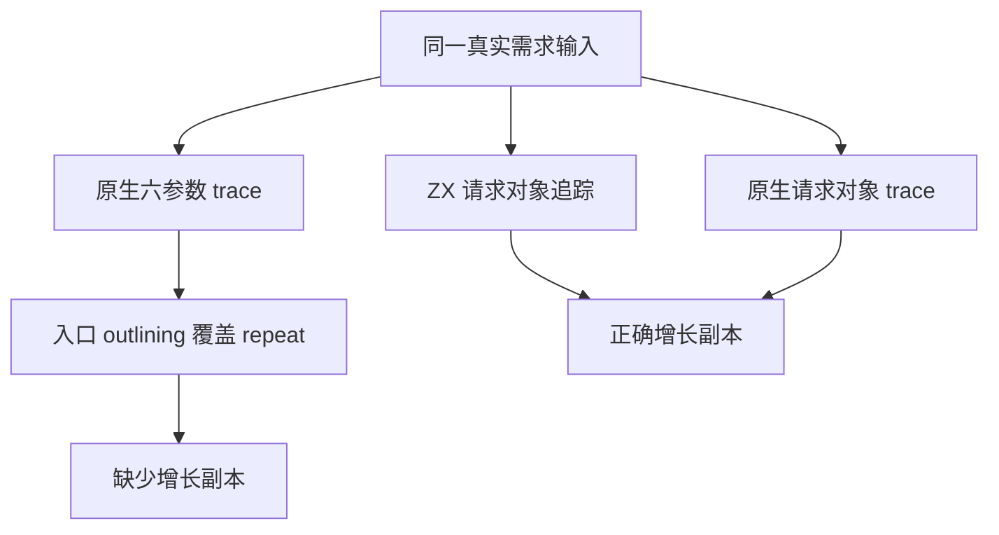
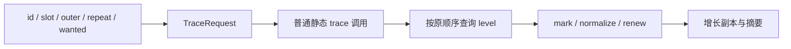

# 原生需求追踪参数覆盖修复

## Intent：最终目标

消除自举差分参考中的真实错误，保留需求追踪算法及零运行时约束，再核对 RX/ZX
迁移是否与正确的原生语义一致。生产修改使用普通 Zig 请求对象，不更改算法或
追踪顺序，不依赖特定函数名、源码路径、寄存器地址或编译器诊断补丁。

## Data：可用证据

证据目录：`/tmp/zxc-function-levels/`。

原 query-only 差分在真实模块 members.zx 的 fn891 稳定失败：Source normalized
含节点50、63，值均为2；Native为空。两边19次level请求及返回值逐项相同，均为
Deferred4。此前详细日志改变了代码形态，不能据日志版通过认定修复。

对保留调试信息但仍能失败的二进制反汇编发现：原生 trace 的六个参数中，
repeat 使用 x4；函数入口的后端 outlining 序列却先用 x4 保存返回地址，随后
仍用该寄存器计算 repeat。因此 repeat 读到的是返回地址的低位，正常为 false。
被 outline 的 helper 只保存 x19–x28，没有备份或恢复传入的 x4。

| 证据                            | 文件                                   |
| ------------------------------- | -------------------------------------- |
| 完整 trace / normalize 机器码   | query-static-disassembly.log           |
| outlining helper 与函数调试信息 | query-outline-prologue.log             |
| 保留符号版本的原始失败          | query-symbols-execution-with-debug.log |
| 仅替换两条指令后的完整差分      | query-register6-probe.log              |
| 请求对象版本的正常编译完整差分  | request-abi-oracle.log                 |

单因素实验只把两条保存/恢复返回地址的指令改用空闲寄存器，并对本地诊断副本
进行 ad-hoc 重签。未增加运行探针或改变追踪算法，完整113入口通过：2289次实际
分析、2289次独立deferred分叉、1,321,920条读取记录一致。正常源码编译的请求
对象版本随后也通过相同差分，包括 known、增长副本、mark、changed 和摘要行。

这证明本次差分参考的机器码存在参数覆盖；尚不据此判断所有 Zig 优化模式、
平台或 LLVM 版本都有同类问题。

## Edges：边界与限制

- 二进制补丁只用于确定根因，不进入生产源码、构建流程或生成产物。
- trace 改为 self + TraceRequest，21处调用保持原来的字段值、求值依赖与顺序。
  请求包含 id、slot、outer、repeat、wanted，仍由普通 Zig 静态调用传递。
- 这是原生过渡实现及 seed 的正确性修复；不能为了复现旧错误去删掉 Source
  合法的增长副本，也不能以回到旧原生实现作为性能验收。
- 完整 Function 迁移仍保留在工作区。独立提交应只包含既有原生实现的参数
  收束及验收记录，不混入未收口的迁移和表示优化。
- 独立修复快照构建34/34步通过。相关回归1212/1220项通过，8项容量断言失败；
  另外6个编译失败来自已移除的Lane/transfer夹具接口，不能报告整组通过。
- 对8项容量失败对应的flat/branch/chain/mixed，修复前独立生成的源码及库消费
  路径与修复后全部8组源码/ABI逐字一致；因此该容量缺口未由本修复引入。
  保留断言，不放宽预算。证据 updates-request-comparison.json。
- 旧函数分析夹具需单独对齐当前Analysis公开接口，不恢复废弃生产抽象；Program
  必须继续存活，不能把内部scratch可释放误写成整个IR可提前释放。

## Answer：交付与成功标准

正常编译的请求对象版本通过完整真实差分。仅关闭Function的Source派发以构建
正确原生对照，其余代码与迁移版本相同；同一113入口完整生成的2027个文件与
Source版本逐字一致，仅排除.zxc-inputs。两处长期复制差异均消除。证据
request-abi-native-comparison.json。

另外隔离本次修复，在固定107入口输入、Zig0.17.0 small模式下，使用独立输出与
缓存、关闭resident，三组交错CPU：before4.57/4.47/4.49秒，after4.56/4.49/4.50秒；
中位4.49→4.50秒。墙钟中位1.023→1.017秒；after首轮1.692秒离群仍保留在报告，
没有丢弃样本或重复计时。RSS中位521.75→521.32MB（十进制）。差异在用户容差内，
不重置固定累计锚点。证据 trace-request-paired-results.json。

该107入口前后预期有两个生成模块改变增长副本及frontier复用，其余代码保持
一致；.zxc-files仅更新相应摘要。不能把正确性修复应有的复制差异解释为格式
变化。证据 trace-request-frozen-comparison.json。

本次独立提交只收束原生追踪请求和记录证据。Function迁移继续保留，其整体
性能与完整自举验收仍未完成。

### 自我复核

根因由失败原二进制、两条机器指令的单因素实验、正常源码编译差分和完整产物
对照共同支持；不依赖加日志后的偶然通过。既有容量失败和过时夹具均保留为
未完成项，不能用本次修复掩盖，也不将1212项通过说成整组回归全绿。

