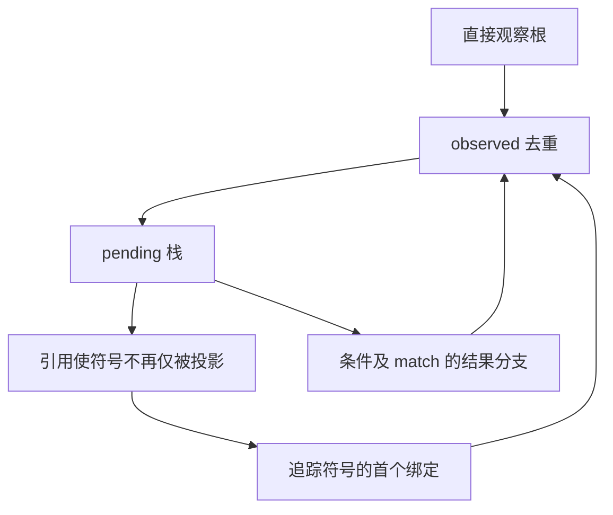

# 投影消费事实自举

## Intent：最终目标

将 `zx/value_call/projections.zig` 的符号消费规则迁入普通 RX/ZX。
保持原算法：收集直接观察、绑定和任务捕获，之后用去重工作清单传播消费事实。
不改变借用判定结果，不为了迁移额外分配每个表达式的子节点数组。

## Data：可用证据

Native 输入为表达式列、控制列和符号数，输出每个符号是否仅被投影消费。
`core/expression_table/child.zx` 已能逐个查询子节点，不需要使用会构建数组的
`analysis/ir/children.zx`。Native `Children.at` 的顺序作为语义对照。

## Edges：边界与限制

重复绑定保留首个绑定，并观察前值和新值；作用域先于控制常量收集。
任务捕获直接取消对应符号的投影资格。字段、元组投影和引用不直接观察其子节点；
条件及 match 先观察判定部分，只在整个结果被观察后传播到各分支结果。
每个表达式只入栈一次。没有新语法、原生语义桥或解释运行层。

已有函数求值器 WIP、8 项容量失败及累计性能差距属于尚未完成的独立问题。
本阶段不得用局部验证证明完整自举。

## Answer：交付与成功标准

交付 RX 三阶段编排、ZX 事实收集与工作清单算法、Native 数据适配及 seed 保留。
验收应含真实编译输入上逐次 seed/Source 事实对照、生成产物一致、受影响既有检查、
相同入口的 CPU/耗时与内存对照；正式构建需使用 Source 分支。
Source→Source 的 115 入口生成 2033 个文件，全部一致。
临时 oracle 在 493 次真实调用中，对照 10679 个符号事实，逐项相同；其生成的
2033 文件也与正式候选一致。临时比较和计数器未进入生产源码。

三个交错轮次在相同 115 入口和生成内核上，仅切换此分析的 seed/Source 分支：
CPU 中位数 5.50 → 5.46 秒，墙钟 1263.16 → 1227.87 毫秒，RSS 中位数
643956736 → 641351680 字节。首个 seed 墙钟 3548.76 毫秒的离群值保留在原始记录，
不据此宣称加速；其余样本区间有重叠。未测得本阶段新增性能退化。

固定累计锚点仍为 `ca03eb0011e3efd13221e1baefca7fcc10a1da77`。两工具均保留同一
函数求值器 WIP，本次对照不能证明它相对 Native 的约 0.99 秒差距已被消除。

生成源码复核确认 observe 使用原地布尔写入与 zxReserve 追加，不为读取子节点
创建临时列表；State 为私有值表示，宿主只借用列描述符并返回拥有的 bool 列表。
expressions.zx 为内聚的观察种子扫描算法，137 行是 lint 评审信号，保留语义空行，
不为满足 120 行信号将其机械拆成多个转发文件。

现有 function-analysis、function-analysis-runtime、value-return、native-value-boundary
四组的 200 项测试通过。borrowed-call-views 起初被旧 MissingReaderCall 形状断言
挡住：两入口均调用共享 step，step 内只有一处读函数调用，旧断言却要求值调用
至少出现三次（含定义）。现改为普通和值调用均检查“定义加至少一处实际调用”。

先在 prefix/offset 的真实编译任务中增加临时双实现对照，每项 19 个符号事实一致，
oracle 输出的源码也与正式任务逐字节相同，确认不是此次事实迁移引入的差异。
修复已有断言后，该组 44/44 步、28/28 项检查全部通过；覆盖 Source/library 两路、
零轮身份、旧值及字符串保留、重复选择、大量增长、准确越界与分配失败清理。
未新增用例，未改变预算或关闭检查；不重复执行已经通过的其余四组。
日志为 views-final-checks.log 与 view-{prefix,offset}-oracle.log。

证据保存在 `/tmp/zxc-function-levels/value-projections-*`：stage-comparison.json、
oracle.log、oracle-comparison.json、paired-results.json、related-checks.log。

自我复核：本次迁移的是“仅被投影消费”的完整事实算法，不包含 locals.zig 的
输入直接投影快速判定及全部借用策略。Native seed 仅供引导/对照；其他 Native
适配器和待迁移状态仍需按最终依赖闭包标准逐项清除。
