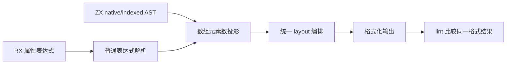

# 数组方法与垂直排版对齐

## Intent：最终目标

按用户最新要求统一 RX/ZX 的多元素数组排版，将 map/reduce 从 utils 调整为数组方法，
并用既有 pipeline 简化只消费一次的连续计算。ZX 优先复用 TS 已有表达，但保持
明确的不可变、元组返回和所有权契约，不凭 TS 返回值覆盖 ZX 设计。

## Data：可用证据

当前 Native calls.zig 与 Source traversal/calls/target.zx 显式拒绝 map/reduce 方法；
utils 中两者已共用 collections 的 loop lowering。恢复方法可复用同一路径。
旧文档和实际实现仍将 map/reduce 返回值列为单值，与用户本轮强调的元组要求不一致；
用户再次强调元组并要求核对关联数组方法后，依照已有全局不可变操作协议统一为
`[数组, 业务值]`：map/filter 为 `[结果数组, void]`，reduce 为 `[原数组, 累计值]`。
push/pop/sort/reverse/splice/concat 原有二元契约保留，every/some 只读查询仍为 bool。
with 是 TS 式不可变替换，当前契约为新数组，不在本次回调方法迁移中改写。

布局和 lint 共用 layout RX/ZX 规则。语法 AST 区分列表值、索引和类型列表，
可直接投影多元素值的 multiline 标记；不靠文本逗号计数判定数组元素数。

## Edges：边界与限制

两个及以上元素的数组值一律纵向，开闭方括号各占一行；空和单元素数组按现有宽度。
不将索引、T[] 后缀或类型元组误标为数组值。数组中的对象仍保持原来的垂直规则。
RX 短属性也进入同一表达式投影，保留 LF/CRLF、注释及幂等性。

map/reduce 的接收者、初值及显式实参各求值一次，回调顺序和错误传播保留；
普通输入保持不可变，不引入专用运行库或新 transform IR。

pipeline 改写只折叠单次消费且无独立业务含义的传值绑定，不穿越 lambda 边界，
不改变短路、副作用、对象键名或求值次数。保留必要的语义空行。

## Answer：交付与成功标准

交付 Native/Source 同步支持、utils 导出清理、现有源码及夹具/文档对齐、统一格式规则。
使用既有格式/集合/所有权/库与缓存检查；不新增测试用例，不为纯格式改动计时。
语法糖与等价管道应生成相同普通循环，只有实际生成形态或开销变化才对受影响路径计时。
每个完整阶段检查后提交推送，不将未收口的求值器迁移一起提交。

## 数组排版阶段验收

Native 与 indexed AST 均将多元素数组投影到同一 multiline 标记，RX 属性复用表达式
解析；Args 与 Field.type 保持类型语法，不把类型元组当作数组值。

已格式化 2,060 个有效 RX/ZX 源文件；不将原生接口声明 .d.zx 交给普通函数解析器。
第二次格式化全部幂等。现有 RX 检查中 52 项格式用例、2 项分配失败检查、1 项
执行前后对照通过。执行对照首次受缺少 z3 阻断，安装依赖后只重跑该失败项并通过。

115 入口经新生成器处理后，2,032 个 Zig 文件与格式化前逐字节相同（另有输入清单）；
纯排版不做性能对比。证据在 /tmp/zxc-function-levels/vertical-arrays-*，包含格式化
清单、幂等报告、检查日志及 complete-comparison.json。

自查：只将已闭合的数组排版职责提交；此前未收口的求值器实现不纳入提交。
数组排版提交：d9dc0915，已推送。

## 管道简化阶段

AST 扫描 1,842 个 ZX 文件，发现 826 处单次使用的相邻 const 候选。选择 179 处
循环结果只取一次字段的绑定，以及原生库名称编码链，共改写 180 个文件。保留业务
命名、多处消费和回调边界；此前未提交的求值器文件不纳入此阶段。

既有零分配查询检查发现管道作用域未复用普通 const 的标量入口栈布局策略。
scope lowering 补齐该策略，不扩展对象逃逸条件，不为新对象引入运行库；真实槽位
查询生成物已无 allocator.create，两个零分配断言恢复通过。

既有前端检查另有一个旧断言要求拒绝同函数自递归。使用改写前生成物单独复现相同
失败，确认与本次管道无关；按已支持的具名默认函数递归契约修正该既有断言。
未新增测试用例。前端 313 项、函数分析 49 项、借用视图 28 项、原生值边界 35 项
检查通过，共 425 项；借用与原生值边界在 scope 修复后复核通过。

修复后的生成器对 115 个入口阶段自编译，2,032 个 Zig 文件逐字节一致。180 个修改
文件再次格式化均幂等。纯排版阶段不计时；因管道实际暴露分配差异，本阶段仅对受
影响的同一生成路径交替测量三组。CPU 中位数 5.24s → 5.21s，墙钟 1,143.47ms →
1,128.82ms，RSS 644,104,192 → 643,956,736 字节，范围重叠，不宣称明确提速。
累计性能仍以 ca03eb0011e3efd13221e1baefca7fcc10a1da77 为固定基线，不重置容差。

证据：/tmp/zxc-function-levels/pipeline-applied.json、pipeline-scope-stage-comparison.json、
pipeline-frontend-final-checks.log、pipeline-function-fixed-checks.log、
pipeline-boundaries-final-checks.log、
pipeline-final-paired-results.json；原失败及改写前复现日志一并保留。

自查：管道改写不能仅靠语法等价宣称零成本，已用现有零分配边界发现并修复 lowering
缺口；仍需按真实借用生命周期验收。
完整自举及其累计性能差距仍未完成。

## 数组回调方法与元组阶段

Native 与 Source 已同步接入数组 map/filter/reduce，并移除 std:utils 中 map/reduce
的枚举、导出及旧路由。编译器源码的 150 处旧调用已改为方法与显式索引；旧夹具和
生成源头同步迁移，没有新增测试用例。完整接口返回二元元组，显式投影的类型上下文
传给回调，保留可空元素、空数组及数值字面量的既有推导。

初次实现的容量回归源于分析阶段先构造整个元组，丢失循环的直接消费关系。仅在后端
删临时元组未恢复更早的所有权与布局事实，该尝试已移除。最终在集合分析阶段消费
显式常量槽位，直接生成对应 result/source/unit 的 scope；所有源、实参和回调仍按原
顺序求值，选未使用的业务结果也不能跳过整个迭代。完整元组返回使用原 tuple 原语。

现有值返回与容量 116 项、Source 前端 313 项、Native 回调 16 项通过。
20 个源生成脚本与产物一致。旧 AST 断言因调用
变为方法加显式投影而同步调整；没有放宽容量预算或修改数值期望。

115 个入口完成更新后的阶段自编译：stage 1 → 2 因提前消费槽位改变 79 个生成文件，
stage 2 → 3 的 2,034 个 Zig 文件全部一致。该证据不替代最终自举的传递依赖审计。

最后将上下文 TypeId 和目标 ExprId 保留在原 16 字节 Index 帧内，分别使用字段
output_hint/target；没有扩大所有索引帧，也不再逐次查找 coercion/span。
复用 core.max_u32 作为空 hint/已完成目标标记：expression_table/reserve.zig 与
type_table/storage.zig 均约束追加后 count 不超过 max_u32，因此最大有效 ID 为
max_u32 - 1。IndexTarget 完成后先弹 action，标记路径只弹 Index 帧；普通路径先存
实际 ExprId 再进入 IndexValue。节点身份匹配及合法常量槽位检查隔离嵌套索引。

候选与改动前的等价源码快照交错测量三组；快照用旧生成器生成的 2,032 个 Zig 文件
与改动前保存的产物完全相同，避免拿不支持新方法的旧编译器测新语法。
最终 CPU 中位数 5.19s → 5.20s（+0.01s），墙钟 1,115.97ms → 1,107.95ms，RSS
649,707,520 → 648,822,784 字节，未超出约定容差。没有把此前尝试的较好数字当作
最终数据；固定累计基线和完整 Function 迁移尚存的差距均保留，不宣称整体门禁通过。

工作区的 10 组既有运行门禁完成后，单独修正并补跑生成脚本遗漏的 filter/context。
最终暂存区导出到独立副本，排除未提交的求值器改动：前端 313 项、容量与数组回调
421 项全部通过，后者 235/235 构建步骤成功。未降低容量门禁；语法位置样例保留
生成器要求的 LF/CRLF。暂存的 frozen.zx 仅迁移旧 map 调用，保留提交前算法，
工作区中尚未收口的 frozen 实现不随本阶段发布。

最终证据：array-methods-frame-stage-comparison.json（2,034 文件相同）、
array-methods-before-snapshot-comparison.json（2,032 文件相同）、
array-methods-frame-paired-results.json、array-methods-index-frame-frontend-checks.log、
array-methods-index-frame-runtime-checks.log，均位于 /tmp/zxc-function-levels。
