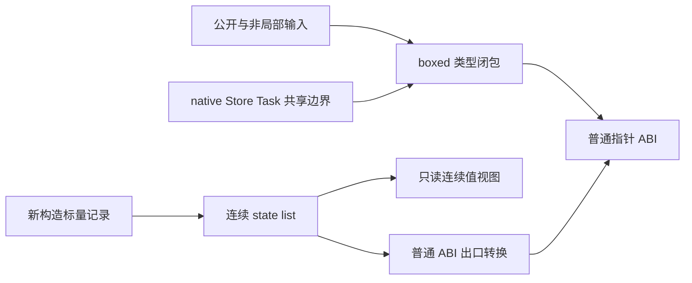
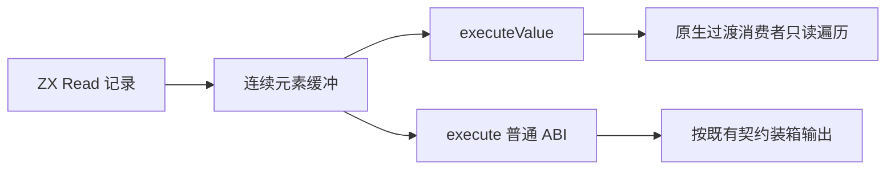

# 标量记录数组的连续值视图

## Intent

保留函数槽位求值器的 RX/ZX 实现，补齐其记录数组跨值入口逐项装箱的生成缺口。
普通公开 ABI 不变；允许安全的新构造标量记录数组通过 executeValue 连续借用。

## Data

- 内部 state list 已支持标量对象的连续 ABI 行布局，元素写入不需要逐项分配。
- 现有 View 类型及转换将列表退回普通 ABI，输出 Read[] 因而仍需指针数组和装箱。
- 可见性分析把公开输出、类型导出与外部输入一起视为入站数据，阻止 Read 的选择。
- Source 函数求值器仍比原生参照多约 1 秒 CPU；此前计数约 540 万条 Read 分配。
  分配次数不是 CPU 占比证据，本次不能预先宣称消除此差距。
- 复用现有数组、借用视图、原生边界与快照检查，不新增测试用例。

## Edges

- 外部可进入的输入必须保持 boxed 闭包；native 输入与输出、Store、Task、比较、
  重复共享及非 fresh 元素等既有保护继续生效，不能仅删除 visible 门禁。
- 普通 execute 的 []const *Row ABI 和引用共享关系不变。executeValue 可使用
  []const Row 的只读值视图，不引入运行库、动态调度或专用求值器接口。
- boxed 父对象投影列表必须执行对应 ABI 转换，不能只包装原始指针数组。
- 输出重复路径检查深入列表；同一行类型在一个输出内重复出现时保守装箱，避免
  两次出口转换把同一元素复制为不同引用。可见性只放宽输出，所有真实入站仍保护。
- seed 可以保守保留 boxed 选择；两种选择都必须正确，Source 阶段固定点必须一致。
- 本阶段不代表完整 Function 迁移验收，也不解决跨调用条件唯一性的 8 项容量失败。
- 性能固定累计锚点仍为 ca03eb0011e3efd13221e1baefca7fcc10a1da77。

## Answer

交付通用生成器能力、真实求值器消费结果及验证记录。贯通类型选择、共享类型生成、
局部类型声明和双向视图转换后集中验收；行为与固定点通过后测受影响的生成路径。
保留迁移；无收益的优化尝试单独记录，不把未验证的设计称作完成。

## 实现与证据

- Value View 类型规划增加 Slice 包装；共享类型、独立声明和双向转换同步使用
  连续 ABI 行切片。普通 execute 仍走原来的指针数组转换。
- 入站闭包继续包含入口输入、公开函数输入、非局部输入和 native 双向类型；
  类型导出与纯输出不再被误作入站。输出重复检查现在深入 List，保留共享身份。
- boxed 父对象和循环消费者的 ABI 投影仅在 inlineStored 时走实际转换，其余列表
  保留原先直接借用。状态类型缓存身份升级到 state.value.origin.v4。
- 115 入口的 stage2→3 共 2,034 个 Zig 文件逐字节一致；只排除记录输入/工具身份
  的 .zxc-inputs，其他 2,035 个文件全部一致。报告位于
  /tmp/zxc-function-levels/inline-record-views-stage-comparison.json。
- 实际产物中连续对象行的值视图由 0 种变为 18 种；不是只改未启用的 seed。
- 工作区相关 Debug 门禁 232/232 步、538/538 项通过；Small 的原生缓存、数组
  回调和跨库别名门禁 185/185 步、424/424 项通过。原日志前缀为
  /tmp/zxc-function-levels/inline-record-views-。
- 独立暂存副本不含 Function WIP，前端 30/30 步、313/313 项通过；原生值边界及
  数组回调的 Small 运行检查 143/143 步、340/340 项通过。副本位于
  /tmp/zxc-inline-record-views-index，日志为 index-frontend/index-runtime 后缀。

## 失败边界与自我复核

默认 Debug CLI 编译两次 SIGSEGV；关闭二进制输出的相同命令通过，显式使用 LLVM
也崩溃。崩溃报告与历史 Zig 同类故障的栈偏移相同，仍不足以证明已定位根因。
逐模块去掉调试信息后，Debug CLI 成功编译，既有原生缓存与跨库别名 Node 检查
各 1 项通过；Small 完整组也通过。没有改正式构建策略或放宽测试，默认 Debug
CLI 的失败仍需保留，不能以其他模式通过宣称它已修复。

Read 同时可经其他公开入口的 State 输入进入，因此仍被入站闭包保护，不能安全
直接放开。当前阶段交付的是通用连续值视图，不是 Read 分配或约 1 秒 CPU 差距
已消除。下一步需要连通真实跨入口数据表示与所有权，不能绕过入站保护或用专用
接口硬编码 Read。原有 8 项条件唯一性容量失败与完整自举依赖闭包验收仍未收口。

## 性能验收

关闭常驻生成器，所有构建结束后，以同一 115 入口、源码、工具链与冷缓存边界，
交错执行三个 before/after 样本。before 保留与 after 相同的 Function WIP，只隔离
本阶段生成器变化；不是把 Native 与 Source 两套不同求值器混作本阶段对照。

| 指标     | 修改前中位数 | 修改后中位数 |
| -------- | ------------ | ------------ |
| CPU      | 5.23 s       | 5.18 s       |
| wall     | 1125.986 ms  | 1119.244 ms  |
| 峰值 RSS | 652263424 B  | 643842048 B  |

CPU 样本分别为 5.26/5.23/5.22 与 5.18/5.19/5.17 秒；未见阶段退化。原始测量
inline-record-views-paired-results.json 和每轮报告保存在 /tmp/zxc-function-levels。
三次 after 的全部 2,035 个非输入指纹文件均与 stage3 一致，before 各轮也互相一致；
对照报告为 inline-record-views-measure-output-comparison.json。

固定累计锚点没有重置，整项 Function 的约 1 秒 CPU 差距仍不达标。本阶段能力及
独立验收已经完成，可以单独提交；不把这次小幅改善算作完整自举性能已通过。
