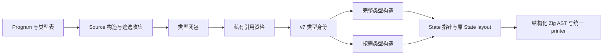

# 私有状态引用

## Intent

让同步调用中的私有只读聚合传递引用，减少递归反复搬运不变的列表描述符。
保留完整 State 布局与列表元数据，不改变普通 ABI、公开值语义或语言语法。
这是生成能力阶段；Function 逻辑迁移及其累计性能差距另行收口。

## Data

直接递归求值的 Environment 约 96B，原来内嵌于约 176B 的输入中，每轮重新传递。
只改整个输入为指针的旧实验未获收益；单独借用环境的临时实验，三组 CPU 从
5.55–5.57s 降至 5.47–5.48s，全部 2040 产物一致。

现有 selected=false 会退回普通 ABI，丢掉列表 storage；selected=true 则默认
state_types 与 state_layouts 相同，不能表达完整 State 的 const 引用。表达式
构造又发生在局部 block，不能直接把其中局部变量地址返回给调用者。

正式实现已在当前工作树通过以下检查：

- Source→Source 两代全部 2044 个非输入指纹产物一致。
- Function、循环初值、普通原生边界与借用运行检查完成。末次六组中资源检查发现
  新列释放遗漏，补齐后对应资源组 35/35 全过；其他已通过组复用其有效结果。
- 同一 115 入口三组交错 CPU 中位 5.72→5.64s；三对均下降 0.06/0.08/0.15s。
  wall 中位 1269.052→1258.579ms，首组 after 的 1864.865ms 异常保留，不据此
  推导墙钟加速比例。峰值 RSS 中位 661192704→664190976B，未取得内存收益。
- 每次计时的全部 2044 产物均与对应版本的固定点一致。生成形态有意改变，旧版
  对照核对 stage1，新版核对 stage3，不将两版文本差异误当语义差异。

证据位于 `/tmp/zxc-function-levels/private-state-reference-*`。固定累计锚点仍为
ca03eb0011e3efd13221e1baefca7fcc10a1da77；本阶段数字不能代表完整自举已无退化。

## Edges

资格由 RX/ZX 在完整共享 Program 上计算，不按文件名、类型名或源码 hash 选择。

- 只考虑原规则允许按值表示、包含托管描述符的宽对象。
- 全 Program 只有一个静态构造；其所属函数及契约含循环、transform、Task 或
  Parallel 时保守拒绝。宽度阈值仅是成本启发，不承担生命周期证明。
- 函数与 Scope 的结果、列表和 Task 元素、loop 初值进入逃逸类型闭包。
- 原有公开入口、native、Store、捕获与身份观察的 boxed 约束保持有效。
- 循环的只读环境可以转发引用，循环携带状态不能保留这种局部存储地址。

Native seed 给出同长度全 false 的保守资格列；正式资格来自 Source。新增列由
各持有者负责释放，错误与分配失败路径不能遗漏。

## Answer

State 仍保留 selected=true；借用类型的 state_types 是 const 指针，state_layouts
仍为原结构。普通 ABI/View 继续按既有契约转换，结构化 ConstPointer 原语负责
生成类型，未引入源码模板、运行库或动态调度。

构造、ABI 输入与 View 输入转换将布局存储提升至当前函数作用域，再在原求值位置
赋值并取得地址。契约谓词回传其存储收集器；Task worker 使用自己的收集器。
需要清除来源元数据时先复制布局，重绑新引用，保留旧版本。

提交仅包含通用资格与表示能力、调用方存储和资源接线。暂存树
41135b1433e605e9059e6010d3358f7211397d33 已导出至独立目录，用其配套 Source
与 Native 构建的五组既有检查为156/156步骤、212/212项全通过。范围包括函数
事实、函数实际执行、循环初值、原生值边界和原生借用运行；未借用与该树不匹配的
历史生成模块。独立日志为private-state-reference-independent-checks。

独立暂存树静态复核未发现遗漏依赖或混入的迁移实现；它仍使用HEAD的
headered: bool，不包含条件唯一性、growth资格或Function求值迁移。

当前工作树的条件唯一性还需要在其 ownership 裁剪处先复制 State layout；这项
联动保留在对应未提交迁移中，不把整个 Function 或条件凭据实现混入本阶段提交。
独立提交的 HEAD 尚无该裁剪通道，仍保留原有按值和来源清除保护。

自我复核：有用的局部提速、阶段固定点与借用能力完成，不能证明编译器自有规则
和状态的传递依赖闭包已经迁入 RX/ZX。最终 seed→1→2→3 和全目标性能仍待验收。
