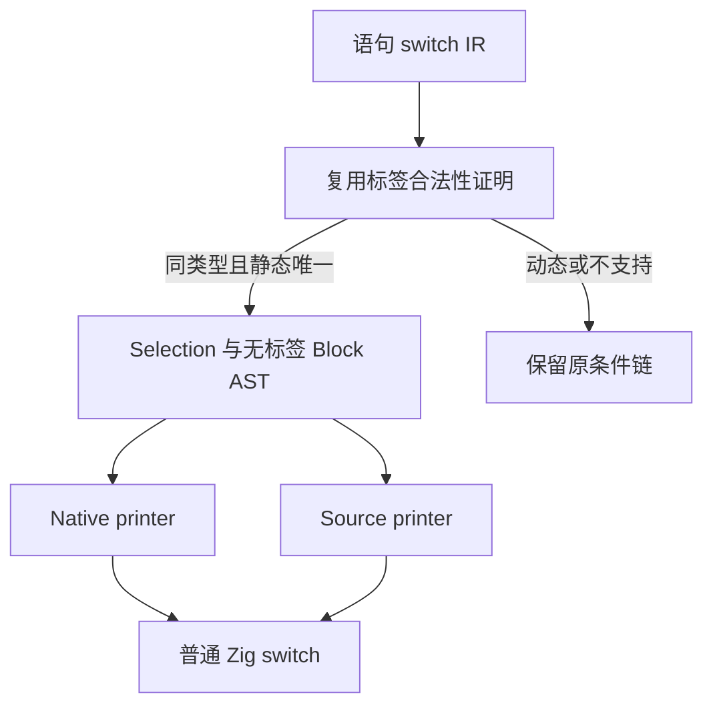
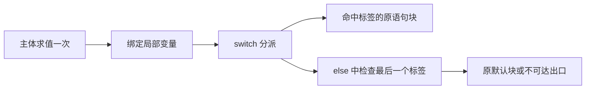

# 语句分派结构化生成

## Intent：最终目标

让 ZX 的静态语句分派直接生成普通 Zig switch，复用已有结构化 Selection AST。
这是生成质量补齐，不代表函数求值器整体自举或其性能优化已经完成。

## Data：可用证据

原有表达式 match 已使用常量标签证明；语句 switch 始终生成嵌套 if。
函数求值器的 Definition、ExprKind 分派因此没有保留目标语言的 switch 结构。

本次共用标签证明，并让 Native 与 Source printer 支持无标签语句块：

求值及作用域关系：

三个交错对照轮次，同一 114 入口、工具链和配置：CPU 中位数 5.19 → 5.19 秒，
墙钟中位数 1135.76 → 1132.41 毫秒。峰值 RSS 中位数 636486 → 643629 KB，
原始范围分别为 635978–644153 KB、632799–644989 KB，有重叠，未证明内存收益。
不将此次调整报告为性能优化成功。

Source printer 与 Native printer 生成的 2025 个文件逐字节相同。
既有 switch 求值顺序、嵌套、作用域、标量、match 和函数分析六组检查通过：
188/188 构建步骤、131/131 测试。未新增测试用例。

原始证据位于 `/tmp/zxc-function-levels/`：
`statement-switch-paired-results.json`、`statement-switch-stage-comparison.json`、
`statement-switch-final-checks.log`。临时日志不提交。

## Edges：边界与限制

只有至少两个同类型、互不重复的整数、布尔、枚举或错误字面量标签走此路径。
浮点、字符串、聚合、动态标签和重复标签继续走原路径，避免改变求值与优先级。
默认分支保留原位置语义；每个主体只求值一次，分支独立保留原块的作用域。

最后一个标签在 else 中判断，复用表达式 match 的既有做法，既保留未匹配时的
默认行为，又避免对已穷尽枚举生成 Zig 不接受的多余 else。

已证明为静态字面量的标签不能读取运行时表达式缓存。生成标签时临时绕过缓存并
恢复原绑定，避免主体与标签共用 ExprId 时把局部变量输出成 switch 的常量标签。
表达式 match 同步使用这一修正；普通表达式仍使用原缓存和所有权处理。

全部输出由 AST 和统一 printer 完成，没有源码拼接、专用运行库或动态调度。

## Answer：交付与成功标准

交付结构化语句分派、两个 printer 的对应支持、静态标签缓存修正及既有门禁证据。
最后的缓存修正已重新构建候选工具；114 入口生成的 2025 个文件与已验证产物
逐字节相同，仅源码指纹 `.zxc-inputs` 按预期改变。比较记录为
`statement-switch-final-comparison-verified.json`，复用既有性能对照。

自我复核：这次补齐了目标生成形态，但 CPU 未测得改善，不能据此消除函数求值器
Source 路径约 0.99 秒的差距。固定累计性能锚点仍为
`ca03eb0011e3efd13221e1baefca7fcc10a1da77`；完整迁移仍需满足累计性能标准。

本轮已停止三个无收益的优化尝试：压缩 carried 槽位 CPU 5.18 → 5.20 秒且 RSS
上升；批量发布 Read 记录 CPU 5.17 → 5.17 秒；Ahead 日志计数表明 Source 的读取
行数并未超过 Native，不能把差距归因为更多读取需求。优化探针已撤回，迁移保留。

另发现通用静态复合常量缺口：当前顶层 const 仅允许闭合标量，无法表达语义枚举
组成的常量表。未用裸数字编码或原生桥绕过，也未把未完成的常量表尝试留在源码。
