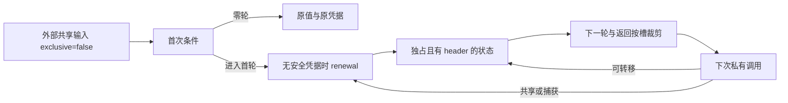
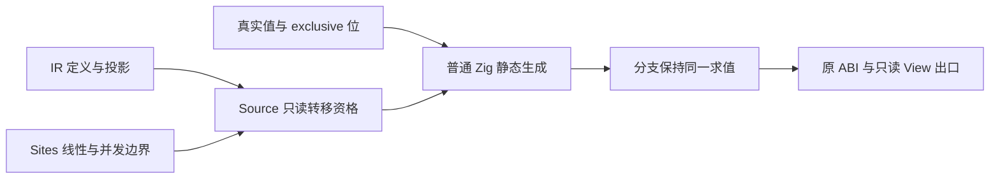
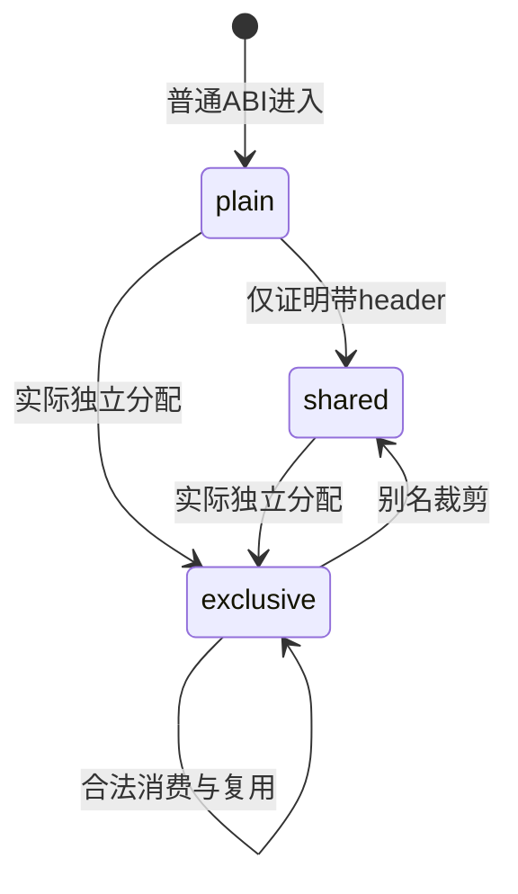
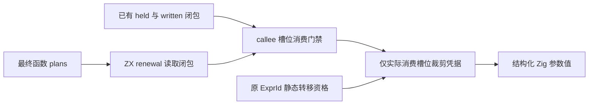
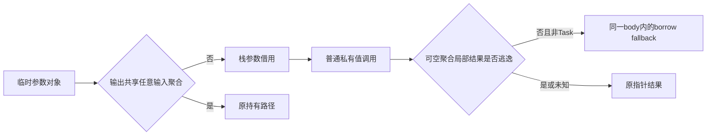
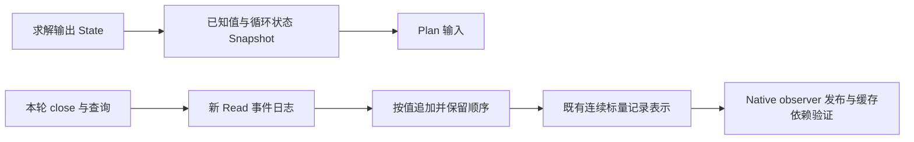

# 跨调用条件唯一性

## Intent

消除重复调用循环更新函数时，每次非零调用重新复制已独占缓冲的问题；保留零轮
identity、共享输入、旧快照、捕获与转义语义。保留已有 Source 函数求值器实现。

## Data

- 8 项严格容量失败来自 flat/branch/chain/mixed 的 source/library 两条路径。
- 现有静态 meet 将首次共享输入与后续独占返回合并，丢失条件关系；headered 只能
  证明缓冲头存在，不能证明唯一性。不能据 headered 直接跳过 renewal。
- 状态列表已有 items、headered 的私有描述符；两个 bool 可共享现有尾部 padding。
- Source 的 projection/member/aggregate 可追溯槽位；usage 加 concurrent 边界可以
  判定某次使用是否允许转移，但不能凭空授予独占。

## Edges

- 使用私有列表描述符传递一个 exclusive 凭据，让元数据与实际分支结果一起流动；
  避免为每个表达式另建动态调度或重新求值分支条件。公开 ABI 与 View 都不发布它。
- 凭据只来自真实复制、已有静态唯一性或安全继承；headered 不等于 exclusive。
- 跳过 renewal 需要 headered、exclusive 与静态转移资格同时成立。原始公共输入
  和未知来源从 false 开始。只有进入首轮后才允许 renewal，零轮保持原值。
- 调用实参、私有返回、循环初值与下一轮状态都按槽位裁剪；字段与元组投影须追源，
  不能复用 demand/linear 中对投影恒 true 的局部规则。
- 保留 Source 实现，先贯通再优化。阶段未闭合前不提交内部接线作为完整交付。
- 不新增测试；复用现有容量、captured/duplicate/escape、零轮和 Source/library
  门禁。性能累计锚点仍为 ca03eb0011e3efd13221e1baefca7fcc10a1da77。

## Answer

交付静态转移事实、私有凭据生成与裁剪、调用和循环联动，以及完整行为与性能证据。
8 项容量和所有隔离门禁通过、真实编译路径不退化后，才完成提交推送。

当前状态：实现中，未通过本阶段验收，不能宣称容量问题或完整自举完成。

## 实现记录

- 私有 StateList 增加 exclusive，公开 ABI/View 不发布。Source 只读 qualify 负责
  追溯字段、元组、定义、对象成员与分支，再与 Sites/concurrent 资格结合；没有
  凭据时不会因“允许转移”凭空获得独占。Condition/Element/Unknown 保守拒绝。
- 调用、返回、普通循环与借用字段循环均接入裁剪；借用字段在续用前丢弃凭据，
  非借用字段按真实槽位裁剪。合法 legacy Reduce IR 也清除初值与回写凭据。
- 新列同步进入 clone、ahead、replay 和磁盘 memo，版本从 v15 升为 v16；状态
  类型身份从 v4 升为 v5。保留 seed 的保守默认，正式 Source 计算资格。
- 第一轮发现无来源哨兵加一的 u32 溢出，以及 copyPlan 漏复制新列。均已修复，
  生成进程的 BUS 不再复现。没有把崩溃归咎于环境。
- 修复后既有 test-function-updates 的 350/352 项通过，原 8 项容量失败只剩 mixed
  的 source/library。隔离、错误与效果检查没有放宽。此结果是中间证据。
- 临时仪器复用原 mixed 容量用例及原数据，记录 arena backing 5,506,204 B，
  门限 4,194,368 B；生成代码已保留 values、隔离旧 mirror。剩余成本来自 renewal
  对固定长度改写仍预留几何增长容量，而非继续重复复制 values。
- 新增 Source growth 事实：能证明自身及已知调用不追加时，私有 renewal 只按原
  长度建立 header 缓冲；追加路径继续原几何策略。未知、native、递归、前向依赖、
  Task/Parallel 保守判为可能增长。未改全局 append 增长因子来迎合门限。

当前容量复验与完整行为、固定点、性能验收仍在进行。证据统一保存在
/tmp/zxc-function-levels/conditional-ownership-*，另有 conditional-mixed-inspect。

固定长度 renewal 后，既有 test-function-updates 完整通过：130/130 步、352/352 项，
含原 8 项容量以及 captured/duplicate/escape、Source/library、旧输入和错误检查。
未改测试门限；日志 conditional-ownership-capacity-growth.log。

只读复核又补齐了空 concat 的 target 裁剪和 legacy Reduce 初值/next 的保守清除。
Source growth 事实也将无 root 的外部/未知行保守视为可能增长。

进一步贯通直接 list_update 的动态凭据复用以及 push/concat 的新分配授予，避免
凭据仅能作用于循环入口。静态 in_place 仍优先；共享时真实复制后才授予。运行时
headered=false 只能表示未知，frontier 路径因此只在空源或已有 E 时授予；lazy 的
!headered 分支确实强制新分配。相关分支已复核，最终行为复验仍未完成。

当前 Source→Source 2,039 个 Zig 文件全部一致，其余非输入指纹文件也相同；报告
conditional-ownership-stage-comparison.json。前端 313/313 项已通过。范围更大的
相关门禁尚在原进程句柄运行；没有以观察超时重启，也没有在其间进行性能计时。

上述原句柄最终成功：483/483 步、1,008/1,008 项通过，日志
conditional-ownership-related-checks.log。由于后续动态写入改动发生在该构建期间，
源码稳定后另启动受影响后端组的增量复验，日志为 final-related-checks。

所有构建停止后执行同一 115 入口的三组交错性能对照，结果未达标：CPU 中位数
5.22→5.73 s，wall 1115.421→1228.591 ms，峰值 RSS 652017664→686637056 B。
before 为78c27c46工具，保留相同Function WIP及当前源码；after为最新dynamic
stage2工具。记录 conditional-ownership-paired-results.json。保留能力与迁移，
继续定位新增事实计算和生成形态的成本，不能因容量已过而提交本阶段。

只读产物核对确认 complete 的 Known.with 原本已静态原地，并非本轮动态 H/E
分支降低了该路径；Read 仍逐条装箱。另发现 visit 的 request.pick 立即spread
仍生成一个8B临时对象：dynamic-stage3/zxc_module_6e8e37eebe15c89c4afd29c110cdd9027bc181b21dc7e7cb529ae852a46455c8.zig:678。
这是可进一步核对的通用投影消除机会，不是CPU占比证据。先定位本轮0.51s增量，
不以修一个旧热点掩盖新事实算法的不必要工作。

## 增量复验与成本定位

源码稳定后的 final-related 原句柄52665已0退出：567/567步、1261/1261项通过，
包含容量与最新动态写入路径；不是用前一批混合构建结果代替最新验证。

/tmp下的conditional-profile-*为临时诊断副本，未修改正式源码。与stage3比较，
其生成产物完全一致（conditional-profile-output-comparison.json）。仅比较计时
不能作为优化验收；最终性能仍须移除探针后按原可比边界测量。

无后台构建的detail探针：mach timebase125/3 ns，transfer1889次/1748198ticks
（72.84ms），projected10752次/90074ticks（3.75ms，排除worker尾部），memo.put
1774次/15017ticks（0.63ms），plan1889次/2001633ticks（83.40ms），全局facts
1次/259140ticks（10.80ms），state types1次/87020ticks（3.63ms），shared types
26136次/495389ticks（20.64ms）。均是含调度的inclusive墙钟总和，不是精确CPU
占比；至少不能将0.51s增量全部归给转移资格计算。日志conditional-profile-detail-run。

原始同输入性能缓存：before1961文件/33053152B，after1961文件/42561727B。
新增资格处理只是成本的一部分，生成形态额外约9.51MB也应核对。当前裁剪先绑定
整对象，再逐字段重新构造；可优先评估安全地在已构造对象内裁剪，避免重复整对象
构造，同时保持求值次数、错误、分支与引用身份。不要未经证明改写block的单一出口。

## 构造时裁剪尝试

ownership.constructed 已实现：仅在原位置裁剪已构造字段，不额外绑定和重建整份
对象；字段需要局部语句时仍放在该字段自己的block。只有可证明无控制出口的块
才折叠，prefix与末尾值都递归排除嵌入block/return，多出口沿用原逻辑；旧范围
仅保存索引、复制row后再追加，不持有会被重分配的column指针。pure的E计算才
能被删除。只读审计未发现该边界内的身份、求值次数或顺序问题。

实际首轮只减少46KB，发现构造通常包在@as中后补同型转换穿透，减少约80KB
（31992893→31912660B，2039文件）。这只是生成文本证据，尚无收益结论。
随后相关检查暴露可空转换的真实错误：将内部T当成T?裁剪导致struct与null比较；
已限制optional转换不穿透，保留外层类型边界。没有放宽断言或忽略失败。
当前optional-safe生成器构建与相同后端组正在原句柄复验，结果尚未取得。

缓存大小须区分：Zig产物实际增加3,473,071B，之前总缓存增量9,508,575B中，
约6,020,423B来自固定d1ffe5…项内的uniqueness memo.v15→v16，而非Zig文本。
save探针一次619408 ticks（25.81ms，包含并行构建调度），不足以直接解释0.51s
CPU增量。不能把缓存总量当成源码字节数或准确CPU归因。

optional-safe构建15671已0退出；后端复验36941仍运行，原日志fold-checks-retry。
用于生成安全产物的工具为conditional-ownership-fold-stage2-candidate，Native代码
已含optional边界修复；其输入generated目录仍是早前fold-cast-generated，最终固定点
必须以新生成的fold-safe-generated继续核查，不能沿用旧候选一致性声明。

## 结构类型布局污染定位

optional-safe原句柄36941最终0退出：523/523步、1212/1212项通过，包含原容量、
借用、调用、错误与回调检查；日志fold-checks-retry。不是之前失败批次的结果。

只读产物差异找到新增真实分配：Flow/body/Point[]原来按连续记录存放，新版变为
指针列表；step六条分支及reference/collection增加Point逐项堆构造。根因是新增
transfer/qualify三个pick([node,slot])产生同形二字段临时对象，而scalar输出函数
的表达式类型会进入state/boundaries的visible闭包，继而污染全局结构类型布局。

本轮先将三个临时pick改为一次绑定projection/aggregate结果并直接取node/slot，
保留nullable短路与原调用次数，不放松公开输入或身份门禁。新生成的point-generated
中a0b0c380…模块zxReserve由*const Point恢复Point，已证实这条因果链；候选构建
44163正在原句柄运行，尚无性能结论。通用立即spread投影消除及按使用点布局仍是
生成器后续改进方向，不能把规避这三个临时对象宣称为通用生成质量问题已解决。

Point候选三组交错复测：before CPU中位5.22s，after5.66s；wall1130.988→1243.307ms，
RSS649134080→661520384B。after首组wall3069ms明显偏离其余两组，保留原始记录，
不以该墙钟值推导精确收益。报告conditional-ownership-point-paired-results.json。
CPU增量从约0.51s缩小为0.44s，仍未达标，不因布局恢复就宣布问题解决。

第二个生成源头改动：用显式类型的局部var按值复制state描述符，递归只清除需要
裁剪的exclusive字段；optional先判非空再修改payload，items/headered/origin不变。
不穿过非selected对象的ABI指针，循环borrowed字段仍由原mask/qualify边界管理。
它替代了完整重建对象和先前复杂的构造fold，不改变调用次数或原表达式求值位置。
只读复核未发现原值修改、可空lvalue或borrowed布局反例，运行检查仍须独立成立。

mask-generated的2039个Zig文件共30264114B，比point-generated的31895976B少
1631862B；这是文本与AST工作量证据，尚不是CPU收益。受影响后端组原句柄79040
正在验收；新生成器阶段2构建原句柄71077运行。阶段性能不得在它们运行时测量。

mask阶段2构建71077已0退出。其再次生成mask-stage3成功；与mask-generated比较，
2039个Zig文件及全部2040个非输入指纹文件一致，报告mask-stage-comparison.json。
源码120个活动改动文件的SHA已记在mask-source-identity.json，用于终态核对；固定点
不代替尚在运行的行为检查，也不证明原生依赖闭包已迁移。

## 最新稳定验证与未关闭成本

mask行为检查79040最终0退出：523/523步、1212/1212项通过。前后120个源码文件
SHA完全一致；该结果覆盖当前descriptor副本裁剪和qualify直接字段读取。之前的
Source功能分析49项未因本轮生成写法改动重复执行，已有1261项中的对应证据保留。

所有构建停止后，三组同输入交错CPU为before5.25/5.24/5.26s，after5.65/5.64/5.67s；
中位5.25→5.65s。wall1140.859→1233.585ms，RSS650887168→675545088B。报告
conditional-ownership-mask-paired-results.json。文本减少1.63MB没有可辨别CPU改善，
当前表示仍有约0.40s新增成本，不满足提交门禁。Source与能力均保留。固定累计
锚点ca03eb…不变，Function本身此前约1s差距同样仍未关闭。

阶段墙钟before infer509ms、emit436/439/444ms；after infer543/543/544ms、
emit483/482/482ms。两边都有增量，不能只归给Source transfer约73msinclusive wall。
系统sample的两个1秒窗口在符号处理超时后被工具终止，没有取得任何有效采样栈，
不得以空采样声称热点消失。改在/tmp的conditional-cpu-genz/build/generated副本中
加入CLOCK_THREAD_CPUTIME_ID探针，区分线程CPU与之前mach wall时钟；正式源码
没有探针。构建句柄9184正在运行，日志conditional-cpu-build，正式源码保持稳定。

自我复核：本轮确实消除了新增Point逐项装箱并大幅简化Native裁剪实现，但尚未
解决通用pick/spread临时对象对全局布局的影响，也未证明CPU达标。不能把固定点、
绿色检查或文本缩小替代性能与完整自举验收。下一步先获取线程CPU证据，再选择
最小实现调整，避免继续靠猜测反复改生成写法。

线程CPU探针9184已0退出，实际运行37422成功且全部2040非指纹产物相同（报告
conditional-cpu-output-comparison.json）。首轮thread CPU：transfer1889次68.119ms，
mask12194次5.096ms，plan1889次79.585ms，facts1次9.757ms，state types1次6.275ms，
shared types25529次23.302ms，memo_save1次24.277ms，render1960次214.078ms。
这些都是带时钟调用开销的inclusive线程CPU，嵌套项不可相加；尚无同探针的before
对照，不能把绝对用时当成退化份额。lower.append没有调用，不用0声称AST免费。

继续补足真正Lower.function构造与Source levels.close入口的线程CPU探针，只改
/tmp副本；detail构建正在原句柄运行，日志conditional-cpu-detail-build。下一步用
其运行日志将AST构造、Source固定点和打印明确分开，再决定实现路径。

detail构建8021与运行51859均0退出，所有2040非指纹产物相同。线程CPU新增
AST构造2034次189.318ms，Source levels.close4247次245.713ms；transfer68.607ms、
mask5.107ms、render213.051ms，其余与首轮接近。lower.append=0仅说明该入口未用。
这些入口尚不能覆盖进程总CPU5.65s，也不能与并行stage wall直接相减。继续在
临时shared_generation中加入getrusage进程CPU阶段快照，包含进入infer前的准备
成本，避免遗漏source collection/parse或把所有开销错归AST；构建日志cpu-phases-build。
正式源码自1212项验证后完全未变，禁止为探针重复正式验收或提交。

process CPU阶段探针构建17249、运行7144均0退出，产物仍全同：进入推导前133442us，
infer2099918us，emit2910646us，write263158us；report时全进程5687660us。线程CPU
AST195.729ms、close240.863ms，打印213.040ms。说明单看536/483ms阶段墙钟会低估
并行消耗，但只有after仍不能归因新增成本。报告conditional-cpu-phases-run.log。

为取得真实可比before，而非改正式实现回退，在/tmp/conditional-cpu-before-tree内
从78c27c46归档Native源，应用原inline-record-views-precommit-working.patch（dry-run
全部通过），补回原未跟踪Native Function桥；只从plan桥移除本能力新增results、
transfers/slot_first。使用原inline-record-views-stage2生成目录与原构建命令，接入
相同进程/线程探针。不修改工作区或创建分支。baseline探针构建原句柄29144运行，
日志conditional-cpu-before-build；成功后必须先与无探针before同输入产物逐字节
核查，才能使用before/after计时。若产物不同，先修复临时重建，不拿差异作收益。

baseline探针29144构建、66937运行成功，但产物比较发现312个Zig文件不同，故首轮
before计时不作为可比证据。差异定位为补回的untracked iteration/assignment.zig
也含本能力新增exclusive快照/赋值；已只在临时before副本移除该段并恢复headered
直接return，未改正式源码。修正后baseline构建正在原句柄运行（before-retry-build），
成功后须用新输出目录复验2040文件。没有通过忽略临时名或归一化diff放宽门禁。

修正后的before构建12015、运行54217均0退出；与无探针before同输入的全部2040
非指纹文件逐字节一致，报告conditional-cpu-before-valid-output-comparison.json。
本轮所有构建/运行句柄均已结束，正式源码自1212项验证后没有变动。

可比探针的单次诊断：before→after进程CPU infer1946.118→2099.918ms（+153.800），
emit2655.378→2910.646ms（+255.268），pre127.871→133.442ms，write280.307→
263.158ms；进程report5316.923→5687.660ms。线程CPU plan9.870→77.862ms，
其中新增transfer66.905ms；AST178.444→195.729ms，render189.451→213.040ms，
close230.301→240.863ms，memo_save13.989→24.537ms。这是单组带探针定位，不能
替代上面无探针三轮性能验收；包含时钟开销，嵌套项不可直接相加。

目前新增成本已分到前端约0.15CPU、后端约0.26CPU。新增transfer主要解释plan
增量，但不能解释前端增量及其余后端约0.13s。下一步应比较其生成器私有列表
表示在高频Source调用中的额外字段处理，以及尚未覆盖的Source summary/demand
和后端准备入口；不再把0.40s全部猜作资格算法或AST重建。当前状态：功能与
固定点通过、性能未通过、没有阶段提交，整体自举仍有Native闭包待迁移。

## 私有列表三态表示

Intent：保留条件唯一性全部能力，以单个storage标记代替独立headered/exclusive，
消除每轮两个标记的独立快照、赋值与构造。Data：已有可比CPU定位和真实生成的
iteration/assignment代码每个列表分别读写H/E；所有稳定构造均满足E=>H。
Edges：plain只表示未知header，不是物理无header；flags.grow/frontier的静态证明
仍优先保留。公开ABI/View不携带storage，原数组不被修改，key更新v6防布局混用。
Answer：Source/Native布局与读写完整贯通，原容量/别名/可空/错误检查、固定点及
无探针对照均通过后才接受；不是删除新增能力来换时间，也不以24B未变声称收益。

Source类型构造改为items+storage两字段，storage是plain/shared/exclusive枚举；
Native fallback、proven/borrowed、renew/normalize、collections、list_update、
loop assignment与ownership裁剪同步。shared等价H=true/E=false，exclusive等价
H=true/E=true；静态grow+plain仍进行带header的新分配，输出exclusive。frontier
授予仍要求空源或旧exclusive，不将plain误判为物理无header。只读审计确认这三态
覆盖全部既有稳定构造，没有合法H=false/E=true被丢弃。

先用旧mask-stage2工具生成当前Source到conditional-storage-stage1，再编译新
Native三态生成器，避免新Native搭配旧Source类型构造输出混合字段。首轮生成
9728成功；构建68169、原8组Small行为检查59120正在运行，日志storage-build与
storage-checks。正式11份文件改动前备份在conditional-storage-before，仅用于
逐项审查优化，不得恢复整个能力或旧Function WIP。当前尚无性能收益结论。

三态构建68169与stage2构建88201已成功；stage2→stage3所有2040非指纹文件一致。
真实types.zig含187个storage字段，剩余两个headered是普通模型字段；没有旧私有
exclusive字段混入。总Zig字节30268364，基本等于旧mask30264114，不以此宣称
体积或性能收益。存储证明覆盖三态，不等于将静态Level的Fresh(H=false/U=true)
删除：Fresh仍由原静态flags.in_place处理，动态exclusive只授予实际headered缓冲。
行为检查59120仍在原句柄运行，当前代码保持稳定；SHA记录storage-source-identity。

另核对memo增量列，严格按v16编码解析至文件末尾（无剩余字节）：planned1774条，
flags229103B、transfers5082703B、slot_first923508B；报告memo-columns.json。
新增约6.02MB主要来自按每槽一字节存储的transfers，不是slot_first为主。若三态
后仍有成本，已有Flow.visited的u64位图及integer.bitMask/orBits能力可用于同语义
紧凑资格表；该方向尚未实现。先取得三态的独立行为和性能证据，不叠加改动。

三态检查59120已0退出：523/523步1212/1212项通过，SHA未变。无后台构建时三组
CPU before5.26/5.24/5.25s，after5.65/5.63/5.65s，中位5.25→5.65s；wall
1142.110→1222.739ms，RSS650477568→672481280B。三态未缩小CPU差额，保留其
完整、无非法组合的表示，不拿中性结果宣称优化成功；报告storage-paired-results。

资格表改u64位图：Source复用原flow/body/visited零表与bits_per_word常量及integer
bitMask/orBits，仅qualify=true时置位；Nativeeligible用同一相对槽位除字宽/取余，
先验证行范围与word边界，再读位。每槽语义完全不变。plan/clone/ahead/replay/
函数副本和memo同步改u64，memo升v17，旧缓存边界继续失效，不忽略校验。

这次不移动通用函数或新增运行库，仍复用统一uniqueness内部的已有零位图构造。
bitset-stage1先由旧storage-stage2生成，以贯通公开plan.Output.transfers从bool[]
变u64[]的接口；再构建新Native，不能混用旧generated plan ABI。首轮生成运行中。
三态阶段有效证据不覆盖位图改动，后续先检查实际生成与容量/缓存组，再集中验收。

位图构建44314成功，检查25531完成213/213步551/551项。新生成stage2与旧storage
工具生成的同份Source(stage1)全部2040非指纹文件一致，因此无需为相同源码另构建
第三个同产物工具。直接解析v16/v17的1774条planned记录逐位核对5082975个槽位
（461756个允许位），全部相同，padding均0，flags/renewals/slot_first也完全一致；
报告bitset-memo-comparison。转移列5082975→918456B，缓存9912420→5747901B。
已有零表按二倍增长分配，因此918456B包含padding，并非理论ceil(N/64)长度。

三组无探针CPU before5.23/5.21/5.25s，after5.63/5.61/5.54s，中位5.23→5.61s；
wall1119.889→1193.448ms，RSS651902976→653393920B。位图恢复大部分额外峰值
内存，但CPU无稳定改善，不能把最后一组较好数值当收益。报告bitset-paired-results。

发现并省略raw→state转换后的重复裁剪：value_call仅在原本state_active且callee
是state时clip；iteration仅在未新建state_scope时clip初值。转换递归遍历optional/
object/tuple，列表borrowed/create均不授予exclusive，inlineStored即使fresh header
也仅shared；!represented早退范围也不在原clip触及范围。所有非state调用的私有
返回在旧上下文转回ABI/layout，不会把E藏进raw。只读核对未找到反例。next与
renew后borrowed mask保持。未来输入转换若授予exclusive，必须重审此不变量。

两行Native改动后构建93141成功；11792的函数更新/原生边界/borrowed views/聚合
循环检查212/212步517/517项通过。新生成2039个Zig共30245245B（原30265647），
qualified var从1670降到1625，仅45处；文本差异不等于CPU收益。用新产物构建
inbound-stage2-candidate的句柄60640正在运行，日志inbound-stage2-build。正式Source
未变，其他检查证据可复用；整体性能及Function约1s缺口仍未通过，未提交。

inbound-stage2构建60640及stage3生成8930均成功，2040非指纹文件全部一致。
无后台构建三组CPU before5.25/5.21/5.24s，after5.59/5.61/5.62s，中位5.24→5.61s；
wall1124.986→1201.779ms，RSS649805824→662945792B。重复裁剪省略尚无可辨别
CPU收益；报告inbound-paired-results。差额仍约0.37s，不能提交为无退化阶段。

当前所有句柄已结束，没有遗留构建；最新工具conditional-inbound-stage2-candidate，
对应命令inbound-stage2-command.log，产物inbound-stage2/3；Source值布局v6三态，
memo v17位图。517项验证后只有transfer/build加一个语义空行，属于排版，不为
此重复构建或性能计时。其余正式代码未变，没有临时探针进入工作区。

进一步静态分类剩余1625个qualified var：990个聚合、635个列表，记录在
inbound-qualified-shapes.json。这是生成形态计数，不是CPU热度，也未证明可以
删除。已知complete模块的Known.with仍无qualified且静态constCast，不能再把
该旧热点当作重复裁剪来源。下一步优先定位残留聚合/列表的真实运行成本，必要
时利用构造或借用来源证明其本就不含exclusive，而非继续盲目改写表达式。亦可
分析未消费的资格查询，但不能仅凭scalar callee就省全部：growth.renewValue仍
可能在参数求值时读资格，需保留该路径以及其他选中用途。

## 仅计算实际消费的资格

Source selected原来为所有Call参数算每槽资格。Native实际读取表明：解开optional
后的Scalar/Enumeration/ErrorSet调用结果不走state_callee裁剪，但参数若带最终renew
仍在求值时由growth.renewValue读取。因此现在仅跳过已确认scalar类且最终无renew
的Call参数，其余Call保守保留；updates/collections、loop initial/body、results和
重复ExprId的OR选择不变。Scope内部返回仍由order.results登记，normalize恒新
分配、不读资格。只读审计未发现消费点遗漏。

plan.rx显式把$ctx.renewals.flags连给transfer/build，不能使用初始化/原flags漏掉
growth_flags追加的renew。Input在selected声明，build复用该type，不复制类型。
本轮仅3份Source文件改动，备份selection-before；Native位图、三态、ABI裁剪未变。
旧inbound工具正在生成新Source到selection-stage1，后续先核对生成形态与真实
资格消费行为，再运行受影响既有检查；不能拿表中unused允许位被清零当能力删减。

筛选版Source生成10032、构建15556、再生成13877均成功；新旧算法处理同一份
当前Source的全部2040非指纹产物一致（selection-output-comparison）。因此不另
重建一份同产物工具。43173的函数更新/函数分析/缓存检查完成213/213步551项。

逐项缓存核对1774条planned记录：flags/renewals/slot_first相同，资格严格为旧表
子集，允许位461759→427819，删33940个未消费允许位；表字节量不变，报告
selection-memo-comparison。未把被清零但原先本就false的无用查询计作允许位收益。
原表缓存仍是有效的保守结果，不需为了仅去掉未读位而更换v17格式；若复用旧表
无需强制重算。代码生成行为与观察到的全部资格读取保持一致。

所有构建停止后开始selection-paired无探针对照，未同时构建其他目标。

筛选版无探针三组CPU before5.30/5.23/5.24s、after5.59/5.62/5.63s，中位5.24→
5.62s；wall1122.841→1203.061ms，RSS652918784→661585920B。未取得CPU改善，
不将删掉33940个允许位计作整体性能成功，报告selection-paired-results。

开始复用已有进程内Mach采样（只在/tmp）。新C副本每2ms枚举运行线程、捕获PC/LR，
去掉旧稿无用的SIGPROF禁用调用；不改分配器、不改语义、不剥离必要裁剪。before
Native快照源自已逐字节验证的before-tree，after为当前源码副本，均删去旧线程CPU
计时探针，使用正式generate_parser入口，仅静态链接采样对象。构建句柄56532与
87702独立运行，日志conditional-hot-before/after-build。实际运行时串行、必须
先验证产物与各自无探针工具完全一致；采样不是新的计时验收，也不是整轮CPU比例。

两份原strip采样构建56532/87702和串行运行52224均成功，各自2040产物相同；
但nm没有任何Source符号，只有main和outlined函数。未把main计数误报为热点。
仅在诊断构建逐模块fno-strip后72102/52496及运行29912成功，各自2040产物仍
全同；正式编译配置不变。报告conditional-hot-symbols-summary及两份comparison。

按现有names.functions/digest的长度前缀SHA规则补当前虚拟源码路径图，未解析
模块保持原hash。单窗口before1644/after1675个运行线程样本：visit253→176，
complete68→66，after的aggregate50；这些含采样扰动且存在内联位置变化，不能
当成整轮CPU占比或增量秒数。before无aggregate独立符号，after有；两边生成的
visit均1处aggregate调用、aggregate体均11997字节，说明并非IR删掉了旧调用。
新增qualify是其第二个Source调用者；独立函数出现与后端内联改变一致，但尚未
证明全部退化由此导致，前端0.15CPU也不能由该后端helper单独解释。

aggregate只读in.context.metadata，不读normalized/renewed，却传完整Context；
真实private Context为metadata指针+两份24B列表+origin，共64B，aggregate参数
连node/slot/origin为80B。先按原子职责最小输入收为Metadata，两个调用者更新，
复用既有Metadata类型；没有复制规则、强制通篇inline或变更私有/公开ABI机制。
预期输入降24B，是否有CPU收益仍须测。Native byref input是另一个通用方向，
只读排查已确认若以后采用需同时处理Task发送端复制input0及worker表示标记，
不能让调用帧指针进入异步捕获；本轮未实施该方向。

三份Source备份metadata-before；首轮生成23424成功，Native构建70293、相关
函数更新/分析/缓存检查86905正在运行。正式源码不含采样器，所有诊断副本与
日志保留/tmp，不能将fno-strip运行拿来替代正式无探针性能验收。

Metadata收窄版构建70293、再生成88029成功；stage1→2全部2040非指纹文件一致。
真实输入类型已为metadata原生指针+node/slot+origin，24B。86905检查完成213/213
步551项。无后台构建三组CPU before5.27/5.20/5.25s，after5.64/5.64/5.66s，中位
5.25→5.64s；wall1141.449→1216.464ms，RSS649707520→664322048B。缩小输入
没有取得可辨别CPU收益；保留原子函数只消费所需Metadata的接口，不能将尺寸
减少当性能达标。报告metadata-paired-results。

当前所有句柄均结束，无临时探针在正式源码。最新工具conditional-metadata-candidate，
源输入conditional-metadata-stage1，产物stage2与其全同，不为同产物再重建工具。
Source聚合查询输入变更只涉及aggregate、visit、qualify；资格按最终flags筛选仍
保持。v6三态、v17位图不变。性能差额仍约0.39s，原Function约1s累计缺口未关闭，
阶段仍未提交，不能宣称自举完成。

自我复核：本轮证据将此前“元数据裁剪必然是主因”的猜测收窄。真实样本显示新增
调用者与aggregate独立函数出现一致，但仅减少输入字节并未降低整体CPU；当前
也不能把样本占比当退化归因。后续若验证调用边界成本，应先在/tmp做可撤销的
单helper inline对照并核对完整输出，证明收益后才设计通用规则；严禁按Source
文件hash在正式实现强制inline。私有byref ABI亦须先实证，且不能漏Task捕获边界。
不要重复Known.with、已验证的两行入站裁剪或同一个普通sample失败路径。

## 调用边界与裁剪遍历复核

上一自举轮已形成有效证据：Metadata 输入收窄后的 2040 产物一致、551 项既有检查
通过，但 CPU 差距未消除，属于进展，不能当成性能门禁通过。

临时单 helper inline 对照已构建完成，实际进程确认结束后运行。全部 2040 非指纹
产物与 metadata-stage2 一致。以无 inline 的当前 metadata-candidate 为本地诊断
对照，三组 CPU 中位数 5.62→5.58s，wall 1207.583→1201.905ms，RSS
667041792→659554304B。报告 conditional-inline-diagnostic-comparison 与
conditional-inline-diagnostic-paired-results，位于 /tmp/zxc-function-levels。
该对照不更换累计锚点，也不能解释全部约 0.39s 差距；未将按 hash 强制 inline
写入正式实现，不据单函数结果扩大内联范围。

正式 ownership.clear 原先每进入一个字段先 needed 整棵子树，随后再递归 clear；
嵌套对象会反复遍历后代。当前保留 projected 的一次总体判定，clear 自身按 selected
与叶槽 eligible 递归一次；optional 仅在子体实际产生裁剪语句时输出分支。这样避免
重复的完整子树判定，不改变裁剪资格、声明与赋值顺序。待构建、全产物对比及受影响
路径计时后决定保留；不将删除递归工作直接计为整轮加速。

clear 单次遍历版构建与运行均成功，2040 非指纹产物与当前 metadata-stage2 全同。
三组 CPU 中位数 5.62→5.61s，wall 1195.207→1188.111ms，RSS
662093824→660914176B，CPU 分布重叠，未取得可辨收益。按性能技能要求撤回本次
遍历尝试，恢复此前 ownership.zig；条件唯一性能力和 Source Function 迁移保留。
/tmp 中保留 clear-candidate、comparison、paired-results 供核查，不再次计时同一
尝试。正式源码目前仍对应 metadata-candidate，所有本轮测量句柄已经终止。

ABI 纯投影链已在 lower.rawProjection 实现：从 boxed ABI 锚点沿 field/tuple_field
投影，仅转换实际叶类型。被跳过的 represented 节点有 cache、normalize 或 renew
就退回原路径；不追 Reference 绑定，不穿 optional/index/call，不在 iteration_value
或 loop_fields 特殊表示中启用。锚点仍调用原 projection，保留实际求值路径与次数，
不会将调用或循环副作用重新求值。叶转换沿用原 borrowed/inlineStored/value 原语，
不从父级臆造 storage；对象 origin 仍取实际 ABI 叶对象。没有改变 Task 或公开 ABI。

证据来自真实 visit 的 metadata.usage.plan.slot_first：此前为了取一个列表先展开
整个 Query（含 sites/regions/nodes 等多层列表）。这一变更从源头消除中间转换；
是否消除实际 CPU 差距仍待完整阶段产物、既有行为检查和无探针测量。

投影版本 seed 构建成功，生成 stage1 的 2039 个 Zig 文件：其中 57 个变化，总体
30255996→30016457 字节，visit 单模块 132666→105414 字节。真实字段读取已为
ABI 叶 .usage.plan.slot_first，再用原列表转换建立 .plain 描述符；不再展开 Query
的其余字段。这是生成形态证据，不代替运行正确性或性能。

stage1 工具构建句柄59383，既有函数更新/分析/缓存/原生值边界/借用视图/聚合循环
检查句柄34808；构建与检查可以并行，正式计时必须等两者结束。

投影候选构建与 stage2 生成均成功：stage1→2 全部 2040 非指纹文件逐字节相同。
同一源码和工具链不再重建一份相同工具。只读复核未发现语义漏洞，确认原 projection
锚点即使是 call/scope 也求值一次；cache/normalize/renew 门禁覆盖所有被跳过节点。
.scope 纳入原 projection 路径属于此前未提交的 Source Function 工作，并非本次
字段链优化新增。既有检查仍按原句柄34808等待，不启动重复构建。

投影版既有回归通过：295/295 构建步骤，716/716 项检查。stage1→2 的 2040
产物一致，各组三次计时产物也分别与对应正式对照全部一致。正式无后台构建对照
CPU 中位数 5.66→5.65s，wall 1218.058→1220.599ms，RSS
662126592→661471232B，收益不可辨。仅减少 Source 中临时描述符构造，不证明
机器码执行了它们；LLVM 很可能已消除大部分未用字段，但仍不能据此推断全部
剩余成本。按性能技能撤回 rawProjection 尝试，恢复 lower.zig 原稿；独立补丁、
候选工具和所有原始报告保留 conditional-projection-*，不重复同一对照。716 项
结果对应该尝试源码，恢复 metadata 版本复用其既有551项证据，不重复构建。

本轮三次可证伪实验分别排除“大部分差额来自 aggregate 非内联”“重复 needed
遍历是显著主因”“整 Query 临时转换是显著主因”；均未回退条件唯一性功能或
Source Function 迁移。下一步应核对机器码中真实的大参数复制，再决定私有只读
借用是否必要，不能继续按源码文本体积猜成本。

## 私有参数借用的直接对照

从已有 fno-strip 采样构建反汇编 visit，确有参数载入、栈写入及较大栈帧；这说明
值得做直接实验，但不等于这些开销都由按值 ABI 引起。反汇编保留在
conditional-visit-disassembly.txt。正式配置不变，没有再次运行采样构建。

仅在 /tmp 复制 metadata-stage2 的生成物，把 visit 的 in 参数改为 *const，
19 个真实递归/调用点同步取址，函数内按原值读取；不匹配产品中的文件名或 hash。
临时工具 conditional-byref-diagnostic-candidate 构建及运行成功，2040 非指纹
产物与 metadata-stage2 全同。三组三次产物也逐一核对，无差异。

无探针、无其他后台构建对照 CPU 中位数 5.61→5.70s，wall
1187.288→1225.211ms，RSS 662650880→664584192B。该方向在实测中退化，
不把参数字节数或机器码装载当收益，也不扩展为通用私有 byref ABI。正式源码
从未加入该改动；所有诊断产物、调用改写脚本和报告保留 conditional-byref-diagnostic-*。

四项实验未消除已知差距，不能声称完成新阶段或提交未验收的 Function 迁移。
下一步只读核查现有 Source/Sites 的 callee 槽位消费事实，判断能否在安全边界内
省去未消费槽位的凭据裁剪；必须包括返回/转递及 renewal，不仅是直接写入。

## 按实际凭据消费缩小调用裁剪

进一步只读核查确认：既有 Flow.held/written 已是输入列表槽位的调用图闭包，
Sites.role 正式使用 held||written 区分消费与观察，包含返回内嵌及 text_held。
但 push/concat 不算 written；内部 renewal 可能读 exclusive 跳过复制，直接只用
旧 mask 会漏新能力的消费。私有 wrapper 也需要保守闭包，不能仅查当前函数。

当前新增 Source capability/renewals/functions.zx：按函数表顺序传播实际 plan.renewals
与普通调用依赖。Native、无主体、Task、Parallel、前向/自递归及缺失 plan 均保守。
判断规则留在 ZX；原生 consumers.zig 仅借用现有 Functions 列、封装实际 renewal
存在位和调用生成模块。未新增图算法到手写 Zig，也没有增加运行库。

闭包在 function_analysis.analyzeFrom 的完整 plans 就绪后只计算一次，作为不可变
Facts 复用；不能放到每个 function module 的 initializeAnalyzed 中重复全图计算。
Owned facts 单独复制 renewed 数组并重新借用 owned basis 的 held/written，避免
scratch arena 释放后悬垂；reentry 同一函数集合时沿用该事实。

只有私有 value_call 的 argument 裁剪使用该 callee mask：有 renewal 闭包或数据
未知保持全部裁剪，否则仅处理 held/written 槽位。共享 plan.transfers 位图含义不变，
不把只读 callsite 的豁免写回 ExprId 全局资格，避免同一值另一个写入/返回用途误放行。
return、loop、collection、erase 的裁剪仍走原路径。

首版 Source 接口先用 flags/调用列验证贯通，随后按自举规则移除 Native 中的未知
来源分类，直接借用既有 Functions 模型，由 ZX 判断所有保守边界。正式 build entry
增加 exclusive_renewals，116 入口 manifest 为 conditional-consumers-manifest.json；
新工具必须绑定该生成模块，不能用旧115模块链接参数漏接。暂未作性能成功声明。

消费版 Source 接口已最终复用 Functions，构建66519成功；运行后 stage1→2 只有
11 个 Zig 文件变化，qualified 变量1629→1619，总体30284136→30274265字节。
这不证明实测收益，尤其不能将10个变量外推为全部性能差额。stage2候选构建87021
已成功，stage3验证句柄24975；既有6组回归句柄85371仍在
运行，未重启、未测量。

只读审计未发现闭包、槽位或生命周期漏洞，也确认contracts合法IR禁止普通Call等
计算，未扫contracts不会漏隐含renew调用。但 consumers.consumes 当前仍在Native
组合 renewed/未知/held/written，是明确的过渡编译器规则，不能把整个文件称为纯
表示桥或宣称该完整规则已经自举。闭包图算法已为ZX；若本轮方案保留，组合判定
仍须迁入Source或列入最终闭包审计，不能用“简单布尔条件”规避归属要求。

stage2候选与stage3均已结束且成功，2043 非指纹产物逐字节相同，报告
conditional-consumers-stage-comparison.json。不为同产物再建stage3工具。
当前待续：检查原句柄85371（conditional-consumers-checks.log）后才执行
measure-conditional-consumers.py。该脚本以相同116入口源码对照 metadata-candidate
与 consumers-stage2-candidate，不能使用旧115入口报告直接相减；各次生成物仍须
核对对应stage1/stage3。现有716项旧投影尝试证据不能代替新消费规则回归。
新消费者5个旧文件已有修改前备份于 conditional-consumers-before，另备份了
function_analysis.zig；新Source目录和consumers.zig为本轮新增。新Source接口
Functions版已构建，不要重新运行已终止的66519/87021/24975。暂存区空，未提交。

消费门禁候选回归结束：295/295 步、716/716 项通过。116入口同源码三组无探针对照
CPU 5.61→5.62s，wall1188.603→1201.004ms，RSS663207936→652754944B；分布
重叠，未取得可辨收益，各次2043产物与对应正式对照全同。仅少10个qualified变量，
该方向不能解释已有差距。按性能技能撤回全部消费者优化（包括Source闭包、新Native
桥、entry接线及mask），使用consumers-before恢复既有Source Function/条件唯一性
实现；没有回退原有能力。Source组合判定尚在Native的问题不再新增到正式闭包。
诊断代码与构建产物留/tmp，不重复同一对照。原85371与31648均已结束。
正式当前版本重新对应metadata-candidate；后续不重建、复测该恢复版本。

## 实际装箱分配定位

临时生成物中只把 allocator.create 转到计数 wrapper，再原样调用原 allocator；
未更改分配器、arena、resize 或释放策略。C 静态表按返回地址和 sizeof(T)计数，
互斥保护、无动态分配。三份 fno-strip 诊断构建：native 在独立副本仅关闭 Function
迁移开关，source 保留迁移但无条件能力，conditional 为当前正式 metadata 版本。
这些仅为诊断，不能拿计时对比，也没有更换固定累计锚点或回退正式 Source。

三者完整运行成功，2040非指纹产物全部与对应原控制相同；native与source产物也
全同，计数表 dropped=0。create 调用/累计申请字节分别为：

| 路径            | create 次数 | sizeof(T)累计字节 |
| --------------- | ----------: | ----------------: |
| Native Function |    42247041 |        2867877625 |
| Source Function |    47302441 |        2929326919 |
| 条件唯一性      |    49454377 |        2973196620 |

这是create尝试与请求尺寸，不是峰值RSS、arena容量或所有分配总量。日志
boxalloc-{native,source,conditional}-run、output-comparisons、summary全部保留/tmp。
按实际noinline wrapper调用返回点和nm/反汇编解析ASLR：最佳候选匹配387/403/390
个直接create返回点，次佳仅7/5/5，其他为LLVM outlined/tail调用；目标read/qualify
现场反汇编另外核对。未把地址启发式当源码调用栈或耗时比例。

Source相对Native主要新增 levels/read 4341544次12B和 demand/read 657731次12B，
对应依赖Read记录入列表时仍逐条装箱。该原Function差距需要解决记录列表表示。
条件路径则在 qualify 中695211次16B参数盒、695211次12B可空Request盒，共1390422次；
后续printer等还有实际增量，不把这139万次直接等同全部0.39s。

旧8B request.pick推测已由当前生成物排除：Metadata接口缩小后该pick结果已是
内联value构造，不再是当前分配热点，不能为旧观察再改写Source或重新计时。

## 临时聚合借用贯通

当前最小实现范围为value_call/root、value_call/locals、statements、scope四文件。
pointer-result调用原先一概禁止栈参数，即使输出不共享输入中的任何聚合类型；
现使用既有完整 sharesAggregate 证明允许此种临时借用，输出可能持有输入时保持原路。

纯scalar且非Task的raw调用者，可对represented的optional object/tuple局部结果
调用现有borrowInvocation，fallback声明放在局部绑定的同一body内；ABI类型仍是原
可空指针。cache、normalize、renew保留原路。普通语句以函数输出为边界，Scope以
scope.result类型为边界，任意聚合子类型共享都拒绝借用，避免Parent?内的Child逃逸。
原第一版只检查完整payload类型的边界已在只读审阅发现后修复，未用其生成或计时。

当前构建句柄24090，日志conditional-temporaries-seed-build；修正sharesAggregate后
等待本句柄，不复用此前未修正版工具。未宣称性能达标，新阶段尚未提交。
新临时借用4文件修改前备份 conditional-temporaries-before；此前消费者全部已还原。

修正版seed24090成功，生成stage1后热点qualify的两个create调用点都已消失，
改成同一if body中的state_borrow fallback；该函数34759→34031字节。Native候选
19785已构建成功，stage2正在生成；既有6组回归句柄29900继续运行，不能复用旧
消费版716项替代本次临时生命周期检查，也不并行计时。

临时借用完整回归29900已结束：295/295 步、716/716 项通过；stage1→2 的2040
非指纹产物全同。全语料只有20个Zig文件变化，create静态调用点2186→2160；
不能把静态26处当成执行次数，热点两处执行次数来自前述独立计数。

无后台构建、无探针三组CPU before5.66/5.64/5.62s、after5.58/5.53/5.60s，中位
5.64→5.58s；wall1202.118→1188.151ms，RSS662929408→656097280B。
三组每次2040产物也核对正式对照全同，报告conditional-temporaries-paired-results
及paired-comparison。CPU分布不重叠，保留这一有可辨收益的完整借用改动；不把
它当作已关闭原Function约1s或条件能力全部约0.39s差距。累计锚点不变。

独立4文件补丁conditional-temporaries-only.patch在HEAD暂存区检查可应用，暂未
混入任何未提交Function/条件状态实现。追加一个HEAD genz源码导出副本的编译检查
1613（temporary-head-build），只应用该补丁、借用此前有效Source模块，排除依赖
未提交Native改动；不是重跑同源码同配置的716项。没有创建分支或新worktree。

独立HEAD Native导出检查1613失败于未修改的types/shared_state与Function.iteration_owners
对旧Source生成模块的ABI形状期望不匹配，不将其算作借用功能检查通过。正在以相同
模块/配置、移除4文件补丁的HEAD control原句柄88962复现，共同失败需核对后再
决定最小独立验收方式，不能把任意历史Source模块当作HEAD匹配产物。
当前实际工作树新借用功能的716项、完整2040固定点和三组性能证据均有效；尚未
暂存或提交4文件。commit文本temporary-borrowing-commit.txt已备，独立补丁可在
HEAD应用，当前分支master不新建。下一步先处理88962的结果，不重启已终止1613。

HEAD control88962同样复现上述两项旧Source模块ABI期望错误，确认该额外配置本身
无效，不用其失败判断补丁，也不声称通过独立HEAD全构建。现有实际工作树的716项、
完整固定点与无探针同源码对照作为本次有效验收；未为了额外检查引入Native兼容补丁。

4文件独立补丁已暂存复核，只含30新增/4删除，不含未提交Source Function或条件
元数据实现。lint-staged格式检查通过并恢复了未暂存改动。已提交并推送
7c5bb3a3965356daa2f681b5dc8cf9ad87a30cc2：
perf(genz): borrow non-escaping optional aggregate temporaries。
HEAD与origin/master一致；阶段完成，但完整自举、原Function记录列表的约500万次
装箱以及累计性能差距仍未完成，不得标记goal完成。

当前正式工作树包含该借用优化和此前Source/条件能力WIP，对应有效工具
conditional-temporaries-candidate；当前语料固定点为temporaries-stage1/2，2040文件全同。
所有本轮检查/计时/诊断构建句柄已结束。下一步应从Read记录列表被公共输入可见性
强制装箱的表示限制入手，先厘清普通ABI身份与值视图的边界；不能只强行selected
Read类型导致普通输入/输出指针身份或布局改变。原生Read数组为连续标量记录，
Source逐条create已是实测差异，需要普通语言/生成能力水平迁移，避免新专用桥。

## Read 观测日志的输入边界

Intent：消除Source每条Read的装箱，按已有语言能力水平迁移Native连续值记录。

Data：只读审计确认公开Read入站根只有Plan.Input.state:State。plan.initialize已把
reads从[]起，正式链只使用state.known/carried；buffer_flags的state来自本轮新的
levels/close，须保留它的日志。close/settlement/demand公开输入都无Read。
Source从不索引Read[]或以记录内容做决策，只追加/传递/合并；Native publish按字段
转成已有Function.Read observer。未发现跨阶段重发历史日志：各阶段本就新建输出。
Native observer跨close/demand累计、同一summary RX内的close→contributions→outputs
日志以及Ahead.unchanged校验均必须保留，不改发布协议。

Edges：不强行selected Read，不削弱对象身份/共享/普通ABI边界，不把事件编码成
裸整数或SoA绕开记录表示，不新增专用桥。普通程序的编译规则和接口保持既有机制。

Answer：Plan模型增加唯一Snapshot{known,carried}，输入state使用Snapshot；Native
plan桥按该类型投影，不再直接传整个evaluation状态。第一轮仅收窄输入后Read仍
装箱，进一步发现buffer_flags的日志concat触发现有sharing保护；因为事件消费者
只按值读取，合并改为按事件值push({...entry})，明确新事件记录所有权，不依赖
共享记录身份。这是原Native值记录追加的对应表达，并非改变编译器的保护规则。

只有3文件改动：plan/model.zx、plan/buffer_flags.zx、Native function/plan.zig；
原始备份read-snapshot-before。115入口stage1-v2已生成，levels/read和demand/read
两个create调用点均消失；zxReserve元素已从*const Read变为Read布局，不是通过
模板、RawCode或只修改产物实现。buffer_flags为110行，不新增测试用例。

当前Native候选构建47067（read-snapshot-build），既有6组回归10517
（read-snapshot-checks）；后续先沿句柄等待，再验证完整阶段产物及无探针性能。
固定累计锚点仍为ca03eb…，不能把“create点消失”直接当CPU门禁通过。

首轮47067编译暴露demand桥仍调用executeIn，得到指针数组Read；close/settlement/
plan已用executeValue，Read现在连续后两种ABI不能混赋。已将demand同步为值视图，
按实际Parameter构造context/source输入，不把boxed Read重新加回来。新增第4个
修改文件demand.zig也已备份read-snapshot-before。修复后10021构建成功。

旧回归10517仍按原句柄等待；它含首版或混合构建产物，不能替代修复后最终增量
复验。新阶段图/公开快照与Native入口必须联动验收，未把读数组create=0当作完成。

Snapshot修复候选生成stage2成功，stage1-v2→2的全部2040非指纹文件相同；无需为
同产物另编stage2工具。旧temporaries工具处理同一当前Source的2040产物也与新工具
全同，说明内部表示改变后实际规划/生成行为未变。读取既有新cache再生成的2040
产物也全同，日志read-snapshot-warm及comparison保留。

首版回归10517已结束716/716通过，但Demand入口修复后仍进行最终增量复验50762，
日志read-snapshot-final-checks；只有当前源码相应结果才作最终门禁。不重复构建
已经一致的stage2。统计上37个Zig文件变化，静态create总数2160→2162（普通ABI
输出适配可能增添位置），因此不能用静态总数判断动态Read逐条装箱是否消除；两处
关键源码已为连续结构体追加，须以无探针计时和行为证据收口。

最终回归50762已结束：295/295步骤、716/716检查通过，日志
read-snapshot-final-checks。三轮交错无探针对照CPU中位5.60→5.58s，
wall1201.936958→1202.948209ms，RSS655851520→659423232B；分布重叠，
不报告可辨提速。六次计时产物各2040文件均与stage2完全一致，报告
read-snapshot-paired-results与read-snapshot-paired-comparison。保留正确的Snapshot
输入边界和连续事件记录，不将消除逐条装箱当作关闭累计性能差距。

下一项可证伪假设：Native normalized/renewed为哈希表，Source levels/want却按
Growth[]线性查询；只有当前实际查询次数和行数足够大时，才值得补齐对应集合表示。
临时read-snapshot-want-probe仅统计调用、空表、查询长度之和及最大长度，不改正式
源码、不用于计时结论。构建67498沿原句柄等待，当前不新增语言设计或专用桥。

计数构建67498与运行75697均成功：want共5282674次，空表630399次，所有查询
表长之和20658920，最大243；这是扫描上界，不是实际比较次数或CPU占比。
诊断产物2040份与正式stage2全同。暂不据此引入HashMap或密集表抽象。

已在materialize/entering短路空表；中间empty-growth候选与两代2040文件固定点
通过，未为这项内部接线单独计时。随后合并同一职责的另一项短路：All、
UniqueDeferred、AllDeferred对全部合法wanted均不lacks，直接保留原值，不查表。
新增satisfies_all纯枚举谓词供两处复用，不构造Level对象，不丢弃原deferred位。
Unknown不满足；complete仍先finish再决定materialize，Known写回、Read透传和
原子summary读取顺序均保持。只读审计核对8种合法值与Unknown，无语义反例。

新候选satisfied-growth-stage1有2041产物（新增通用谓词模块），构建30463与既有
Function analysis/runtime/updates检查77594运行中。先完成同一语料的阶段固定点
与旧工具输出对照，所有构建结束后才对完整短路改动计时；不重复验收中间接线。

上述30463、77594均成功：401/401检查、174/174步骤；两代2041文件及旧工具
处理同一当前Source的产物全同。三组CPU before5.60/5.58/5.58，after5.55/5.55/
5.66s；wall中位1197.499→1204.622ms、RSS660226048→662061056B。分布重叠，
尚无稳定收益，六份计时产物2041文件均一致。已仅恢复本项空表/最大能力短路
及其新增谓词，不撤回Read snapshot、Source Function或条件唯一性能力；不反复
计时试图让小差距通过。记录satisfied-growth-paired-*，后续不重试同一方向。

新的表示假设须与已否定的整个visit输入指针区分：visit将不变的Environment
（Context与carried）内嵌在每个递归Input；Known/Read/Request才是真正变化的部分。
只读审计及临时独立环境指针实验先验证是否值得补充通用借用能力，不能用新增公开
入口或按Source类型名强制布局；未取得证据前不改正式ABI。

只读审计确认Environment仅在query构造一次，递归与Match循环只转发、读取；
carried修改发生在同步query返回后。Output仅Known/Read/Knowledge，不携带Env。
当前StateEnvironment约96B、visit Input约176B；这是静态布局，不把它当实际
memcpy量。普通ABI Env会抹去私有storage/origin，不能用它替代StateEnv借用。

临时environment-borrow仅将visit和Match载体的Env改为*const StateEnvironment，
query在调用期间持有原StateEnv。没有修改正式Source、ABI生成或新增公开入口。
构建73326、执行67401成功，2040输出与正式候选全同；随后三组交错CPU
5.57/5.55/5.56→5.48/5.48/5.47s，分布不重叠。wall中位1207.079→1193.691ms，
RSS659652608→664109056B，未观察到内存收益。六次2040产物全部相同，报告
environment-borrow-output/paired-comparison及paired-results。

结果支持补充只读聚合借用能力，但这仍只是表示假设的证据，不是已交付功能；
不能提交临时按模块定位的改写。通用规则须证明构造次数、作用域、输出/Task/
Store逃逸、私有元数据保留及裁剪前复制；需要联动Source事实与结构化类型/值生成。

## 私有只读聚合的实现边界（实现中）

Intent：用普通编译能力消除递归Input中不变的大聚合搬运，仍保留StateList的
storage与对象origin。不能把临时实验或普通ABI指针当成最终交付。

Data：现有selected=false会退回ABI；selected=true在Native types与Source
types/state明确令state_types=state_layouts。locals.stack_symbols只处理raw ABI
记录，borrowInvocation也是State→ABI转换，均不直接表达*const State布局。
aggregate.objectMode的构造发生在表达式block，直接返回局部地址会悬空。

Edges：最窄表示为一项Source资格列，selected仍为true，layout保留State结构，
type使用const指针；普通ABI/View契约不变。资格必须基于完整共享Program的结构
类型与真实用途，拒绝身份观察、public/native/Task/Store、列表元素、循环携带及
函数/Scope结果逃逸；构造位置和次数不足以单独证明安全。不得按名称/hash选择。
资格进入类型身份；完整与按需两条Source类型生成同步。调用方存储必须覆盖实际
使用期，不能从内层表达式block返回地址。ownership当前复制state_types再递归清除
凭据，引用化后这会别名原值；必须证明无需裁剪，或先复制State layout再修改。

Answer：先贯通Source资格、类型身份、完整/按需结构化类型生成、构造存储、
ABI/View转换与ownership，再集中复用现有行为/容量/错误检查、全部阶段产物与
受影响路径计时。当前只取得诊断收益，正式源码尚未新增此表示，本阶段不提交。

自我复核：本轮有效推进是Read表示最终验收、查明growth空查询并否定小优化、
以及用单独环境引用取得可辨CPU收益。没有关闭原Function/条件能力累计差距，
没有完成通用State引用，也未完成编译器传递原生闭包与seed→1→2→3最终自举。
全部测量、构建和检查句柄现均结束，暂存区空；7c5bb3a3之后没有新完成阶段提交。

已新增Source state/borrowing真实编排：收集构造与逃逸根→类型闭包→按私有State
形态选取。只考虑未boxed的宽托管记录；全共享Program只有一个静态构造，构造
所属函数/契约表出现循环、transform、Task或Parallel时保守拒绝。函数/Scope
结果、列表与Task元素、loop初值进入逃逸闭包。宽度只是成本启发，不承担安全证明。
普通入口/native/Store/身份观察继续由既有boxed闭包排除，不按路径或类型名选择。

资格列进入Facts和类型身份v7；Native seed明确提供同长度全false列。完整与按需
Source类型生成现区分State value指针、原State layout和原View值；类型构造继续
使用结构化ConstPointer节点。Lower的function级reference_storage持有布局，
construct/conversion/view都用它生成地址，不把表达式block中的临时地址传出去。
ownership/origin清除先复制layout再重绑，不经const引用修改源对象。

只读审查发现contracts浅复制Lower会遗漏新声明列，已回传reference_storage；
Task worker也重置并输出自己的声明收集器。第一轮Native候选与正式Source stage2
生成成功，环境字段已是*const value_83b8…，整个生成目录共有181处引用存储声明。
这证明正式规则命中，尚不能证明性能或所有生命周期行为均通过。

扩大既有回归发现loop-initial三项生成断言仍只认3参数zxRenew；现有固定容量
renewal的真实接口为4参数。仅对齐该断言，未删用例或放松运行语义；增量复验
77157为86/86步骤、128/128项通过。第一轮大组89418有上述已修复失败，不能记全过。
Native保守列最后改为显式完整分配，最终复编75613已成功；最终6组28563及新工具
stage3生成59962仍按原句柄等待。候选/报告统一private-state-reference前缀。

stage3生成59962成功：stage2→3全部2044非指纹产物逐字一致，比较报告
private-state-reference-stage-comparison。最终6组28563为561/564项，剩余3项
OOM失败及Native boundary泄漏来自新增borrowed列遗漏释放：直接检查helper和
compiler typeNames两个持有者已补齐（后者同时补回既有queries释放）。未忽略
分配失败；资源组30915复验36/36步骤、35/35项全通过，其余已通过组不机械重跑。
最终Native复编43106成功，当前工具private-state-reference-stage2-candidate，输入
模块private-state-reference-stage2，所有构建已结束；无探针对照开始。

正式对照完成：CPU三对5.77/5.72/5.71→5.71/5.64/5.56s，中位5.72→5.64s；
wall中位1269.052→1258.579ms，after首组1864.865ms保留为异常，不报告墙钟
百分比收益。RSS中位661192704→664190976B，差异仍在before范围内，无内存
收益结论。六份计时输出各2044文件与对应版本固定点全同；不把刻意改变的
类型身份和引用布局要求为前后文本相同。

通用能力从WIP独立提取32代码文件，暂存代码树41135b1433e605e9059e6010d3358f7211397d33
按配套Source/Native重新构建五组既有检查，156/156步骤、212/212项通过。保留
HEAD headered(bool)，未包含Function、conditional或growth迁移；未用不匹配的
历史Source模块冒充独立检查。暂存静态复核未发现遗漏依赖。

已提交推送f27616c1：perf(genz): borrow private state records in synchronous calls。
33文件含独立IDEA文档私有状态引用.md；hook只在2个Native文件调整空行，其余30
代码文件与有效快照逐字相同，非空行全相同，无需为格式重跑验证。HEAD与
origin/master一致，暂存区空。当前WIP ownership的引用裁剪复制继续保留未提交，
属于条件能力联动，不能误删；loop初值4参数shape修正也暂留该能力的WIP。

阶段已完成，完整Function与条件能力累计性能、自有状态/规则传递闭包及最终阶段
自编译仍未完成。所有本轮构建/测量/检查句柄均已结束，不标记goal完成。

## State 输入局部别名（进行中）

Intent：在环境整体引用之后，减少visit的const context=in.environment.context
这类State描述符局部复制。不是再次修改整个输入ABI，也不重试raw projection。
Data：正式生成物仍把Context按值绑定；新候选已将该绑定生成为输入字段地址。
Edges：只在同步私有value入口、无Task、非公开View输入中考虑含State子值对象。
沿selected State字段/元组字段追溯到输入0或既有别名，拒绝cache、normalize、
renew及循环参数的特殊布局，不从ABI转换后的临时结构取址。普通消费显式解引用，
参数/结果继续按值；实际AST不可稳定取址时先复制到function级存储再借用。
Answer：新增input_alias模块与符号映射，statement/Scope退出清理、function/worker
重置；没有改变公开接口或全局类型身份。只读审查未发现所查生命周期或names旁路
消费的确定反例，仍须行为和性能证据，不能把生成的指针声明当作完成。

第一版候选48741与stage1生成8778成功，新的Context绑定为*const State。
随后将资格收窄到真正含State子值的对象，避免给简单Request记录增加间接读取；
最终候选46562与首版既有6组49840仍运行，只有收窄后的产物作最终固定点和计时。
