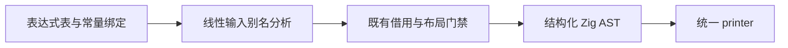
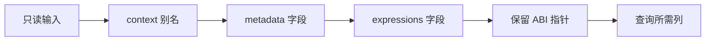

# 输入别名借用与递归求值优化

## Intent

保留函数槽位求值器的直接递归自举，补齐生成器对只读输入的局部别名识别，
消除不必要的对象描述符快照。本文按 IDEA 记录证据与验收边界。

## Data

当前 visitor 中的 `context` 来自 `in.environment.context`，随后
`const expressions = context.metadata.expressions` 经只读别名取得表达式表。
既有借用判定只能沿表达式投影追到输入，遇到局部 reference 就停止。
这使表达式表进入普通 stack value 路径，被完整解引用为局部结构体。

同一次带符号构建的反汇编证实：非缓存查询执行一次 1424 字节 memmove。
原始日志在 `/tmp/zxc-function-levels/frameless-flat-disassembly.log`；
对应采样在 `frameless-flat-signal-summary.json`。不能用源码体积代替此证据。

新增分析先收集唯一 const 绑定，再按表达式次序传播输入来源；遇到前向依赖、
重复绑定、调用、构造或索引时不扩大证明。事实按函数缓存，函数发射前清空。

生成后的 expressions 确认为 `*const` ABI 描述符，不再解引用构造局部整表。
候选重新生成 113 个入口；排除输入指纹 `.zxc-inputs` 后，二阶段
2020 个文件全部相同，证据 `input-alias-stage-verified.json`。

关闭 resident，使用同一当前 113 入口、同一 Small 配置、每次独立输出及缓存，
没有并行构建时交错三轮：

| 指标                  |             修改前 |             修改后 |
| --------------------- | -----------------: | -----------------: |
| CPU 三轮（秒）        | 6.46 / 6.40 / 6.43 | 5.18 / 5.18 / 5.17 |
| CPU 中位（秒）        |               6.43 |               5.18 |
| 墙钟中位（毫秒）      |            1305.48 |            1128.11 |
| 峰值 RSS 中位（字节） |          636944384 |          641630208 |

RSS 取值区间重叠，不能据中位差推断泄漏。测量及全部原始报告为
`input-alias-paired-results.json` 与六份 `input-alias-paired-*.json`。

## Edges

- 保留 `state_active`、非 represented 布局及原有返回生命周期限制；不改变公共 ABI。
- 不传播循环参数、索引、调用和构造的来源，不放宽私有布局的输入指针规则。
- 不新增语言语法、运行库、动态调度或专用编译器路径。
- 输入来源分析暂为原生生成器职责，仍需随生成器整体迁移；本项不算该职责自举完成。
- 直接递归去除 Frame 的整个迁移尚未完成性能收口；本次局部收益不重置累计基线
  `ca03eb0011e3efd13221e1baefca7fcc10a1da77`。

## Answer

交付通用输入别名借用修复及实际语料二阶段一致性、性能证据，运行已有所有权、
循环调用、原生边界及 contracts 回归，不新增测试用例。七组回归共 319/319 步、
576/576 项通过，见 `input-alias-related-checks.log`。日志中的 capacity 子进程
预期失败输出由现有夹具捕获，最终构建成功，不能将其误报为回归失败。

自我复核：已证明复制来自生成器的保守分类，未用修改调用方源码绕过问题；
输出一致与本次收益只覆盖所测路径，不能据此宣称全部自举或全仓回归完成。
