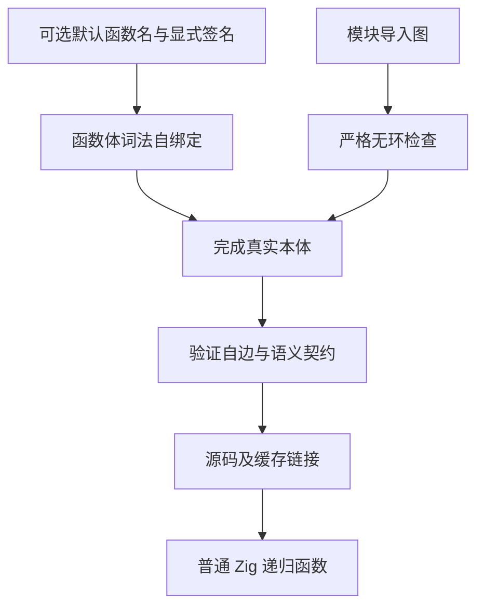
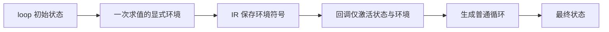

# 递归与循环环境能力验收

## Intent：最终目标

先补齐自举实际需要的通用表达能力，再迁移求值器：ZX 默认函数允许文件内自递归，
loop 的第三个参数在 IR 中保留显式、只读的环境绑定。保留一个文件一个默认函数、
模块依赖无环、值语义及普通 Zig 静态编译，不引入运行库或动态调度。

本次交付是语言与编译器能力。Function 求值器迁移及其性能收口继续保留在工作区，
不以该能力交付宣称完整自举完成。

## Data：可用证据

从暂存区导出独立快照进行验收，未包含 Function 求值器迁移、尚未收口的状态布局
优化或临时探针。另从 HEAD 导出对照快照，两份快照分别构建自己的 seed 与正式
生成器；不创建 Git 分支。

证据统一位于 `/tmp/zxc-function-levels/`。

| 检查                                         | 结果                                   | 证据文件                                            |
| -------------------------------------------- | -------------------------------------- | --------------------------------------------------- |
| 独立能力快照构建下一阶段生成器               | 34/34 步通过                           | language-capability-build.log                       |
| 模块、缓存、链接及值所有权回归               | 240/240 步，505/505 项通过             | language-capability-checks.log                      |
| 前端、循环列传递、初值所有权与上下文借用回归 | 218/218 步，6945/6945 项通过           | language-capability-loop-checks.log                 |
| 真实递归模块冷分析、命中、编辑、恢复         | 50 个模块均可缓存                      | language-capability-real-cache.log                  |
| 全部真实模块 extract、codec、link            | 50 个模块通过                          | language-capability-real-cache.log                  |
| 冷生成、命中、恢复的源码与类型               | 逐字一致，编辑只改变源码               | language-capability-real-cache-comparison.json      |
| 冷生成与重链接的实际递归执行                 | 三个真实查询完整结果一致，公开输入不变 | language-capability-linked-replay.log               |
| 同一冻结 HEAD 源码的完整生成产物             | 1937/1937 一致，仅排除 .zxc-inputs     | language-capability-existing-output-comparison.json |

实际缓存计数依次为 analyzed/reused：50/0、50/50、51/99、52/148，
uncacheable 始终为 0。真实消费者来自已保存的槽位求值器项目，包含 67 个函数；
未新增仓库测试用例，也未为输入添加生产特例。

### 性能

固定 Zig 0.17.0、small 模式、同一个 107 入口 HEAD 源码 manifest。每个样本使用
独立输出和缓存，关闭 resident 转发；计时期间无构建或其他诊断任务。按
before/after、after/before、before/after 顺序测量三个配对。

| 指标                          | HEAD               | 能力快照           |
| ----------------------------- | ------------------ | ------------------ |
| CPU 秒                        | 4.51 / 4.48 / 4.45 | 4.50 / 4.50 / 4.49 |
| CPU 中位数                    | 4.48               | 4.50               |
| 墙钟中位数（秒）              | 1.018              | 1.029              |
| 峰值 RSS 中位数（MB，十进制） | 522.3              | 512.9              |

差异约 0.02 秒 CPU、0.011 秒墙钟，在用户已接受的容差内，样本范围重叠；
不宣称提速。证据 language-capability-paired-results.json 及逐样本报告。
该对照只隔离本次能力变化，不重置累计性能锚点
`ca03eb0011e3efd13221e1baefca7fcc10a1da77`。

## Edges：边界与限制

- 默认函数名只提供函数体内的词法调用绑定，不增加额外导出。原匿名写法继续有效，
  Input/Output 仍显式确定签名；不开放互递归、跨模块循环或一般前向调用。
- 先保留稳定签名与 ID，真实函数体完成后才加入函数表；不创建假 external 或
  占位本体。只有真实自边可通过验证；错误汇总、所有权及资源边界继续检查。
- 缓存持有真实 own 函数，入口通过普通 Call/Return 调用该本体；源码链接与
  artifact 链接均重映射真实自边。缓存协议升级至 v7，旧协议不复用。
- 显式 loop 环境必须是已有的活动绑定。回调隔离外层作用域后，只激活状态参数
  与该环境；不放开普通隐式捕获。内联、RX 映射、序列化列及 seed 校验保留它。
- Store 调用授权继续有效；证明与 FPGA 目标仍明确拒绝当前不支持的递归能力。
- seed 与正式生成器的产物核对没有通过：能力快照为 1939 个文件中的 515 个
  差异，HEAD 对照为 1937 个文件中的 515 个差异。已观察到循环字段布局及状态
  表示差异；不能用相同差异数量证明完全同因，也不能把两者都成功退出说成固定点。
  本次同一冻结输入的前后 1937 文件完全一致，是更直接的既有生成行为保持证据。
- 本轮未完成 seed→stage1→stage2→stage3 的最终自编译与正式入口依赖闭包审计。
  Function 整体迁移仍有约 1.3 秒 CPU 差距和两处复制差异，仍需优化与正确性定位。

## Answer：交付与成功标准

已贯通解析、词法绑定、IR、效应分析、生成、链接、缓存与实际执行，并使用独立
暂存快照验收。7450 项既有回归通过，真实递归缓存及输入不可变性通过，同输入
完整产物保持一致，性能差异未超过已接受容差。应用编写说明同步到
`packages/skills/rx/编码约定.md`；内部验收细节保留在本文。

### 自我复核

不把语言能力补齐等同于求值器性能问题解决，不用 7450 项既有测试代替真实递归
执行证据，也不将已存在的 seed 差异忽略为固定点通过。后续继续推进自举时，
复用这些有效证据；只在代码、工具链或风险变化时补对应检查。
