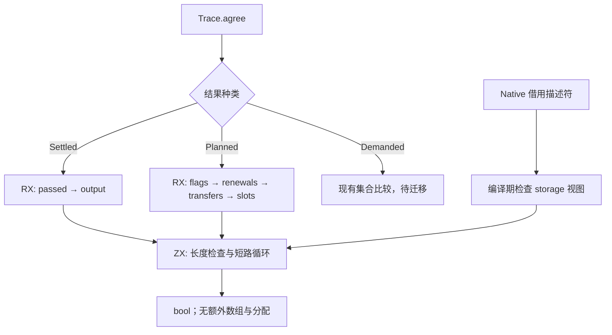
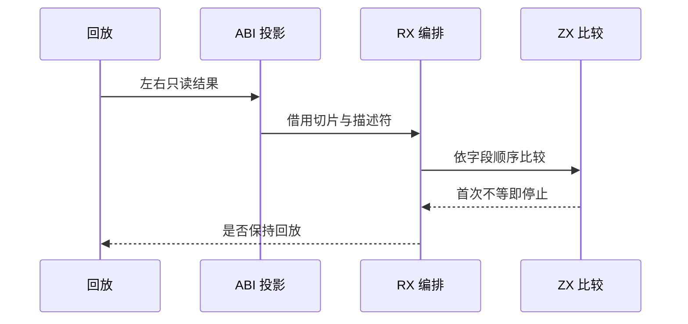
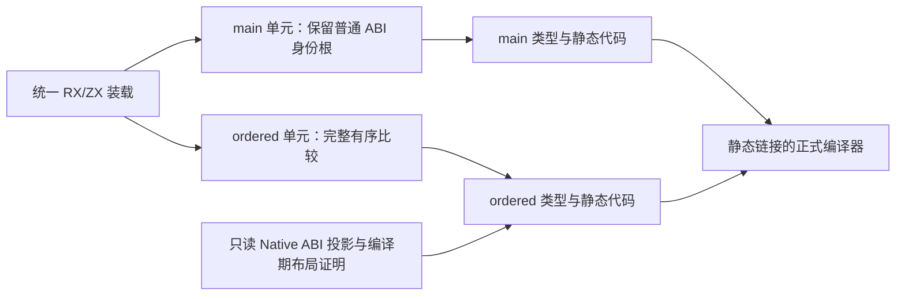

# 回放有序结果比较自举

当前状态：Settled、Planned 有序比较已迁入 RX/ZX，集中验收通过。
Demanded 集合比较及整体自举尚未完成。

## Intent：最终目标

把回放中的 Settled、Planned 有序结果等价规则迁入 RX/ZX，保持逐字段、逐元素
比较和原有短路顺序；忽略 memo 的 used 标记。整体自举目标与固定累计性能
基线不变。本阶段文档按 IDEA 记录目标、证据、边界与成功标准。

## Data：可用证据

原实现位于 packages/genz/src/zx/uniqueness/trace.zig 的 agree/same。
Settled 按 passed、output 比较；Planned 按 flags、renewals、transfers、
slot_first 比较。Contribution 按 callee、levels 比较；Renewal 按 owner、
path、value 比较。Level 是三位 packed struct，Flags 是八位 packed struct。

上一阶段 244b51a1 的实际 Source 工具为
/tmp/zxc-function-levels/replay-budget-candidate。受影响的是 changed body 的
回放验证，包括 shortcut 与 Replay.met；纯冷生成只提供整体无回归对照，不能
单独证明新比较逻辑已经执行。

## Edges：边界与限制

不复制或展平比较对象。原生适配层只执行编译期布局验证和只读 ABI 投影；
比较规则、掩码、循环及短路位于 Source。packed Level 的高位不是语义，
必须屏蔽；不得比较 padding 或把整个结构体当字节串比较。

Demanded 的 normalized/renewed 是按键排序后比较的集合，仍由旧实现承担。
当前数组 sort 尚无对象 comparator，且 Zig sortUnstable 比较器不能直接传播
ZX 错误。该通用能力须另行完整实现，不能用平方复杂度比较或专用 Native
排序语义桥代替。本阶段不宣称完整 Trace 自举。

不新增测试用例。复用已有功能分析、生成运行时与持久缓存检查；在临时诊断
构建中核对真实新旧比较结果，最终删除探针后再做冷/热性能对照。

## Answer：交付格式与成功标准

- 两个 RX 模块显式连接字段比较及提前返回，ZX 负责内聚的列表比较。
- 通用 storage 只读视图在编译期检查大小、对齐、字段偏移和标量表示，
  不放宽原有 columns.view 的语义兼容约束，不引入运行时转换或分配。
- 生成产物与既有行为检查通过；真实编辑/恢复的常驻输出等于同输入冷生成。
- 比较热路径不分配，单阶段性能、固定基线累计差距和趋势如实记录。
- 全部工作区变更一并提交推送，最终工作区干净且本地远端一致。

## 实现发现：只读连续记录数组入口

首次构建在 ABI 检查处拒绝 Contribution→*const Row 与 Renewal→*const Row。
这是合法拒绝：普通 executeIn 的对象数组为指针数组，不能借用原生连续记录。
为平移原算法，需要复用值入口的连续记录布局，而不是复制数据。

进一步定位发现两个既有选择条件：值函数只看输出表示，标量输出函数又将
其全部输入类型标记为普通 ABI 边界；同时，记录候选只接受纯标量字段。
这些限制阻止“读取含切片记录数组、返回 bool”的普通谓词使用值布局。

改动在通用规划中处理：本地函数的值布局选择同时考虑输入；本地标量函数
不再天然构成 ABI 边界；记录允许切片字段，仍保留 identity、native、Task、
Store、捕获及共享检查。只对连续记录数组的记录元素及承载对象补齐布局
材料化判定。公共 executeValue 复用 executeState 的只读 view 转换。

storage 保持大小、对齐、字段字节偏移校验，并补充 packed 字段位偏移校验。
旧 columns.view 不变；新 storage.view 明确只投影只读存储，Level 的无关
高位由 ZX 的模 8 运算屏蔽，优化后等价于低三位掩码。

## 公开边界的身份保护

复核明确不能移除 visible gate：聚合结果可以把输入数组原样交给 Native，
如果输入指针数组被复制为连续记录再还原，会改变元素指针身份。该保护保留。

补充的事实是公开入口的输入/输出类型配对：Native 只投影两列 TypeId；
Source 将非 Scalar/Enumeration/ErrorSet 输出对应的输入继续作为 visible 根。
只有不能通过返回值带出记录身份的标量入口不再机械阻止私有值布局。Optional、
NativeType 等形状暂时保守处理，identity/native/Store/Task/capture 等硬根仍保留。

值模式的输入选择与输出表示分别判断，防止“输入有状态、输出仍是 boxed 对象”
跳过必要装箱；标量返回不再经过对象解引用路径。公共 facade 的 state_entry
也同步识别仅输入使用值布局的函数。

开发中用临时工作副本构建能力引导工具，仍使用旧 Trace 比较，避免新入口尚未
生成时强转不兼容 ABI；正式工作区始终保留 Source 比较接线。临时引导工具
不作为最终正确性、性能或迁移完成证据。

## 当前验收状态：尚未完成

当前正式 HEAD 仍为 244b51a1，以下为未提交的实现工作，不是已完成阶段。

实际工具链证据：

- ordered-capability-fixed-candidate：临时能力工具编译成功。
- ordered-escape-stage：新的输入/输出边界模型及 Source 规划生成成功。
- ordered-escape-producer：包含上述 Source 规划的临时引导工具编译成功；
  它仍使用旧 Trace 比较，仅用于产生下一代接口。
- ordered-private-stage：由上述工具生成成功。Settled.passed 已是连续记录
  切片，编译期 storage 布局校验通过。
- ordered-private-candidate：正式接线构建失败；唯一剩余编译错误为
  Function.Renewal → *const Row 的存储不兼容，见
  /tmp/zxc-function-levels/ordered-private-candidate-build.log。

Renewal 与其他接口共享结构类型，其中仍有公开聚合输出入口需要保留输入
身份，因此全局 visible/boxed 事实继续保护该类型。仅按标量公开入口筛选
visible 根不足以解决不同入口共享一个结构类型时的表示需求；不得删除保护、
强转指针数组、复制数组，或通过无语义的字段改名规避结构类型碰撞。

下一步需要让调用边界的只读连续记录视图与全局普通 ABI 身份布局同时存在，
并贯通 helper 调用、类型声明和缓存身份；不能仅让 Settled 独立通过后宣称
有序结果比较已经完成。完整的 seed 引导同样必须验证：原 Native seed 的
State 选择仍将所有记录数组元素 boxed，尚未覆盖新的只读值入口能力。

本次没有新增测试用例，没有进行尚不可运行路径的性能计时，没有提交半成品。
现有生成成功与能力工具编译成功不能替代正式工具、真实回放等价性、无分配、
冷/热对照、缓存与阶段自编译验收。固定累计 CPU 差距仍未消除。

## 完整职责的编译单元与 seed 引导

独立生成比较模块验证了 Source 可生成两个连续记录输入；批量生成中
Renewal 与其他公开接口共享结构类型，导致全局身份约束保守阻止该表示。
保留全局保护，复用已有 main/checks/constant_seed 的独立编译单元机制，
将整个有序比较职责的两个入口放入 ordered 单元。RX 与 ZX 仍属于同一模块，
普通静态 Zig 链接，不存在专用解释器、运行库或新增 Native 比较语义。

该单元只收集同职责目录的十个模块，不重复扫描完整编译器源码。实际独立
Source 生成记录为 infer 2ms、emit 1ms、write 0ms；这只是定位输入范围的
证据，不作为整轮性能结论。main 的公共 ABI 与比较单元各有自己的类型根，
编译器装配沿 Entry Set 选择目录及 generated 模块，不按文件名判断运行语义。

Native seed 增加保守的只读 scope 判定：全部函数无原生或共享状态出口、
输出均为标量/枚举/错误值，且无集合更新、Transform、Task、Parallel 操作，
才允许简单记录数组使用连续输入布局。现有比较、Native、Store、Task 等
boxing 根保持有效。它只负责 seed 的初始引导，正式阶段仍使用 Source 规划。

实际 packages/compiler 的 zig build -Doptimize=ReleaseSmall 已从 seed
完整成功，见 /tmp/zxc-function-levels/ordered-formal-build.log。包含 Source
规划和完整比较的 ordered-unit-candidate、ordered-final-candidate 均编译成功。
独立比较单元的两代 Source 生成产物十五份完全相同，证据为
ordered-unit-fixed-point.json。

## 集中回归与真实数据诊断

现有五组回归首次运行：205/214 步成功，76/76 原生测试通过，八个字段
生命周期运行时构建因丢弃循环末态时出现 unused local constant 而失败。
新标量值入口触达了原先未覆盖的 State/fields 恢复路径；iteration.zig 先
恢复并绑定最终记录，再丢弃它。修复为 discard 模式直接结束循环，不恢复
无需消费的记录；循环、分支、错误与实际处理全部保留。

针对失败职责复跑 test-field-facts：65/65 步、27/27 原生测试通过，八项失败
均已消除。其他四组此前通过的证据复用；没有新增测试用例。后端缓存身份
升为 zxc.zig.input.v75，防止复用修复前的生成代码。

正式 Source 两代主产物比较：2157/2157 完全相同，证据
ordered-main-fixed-point.json；比较单元为 15/15，见前文。

临时旁路 oracle 在已有六轮常驻生成中，将每次实际调用的新 Settled 比较
与旧 same 比较，同时把 Source 调用的 allocator 换成容量为零的分配器。
观察到 22 次相等、2 次不等，结果全部一致且无分配；六轮各2155份产物
等于同输入冷生成，见 ordered-oracle-resident-comparisons.json。

单独修改已有纯标量谓词及交换已有队列比较的操作数，五轮产物同样各2155
份等于冷生成。但只观察到 Settled 比较，不能据此宣称 Planned 已被验证。
正常 shortcut 会直接重算计划而不比较，因此增加临时观察性探针，在真实
shortcut 产生 Planned 记录后，将其与上一版记录交给新旧实现比较；正式
源码不增加这项额外工作。该诊断不构造专用业务用例，仍使用实际编译器
源码编辑与实际分析结果。

## 首轮性能失败与生成范围优化

无探针 ordered-verified-candidate 与固定阶段对照 replay-budget-candidate，
对同一133入口当前源码交替各三轮冷生成：CPU中位数5.32→5.65秒，墙钟
1217.57→1327.99ms，超出容差。失败样本保留于 ordered-cold-paired-results.json。
首轮阶段时间中 emit 473→558ms，与四个输出线程的CPU增量一致；infer仅
563→575ms。静态检查显示函数数2298→2513，增加215个函数，代码从
31,595,081增为32,248,481字节；该静态计数用于解释生成范围，不等于运行频次。

根因假设：值入口只需补齐连续记录数组输入，却以任何 represented/nested
输入触发，为许多原本无需表示转换的标量谓词生成完整State变体与公共包装。
保留比较迁移，新增预计算的 InlineRows 类型事实，将输入触发限制到真实
需要连续记录布局的类型，输出值入口仍沿用既有判定。所有Native/Source
调用与公开facade门禁同步消费该事实，避免在每次生成调用时递归扫描类型。
row_storage同时跳过已boxed的记录，避免将无可用连续视图的父对象误标为
材料化需求。缓存身份推进至v76；尚需后续实测确认是否消除退化。

Native seed的只读资格另行复用现有parallel遍历，覆盖语句级并发；这是保守
边界修正，不改变本阶段普通比较模块的资格和正式Source执行路径。

## 精确门禁后的结果与最终身份复核

ordered-row-final-candidate 无探针冷生成同输入交替三轮：before CPU
[5.40,5.35,5.34]，after [5.35,5.38,5.35]，中位数5.35→5.35秒；墙钟
中位数1233.42→1237.11ms。热常驻四次编辑/恢复加warm屏障，服务器CPU
before [2.92,2.92,2.93]，after [2.94,2.93,2.94]，中位数2.92→2.94秒；
墙钟1111.32→1114.18ms。ps CPU计数精度为0.01秒，不声称微小收益。

静态函数数恢复为2298，未保留宽泛门禁新增的215个函数；冷生成首轮emit
468→469ms。未撤回Source比较，也未通过忽略累计差距验收。历史固定锚点
ca03eb0011e3efd13221e1baefca7fcc10a1da77及4.11秒CPU记录继续保留；当前
Source语料增长，不能直接相减并报告为严格累计增量。历史差距及趋势仍是
整体目标的未完成项，容差不因本阶段重置。

主2157份和比较15份产物在精确门禁下两代生成完全相同，见
ordered-row-main-fixed-point.json和ordered-row-unit-fixed-point.json。
v73旧缓存→v76新工具的冷/语义编辑/恢复分别2157/2156/2157份等于新工具
冷生成，见ordered-cross-v76-cache-comparisons.json。

实际Planned记录的观察性诊断同时覆盖重算记录与已有计划自比较，使用零
容量分配器；此前宽泛门禁阶段观测1853次，其中1849相等、4不等，37次
有非空renewals，最多1979 flags、4 renewals、1024 transfers、1980 slots。
精确门禁已补跑同一实际源码编辑诊断；正式工具无探针。

最终自我批判发现此前“输入有State但输出boxed时补装箱”的修正仅解决类型，
仍可能改变对象身份：helper原样返回输入中的共享Metadata时，先解引用再
重建产生新指针，并可能制造源码没有的OutOfMemory。因此修为该值变体直接
返回原普通ABI指针，pointer/borrow消费原样保留，只有显式layout消费才解引用。
此修正独立于标量比较的性能路径，但仍补跑现有回归与正式构建；缓存身份
最终推进至v77。静态反例与修复由独立只读复核确认，没有新增专门测试用例。

最后补齐const绑定的同一身份边界：局部变量登记原先仍可能把一个别名调用
结果解引用后存入新栈对象。对boxed对象的非fresh或外部调用结果，保留ABI
指针；只有fresh检查已能证明是新对象时才继续既有栈上优化。修复不增加
Source业务判断，不按文件名、函数名或案例硬编码；最终缓存身份为v78。

生成产物复核显示别名修复影响13份主产物：对象局部变量由值改为原ABI指针，
比较单元15份不变。同时属性读取的非pure但local调用不再借旧layout路径，
会在参数转换中出现两次不必要分配。保留结果身份修复，只在已有local值调用
且输入/输出不存在任何共享聚合类型时借用参数描述符；这类描述符不能逃逸，
不复制输入数组。其余场景维持保守路径，不用Source字段改名或专用桥绕过。
最终阶段仍需验证这项变化，不复用尚未覆盖的性能结论。缓存身份为v79。

## 最终借用证明与集中验收

v79 的无共享聚合类型条件过于保守，无法消除实际属性读取处的参数分配。
最终复用已有 fresh_outputs 事实：仅当返回值为 boxed 对象或元组、调用已具备
local 值入口、输入根类型不等于输出类型，且返回值后代不包含输入根类型时，
允许借用参数描述符。返回的已有子对象仍保留原 ABI 指针；其他对象继续由
既有身份与深层装箱规则保护。该条件不能用于推断“返回值不共享任何输入
子对象”，也不放宽 Native、Store、Task 或公开聚合输出边界。独立只读复核
确认这一限定范围内的借用证明；未增加按文件或函数名特殊处理。

最终后端缓存身份为 zxc.zig.input.v80。现有五组回归完成214/214步骤、76/76
测试，正式 CLI 构建完成46/46步骤。旧工具缓存升级到最终工具后，冷生成、
合法语义编辑、恢复分别2157/2156/2157份产物与新工具同输入冷生成一致。
报告见 /tmp/zxc-function-levels/ordered-cross-v80-verification.log。
有序比较单元15份产物与此前零容量分配器诊断版本完全一致；该比较单元的
实际记录等价和无分配证据继续有效，不重复构造专门用例。

## 最终全量成本口径与无效扫描修正

v80 主单元单独冷生成CPU中位数5.35→5.37秒，墙钟1251.65→1253.63ms；
热编辑CPU中位数2.95→2.97秒，墙钟1140.25→1143.91ms。比较单元单独首次
生成另需约11ms墙钟、0.01秒CPU；后续缓存命中约5ms，不能把缓存命中当冷生成。
因此补充主单元加比较单元的完整冷生成口径：三轮交替CPU中位数5.38→5.42秒，
墙钟1294.93→1295.50ms。CPU超过0.02秒边界，未据此提交或宣称性能收口。

定位类型查询构建的新增成员扫描：InlineRows 对未selected的product恒为false，
却仍扫描全部成员寻找该事实，导致找到Represented也不能提前停止。将循环内部
rows初值在该条件下设为true，作为“不需要寻找”的完成标记；最终查询结果仍由
selected门禁截断为false。选中product、List与Optional不变。该变化经独立只读
复核，复用同一遍历而不增加缓存、分配或新桥接。后端身份仍为v80，因为输出
查询语义不变；Source依赖内容变化仍由既有源码缓存追踪。

收紧扫描后的主单元2157份与比较单元15份在两代Source生成中完全一致，见
ordered-query-short-fixed-main-comparison.json、ordered-query-short-fixed-unit-comparison.json。
本次优化没有改变布局、查询事实或缓存语义，复用v80既有行为回归与编辑恢复
等价证据；正式CLI另行构建，以验证实际构建图消费更新后的Source算法。

## 最终交付与自我复核

收紧无效扫描后，完整冷生成包含主单元及新增比较单元，按before/after交替
三组计量，CPU样本为before [5.41,5.39,5.38]、after [5.39,5.42,5.40]，
中位数5.39→5.40秒；墙钟中位数1294.05→1389.72ms，增量95.67ms，接近
0.1秒边界。该墙钟抖动与历史样本共同保留，不能用CPU通过推断墙钟已优化。
正式工具无诊断探针，测量时没有并发构建。

同一实际源码四次编辑/恢复的常驻场景，CPU样本before [2.99,3.04,2.98]、
after [2.94,3.00,2.94]，中位数2.99→2.94秒；墙钟1149.93→1141.60ms。
CPU计量精度0.01秒，单阶段结果在用户容差内，不将这些容差累计为后续预算。
原始报告保留在 /tmp/zxc-function-levels/ordered-query-short-total-results.json
与 ordered-query-short-hot-results.json。未采用失败的较早性能结果作为验收。

最终正式CLI构建46/46步骤通过，两代Source主产物2157份及独立比较产物15份
完全一致。既有五组回归214/214步骤、76/76测试通过，旧缓存升级与实际编辑
恢复均已有同输入冷生成对照；语义等价的最后扫描优化复用这些证据。
格式化仅调整本次变更，未新增测试用例、专用运行库或编译器语义桥。

本阶段交付的是有序结果比较职责及其必需的通用布局能力，不是完整Trace，
更不是整体自举完成。Demanded集合比较、原生状态传递依赖和历史固定基线
可比口径仍未完成；后续必须沿这一缺口继续，不能反复验收本阶段已有证据。
全部工作区变更统一提交推送，包含新文件；临时测量报告、探针和日志不提交。
