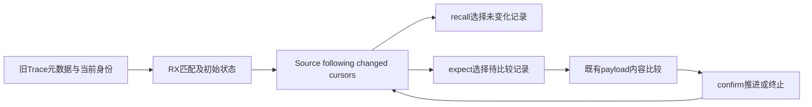
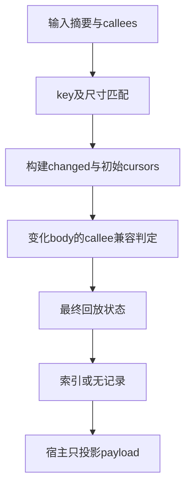

# 回放游标状态自举

## Intent：最终目标

把Trace回放的匹配判定、变化标记和三种分析游标的完整状态机迁入RX/ZX。
保留按kind/body/visit选择结果的顺序、终止条件和失败传播；复用executeState
及已补齐的消费资格，不新增专用原生语义桥或运行库。

## Data：可用证据

上一阶段66d60ae7完成Work状态，2132份产物一致，52项Node检查通过。
同129入口CPU中位5.34→5.33秒，RSS约648→644MB，历史累计差距仍未消除。
Trace.Replay目前在Native中比较program key、identities和callees，维护三个
cursor数组，并在recall/met时决定是否继续跟随旧Trace。

## Edges：边界与限制

本职责不冒充整个Trace已自举：泛型payload记录、分组与结果内容比较仍为Native，
不将它们改成新桥隐藏。Source拥有回放决策及游标；宿主只借用元数据、按返回
索引投影既有payload、执行既有内容比较，并移交其bool结果。

recall对未变化body才消费；变化body在记录本次结果后才校验旧结果。
记录失败时不推进状态，比较失败仍传播OOM。回放一旦失效不得恢复，三个kind
游标彼此独立。recalled payload状态仍由既有记录边界保存，不作额外复制。
摘要以扁平字节借用，避免为每个32字节值新建slice descriptor数组。

## Answer：交付与成功标准

实现create/recall/expect/confirm状态入口及真实Native消费，移除原生重复决策；
匹配阶段由RX串联事实计算，数组遍历和单步状态更新保留ZX。使用既有回放、
缓存、所有权和失败检查，不新增用例。核对阶段产物、缓存与同输入成本，
保留固定累计基线；完整职责验收后提交推送全部改动，确认工作区干净。

## 首轮表达与能力缺口

133入口、2115源码模块的首轮生成通过；未新增用例。回放Source已包括创建、
recall、expect、confirm，摘要以扁平字节借用；met的payload追加与agree调用
仍按原惰性顺序保留。agree OOM时不提交cursor或following变化。

实际签名显示Step虽含State，executeState输入仍是ABI指针，内部State失去
列表storage。进一步定位不是标量输出本身，而是frozen把只由宿主构造的
输入壳当成纯ABI对象。先修通用表示：若普通函数输入含有输出保留的聚合
状态，则该输入壳需要私有布局，复用已有sharesAggregate判定；身份、原生
与任务等硬装箱约束不清除。标量辅助读取继续可借用ABI，不能因此丢掉调用方
的可写描述符。fingerprint升级v71，需真实签名、既有接口与成本验收。

## 接线与真实消费证据

通用私有输入规则已同时写入Source built与seed frozen，并保留已有硬装箱。
新的133入口生成中recall/expect输入已由纯ABI改为含StateList的私有布局。
五个宿主不再假定值入口参数一定是指针，复用core.columns.invoke同步借用
投影，optional递归投影保持原始source指针，不新增堆分配。

Native Replay已删除重复变化判定和游标规则；payload先追加，expect再决定
是否比较，agree成功后confirm才推进或终止。State每次成功调用后移交替换。
Root各处recall显式传播既有分配错误。旧控制算法保留在replay/seed.zig，
仅作初始引导；结果记录与Trace.agree仍属于未迁移内容。

正式候选构建通过；Native控制对照生成的replay-managed-stage与Source控制
生成的replay-stage2共2155份产物完全一致。既有function-analysis、
generation-runtime、persistent-cache、context-borrow、field-facts五组命令
退出0，54项Node检查无失败，没有新增仓库用例。

常驻进程在独立源码副本执行初始、无修改、保留关系编辑/恢复、追加表达式
编辑/恢复，六轮各2155份产物均与同输入冷生成一致。只位于/tmp的计数探针
构建确认这些路径实际调用Source控制：28748次成功recall、12次expect，
其中8次比较匹配、4次不匹配。正式候选没有探针。协议耗尽分支尚无专用
运行覆盖，以源码顺序审查和既有整体检查为证，不能将它虚报为独立边界用例。

证据前缀/tmp/zxc-function-levels/replay；临时探针为replay-observe-src及其
二进制，不写入仓库。常驻脚本在finally恢复临时源码并终止原server句柄。

## 首轮正式成本与后续优化

133入口冷生成三轮交替CPU中位5.35→5.34秒，墙钟1247.66→1250.64ms，
RSS654098432→652656640字节。常驻路径另测四次追加编辑/恢复，包含无修改
barrier，server CPU以ps累计CPU读数计（0.01秒精度），中位2.89→2.92秒；
该增量仍需优化，不能拿冷生成通过代替热路径成本。

实际生成游标步骤没有堆分配，cursor标量读取仍经ABI借用包装。扩展已有通用
有界record-helper内联策略：小对象输入、原始值输出、最多32个表达式；继续
要求纯、无IO/process/Task、无契约、无循环/transform及前向/递归调用。
预算在entry/const.zx，Native只消费既有inlined资格；regular调用也输出inline，
不以源码路径、函数名称或特定Source模型判定。fingerprint升级v72，需要
下一代真实生成代码和完整成本对照后收口。临时观察二进制不用于性能测量。

## 热路径归因与收口修复

短标量内联后的三轮热路径中位仍2.94→2.98秒，因此没有将它报告为已确认的
独立收益。临时分配计数器确认五次完整分析的回放选择/确认步骤累计0次分配、
0字节；六轮常驻输入仍各2155份等于冷生成。探针均在/tmp，不进入正式产物。

用已有replay-built-candidate隔离通用表示规则（保留Native控制），热路径中位
2.90→2.93秒，说明主要增量在共享输入判定而非每步游标更新。原规则对全部
函数重复遍历共享类型树，甚至输入类型已由构造表达式确定。改为先完整收集
所有构造事实，再仅检查非Native、尚未built的对象输入；非对象位本不参与
frozen对象判定。Source与seed同步，仍保留相同装箱结果，不撤回迁移或私有视图。

v73三轮交替热路径CPU：before[2.91,2.99,2.93]，after[2.92,2.93,2.93]秒，
中位2.93→2.93；墙钟中位1123.97→1115.75ms。ps累计CPU精度0.01秒，
不能据此宣称微小收益，但不再有可辨的阶段热路径退化。先前失败样本全部保留。

最终replay-budget-stage与replay-budget-stage2共2155份完全一致；v70→v73
缓存与冷生成2155份一致、合法编辑2154份一致、恢复2155份一致。无额外新增
用例，既有5组54项Node证据及内联补充的function-analysis/generation-runtime
证据保留；语义等价的扫描收口由最终产物及缓存对照验收，不重复整仓构建。

## 最终结果与自我复核

正式无探针候选replay-budget-candidate的六轮常驻输入全部2155份等于冷生成，
包含追加表达式编辑与恢复；临时源码与server均已结束/恢复。最终冷生成
三对CPU before[5.39,5.41,5.33]、after[5.32,5.32,5.33]秒，中位5.39→5.32；
墙钟1251.54→1216.33ms，RSS658472960→660226048字节，内存样本区间
重叠，不宣称内存改善。前后133入口相同输入；不将较高before样本解释为
可稳定重复的0.07秒优化收益。结合热路径2.93→2.93秒，没有可辨阶段退化。

通用表示、Source状态机、真实回放、阶段不动点、缓存和行为证据分别核对；
没有把任一项等价当作整体自举完成。旧Native payload记录、Trace.agree、
全局唯一性调度和其他编译器语义仍待迁移；固定ca03eb0/historical4.11秒CPU
基线未重置，累计性能差距未解决。Source新增14个replay文件及两个类型谓词，
Native只保留宿主投影、资源和旧seed，并未新建同职责运行库或用RawCode生成。

阶段文档按IDEA记录目标、证据、边界和成功标准。最终提交统一包含工作区全部
未提交内容，英文commit并推送master，随后确认工作区干净且无未推送提交。
