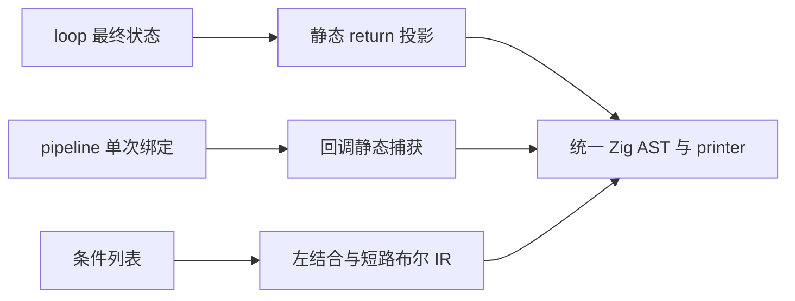

# 循环返回、管道闭包与条件列表

当前状态：三项尚未实现；已完成语法边界、分析器接线与零成本约束核对。

## Intent：最终目标

完善 loop.return、pipeline 回调捕获及条件列表，整理现有 RX/ZX 使用方式，
保持零成本抽象、一次求值、正确作用域和短路行为，不引入运行库或动态分派。

## Data：可用证据

用户要求 loop 规则在 next 后添加 return 函数，避免尾部成员投影。
pipeline 应允许回调捕获当前流水值与合法外部绑定，使连续计算可以串联。
条件列表第一项不写关系，后续每项必须显式连接符；已明确从上到下组合，
支持 and、or、xor、nand、nor 及 &&、||，取反属于操作数，例如 - and !value。
const condition 与 pipeline 闭包均必须为零成本抽象。

## Edges：边界与限制

loop.return 在循环结束后执行一次，以最终状态为第一个参数；有上下文时，
第二参数沿用已经求值的只读上下文，不能重复执行初值或上下文表达式。
未声明 return 的 loop 保留原有结果。优先静态展开为普通 scope/projection，
不新增运行时回调对象，保留 next/do 与 while 的既有求值顺序和错误传播。

pipeline 的占位符属于各自流水作用域；嵌套 pipeline、lambda 参数遮蔽与普通
捕获分别处理，不做文本替换，不允许回调把未绑定的占位符带出其有效作用域。
捕获通过现有静态降级传递，不增加闭包对象、动态函数调用或额外数据复制。

条件列表按列表顺序左结合，每行的表达式仍按自身括号计算。例如：

```zx
const condition = (
    - value
    - and value_a
    - or (value_b && value_c)
    - and !value_d
)

if (condition) {
    execute()
}
```

上述列表组合为 (((value && value_a) || (value_b && value_c)) && !value_d)。
and/or 及 &&/|| 保持短路；nand 为 !(左值 && 右值)，nor 为 !(左值 || 右值)，
也保留内层短路；xor 对布尔左右值各求值一次。全部降级为普通布尔 IR，
不生成条件对象、解释器或运行时 helper。第一项可取反，后续缺少关系则报错。

if 内直接条件最多两个逻辑项，超过则单独绑定 condition 变量；其他快捷布尔
连接最多三个逻辑项，嵌套括号不重置计数，更多项使用条件列表。维持正常
比较、成员调用及取反的边界，不能把比较操作数个数误算为条件个数。
条件列表位于已有括号的语境时复用外层括号，不叠加多余括号。

## Answer：交付与成功标准

三个特性分别贯通解析、Source/seed 分析、生成、格式化与 lint 后提交推送。
不新增测试用例，使用现有循环、回调、捕获、短路、缓存与 OOM 检查；
必要时据实际契约调整既有断言，不放宽行为或分配标准。
先修源头，再按语义整理现存代码，不机械把所有 const 或 loop 都替换。
通过本次 diff 复核可读性；格式或明显等价对齐不重复做性能计时。
涉及捕获和生成表示的变化检查受影响生成代码与实际成本；继续保留固定累计基线。




