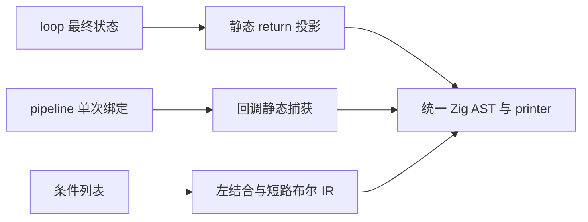

# 循环返回、管道闭包与条件列表

当前状态：loop.return 已实现并完成本阶段验收；pipeline 闭包与条件列表尚未实现。

## Intent：最终目标

完善 loop.return、pipeline 回调捕获及条件列表，整理现有 RX/ZX 使用方式，
保持零成本抽象、一次求值、正确作用域和短路行为，不引入运行库或动态分派。

## Data：可用证据

用户要求 loop 规则在 next 后添加 return 函数，避免尾部成员投影。
pipeline 应允许回调捕获当前流水值与合法外部绑定，使连续计算可以串联。
条件列表第一项不写关系，后续每项必须显式连接符；已明确从上到下组合，
支持 and、or、xor、nand、nor 及 &&、||，取反属于操作数，例如 - and !value。
const condition 与 pipeline 闭包均必须为零成本抽象。

## Edges：边界与限制

loop.return 在循环结束后执行一次，以最终状态为第一个参数；有上下文时，
第二参数沿用已经求值的只读上下文，不能重复执行初值或上下文表达式。
未声明 return 的 loop 保留原有结果。优先静态展开为普通 scope/projection，
不新增运行时回调对象，保留 next/do 与 while 的既有求值顺序和错误传播。

pipeline 的占位符属于各自流水作用域；嵌套 pipeline、lambda 参数遮蔽与普通
捕获分别处理，不做文本替换，不允许回调把未绑定的占位符带出其有效作用域。
捕获通过现有静态降级传递，不增加闭包对象、动态函数调用或额外数据复制。

条件列表按列表顺序左结合，每行的表达式仍按自身括号计算。例如：

```zx
const condition = (
    - value
    - and value_a
    - or (value_b && value_c)
    - and !value_d
)

if (condition) {
    execute()
}
```

上述列表组合为 (((value && value_a) || (value_b && value_c)) && !value_d)。
and/or 及 &&/|| 保持短路；nand 为 !(左值 && 右值)，nor 为 !(左值 || 右值)，
也保留内层短路；xor 对布尔左右值各求值一次。全部降级为普通布尔 IR，
不生成条件对象、解释器或运行时 helper。第一项可取反，后续缺少关系则报错。

if 内直接条件最多两个逻辑项，超过则单独绑定 condition 变量；其他快捷布尔
连接最多三个逻辑项，嵌套括号不重置计数，更多项使用条件列表。维持正常
比较、成员调用及取反的边界，不能把比较操作数个数误算为条件个数。
条件列表位于已有括号的语境时复用外层括号，不叠加多余括号。

## Answer：交付与成功标准

三个特性分别贯通解析、Source/seed 分析、生成、格式化与 lint 后提交推送。
不新增测试用例，使用现有循环、回调、捕获、短路、缓存与 OOM 检查；
必要时据实际契约调整既有断言，不放宽行为或分配标准。
先修源头，再按语义整理现存代码，不机械把所有 const 或 loop 都替换。
通过本次 diff 复核可读性；格式或明显等价对齐不重复做性能计时。
涉及捕获和生成表示的变化检查受影响生成代码与实际成本；继续保留固定累计基线。




## loop.return 实现与验收记录

Native 引导与 Source 分析器均支持 return 规则，放在 next/do 后，以最终状态
及可选的既有只读上下文调用一次。初值推导不再错误消费最终投影的期望类型。
规则解析复用普通对象与 lambda AST，降为普通 Iteration/Scope，不引入运行时回调。

已整理 402 个生产源码文件中的 492 处尾部字段/管道投影，排除测试 fixture、
历史与生成源码。初次完整生成成功；生成形态核对发现一处哈希表更新丢失
原就地更新证明，出现多余复制。修复从源头消除简单字段投影的多余 scope，
还原为对 Iteration 的直接 Field/TupleField；其他返回表达式保留一次求值绑定。
不能把语法糖造成的所有权变化当作正常成本，也不回退生产源码的 return 用法。

旧编译器自带的查询函数也在首轮对齐时产生了不必要的 Scope，因此直接用它
继续自编译会在零容量查询适配器中触发 OOM。保留 Source 实现和 492 处对齐，
用当前 Native 引导分析路径生成新的初始产物，再恢复正式生成分析路径核对
后续阶段；不把该引导器作为最终编译器。新引导产物中的哈希桶更新已恢复为
原有就地写入，新增 dupe 消失。四个旧轮应用编译失败不混作最终验收证据。

进一步定位：有显式上下文时，简单投影必须放在保存初值与上下文的 Scope 外，
恢复原 Field(Scope(Iteration)) 形态；只改为 Scope(Field(Iteration)) 仍会使初值
对象堆分配，破坏零容量查询。Native 与 Source 已同步该重排，仅对目标恰为
回调参数的简单投影使用，通用返回表达式仍在上下文 Scope 内保留一次绑定。

使用当前 Native parser/analyzer 和 Native genz 初始引导（正式路径继续恢复
Source）生成 loop-return-native-stage1，检查 read validation 查询产物已无
allocator.create。暂存证据均在 /tmp/zxc-function-levels，后续仍需正式路径
阶段核对、循环回归、缓存与最终生成形态核查，尚未提交此特性。

既有回归已通过 229/229 步、262/262 项，包含循环条件/后测、状态快照、
资源与 CLI 执行、聚合与嵌套缓冲、函数及字段所有权。未新增测试；只同步
已有未知规则断言的新提示文本。正式 Source 路径第二到第三轮的 2097 个文件
完全一致，缓存编辑/冷生成和恢复分别通过 2096、2097 个文件对照。

另将层深度计算的最终条件结果纳入 return，实际使用通用返回表达式。
生成产物新增分配数为零（create 前后均为2，alloc/dupe/reserve 均为0）；
该改动仅影响对应一个函数文件。最终编译器正在复核该消费。

最终编译器执行含条件返回的完整输入成功，再次生成的 2097 个文件逐字一致。
零成本验收沿用原查询的零容量 allocator、所有权/缓冲预算及生成形态核对；
语义等价的生产源码对齐不单独重复计时。新编译器的累计性能将在三项功能收口
时集中复测，固定锚点不变，当前不宣称整体自举或最终性能目标完成。
