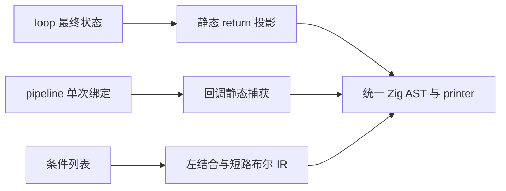

# 循环返回、管道闭包与条件列表

当前状态：loop.return、完整后处理 lint、pipeline 回调捕获与连续计算链、条件列表已完成功能阶段验收；整体自举的累计性能差距与后续迁移继续处理。

## Intent：最终目标

完善 loop.return、pipeline 回调捕获及条件列表，整理现有 RX/ZX 使用方式，
保持零成本抽象、一次求值、正确作用域和短路行为，不引入运行库或动态分派。

## Data：可用证据

用户要求 loop 规则在 next 后添加 return 函数，避免尾部成员投影。
pipeline 应允许回调捕获当前流水值与合法外部绑定，使连续计算可以串联。
条件列表第一项不写关系，后续每项必须显式连接符；已明确从上到下组合，
支持 and、or、xor、nand、nor 及 &&、||，取反属于操作数，例如 - and !value。
const condition 与 pipeline 闭包均必须为零成本抽象。

## Edges：边界与限制

loop.return 在循环结束后执行一次，以最终状态为第一个参数；有上下文时，
第二参数沿用已经求值的只读上下文，不能重复执行初值或上下文表达式。
未声明 return 的 loop 保留原有结果。优先静态展开为普通 scope/projection，
不新增运行时回调对象，保留 next/do 与 while 的既有求值顺序和错误传播。

pipeline 的占位符属于各自流水作用域；嵌套 pipeline、lambda 参数遮蔽与普通
捕获分别处理，不做文本替换，不允许回调把未绑定的占位符带出其有效作用域。
捕获通过现有静态降级传递，不增加闭包对象、动态函数调用或额外数据复制。

条件列表按列表顺序左结合，每行的表达式仍按自身括号计算。例如：

```zx
const condition = (
    - value
    - and value_a
    - or (value_b && value_c)
    - and !value_d
)

if (condition) {
    execute()
}
```

上述列表组合为 (((value && value_a) || (value_b && value_c)) && !value_d)。
and/or 及 &&/|| 保持短路；nand 为 !(左值 && 右值)，nor 为 !(左值 || 右值)，
也保留内层短路；xor 对布尔左右值各求值一次。全部降级为普通布尔 IR，
不生成条件对象、解释器或运行时 helper。第一项可取反，后续缺少关系则报错。

if 内直接条件最多两个逻辑项，超过则单独绑定 condition 变量；其他快捷布尔
连接最多三个逻辑项，嵌套括号不重置计数，更多项使用条件列表。维持正常
比较、成员调用及取反的边界，不能把比较操作数个数误算为条件个数。
条件列表位于已有括号的语境时复用外层括号，不叠加多余括号。

## Answer：交付与成功标准

三个特性分别贯通解析、Source/seed 分析、生成、格式化与 lint 后提交推送。
不新增测试用例，使用现有循环、回调、捕获、短路、缓存与 OOM 检查；
必要时据实际契约调整既有断言，不放宽行为或分配标准。
先修源头，再按语义整理现存代码，不机械把所有 const 或 loop 都替换。
通过本次 diff 复核可读性；格式或明显等价对齐不重复做性能计时。
涉及捕获和生成表示的变化检查受影响生成代码与实际成本；继续保留固定累计基线。




## loop.return 实现与验收记录

Native 引导与 Source 分析器均支持 return 规则，放在 next/do 后，以最终状态
及可选的既有只读上下文调用一次。初值推导不再错误消费最终投影的期望类型。
规则解析复用普通对象与 lambda AST，降为普通 Iteration/Scope，不引入运行时回调。

已整理 402 个生产源码文件中的 492 处尾部字段/管道投影，排除测试 fixture、
历史与生成源码。初次完整生成成功；生成形态核对发现一处哈希表更新丢失
原就地更新证明，出现多余复制。修复从源头消除简单字段投影的多余 scope，
还原为对 Iteration 的直接 Field/TupleField；其他返回表达式保留一次求值绑定。
不能把语法糖造成的所有权变化当作正常成本，也不回退生产源码的 return 用法。

旧编译器自带的查询函数也在首轮对齐时产生了不必要的 Scope，因此直接用它
继续自编译会在零容量查询适配器中触发 OOM。保留 Source 实现和 492 处对齐，
用当前 Native 引导分析路径生成新的初始产物，再恢复正式生成分析路径核对
后续阶段；不把该引导器作为最终编译器。新引导产物中的哈希桶更新已恢复为
原有就地写入，新增 dupe 消失。四个旧轮应用编译失败不混作最终验收证据。

进一步定位：有显式上下文时，简单投影必须放在保存初值与上下文的 Scope 外，
恢复原 Field(Scope(Iteration)) 形态；只改为 Scope(Field(Iteration)) 仍会使初值
对象堆分配，破坏零容量查询。Native 与 Source 已同步该重排，仅对目标恰为
回调参数的简单投影使用，通用返回表达式仍在上下文 Scope 内保留一次绑定。

使用当前 Native parser/analyzer 和 Native genz 初始引导（正式路径继续恢复
Source）生成 loop-return-native-stage1，检查 read validation 查询产物已无
allocator.create。暂存证据均在 /tmp/zxc-function-levels，后续仍需正式路径
阶段核对、循环回归、缓存与最终生成形态核查，尚未提交此特性。

既有回归已通过 229/229 步、262/262 项，包含循环条件/后测、状态快照、
资源与 CLI 执行、聚合与嵌套缓冲、函数及字段所有权。未新增测试；只同步
已有未知规则断言的新提示文本。正式 Source 路径第二到第三轮的 2097 个文件
完全一致，缓存编辑/冷生成和恢复分别通过 2096、2097 个文件对照。

另将层深度计算的最终条件结果纳入 return，实际使用通用返回表达式。
生成产物新增分配数为零（create 前后均为2，alloc/dupe/reserve 均为0）；
该改动仅影响对应一个函数文件。最终编译器正在复核该消费。

最终编译器执行含条件返回的完整输入成功，再次生成的 2097 个文件逐字一致。
零成本验收沿用原查询的零容量 allocator、所有权/缓冲预算及生成形态核对；
语义等价的生产源码对齐不单独重复计时。新编译器的累计性能将在三项功能收口
时集中复测，固定锚点不变，当前不宣称整体自举或最终性能目标完成。

## 后续修正：完整后处理与 pipeline 捕获

用户指出首轮对齐只移入字段、留下 .reverse()[0] 等后缀，不符合目标。
已扫描并对齐 25 处完整后处理，包含静态 pick/omit、排序/反转、索引和追加。
索引及追加引用尽量复用状态已有字段；不把外层变量直接移进受限回调。
新 lint 由 Source 规则判定 Field/Index/Call 的直接接收者是否为名为 loop 的调用；
宿主只投影 AST 事实，不按文本重解析或按路径特判。规则接在 ZX style 和
RX CLI 的 lint 专用通道，不写入普通 parser 或公共 RX 属性语义校验路径。

pipeline 已接入按 SymbolId 的捕获链；记录创建时的 capture owner，跨集合
回调逐层调用既有 ensure，继续使用已有静态 gather/leave 及 loop 降低。
内层局部 _ 绑定遮蔽流水占位符；异步与显式 loop 回调边界继续校验。
尚需完成新编译器、实际闭包消费与既有捕获/分配检查，不能以接线完成代替交付。

## 完整后处理 lint 与 pipeline 闭包验收

pipeline 在自递归标记计算中实际捕获流水值，另整理四处单次消费的中间绑定。
对应生成函数的 create、alloc、dupe、reserve 前后均为零；完整后处理改写未增加
对应生成模块的分配调用。捕获复用现有静态集合回调，不新增运行时闭包对象。

修改范围内 36 个 ZX 文件全部通过 lint。使用截图对应文件的 HEAD 原文核查，
旧 `.reverse()[0]` 后缀得到 style 诊断，当前 return 回调版本通过。未新增测试用例。
现有循环策略、回调参数、谓词零分配及循环检查中 39/39 Zig 项通过；组合任务
165/167 步完成，唯一失败为 semantic lint 中独立 Store 初值类型漏检，已在修改前
CLI 复现，同一断言保持原样；不宣称完整回归全绿。

正式 Source 编译器生成下一轮的 2102 个文件逐字一致。冷/热缓存、合法语义编辑
和恢复与相应冷生成对照均通过，记录位于 /tmp/zxc-function-levels 下
pipeline-final-fixed-point.json、pipeline-final-cache-comparisons.json。
固定累计性能锚点不变，三项特性收口前不重复进行语义等价改写计时。

自查：首轮只移动字段投影，未覆盖整个后处理链，确实没有满足减少外部后处理的
初衷；现已修正源码并通过独立 lint 通道固定约束。当前闭包支持沿已有集合捕获链
传递，显式 loop 回调仍遵守只读上下文边界，不把它描述为任意动态闭包支持。

## 条件列表实现与对齐

Native 与 Source 均在显式表达式分组和 if 条件入口识别列表，普通调用中跨行的
负数实参保留既有含义。列表操作数使用独立 token 边界，嵌套括号、对象、数组及
模板插值按自己的流处理；连接符必须在 bullet 同一行，长操作数允许合法折行。
连接词按原始源码借用读取，不扩展保留字或每个 token 的常驻列号表。

列表静态左折叠为现有 Unary/Binary AST，来源和逻辑项计数只在前端保留。
and/or/nand/nor 保持短路；xor 使用布尔取反后的不等比较，两个操作数各一次。
计数在四项饱和，足以执行 if 两项及快捷条件三项限制，避免窄整数溢出。
格式投影固定 bullet 行，括号分组不重置逻辑项计数。

已按 AST 结构整理 327 个生产文件中的 479 处条件，保留原有分组、优先级和
短路顺序。较长 if 判断在原执行位置绑定 condition；else if 必要时保留为 else
内部的条件绑定，避免提前求值。只改写超过阈值的条件，不机械替换短表达式。

实际对齐暴露布尔 const 丢失可空收窄的问题，已补充按 SSA SymbolId 登记的
谓词定义，分析 if 时追踪既有 IR，不重新执行 initializer。状态更新使用新
SymbolId，旧定义不会错误收窄新状态。Native 与 Source 分析、规范 IR 校验同步；
initializer 与声明成功后才登记，作用域退出仅保留不可访问符号的定义元数据。
重复空值判断使用声明类型作为比较期望，避免已有收窄使 null 比较错误失去上下文。

审查发现谓词 DAG 若无去重会指数展开，已在单次假设中按“符号与真/假方向”
记录访问代次，沿用缓存表且在代次溢出时清零。常规源码不会为每次假设扫描整张表。
首轮正式 Source 生成成功；完整回归、不动点、缓存和最终成本验收仍在进行。

## 用户补充：pipeline 使用对齐与提交收口

pipeline 完善的验收重点是实际整理“多行连续 const 推演目标值”的计算链，
不能只交付集合回调捕获。按真实 AST 和引用次数寻找仅传递结果的连续绑定，
保留独立语义、多处消费、类型约束及求值顺序，不用文本批量替换冒充对齐。

每次提交推送统一包含全部未提交变更与未跟踪文件；完成验收后整体提交，
确认工作区与远程同步，不再部分提交并遗留其他改动。

## pipeline 连续计算链对齐

完整 AST 扫描识别出 1374 条相邻绑定消费关系；按单次引用、作用域和计算职责
筛选后，将 435 个文件中的 627 条计算链改为 pipeline，减少 733 个中间 const。
被多处引用的值、独立条件依据、类型注解、任务或更新回调边界继续保留绑定。
保留最终目标绑定，不以添加无意义的 -> _ 冒充简化；已有管道和 _ 遮蔽均核对。

改写前补齐占位符类型提示：Native 与 Source 的探测都识别流水符号及已存在的
回调捕获，不创建新捕获、不重复执行计算；字段收窄使用同一符号解析。避免 _+1
丢失原 u32 上下文并被推成 u64。布尔流水输入登记既有谓词定义，Scope 假设继续
分析结果表达式，维持可空收窄。

脚本按完整语句 RHS 保留括号、条件与模板边界，先合成重叠链，再统一改写。
对象简写保留原键名，展开保持 ..._；match 条件仅引用流水值时写为 (_) 以避免
被识别成默认分支。全部改写已通过解析与格式化，完整自编译验收正在进行。

性能检查发现并消除谓词登记 splice 重建及访问标记无条件复制；三组同输入
交替测量中 CPU 中位均为 5.29 秒，六份产物相同，不宣称稳定耗时收益。进一步
避免非 bool 常量登记及重建描述符，并让普通流水占位符跳过捕获链。
类型查找热点另已采样；Native 原实现是16行SIMD筛选而非哈希索引，Source 为
逐行筛选，后续优先复用现有能力补齐同等成本模型，不能靠错误的索引假设推进。
固定累计基线仍为 ca03eb0011e3efd13221e1baefca7fcc10a1da77；整体性能尚未达标。

## 管道生成成本与阶段自编译

现有连续计算改写暴露两处通用生成缺陷：fresh 返回判定只接受直接 Object/Tuple，
未穿透 Scope.result；Scope 局部绑定没有复用普通 const 的非逃逸栈分配资格。
已让前者查询实际结果，后者同时排除 Scope 结果本身与后代、函数输出后代，
并保留 state selected、借用及原有投影规则。不移除或重排任何 Scope bindings。
只读复核确认同步消费与作用域释放边界，没有放开 Task/Parallel 或动态闭包。

修复后，原先九个模块的新增分配全部恢复；全量逐模块扫描未发现相对改写前
新增 allocator.alloc/dupe/create。静态统计只说明生成形态，不替代运行成本验收。
Source 阶段自编译生成 2114 份产物（排除 .zxc-inputs）逐字节一致；缓存跨版本、
合法语义修改、恢复三次与干净生成分别核对 2114 / 2113 / 2114 份，全部一致。
缓存 fingerprint 提升到 v63，避免复用生成策略变更前的函数文件。

现有检查发现 seed summaries.reset 把含入口行的 known 与仅含函数行的 input、
output 并列遍历，已按 input.len 限定 known 的函数前缀，保留入口行协议。
Debug 所有权检查已有 35 项通过；两个测试工具在 Zig 自身编译期间 SIGSEGV，
正在以 ReleaseSmall 复核现有行为及分配检查，不把工具崩溃算作通过。

证据统一保存在 /tmp/zxc-function-levels：pipeline-fixed-point-comparison.json、
pipeline-fixed-allocation-increases.json、pipeline-v63-cache-comparisons.json。
临时日志与测量产物不提交。本文按 IDEA 记录目标、证据、边界和交付标准。

## 累计成本：类型查找候选优化

按已保存采样与原实现检查，Source 类型查找逐行解码 kind，Native 使用 SIMD
筛选。现复用 std:bytes.indexOfScalar 的现有 SIMD 查找扫描 base、delta 的 kind
列；命中后筛选 first/second，Task 同时比较两个槽位，再构造 Entry 完整比较。
保持 base 在 delta 之前、每张表按行号递增、首匹配和不可复用名义类型的规则。

kind 协议编码收口到 core/type_table/code.zx，与 decoder 共用 const.zx 中的
命名字节常量；构造器复用编码函数，不假设 Source 枚举与协议字节直接等同。
对象字段比较先核对全部 TypeId，再核对名称，复用原数组与 offset/count，
不转换、复制或分配。当前候选已完整生成，收益与最终累计门禁尚待同输入测量。

现有 ReleaseSmall 所有权、回调参数、谓词分配、对象返回检查全部成功；32 个
Node 运行检查无失败。此前版本的前端与逻辑短路检查也已成功。最新修改的
695 个 ZX 文件通过语法、格式与新 lint；最终验收以候选优化收口后的证据为准。

## 候选优化的拒绝与格式复核

kind 跳扫首候选三组交替测量 CPU 中位 5.32→5.42s；将只读数据移至 loop
上下文后仍为 5.30→5.37s，均未通过，六份对照产物分别一致。此优化尝试已撤回，
没有撤回任何自举职责、条件列表或 pipeline 特性。保留通用类型编码常量与构造器
复用，后续不得把这两次测量写成优化收益或累计性能门禁通过。

格式复核发现 nullable Output 后的 ? 会被错误视为跨声明续行，使函数声明与
整个函数体多缩进一层。已在 Native/indexed 投影标记函数声明边界，并让格式器
在语义边界重置运算符续行。仅整理本次修改文件，不扩散无关格式改动。

## 本功能阶段最终验收

函数声明边界修正后，695 个修改 ZX 文件全部通过解析、90 列格式与新 lint；
整理后的 Source 阶段自编译 2115 份产物逐字节一致。最终缓存跨版本、合法修改、
恢复分别核对 2115 / 2114 / 2115 份，全部等同对应的干净生成。

现有前端与 RX 格式回归 ReleaseSmall 成功，53 个 Node 检查无失败；所有权、
回调参数、谓词分配及对象返回检查此前已全部成功。未添加仓库测试用例。
Debug 工具编译时的 Zig SIGSEGV 保留为工具链限制，未记为通过。

以具备类型提示、尚未整理连续链的 pipeline-ready 工具为本次计算链阶段对照，
同一最终输入三组交替 CPU 中位 5.30→5.32s（配对差中位 0），墙钟中位
1213.60→1217.96ms；六份产物各自在同版本内一致。跨版本差异是已核对的
Scope 对象值返回与局部栈分配修复，不能宣称全量字节相同。此为本功能阶段
证据，不替代整体自举相对固定基线的累计验收；固定 ca03eb0 的历史 CPU
4.11s 保留，累计差距仍未解决。没有把容差重置为后续阶段的新预算。

尝试直接在 HEAD 原始源码上跨版本计时，被新增 condition lint 拒绝，属于无效
对照；没有把失败耗时用于性能结论，也不为计时关闭校验。

交接证据：feature-formatted-fixed-point.json、feature-v63-final-cache-comparisons.json、
feature-chain-paired-results.json、feature-final-allocation-shape.json；均在临时证据
目录 /tmp/zxc-function-levels。当前仅收口这三项语言写法功能，不宣称整个自举完成。

最终分配复核：同一最终输入在修复前后生成器间，13 个 caller 的 create 静态
站点增加、9 个模块减少，合计 create 站点净减 7。13 个 caller 的变体集合
不变；16 个增加站点逐一对应 call→callValue，新增装箱类型严格等于该 callee
输出类型。6 个相关 callee 删除 call 装箱变体，只保留 callValue。因此是结果
root 的一次装箱从 callee 移至 caller，未发现重复装箱或未配对新增站点；不能
用静态净减数宣称每次执行减少七次分配。相对改写前的生成形态没有额外分配。
