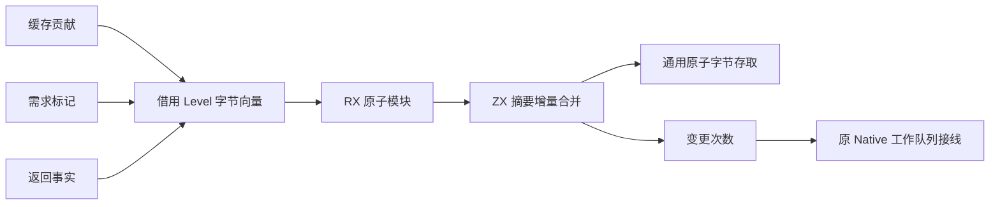
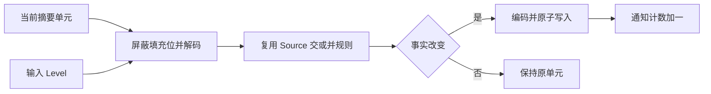

# 摘要增量合并的自举迁移

## Intent：最终目标

将缓存调用贡献的重放、增长需求标记和函数返回摘要的增量合并迁入 RX/ZX，
保留原子读写、变更顺序及既有工作队列语义，继续收缩自举的 Native 语义边界。

## Data：可用证据

当前 dca4e13f 中，Function.replay、Function.applyMark 和 Root.settle 的输出合并
仍由 Native 遍历并更新摘要。源码中已有 Source meet、join、编码解码规则以及
std:bytes 的通用 AtomicRows/loadAtomicCell/storeAtomicCell，不缺少原子存取能力。
changed 列表在完成单个工作单元后才被 Root 消费，且由 Work.queued 去重排队；
重放的同一个贡献中的所有变更都指向同一 callee。

## Edges：边界与限制

新增 Source 逻辑是一个内聚的集合算法，RX 用单原子模块接口公开；不将总控流程
隐藏进 ZX。Native 只借用一字节 Level 行与向量的视图、转交 POD 参数并接工作队列。
Source 遍历向量，选择交或并规则、比较逻辑状态、按原顺序原子写入并返回变更次数。
Native 保留重复变更通知的数量及贡献间顺序，避免顺手改变队列协议。
不引入新的原生语义接口、运行库、动态解释或数据副本。

批量调用保持成功路径的通知次数与顺序。OOM 的内部部分状态不逐槽等同：
旧 replay 可能在某次 store 后因追加通知失败而停止，新路径在合并完行后才可能
因追加通知失败。本次分析随即终止，其私有摘要全部释放；不发布部分计划。
不提前预分配通知空间，不将本接口标为 concurrent，原子存取不代表多写者 CAS。

零容量 FixedBufferAllocator 强制该调用不做临时堆分配。Level 的大小与对齐必须
等同 u8，解码屏蔽填充位，写出编码仅含有效事实位。摘要描述符和单元在调用期间
保持稳定；写入仍由原有串行 Root 执行，其他分析可继续原子读取。

## Answer：交付与成功标准

交付完整 Source 增量合并、正式 Native 调用接入及 seed 路径保留。
运行既有函数分析、所有权/缓存与错误分配检查，不新增用例或降低断言。
对新入口做阶段自编译与完整产物对比，检查缓存语义编辑/恢复一致性；
构建结束后交替测量同一完整输入的三组 CPU、墙钟与 RSS，比较每次全部产物。
每个完成职责独立提交推送。Native 全局调度、缓存与状态所有权仍为过渡依赖，
本阶段不能据此宣称完整自举完成。

## 执行记录

Source 增量合并已接入三处正式调用。初次完整生成 118 入口、2,056 模块，
2,068 个产物与迁移前相同；后续一轮生成也相同。编译输入逐字节一致，因此复用
已构建的候选工具，不为仅改变生成目录名重复构建相同输入。
初次缓存跨版本、合法语义编辑及恢复均一致，编辑实际改变五个产物。

六组既有回归结束：358/361 步、813/815 项通过；只有 mixed source/library
两项容量失败，未新增用例。对保留的旧编译工具和当前工具生成同一 mixed 夹具：
旧 eager zxRenew(...exact=true)，当前 deferred 首次写入却调用 zxReserve(...false)。
将既有容量用例复制到 /tmp，仅增加分配数打印，原断言保留：
旧累计 2,753,734 字节，当前 5,506,204 字节，预算仍为 4,194,368 字节。
65,537 项被几何舍入为 131,072 槽；这是此前首次写入复制遗漏了已有的精确容量策略。

修复延迟复制的生成调用，直接复用 Source 计算的 may_grow：不增长时精确申请，
可能增长时保留几何容量。独立 header、exclusive 资格、边界和 RHS 求值顺序不变。
不撤回延迟复制，不修改预算。生成指纹提升至 v58，隔离旧生成缓存。
函数更新、首次写入复制和聚合循环补验 271/271 步、520/520 项全部通过，
两项 mixed 容量失败消除。未更改原有测试代码或预算。
此前已通过且不受精确容量申请影响的函数分析、字段/缓存所有权和模块循环结果复用，
没有为重复获得相同通过结果重跑整组六组。

## 最终验收与性能

修复生成形态后重建候选工具，再完成 stage 2 → 3：2,068 个文件全部相同，
仅排除工具身份清单 .zxc-inputs。没有把修复前的不动点证据当作最终证据。
v57 → v58 的跨版本缓存与冷生成相同；在独立源码副本中将新增 merge 算法合法
改为返回零，编辑后冷/热相同，恢复后与原始产物相同，各 2,068 个文件。

所有构建结束后，固定 118 入口的相同输入、工具链、small 模式与缓存边界，交替
测量三组。before CPU 5.10/5.07/5.08s，after 5.07/5.09/5.10s；
中位数 5.08 → 5.09s。wall 1,163.05 → 1,163.93ms，
RSS 635,486,208 → 635,650,048 字节。范围重叠，CPU 差 0.01s 落在用户约定
容差内，RSS 的 160KiB 差异不解释为稳定变化，也不宣称提速。
六次计时产物分别与对应基线/候选的全部 2,068 个文件一致。

固定累计锚点仍为 ca03eb0011e3efd13221e1baefca7fcc10a1da77（历史约 4.11s）。
前阶段记录的 0.03s 成本债务继续保留；不能因为本轮容差内就抹去累计差距。
完整自举性能门禁和正式入口的 Native 传递依赖闭包均未完成。

## 自查与后续边界

本阶段迁走的是摘要增量合并算法，不是完整 Root/Ahead 调度。
Native 仍拥有摘要存储、队列、memo 与宿主并发资源；updates.zig 仍是 POD 适配边界，
须随普通 ZX 状态模型和总控迁移继续消除，不能将其包装成最终自举成果。
单原子 RX 模块对应内聚的向量合并算法，内部遍历保留在 ZX，未隐藏跨职责总控。
通用字节原子操作仍采用宿主 Zig 标准库；没有添加新的专用原生语义契约。

本次扩展既有回归范围才暴露此前延迟复制的容量遗漏；局部不动点与部分测试通过
不能替代相关容量、别名与 OOM 门禁。修复保留功能与安全边界，不通过撤回迁移
或放宽预算消除失败。

主要证据位于 /tmp/zxc-function-levels：updates-ownership-checks.log、
updates-mixed-before-capacity.log、updates-mixed-current-capacity.log、
updates-mixed-source.diff、updates-capacity-fixed-checks.log、
updates-final-fixedpoint-comparison.json、updates-final-cache-comparisons.json、
updates-final-paired-results.json 及六份 updates-final-paired-*-comparison.json。
