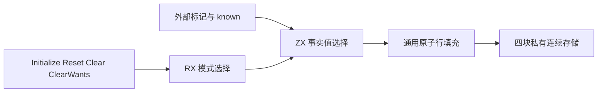

# 摘要状态与生命周期的自举迁移

## Intent：最终目标

将共享所有权摘要的存储布局、初始化、重置和清空规则迁入 RX/ZX。
Source 模型拥有四块连续字节存储与行偏移，Native 只保留借用视图和宿主适配。
保持现有单写者/原子读写语义及零成本静态链接，继续移除正式路径中的 Native 规则。

## Data：可用证据

当前 b1591a60 已将摘要增量合并迁入 Source，但 summaries.zig 仍逐函数分配四组
Level 单元，并自行执行 Initialize、Reset、Clear、ClearWants 策略。
函数表的 input_types/output_types/native_modules 与 Source 数组布局兼容；
slots.counts 已由 Source 布局算法提供，可直接借用，无须复制函数元数据。
Native 为每行分配的细碎单元可以由 Source 前缀偏移和四块连续缓冲替代。

## Edges：边界与限制

Initialize：内部函数 input/output=All，外部=None，所有 wants=None。
Reset：只重置 input/output；input 还取决于 known，wants 保留。
Clear：只清 input/output。ClearWants：只清 wants。
内部状态沿用 native_modules==null，不以有无函数体替代。

Source 在 Summaries 所属 allocator 上创建存储及偏移；Native 只分配行描述符，
不复制单元。建立视图后禁止替换或扩容底层缓冲。Level 大小和对齐必须等同 u8。
Source 初始化规则仍通过 Native 构造的通用 AtomicRows 视图执行，这一过渡桥不属于
完整自举闭包；全局 Root/Ahead 调度和描述符宿主仍需继续迁移。

通用 std:bytes.repeat 负责重复字节分配，32位下先检查 count 到 usize 的转换；
fillAtomicRow 逐单元执行 monotonic 原子写，按行检查边界，不增加专用运行库。
它只是已有 storeAtomicCell 的批处理，摘要值与作用范围的选择仍在 Source。
Lifecycle 调用使用零容量 FixedBufferAllocator，禁止临时堆分配。

reset/clear 所处边界已有后台线程静默保障：上轮 demand defer 完成 Ahead.finish，
超预算 clear 前显式 finish；shortcut 位于 Pool 创建前，独立入口不启动 Ahead。
不能把 load/compute/store 解释为多写者 CAS，也不把生命周期接口标为 concurrent。

## Answer：交付与成功标准

交付 Source 状态模型、真实 RX 创建/模式编排、ZX 规则以及最小 Native 数据视图。
使用既有函数分析、缓存、入口和 OOM 检查，不新增测试用例；验证普通应用构建
及传递借用关系。完成新入口的阶段产物与缓存语义编辑/恢复对照；构建结束后仅对
同一完整输入交替测量三组，并比较所有计时产物。每个完整阶段提交并推送。
不重置 ca03eb0011e3efd13221e1baefca7fcc10a1da77 累计锚点，不以本阶段完成替代
完整自举及最终无性能退化门禁。

## 执行记录

已实现 Source 模型、通用字节原语和 Native 视图适配。更新标准库声明目录后，
以保留 Native 算法的初始引导路径构建新 seed，生成 120 个入口、2063 个模块。
新编译器再次生成的 2081 个文件逐字一致（只排除输入位置记录 .zxc-inputs）。

布局数组通过 map 创建恰好 N 个起点，总单元数独立保存，不追加末尾哨兵。
0 函数产生空表；0 槽位产生相同起点；最后一行以实际缓冲长度为终点。
检查生成产物可见循环赋值直接写入自有数组，没有逐次复制；map 的 append 使用
已有容量证明预留源数组长度。此处沿用 map 返回 [映射数组, void] 的协议。

第一次实现使用逐项追加的前缀表，隔离 CPU 中位数 5.10s → 5.10s，
峰值 RSS 中位数增加 5,062,656 字节。保留完整迁移，继续改为上述固定长度布局；
最终复测另行记录，不能将第一次结果作为最终版本证据。

既有检查最终 192/192 步、340/340 项通过。缓存跨版本复用、合法语义编辑和恢复
分别比较 2081、2080、2081 个文件，均与对应冷生成相同。优化版本第二到第三轮
生成的 2081 个文件一致；三组交替计时的六套完整产物也全部一致。

固定长度布局的 CPU 中位数 5.08s → 5.09s，墙钟 1153.14ms → 1171.20ms；
峰值 RSS 中位数 628,981,760 → 640,204,800 字节。没有用重复计时消除不利样本，
这一内存增量仍待解释，当前不作为性能验收通过证据。

临时构造探针显示整轮仅创建两次摘要，每次 1877 个函数、127472 个输入单元、
73714 个输出单元；新增起点表合计约 60 KiB，不足以直接解释峰值差异。
探针已移除，继续检查 Root arena 的容量放大，而非继续凭假设改写布局。

Root 容量探针观察到临时 arena 从 24,625,884 增至 26,369,146 字节；
摘要数据增长改变了后续 arena 扩张序列。将摘要存储放入同生命周期的独立
arena，父 allocator 仍由调用方提供；Pool/Ahead 先结束，摘要再释放，
不改变共享单元地址，不在生成的应用中加入运行库。探针已全部移除。

### 独立 arena 版本的隔离复测

| 指标                    | 迁移前              | 当前版本            |
| ----------------------- | ------------------- | ------------------- |
| CPU 三次（秒）          | 5.08 / 5.09 / 5.07  | 5.16 / 5.10 / 5.10  |
| CPU 中位数（秒）        | 5.08                | 5.10                |
| 墙钟中位数（毫秒）      | 1169.09             | 1171.04             |
| 峰值 RSS 中位数（字节） | 633815040           | 638222336           |
| 峰值 RSS 范围（字节）   | 626966528–641056768 | 633995264–640368640 |

首次 after 墙钟为 3291.09ms，CPU 为 5.16s；保留该样本，不用重跑替换。
前后 RSS 区间重叠，中位数仍增加 4,407,296 字节，不能宣称内存完全无回归。
此阶段 CPU 差异达到用户接受的 0.02s 边界，计入累计趋势，不当作免费预算。
对应六套完整输出各比较 2081 个文件，全部相同。

原始报告均位于 /tmp/zxc-function-levels/：

- lifecycle-isolated-paired-results.json：六次计时数据。
- lifecycle-isolated-paired-*-comparison.json：全部计时输出对照。
- lifecycle-compact-fixedpoint12.json、lifecycle-compact-fixedpoint23.json：阶段不动点。
- lifecycle-isolated-cache-comparisons.json：最终缓存编辑与恢复结果。
- lifecycle-isolated-checks.log：独立 arena 版本的既有检查。

### 自我复核与剩余工作

Source 现在负责摘要状态模型、布局、创建和四种生命周期语义；RX 表达创建阶段和
模式分派，ZX 保留内聚的布局与填充算法。Native 仅为单元建立稳定借用视图，
并保留宿主 allocator、旧 seed 路径和 Root/Ahead 调度。这是完整摘要存储与生命周期
职责的迁移，并非整个所有权分析器自举闭包。

布局优化不能被当作已消除所有内存差异；峰值采样与实际数据量不同，保留报告供
后续累计优化。固定锚点仍为 ca03eb0011e3efd13221e1baefca7fcc10a1da77，
历史 Native CPU 约 4.11s，当前约 5.10s，最终累计性能门禁尚未通过。
后续继续迁移 Root/Ahead 状态与调度，统一审查传递依赖并消除累计差距。

最终独立 arena 版本再次通过 192/192 步、340/340 项既有检查；未新增测试、
未放宽原有容量与 OOM 断言。最终缓存三项对照均通过，结果与上表文件数量一致。
