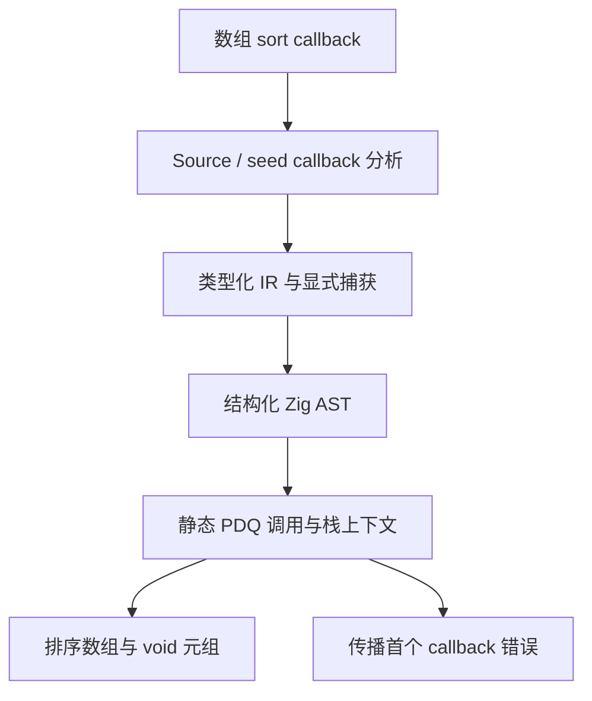

# 数组比较器与集合回放自举

## Intent：最终目标

补齐普通数组 `.sort((left, right) => comparison)`，再将 Demanded 的集合比较迁入
RX/ZX。复用既有不可变元组协议 `[排序数组, void]`，保留闭包、求值顺序和错误
传播，最终生成普通静态 Zig。保持原来的有序快速比较与 O(n log n) 排序路径。

## Data：可用证据

上一阶段 bd4497b3 已迁移 Settled、Planned；工作区起点干净且已推送。
Trace.sameSet 先比较长度和原序列，确实不等时复制两份记录，按唯一键调用
std.mem.sortUnstable 后比较。现有 ZX sort 仅支持无参数的数字或字符串排序。
Source 与 seed 的集合 callback 分析已支持捕获，列表方法返回元组；这些机制
应复用。当前 Zig 标准库 sortUnstable 使用 PDQ，比较器为不返回错误的函数。

固定性能锚点与上一阶段测量继续保留，不能给本阶段重新发放增量预算。
实现完整路径后集中检查受影响的生成与真实编辑回放；不新增测试用例。

## Edges：边界与限制

- 不采用平方复杂度集合查找、不按字段名特殊处理、不增加专用排序语义桥。
- callback 使用 TS 风格两个元素参数及数值比较结果；无参数 sort 行为保持。
- 捕获保存在栈上，生成静态比较函数；不增加闭包运行库或动态函数调度。
- 不允许吞掉 callback 错误或以 catch unreachable 假定不会失败。
- IR、缓存、所有权、生成与 seed 必须同步贯通；仅接通前端不算交付。
- 所有工作区变更在完整职责验收后统一提交推送。

## Answer：实施与验收

1. 复核现有 callback 与 Transform IR，确定可复用的数据表示和捕获契约。
2. 同步实现 Source/seed 分析、普通 IR 及静态排序生成，处理错误与对象身份。
3. 将 Demanded 的 marks、normalized、renewed 比较按真实阶段组织为 RX/ZX。
4. 复用既有回归，检查两代生成、实际编辑与恢复等价、无探针性能，提交推送。

当前状态：数组比较器与Demanded集合比较已完成集中验收；整体自举继续。
下文保留实现边界与最终证据，不将局部交付当作整体完成。

## 当前实现与边界复核

已接通 Source/seed 分析、Sort Transform IR、三参数规范化（两个元素和显式捕获
环境）、元组结果以及结构化 Zig 排序生成。生成独立静态函数和栈上下文；先
求值目标和捕获环境，再复制目标数组。PDQ 首错后比较器恒false且不再调用
Source回调，排序返回后传播首错，错误时释放自己的复制数组。

独立只读复核确认当前 Zig0.17 PDQ 的错误锁存路径有界：无守卫 insertion
循环遇false即停；其余扫描、heap fallback与区间推进均有索引界限。错误后
内部仍可能swap，但只发生在隔离的副本上，不作为用户可观察回调继续执行。

复核补齐两项：连续行参数先由 elements.read 转为真正State再交给回调，不能
把ABI行直接当State；回调错误集合由本次Sort表达式单独计算，使用已有callee
事实，不能取已被外层Capture过滤的整函数有效错误集。

Sort共享输入元素，Source共享规则沿用Filter；只读标量作用域可豁免Sort带来的
保守装箱，其他显式身份、捕获与公开边界保护保留。Source/seed同步要求所有
输出为标量（可递归Optional）、无Native/Store/Task/并发/数组修改，Transform
只允许复制式Sort。表达式资格按列判定，避免额外扫描全部表达式。布局身份
推进至state.value.origin.v12，后端缓存身份为zxc.zig.input.v81。

真实Demands消费已经接入：grew/marks先短路，再依序比较normalized和renewed；
各集合保留长度与原序列快速路径，仅不等时按id/key排序副本。比较器使用
有符号语义常量，不以u64减法表示排序，避免溢出。

迁移还发现合法TS属性名function被ZX的对象字段解析当作关键字拒绝，已同步
放开Source与seed的属性名位置（对象类型、属性访问和对象键），声明绑定位置
保持既有约束。常量求值器bootstrap快照因Transform枚举ABI变化，由上一阶段
稳定Source工具从原Source重新生成28份Zig文件，未手改生成代码。

当前仍未完成：正式构建、已有回归、Source两代产物及缓存编辑恢复、捕获/错误
路径的实际消费验证、无探针性能与累计趋势复核。此前几次构建已定位并修复
枚举快照、关键字属性、显式loop环境、嵌套条件与导入排版错误；失败不计通过。
本阶段尚未提交，需完整验收后将全部变更统一提交推送。

## 集中验收结果

比较器返回类型最终按表达式推导，接受ZX数值类型，而非限定i64。浮点比较结果
也按小于零决定次序，NaN不小于零，视为相等。对象关键字属性位置同步支持
IdentifierName，但关键字不能作为属性简写；两条既有keyword_true/keyword_null
用例更新为接受，不增加用例。面向应用的集合说明与旧README同步对齐。

现有八组检查完成303/303步骤、6918/6918测试，包括前端、typed capture、函数
效果、函数分析、生成运行时、持久缓存、context borrow和field facts。阶段中途
Native seed CLI构建46/46步骤通过；最终Source bootstrap工具35/35步骤通过；再由
该Source工具生成正式CLI，28/28步骤通过。临时诊断不进入正式工具。

完整type-parser资源组存在既有内部包未声明问题：advance.zx/name_part.zx导入
core/const，而独立CLI项目没有相应绑定。旧publish-fixed-clean-cli执行同一
fixture同样失败，见sorting-old-cli-type-parser.log。未通过删除检查或放宽包
边界掩盖；该资源组不计入6918项通过结果，仍需后续修复其构建依赖声明。

Source工具生成自身两代：主单元2166份产物、比较单元23份产物完全一致，见
sorting-fixed-main-comparison.json、sorting-fixed-unit-comparison.json。新旧工具
处理相同当前Source主输入时，2308个函数与31,732,986字节Zig保持相同；布局
身份v12使私有value/view_value标识符变化。按types.zig声明顺序建立6954项双射
后，2165份Zig源码完全一致，剩余.zxc-files差异仅为对应内容校验和；没有以
忽略代码差异代替验证。旧缓存升级、合法语义编辑与恢复分别2166/2165/2166份
等于新工具同输入冷生成，见sorting-cross-v81-cache-comparisons.json。

真实编译器数据的临时观察性诊断：常驻初始、warm、业务保留变更/恢复及追加
变更/恢复六次运行，每次2155份产物等于同输入冷生成。每个实际Demanded记录
额外核对原序快速路径及真实集合的反序表示；不在仓库新增测试用例或探针。
40,106次Source/原Native比较一致，其中40,100次相等、6次不等。20,050组记录的
原序比较用零容量分配器通过；反序比较中285组进入排序。源数据最多8个
normalized、8个renewed；Source实际分配字节逐组严格等于两份需要排序的
Normalized/Renewed数组，零差异，最多256字节。没有附加对象或环境分配。
报告与日志位于 /tmp/zxc-function-levels/sorting-demand-oracle-*。

## 无探针性能与累计边界

主单元采用相同133入口、当前2129模块/1897函数文件输入，前一阶段工具
ordered-query-short-candidate与最终sorting-source-candidate交替各三轮冷生成。
CPU样本before [5.42,5.36,5.40]、after [5.39,5.41,5.39]，中位数5.40→5.39秒；
墙钟1257.27→1243.40ms。相同固定Source上的常驻四次编辑/恢复，CPU样本
before [3.02,3.01,2.92]、after [3.00,2.93,2.99]，中位数3.01→2.99秒；墙钟
1118.86→1126.78ms。计量精度0.01秒，不声称细小差异是稳定加速收益。

冷生成峰值RSS为before 610.20–629.17MiB、after 624.97–632.84MiB，区间重叠；
中位数约624.45→630.67MiB。保留这项约1%的观测上移与波动，不将其写成内存
收益；真实排序路径已另以严格分配预算核对，不能以RSS代替分配量证明。

新增比较入口的独立单元以不同新缓存冷生成三轮，CPU均0.02秒，墙钟
[13.24,13.04,13.37]ms；其中infer 3–4ms、emit 1ms、write 0ms。这里包含三个
入口，相比前阶段两个入口增加真实职责，独立记录，不把缓存命中当冷生成，
也不把不同输入的独立计时直接相减当作完整构建收益。

固定累计锚点ca03eb0011e3efd13221e1baefca7fcc10a1da77及4.11秒CPU历史记录继续
保留。Source语料已增长，尚未建立与该历史锚点严格相同的累计输入口径；这仍
是整体目标未完成项。本阶段与前阶段的单项变化、原始样本和趋势保留，后续
不得重置基线或重复领取容差。测量时没有并发构建或诊断探针。

## 交付边界与自我批判

Trace.agree的Settled/Planned/Demanded比较规则现均由RX/ZX承担。原same/sameSet
仅留给seed；Native适配器只做受检ABI借用与错误边界。Demanded的RX明确连接
grew/marks/normalized/renewed短路阶段，ZX集合算法保留原序快速路径和PDQ副本
排序，未替换为平方查找、模板生成或专用语义桥。

本阶段不等于完整Trace或整体自举。Trace状态、visit分组/持久化、其他专用
Native模型以及通用生成器（含新增排序AST构造）仍属后续迁移职责。泛型捕获
及错误适配经过类型检查与只读复核，实际记录诊断主要覆盖整数记录比较器；
不将它扩大宣称为穷尽浮点、资源捕获或全部外部错误组合的运行覆盖。

全部未提交内容（含生成快照、现有用例预期与文档）统一收口提交推送。临时
日志、性能报告和观察性探针只在/tmp，未加入生产代码或提交。

## 后续收口：类型解析资源检查依赖

上一阶段后继续修复独立type-parser资源组：复用expression_preparation的成熟
构建方式，在Zig缓存目录建立完整工作区，声明core依赖及const/ascii常量导出，
复制原有parser、lexer和模板源码，两个既有入口通过显式--project运行。不
修改生产包解析规则，不新增用例或放宽依赖边界。

依赖门槛解除后，原有短序列及插入变异对照发现Native属性名解析新增诊断
expected a property name，而Source保持expected an identifier。保留关键字
属性语法，将Native诊断对齐既有Source契约；错误条件、位置与正常解析不变。
此修复涉及构建依赖和诊断文本，不进行性能计时。原有整组资源、语法树、
消费位置、短序列及插入变异的诊断等价检查已通过：84/84步骤、16/16测试。
执行命令为packages/test内zig build test-type-parser -Doptimize=ReleaseSmall
--summary all，日志见/tmp/zxc-function-levels/type-parser-parity-fixed.log。
此前记录的独立type-parser依赖问题至此关闭，没有新增测试用例。
