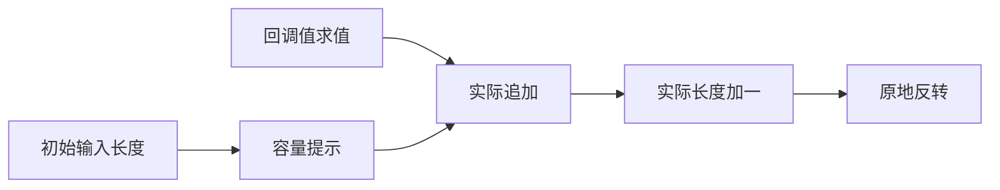

# 有界追加循环的容量推导

## Intent：最终目标

修复映射后反转的既有容量失败，并保留 map 作为普通循环语法糖的设计。
由 RX/ZX 分析普通 IR 中的循环边界，生成第一次实际追加时的容量提示，
不新增编译器专用原生语义接口或应用运行库。

## Data：可用证据

当前提交 5d5950b3 的 test-reverse-ownership 为 100/102 项通过。
source 与 library 两条容量路径均在 2,048 个 i64 元素处失败：
数据为 16,384 字节，累计申请 79,096 字节，arena 容量为 79,024 字节。
生成代码中 reverse 已直接调用 std.mem.reverse 和 constCast，未复制完整数据。
额外申请来自 map 的空列表初值与逐元素 push 的几何扩容。
日志：/tmp/zxc-function-levels/reverse-current-checks.log。

## Edges：边界与限制

只根据 IR 的结构、参数与字段槽位推导，不识别函数名称、生成变量名或夹具路径。
索引从零开始、每轮加一，并受保持不变的输入长度约束；目标列表初始为空，
下一状态中目标只接收一次 push 的结果。未满足证明的循环保持原生成路径。
复用现有字段布局分析对不变来源的证明。只消费已有 frontier 所有权许可，
不扩大别名写权限。空列表不读 header；逻辑 count、committed 和可见长度不变。
容量申请仍发生在首个回调值求值后的真实追加处，空结果不提前分配。
不新增测试用例，不放宽原容量预算。生产生成形态有变化，仅验证受影响路径。

## Answer：交付与成功标准

交付完整的 Source 容量计划、Native POD 消费及结构化生成。
复核原 source/library 容量、空输入、借用、保留结果和 OOM 检查；
核查阶段自编译与缓存产物，并对相同完整输入交替测量三个前后样本。
本阶段独立提交推送；完整自举的传递依赖闭包和累计 CPU 差距仍需继续处理。

## 执行记录

容量规则已在 fields/plan.rx 中显式接入，capacity/plan.rx 编排边界证明与追加选择，
ZX 检查索引、输入长度、不变来源及返回状态的追加结构。Native 只转交 POD 输入、
消费具体操作 ID 与来源字段，并构造现有结构化 Zig AST。没有新增 IR opcode、
源码模板、运行库或按名字识别 map 的特例。

第一笔真实追加申请精确容量，header.committed 与切片长度仍为真实追加量；后续继续
使用原 frontier 分支。未扩大写许可，保留非空才能读取 header 的条件。
新容量会更早触及字节数上界，因此同时将申请大小的乘加溢出映射到 OutOfMemory。

原 2,048 项累计申请从 79,096 降到 24,672 字节；16,384 项为 196,704 字节，
两条路径均通过原预算。反转、不可变列表、聚合循环已执行的 708 项全部通过。
iterate-buffer 初次被下载 Zig 的 TLS 初始化阻断，未重启仍在运行的构建。
确认该构建终止后，用本地已有且 SHA-256 与官方发布记录一致的归档补跑该组，
并集中运行回调参数、上下文效果和缓存所有权检查：202/202 步、280/280 项通过。
没有新增用例、改测试代码或放宽容量、别名、快照及 OOM 断言。

117 入口、2,054 模块的 stage 2 → stage 3 比较中，2,064 个文件完全一致，
仅排除生成工具身份清单 .zxc-inputs。正式 Source 生成物中的 71 个文件、139 处
调用消费容量提示，说明优化并非只覆盖反转夹具。
跨 v56 → v57 缓存、Source 合法语义编辑后的热/冷生成、源码恢复均一致。
编辑发生在独立副本的新 capacity/bound.zx，实际改变五个文件并删除一个旧函数文件；
编辑后的热/冷产物共 2,063 个文件一致，恢复后 2,064 个文件一致。

## 性能与自查

所有构建结束后，固定同一输入、工具链、small 模式和缓存边界，交替测量三组冷生成。
前后所有六次计时产物各自与对应阶段的全部 2,064 个文件一致。
CPU 样本为 5.07/5.04/5.02s → 5.06/5.07/5.07s，中位数 5.04 → 5.07s。
墙钟中位数 1,157.02 → 1,155.30ms；RSS 中位数 660,570,112 → 632,487,936 字节。
RSS 三组范围分离，峰值减少 28,082,176 字节；这不是累计分配量或零复制的证明。
CPU 小幅增加 0.03s，范围有重叠，不宣称提速或无退化。按照用户先实现再优化的要求
保留实现并记为成本债务，不能通过重置累计基线或重复计时挑选较好样本消除。
固定累计锚点仍为 ca03eb0011e3efd13221e1baefca7fcc10a1da77，其历史约 4.11s；
完整自举性能门禁仍未通过。

本阶段仅完成可独立验收的容量推导职责。优化当前复用已有字段布局证明，只对符合
该布局及直接追加结构的循环生效；分支追加等未证明结构保留原路径。
生成器专用 Native 桥、Root/Ahead 调度和其他规则/状态仍需迁移，不能因本次阶段
不动点一致就宣称整个编译器已自举。

复核还发现既有 formatter 会将可空 Output 类型别名后的顶层函数多缩进一级；
新旧 CLI 均复现，当前源码遵循其幂等输出，该格式器问题仍需单独修复。

证据均在 /tmp/zxc-function-levels：bounded-capacity-checks.log、
bounded-alias-checks.log、bounded-fixedpoint-comparison.json、
bounded-cache-comparisons.json、bounded-edit-delta.json、bounded-paired-results.json，
以及六份 bounded-paired-*-comparison.json。
