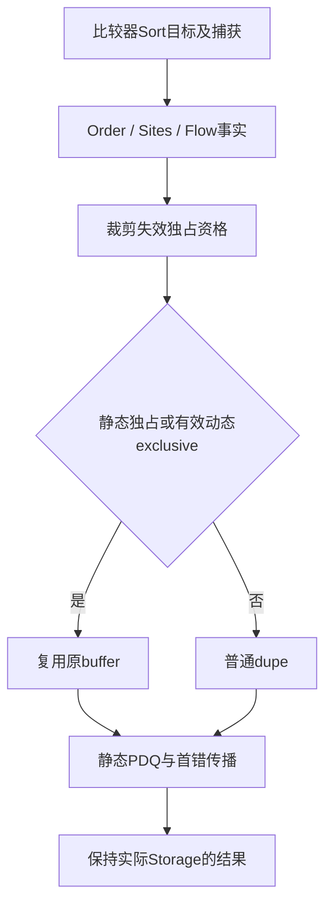
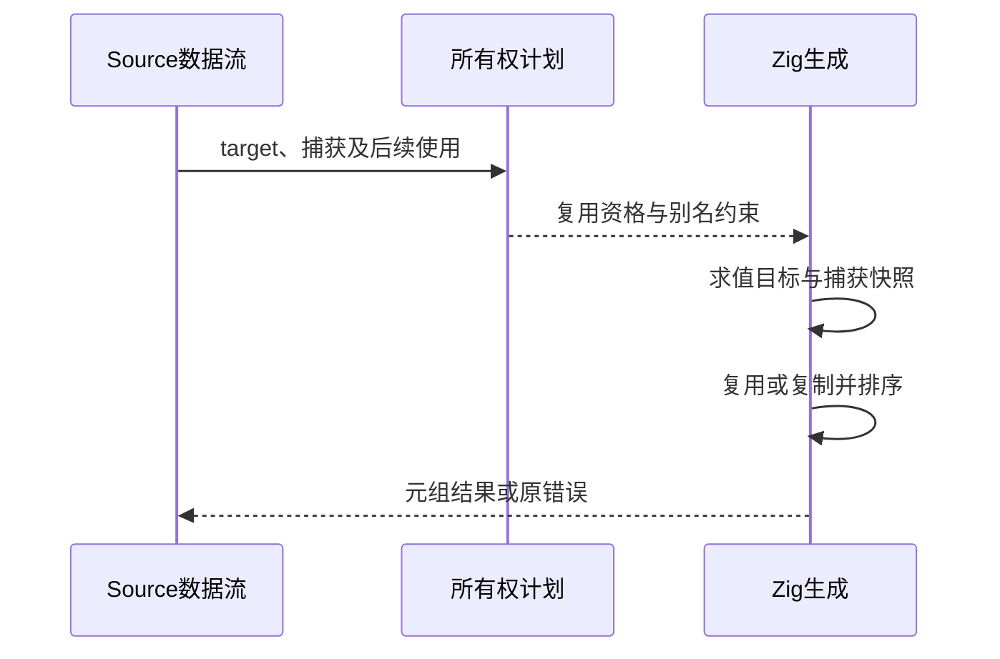

# 比较器排序的独占缓冲复用

## Intent：最终目标

补齐 Memo 状态协议迁移需要的普通数组比较器排序复用能力。保留现有不可变
语义、元组结果、元素身份、捕获快照和错误传播；已独占的数组可原地排序，
共享数组继续复制。完整 Memo 协议和流式摘要能力仍是下一迁移边界。

## Data：可用证据

HEAD d222ddf0 工作区起点干净且已推送。比较器Sort已有Source/seed分析与静态
PDQ生成，但sorting/functions.zig总是allocator.dupe；Memo.entries原先复用
order容量并原地排序。无比较器Sort已有独占分析、in_place标志和动态Storage
机制，可以复用。上一阶段真实记录预算证明借用输入只有必要的数组副本。

## Edges：边界与限制

- 不加语法、专用Memo排序桥或运行时闭包，不改变PDQ算法。
- 捕获原数组及错误后继续读取原数组时，必须保留原值，不得误用独占。
- 外层数组独占不代表元素独占；Flow必须保留元素及可能返回的buffer别名。
- 不能在错误时free复用的source，不能把带header的增长slice当普通dupe释放。
- 优先机会式复用，不为排序优化主动强迫上游创建增长副本。
- 不新增测试用例；复用原有检查和真实编译器记录验证，验收后全部提交推送。

## Answer：实施与验收

1. 核对Sort target的使用、写入及返回别名，贯通Source与seed的计划事实。
2. 利用现有ownership.clip与Storage资格选择原地或普通复制；复制路径保持
   既有分配量，返回描述符保留实际buffer属性，错误清理区分来源。
3. 复用现有行为与缓存检查，验证真实Source自生成和受影响路径性能，再提交。

当前状态：实现、正确性与本阶段性能验收已完成。CPU/RSS及固定
累计锚点继续沿用上一阶段记录，不重置容差预算。

## 实现进度与交接

机会式复用已实现：Sort保持Fresh下界，不主动传播Unique需求或启用grow；
Source/seed收集Sort操作并计算静态in_place，Order目标使用和Flow的写入/返回
别名同步。transfer/selected显式读取transform_targets，避免误索引collection。
生成器只求值一次target，先裁剪再绑定；静态unique或该绑定值的动态exclusive
允许复用，其他情况继续普通dupe。返回值保留实际header属性，错误清理只释放
复制分支，绝不释放复用的source。元素本身的共享规则保持。

backend身份为v82，program唯一性身份为v14。Flow缓存键独立于program身份，
已将flow身份推进至v5，避免读取旧Sort写入/返回别名事实。最终Source候选
和正式CLI均包含此身份；缓存跨版本验收使用该最终候选。

Native引导Source工具构建35/35步骤通过，日志为
/tmp/zxc-function-levels/sort-reuse-bootstrap-build-fixed.log。第一轮只有AST
errdefer节点名称错误，已改为已有条件表达式；失败不计通过。

现有函数分析、生成运行时、持久缓存、context borrow、field facts、owned
collections、array callbacks、nested collections及typed try回归完成：
644/644步骤、11795/11795测试。日志为
/tmp/zxc-function-levels/sort-reuse-regressions.log；未新增仓库用例。

本阶段在完成下述功能与性能验收后统一提交推送。固定性能基线
与上阶段6918项及type-parser16项证据继续保留；实际生成/分配路径变化仍需
受影响范围的性能验证，不能机械复测不变的诊断或格式。

## 最终正确性证据

最终候选sort-reuse-candidate由当前Source主入口及ordered比较单元构建，
两轮Source生成分别2166份和23份产物逐字节相同，排除项仅.zxc-inputs。
正式CLI使用该候选作为stage0构建，28/28步骤通过。

缓存从上一阶段sorting-source-candidate的v81输入升级至当前v82，随后修改
真实Source allocate算法并恢复；跨版本、编辑和恢复分别2166、2165、2166
份产物与独立冷生成一致。Flow v5包含在本次候选内。

在临时Source副本中将真实plan/renewals.zx默认升序sort改为等价三路比较器，
生成器为selected.keys输出reuse=true。使用这份实际编译器算法构建的工具与
正常候选处理同一真实Source输入，2155份产物完全一致。另在同一Source排序
闭包中捕获原数组，生成代码在调用前将其Storage裁为shared/plain，动态
exclusive条件为false；不借助新用例或专用运行时接口。捕获观察路径仅核对
生成形态，未单独构建该临时变体，不能将其记为动态错误路径全覆盖。

真实记录观察工具在临时Native副本保留旧集合规则作为oracle，正式源码没有
探针。六组初始、缓存、编辑、恢复流程中，88226次比较均与旧规则一致，其中
88220次true、6次false。44110组实际记录自比较使用零容量allocator；同组
倒序副本比较全部满足原有精确副本预算，其中627组需要分配，最大256字节。
分配字节始终为normalized长度大于1时16*n加renewed长度大于1时32*n，
未因机会式复用主动增加Unique/grow预算。六组缓存输出各2155份均等于冷生成。

原始报告统一位于/tmp/zxc-function-levels，前缀sort-reuse，主要文件为
main-fixedpoint-comparison.json、unit-fixedpoint-comparison.json、
owned-real-comparison.json、cross-v82-cache-comparisons.json、
oracle-summary.json、oracle-comparisons.json和cli-build.log。

## 无探针性能与自查

使用上一提交阶段的sorting-source-candidate对比最终sort-reuse-candidate，
同一Source主manifest，三组前后交错测量；计时期间没有并行构建和探针。
冷生成CPU中位数5.43→5.41秒，墙钟1260.546→1263.802毫秒，RSS中位数
655294464→652869632字节。常驻工具在固定克隆输入上每组四次编辑/恢复，
CPU中位数2.96→2.96秒，墙钟1149.595→1142.689毫秒；单组CPU变化
+0.03、+0.03、-0.03秒，不能把中位数一致宣传成可辨性能收益。冷生成同输入
跨版本2166份产物全部相同。本阶段未观察到明显退化，不以容差充值掩盖累计成本。

历史累计锚点仍为ca03eb0011e3efd13221e1baefca7fcc10a1da77，历史CPU4.11秒；
当前输入已增长，不能直接用当前5.41秒减历史4.11秒宣称同输入累计差值。
累计性能未整体关闭，此处只证明本阶段固定同输入对照。报告为
sort-reuse-final-cold-paired-results.json、sort-reuse-final-hot-results.json及
sort-reuse-final-cold-shape-comparison.json。

实现遵守机会式复用，没有为了获得in_place而强迫借用数组额外分配，元素共享
规则仍独立于数组独占。正式Source仍含Native适配及Memo协议；下一职责需要
补齐流式摘要的固定缓冲表达，再迁移Memo的key/encode/entries/restore协议。
本阶段只是该迁移所需的通用Sort能力完成，不是Memo或整体自举完成。

提交前复核全部diff、Source与Native格式、工作区清单和用户目标；将全部改动
一起提交推送，随后检查工作区干净且HEAD与origin/master无差异。
