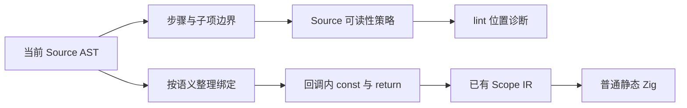
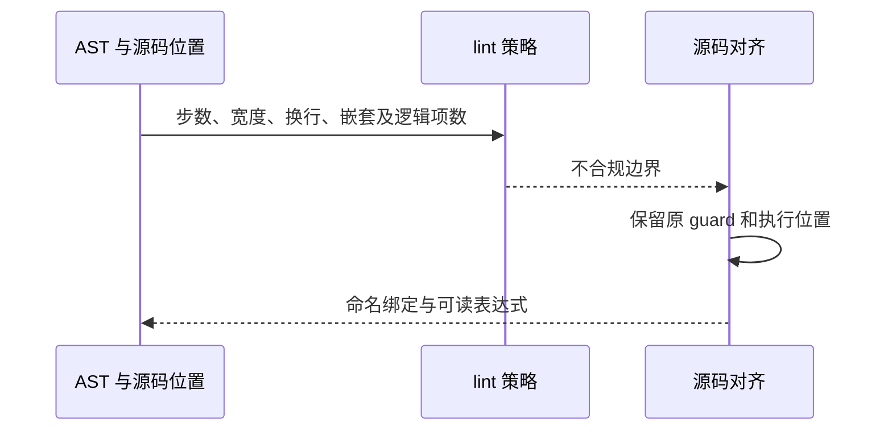
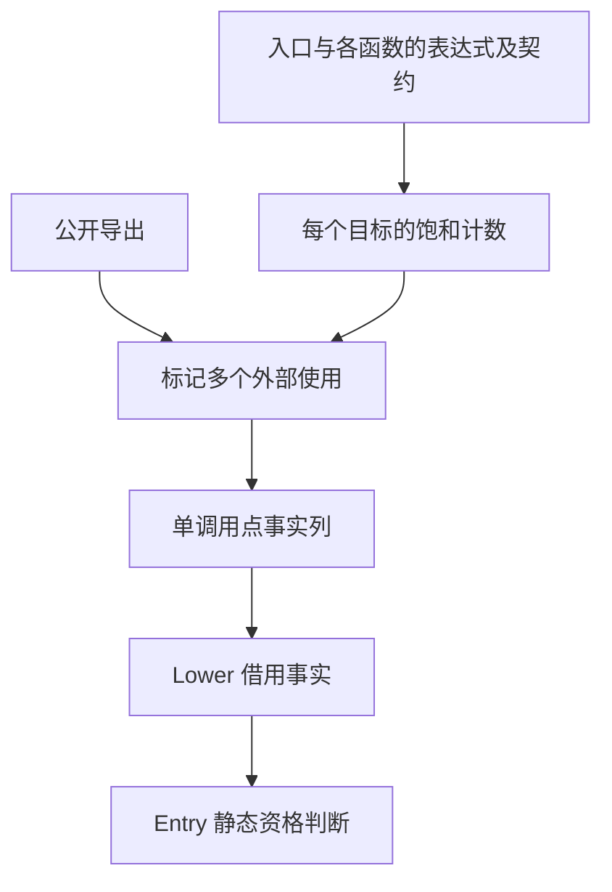
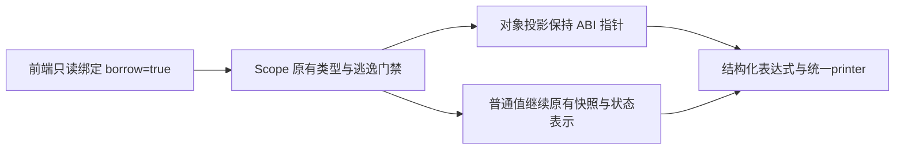
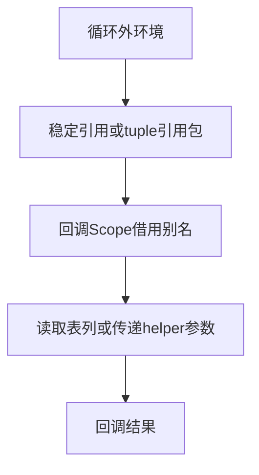

# 管道与条件列表的可读性约束

## Intent：最终目标

先完整收口最近两天的数组协议、loop、pipeline、condition、三元与现存源码对齐，
完成并统一提交推送后，再继续后续自举迁移。
保留 90 列总体格式，不为使用特性牺牲可读性、短路行为或零成本要求。

## Data：可用证据

用户明确：pipeline 至少三个处理步骤；长步骤提取函数，也可直接保留普通计算与
有语义的中间变量。condition 长项继续拆 condition 变量，不提取谓词函数；
每项最多三个逻辑子条件，禁止内联嵌套条件列表。两者的步骤/子项单行且内容
最多 30 列；按表达式内容计，不计缩进和连接前缀。

只读 AST 扫描发现 661 条 pipeline 链，其中 650 条不足三步；659 条处于已有
语句块内的完整 RHS，适合恢复显式绑定。528 份 condition 列表中存在 240 个
多行子项及 920 个超 30 字符子项。36 份列表位于普通回调/while 表达式体，
依赖动态参数，不能把 const 外提到回调外，需要按 TypeScript 形式支持只读
箭头函数 block body，使局部 const 与 return 留在原执行位置。

362e3fa7 的编码缓冲分配观察在独立临时 Native 副本中完成，真实 Source 输入
冻结在 /tmp/zxc-function-levels/memo-budget-sources。新旧产物完全一致，
累计编码缓冲申请 22803→16568 字节；450884 次可复用调用在零容量 allocator
下成功。整个进程 RSS 上浮没有对应编码缓冲申请增长，不能归因为该缓冲膨胀。
探针不进入仓库和正式产物。

## Edges：边界与限制

- 保留未提交的 Memo 帧 RX 改动，最终全部验收并一起提交推送。
- 规则只限制适用边界，不强制为了 pipeline 新增函数、包装或无意义步骤。
- condition 可以分层引用命名变量，不能直接嵌套列表；保持原惰性 guard。
- 不新增测试用例，使用现有解析/分析/资源检查及真实 Source 生成核对。
- 只读 block body 使用已有 Scope IR 静态生成，不引入运行时闭包或解释层。
- 源码对齐以实际 AST 为依据，旧脚本和历史 spans 不直接重放。

## Answer：交付与成功标准

贯通只读 callback block、Source lint 规则、Native AST 位置适配与 ZX/RX 检查。
按语义恢复不适合的 pipeline，拆分 condition 子项，保留求值及 Nullable 收窄。
用现有检查、完整扫描及真实编译生成验证规则覆盖与改写正确性后统一提交。

## 补充边界：三元表达式与 loop 只读作用域

用户进一步要求三元表达式单行且简单，复杂内容改match；后续又明确移除loop
第三参数与回调第二context形参，改为当前函数词法作用域向下只读传递。
生产源码954个loop中158个为三参数：82个identifier、54个object、22个field。
while双形参140处、next双形参153处；独立测试源码中204个loop均已是双参数。

迁移须保留原initial先求值、context后求值且一次的顺序。必要时保留有语义的
只读绑定，不将第三参数对象的字段计算复制进每个回调，也不删除有真实效果的
未消费字段。支持可见绑定的读取，继续限制只有本循环state可更新。

现成Collector可收集词法引用并生成Borrowed符号；while/next/return必须分别
分配target SSA符号，以source SSA符号和捕获类型合并只读来源。静态降为现有
Iteration.environment_symbol及只读ScopeBinding；它只是普通作用域数据，不是
函数值或可逃逸闭包。无新增IR schema、运行库或解释层，并保留现有canonical
callback可见性校验。不得简单开放所有outer active，否则会扩大Task/消费边界。

Source可复用building/tuple、sorting/body与iteration/save/finish；Native使用
同样的结构化IR。过渡引导工具先具备只读作用域再迁移消费代码，最终源码及
公开行为必须拒绝第三参数与双形参loop回调，不将过渡兼容当成交付。

## loop 作用域迁移进度

- AST 核对当前生产源码 957 个 loop，第三实参及双形参回调均为 0。
- Native 与 Source 已删除旧公开接口；三个回调分别收集引用、按源符号与类型
  合并借用环境，无引用时保留原 body，保留生成器的循环结果字段投影融合。
- 已有错误回归中“外层读取必须失败”一项更新为“第三实参必须失败”，未新增用例。
- 已完成一次真实 Source 生成：138 入口、2140 模块、1905 函数文件。
- 构建发现 state/shared 将 tuple 的 sequence_items 误作数组元素共享，导致
  只读环境牵连数组记录装箱；已将共享判定限定真实 List 的元素区间。此项会影响
  生成表示，必须核对 ABI、零分配结果与受影响路径性能，不能作为格式调整免验。
- 过渡引导工具位于 /tmp，其 Native lint 副本暂不启用尚在迁移的新增可读性检查；
  仓库规则保持严格。重新引导生成器时复用上一阶段已验证的 ordered 比较器产物，
  打破生成布局修正与零拷贝 ABI 适配的引导循环；最终验收不得依赖这些临时放宽。
- 两参数接口与 Source 布局修正已通过完整引导构建；既有回归及性能核对仍在进行，
  尚未提交推送。

## 已取得的 loop 验证与剩余工作

两参数实现及新的只读 Source 分析已通过完整 bootstrap-stage；独立 ordered
入口通过严格可读性检查生成。已有 test-iterate、test-iterate-buffer、
test-iterate-calls 全部通过，CLI 的 5 项求值顺序/错误边界检查及 1 项库重定位
检查通过；覆盖既有分配失败清理、缓冲与快照断言，没有新增测试。

继续优化单个只读来源的环境：直接借用该值，只有多个来源才构造静态元组。
相同当前 Source、相同 138 个入口、相同工具链，元组版本与直接借用版本交错
各执行三次冷生成：CPU 中位数 5.70→5.69 秒，墙钟 1.41→1.39 秒，峰值 RSS
中位数 773734400→659980288 字节。原始结果在
/tmp/zxc-function-levels/loop-scope-direct-measurement.json。布局发生有意变化，
不能将生成文件逐字节不同当作语义退化；直接借用改动后，test-iterate、test-iterate-buffer、test-iterate-calls、
test-function-analysis 已通过；根目录构建已通过并更新 zig-out/bin/zxc。
这些数字是本次优化对照，不替换固定累计基线；旧阶段 5.42 秒 CPU 与当前输入
已发生语法、模块及特性变化，不能据此宣称累计性能问题关闭。

可读性规则与现存源码的全部对齐仍未结束：pipeline 主体已恢复普通语义绑定，
仍需处理剩余嵌套管道、condition 长项/嵌套与复杂三元，并复核对象属性简写。
一次机械展开 condition 的尝试产生过多中间条件，已从独立备份完整撤回；
/tmp/zxc-function-levels/align-condition-readability.py 不得直接重放。
最终严格生成器的全 Source 重建仍会报告上述旧写法，不能以临时引导工具的
生成成功代替全部可读性要求验收；收口前不提交这个未完成的整体阶段。

后续直接从可读性源码对齐缺口继续，不重复 loop 功能构建与已有回归：
新增检查仍会拦截部分现有 condition/三元，不能把临时 lint 副本或旧 ordered
产物作为最终依赖。当前正式引导工具为
/tmp/zxc-function-levels/loop-scope-complete-candidate（严格 lint，优化前）；
packages/compiler/zig-out/bin/zxc-bootstrap 已是直接借用优化后的严格工具；
/tmp/zxc-function-levels/loop-scope-direct-candidate 仅为无新增可读性 gate 的临时
引导工具，支持最终两参数接口、Source 与 Native 自动只读作用域。
真实 contributions.zx 的 CLI 核对发现 IR 校验失败：分析阶段提前折叠
return 的字段投影，留下未声明的回调参数 SSA。已改为保留正常 Scope 绑定，
由已有 genz iteration_consumer 完成投影融合，保持完整 IR 校验；正在重新验收。

没有提交或推送这个尚未完成的整体阶段。下一步应避免
再次机械展开 condition、造成大量 !/!! 或无语义的 guard 变量；按实际谓词
和同主体分派优先收口，子项过长再提取命名条件，保留惰性与收窄。

## 实际 CLI 验收暴露并修正的生成问题

保留 return 参数 Scope 后，contributions.zx 的普通 CLI 编译已通过完整 IR 校验。
生成器已有 iteration_consumer 可融合这个 Scope 与最终字段投影；无需在分析时
删除参数或降低“每个 SSA 符号都有声明”的校验。

进一步检查生成代码发现 executeState/executeValue 与普通 executeIn 入口成本
不同：后者会在标量循环中把借用的记录数组反复转成 State 行布局，出现循环内
zxReserve。已限定仅含标量/枚举/错误及其可空成员、且 identity-free 的消费型
循环，沿用 ABI 栈布局，避免为只读数据换表示。一般集合状态继续原路径。
这一 lowering 选择目前仍是 Native 生成器中的规则，属于后续自举迁移依赖，
不将它记为 Source 已自举；需要用真实生成代码和既有回归核对效果。

最新可运行状态：根目录 zig-out/bin/zxc 已包含 SSA 修正及安全的 ABI 选择。
contributions.zx 在完整 IR 校验下编译成功；其 executeIn 旧有 4 次 zxReserve
调用已全部消除，只有一次 while，无 allocator 调用。ABI 优化额外限定 consumer
为标量出口，聚合出口保持原转换路径；这一限制前后，实际模块生成字节完全相同。
Scope/投影修正后完整四组既有回归通过；新增出口限制后的聚合别名与函数分析
回归已通过。

注意临时工具的先后关系：loop-scope-direct-candidate、loop-scope-abi-candidate
均早于 SSA 修正，不可据它们宣称最终 IR 正确；仅作为生成下一阶段 Source 的
临时 stage0。packages/compiler/zig-out/bin/zxc-bootstrap 是 SSA 修正后的严格
工具，但还不包含最后的 ABI 选择；根目录 CLI 才是当前最新版本。完成可读性
对齐后重新引导并核查不动点，不重复当前未改动的回归。

当前没有运行中的构建。所有改动保留在当前工作区，尚未提交推送；后续继续完成
严格 lint 下的旧源码对齐、最终自生成与必要累计性能核对，再按用户要求一次
提交全部未提交内容并推送。

## 保持原迁移成本模型的补充复核

检查旧第三参数为字段表达式的 27 个记录：其中 5 个是嵌套回调通过外层依赖
取得同一字段，剩余 22 处需要独立快照。已在原循环位置按 initial→字段的顺序
各求值一次，循环只读引用该字段绑定；没有把原 in.width/in.bytes 等小依赖
扩大为整个 in，避免额外携带 EncoderState 或其它数组造成保守共享与转换。
记录在 /tmp/zxc-function-levels/loop-field-dependencies.json；20 个文件格式通过。

五处原短路/嵌套循环也核对选取的值：aggregate 提取 slot，invocation 提取
first，qualify 提取 results，row 的内循环提取 inner_lists，collection 已有 end。
aggregate 与 push 已按命名条件、简单子行与 match 收口，严格 lint 通过；
将真实 genz/core 源码复制到临时 workspace 声明同样的 core 导出后，aggregate
已通过完整 CLI IR 校验与编译，无新用例或生产代码特例。

生成器正在将仅在局部纯标量表达式中消费的记录/借用元组保留在栈布局，
复用已有 identity-free 证明，避免多个只读来源的环境元组或纯标量初值被
分配到堆上；仍保留结果及函数出口的类型边界检查。

局部 scalar_scope 的额外优化尝试没有减少真实 aggregate.executeIn 中的堆分配，
原因是现有 deepOperation 明确不接受嵌套 Iteration；不能把 initialValue 当作
循环外层 Scope 的通用 identity-free 证明。该未见效果的额外判定已撤回。
保留已证明有效的标量循环 ABI 路径、单来源直接借用、以及借用元组与既有
对象相同的栈布局资格。aggregate 的普通入口仍有初值/环境及结果分配，
相同原生 Context 对象也存在这条路径；不得宣称全部 ABI 场景均为零分配。

2026-11-06 交接：22 处字段快照及四个手工嵌套场景修正后，
loop-scope-field-snapshot-bootstrap.log 对应 bootstrap-stage 已成功。当前源码
完整；没有运行中的构建。最新严格 bootstrap 位于
packages/compiler/zig-out/bin/zxc-bootstrap。根目录 CLI 已支持新接口并通过
实际 IR/生成核对，但还需在最终源码对齐后重新安装同步最新后端。

必须继续的缺口：全部旧 condition/三元/pipeline 的严格 lint 对齐；完整 Source
自生成及必要不动点；基于固定输入的最终成本与缓存验证；然后 git add -A、
英文规范提交、push 当前 master，并确认工作区与远程同步。当前未提交推送，
不把这份记录或局部结果视为整个阶段完成。

## 最近两天需求倒序核对（2026-11-06）

先采用最后一次明确修正，再向前补充未被覆盖的约束。原功能与后续收口分开，
已经完成的核心能力不重开；数组协议等已交付项直接复用有效证据。

| 倒序 | 最终要求                                                   | 原有完成证据                                                 | 当前差额                                     |
| ---- | ---------------------------------------------------------- | ------------------------------------------------------------ | -------------------------------------------- |
| 1    | loop 删除第三参与第二回调形参，同函数向下只读，不逃逸      | 本次 Native/Source 已实现；957处扫描、循环回归、实际 IR 核对 | 最新字段快照后的完整严格生成及成本/缓存验收  |
| 2    | 三元简单单行，复杂内容用 match/清晰结构                    | 新 lint 策略已接                                             | 664处改写语义收口；补齐 match 收窄           |
| 3    | condition 可命名分层，不内联嵌套；子项30列、最多3项        | 已有 condition 语法                                          | 这是后续调整；新 lint 与旧源码对齐仍在进行   |
| 4    | pipeline 非强制，至少3步；seed/stage单行30列，长步提取函数 | 173955e9、be16a3f3 已实现管道与回调值传递                    | 这是后续调整；剩余不合适管道与全量源码对齐   |
| 5    | 提交时包含全部未提交内容并推送                             | 既有流程约束                                                 | 当前整体阶段未完成，不提前声称提交           |
| 6    | loop 后不接字段/索引/调用，后处理放 return                 | f1e7b72e、be16a3f3 与既有 lint/循环检查                      | 原功能已完成；只核对本轮旧代码对齐           |
| 7    | pipeline/condition 零运行时抽象                            | 既有静态展开及 IR 机制                                       | 本轮实际表示变化需要对应成本证据             |
| 8    | condition 显式连接、取反在操作数、左结合、nand/nor         | 173955e9；Native/Source connector/fold 存在                  | 原语法已实现；新排版/嵌套限制单独验收        |
| 9    | if最多直接2项、快捷逻辑最多3项                             | 173955e9 与现有策略                                          | 原规则已接；只核对本轮新改写不违规           |
| 10   | map返回[映射数组,void]，reduce返回[原数组,累计值]          | fa20e960、7d4aa101及已有421项检查/235步骤记录                | 已交付，不重新实现；仅补真实受影响的关联回归 |

三元转 match 的语义检查已暴露通用能力缺口：match 条件臂与 fallback 未传播
真假假设，可空值丢失收窄。正在补齐分析；无 subject 的 match 静态降为现有
Conditional IR，保持一次求值、顺序短路和既有 IR 校验/所有权规则，避免另造
运行层。初始引导使用冻结的转换前源副本构建新分析器，之后消费当前改造源码。

## 最新调整：180 行建议与 240 行硬上限

Intent：建议每个 ZX 文件不超过 180 行；180～240 行留给继续拆分会损害
算法或状态机内聚性的场景。默认 lint 硬上限为 240 行，含空行与注释。

Data：2026-11-06 用户先要求 240 行 lint，随后明确 180 行建议与中间 60 行
弹性区间。此要求覆盖旧 120 行标准。当前生产源码初次扫描有 30 个文件超过
240 行，不能将历史 120 行诊断或本次关闭行数的风格扫描作为该项验收。

Edges：超过 240 行时按纯函数语义职责拆分；不机械切片、不压缩排版，保留
RX 的真实编排与 ZX 原子逻辑边界。配置入口保留 --max-lines；建议值不新增
180 行失败门禁。

Answer：已更新 seed/Source lint 默认值、仓库规范与 lint 文档。已拆分
标识符保留字识别、表达式结果强制转换、值回调作用域进入和完成职责；这些
拆分后所有文件均低于 240 行。最新真实源码生成通过 141 个入口、2150 个模块，
新增 4 个纯函数文件；最终严格 lint、自生成及完整提交推送仍待收口。

临时执行证据现保存于被忽略的 .zig-cache/recent-alignment；旧 /tmp 文件已
不在当前环境，不用其路径作为后续交接的唯一证据。

## 当前验证位置（2026-11-06）

严格引导工具构建已成功：.zig-cache/recent-alignment/strict-tool-build.log。
引导输入为临时 Native seed，其 lint 副本只在引导阶段略过尚未对齐的风格检查；
最终生成工具仍链接仓库完整严格 lint，不能以本次构建替代全源码严格通过。

本轮将条件单行/30列对齐的失败文件从 262 个继续减少；随后纳入新的 240 行
硬上限，全量 1954 个生产 ZX 文件检查有 111 个失败（96 条条件首诊断、15 条
行数首诊断；另有条件首诊断遮住的超长文件）。这是待处理清单，非通过数量。

进一步拆分 primary 的字面量解析，以及 formatter 的 should_wrap；后者保留
原 guard 与 checked arithmetic 求值位置，主文件 231 行、纯函数 42 行，严格
lint 指定 240 行通过。格式化与语义等价表达改写不做额外性能对比；有生成形态
变化的函数拆分及 loop 作用域仍须在收口时核对实际生成成本。

现有 test-frontend 已启动，日志为 .zig-cache/recent-alignment/frontend-check.log；
该检查结束前不声称通过。当前尚未统一提交推送，剩余源码对齐、25 个以下超长
职责的拆分、完整严格自生成、不动点与受影响路径成本/缓存验收仍需完成。

现有 test-frontend 首次结果为 312/313。唯一失败是旧 negative parse 检查
“block lambda 必须语法失败”，与本轮已支持的回调块契约冲突。已将这条既有
检查迁移到 positive semantics，并按既有 map 元组协议选取 [0]，没有新增数量
或生产特例；同一现有回归正在复验。超 240 行文件当前为 24 个，不能宣称
整个代码规范阶段已完成。

复验已结束：test-frontend 的 313/313 项通过（12/12 构建步骤）。日志为
.zig-cache/recent-alignment/frontend-check.log。这证明当前前端回归通过，不替代
尚未完成的全源码严格 lint、最终自生成和累计成本/缓存验收。

## 有原生只读调用的标量 loop 初值

实际 Source 生成器在零容量 allocator 的 reads 校验中报 OutOfMemory；两个
候选共同失败，不能作为性能对照。生成产物明确把 `{ offset, same }` 初值
放到 heap，原因是 capture 保存初值引入 Scope，而 scalar 局部栈布局只接受
pure 调用图，排除了原生 AtomicRows 读取。

修复采用已有 local/isolated 借用边界，而不放宽 pure 语义：scalar 输出的
局部对象栈布局以 local 资格判断，seed 与 Source 同步。现有 native_value
isolated 限制原生输入为叶子、叶子数组或其展开元组，拒绝 Source 对象输入，
且拒绝 IO/process 参数和 Store；对象地址不能通过该边界逃逸。输出 scalar
不会保留局部对象，Task/Parallel 仍被既有调用图规则排除。Source 的 inlined
仍要求 pure，不混淆原子读取与纯调用，也不允许靠扩大 allocator 容量兜底。

宽 Build 的静态核对未发现新增数组复制，实际 create 站点是 14→13，旧摘要
仅检索 zxCreate 因而漏计 `(allocator).create`，不能用其 create=0 声称零分配。
当前真实风险为 ABI 描述符传递及 storage 裁剪；修复上述共同失败后，再以
同一冻结输入、同一后端比较仅 construct 不同的两个候选。

自我复核发现 local 资格不能单独证明对象身份不被观察：普通 ABI 的输入对象
别名若被解引用复制到栈，alias 与原对象的地址比较可能变化。现已同步补齐
value_call/locals.borrowed 的 ABI 分支：引用、成员、元组、索引与可空投影
保留原指针，非 fresh 调用也保留；fresh 初值才进入栈布局。Scope 的 scalar
局部优化另要求当前 Scope 结果为 scalar，防止把对象局部地址返回块外。
这些防线经只读复核覆盖身份与块逃逸路径，仍待现有边界回归。

新 seed 生成的 reads 校验依赖闭包已从 1 个 create 站点降至 0；未扩大零容量
allocator，也未放宽 Native isolated、pure、Store 或 Task 契约。性能候选正在
以统一修复后的后端重建，两个 producer 冻结源码树逐文件对比，仅 state 的
construct.zx 不同；被测输入另行完整冻结并记录摘要。旧共同失败的报告保留，
不记为性能结果。

## 状态构造器拆分的独立成本对照

原 construct.zx 的 555 行拆为 construct/ 中 initial、step、optional、list、
aggregate、selected、finish 七个纯函数，以及保留集合遍历的 construct.zx；
共享 Build/Selection/Aggregate 类型集中在既有 model.zx，职责文件均低于
180 行。数组增长与 claim 顺序保持原算法，未通过 runtime 或模板绕过。

两份 producer 冻结源码树逐文件对比，唯一差异为 state/construct.zx（原实现
与拆分调用）；都使用统一的 local 标量与身份保护修复。Native seed 分别生成
后构建实际 Source 分析/生成工具。被测 Source 输入另行冻结，2218 个文件
记录于 .zig-cache/recent-alignment/cost-input-digests.json。

三组交错冷生成（每组独立 output/cache，OS 页缓存会逐步热身）的 CPU：
before 7.78/7.61/7.62，after 7.63/7.65/7.57 秒；中位数 7.62→7.63。
wall 中位数 1.66→1.67 秒；首组冷页 wall 3.65/2.24，不取为独立收益。
RSS 约 5.43～5.45 GB，未将静态调用站点误报为动态申请量。

完整产物首次不排除任何项比较，仅 .zxc-inputs 不同；该文件由工具 digest
参与 frameDigest 产生，核对 generate_parser.zig:119～142 后仅排除此精确项。
其余 2216 文件集合和 SHA 完全一致。证据为 state-split-fixed-summary.json、
state-split-fixed-paired-reports.json 与 state-split-fixed-output-verified.json，
均位于被忽略的 .zig-cache/recent-alignment。

本阶段差异 +0.01 CPU/+0.01 wall 在既有容差内且样本交错，未见可辨别退化；
未增加强制 inline 门禁或改变原内联预算。此对照仅证明本次 construct 拆分，
不把 7.62 秒改设为新的累计基线；全阶段固定基线与增长趋势验收仍须收口。

现有 test-native-value-boundary 与 test-function-analysis 已启动，专门核对
此次 local 栈布局、别名与生命周期修改；结果出来前不声明通过。全源码最新
检查为 1969 个文件、59 个待收口文件，含超限及条件诊断。尚未提交推送。

## 5 GB 内存增长的分配定位与阶段来源修正

用户指出 CPU 与内存累计增长后，停止扩大格式调整范围，先定位生成成本。
临时诊断源码与工具均放在被忽略的 .zig-cache/recent-alignment/memory-probe，
不修改生产分配策略、不关闭安全检查。原有边界检查已完成：
local-scalar-boundary-check.log 记录 63/63 构建步骤、84/84 现有测试通过。

同一冻结输入的分配探针显示：prepare owned 75,970,040 字节，生成后 owned
110,395,942 字节；并行 worker 输出总量约 42 MB，单 worker scratch 最大
约 196～275 MB。主要增长确实来自 Memo：分析后 arena 容量 5,196,130,720
字节；编码调用 379,936 次，非空旧 buffer 的地址变化 379,935 次，调用边界
可见的复制长度累计至少 1,674,498,183 字节（不含调用内中间副本）。
RSS 5,444,550,656 字节。日志为 memory-probe/copies-run.log。

生成代码说明 buffer.storage 被裁剪为 shared/plain，后续 zxRenew 为每次写入
复制整个高水位 buffer；副本在 Memo 永久 arena 累积。进一步追溯发现，当前
cost-fixed-after-stage 是 Native seed 生成的：Function.plan 的 Native fallback
只返回 flags/renewals，不产 transfers/slot_first；ownership.eligible 因空列
恒 false。因此并非已经证明 readonly Scope 或 RX 框架丢失凭据；此前对此的
怀疑撤销，不能在未运行 Source qualify 的阶段追查 qualify 的失败节点。

最终工具的 generated_analysis=true 只决定下一次发射，无法修复自身已由 seed
写入的裁剪。需要完成 Source 再生成与编译链，然后在同一输入上计量；不能
用初始 seed 生成的工具与历史 Source 自编译工具直接做累计性能结论。此前
construct 拆分的同配置对照仍有效，但不作为累计性能验收。

已用 cost-fixed-after 对同一冻结 producer 生成 source-owned-stage；静态核对
append 的 loop 初值不再降级 buffer，begin.executeState 恢复直接转发 callValue。
新工具构建中，尚不能声称运行成本已修复。后续验收保留全部迁移，不新增
consuming 专用桥，不豁免 ownership 检查；以 Source 自编译后的原输入、完整
输出及真实 CPU/RSS 作为证据，并继续核对累计基线。

Source 再生成后的工具已构建并完成三次独立输出/缓存运行：CPU
5.37/5.32/5.58 秒，中位数 5.37；RSS 671,055,872 / 656,785,408 /
675,250,176 字节。infer 547/548/631 ms，emit 408/406/436 ms。首轮
OS 冷页 wall 3.22 秒，后两轮 1.15/1.27 秒，保留原样，不混称同一页缓存成本。
与原 cost-fixed-after 同输入的完整输出集合 2217/2217 相同，只有含工具摘要
的 .zxc-inputs 不同，其余 2216 文件 SHA 一致。

继续用 source-owned-tool 对同一个 producer 生成下一轮，输出也是仅
.zxc-inputs 改变，其余 2216 文件 SHA 一致；这是该冻结输入的生成固定点
证据，不代替最终自举的传递依赖审计与完整阶段自编译要求。记录位于
source-owned-summary.json、source-owned-output-comparison.json、
source-owned-next-comparison.json。实际工具没有临时内存探针。

自我批判：此前将 seed 生成工具的 5.4 GB/7.6 秒与历史 Source 自编译工具
混作累计趋势，归因不充分；现已纠正，并将“工具本体的生成阶段”和“本次
运行的后端开关”分别核对写入 AGENTS.md。新结果解释并消除了这次异常，
仍不证明相对历史 96-entry 固定基线的累计验收；当前是 141 entries，输入
规模和源码均有变化。临时性能候选仍使用跳过风格检查的 lint 克隆，生产
lint 必须随剩余 59 文件改造集中通过，不将临时候选冒充最终交付。

完整需求阶段尚未收口，不作局部提交推送；继续保留全部未提交内容，待
统一验收后一次提交，遵守用户要求的工作区与推送收口。

## 2026-11-06 源码对齐与拆分成本核查

Intent：保留已完成的最近语法特性，在 90 列、condition/pipeline 可读性和
ZX 240 行硬上限内完成现存实现对齐，并保持此前的实际算法与成本模型。

Data：原有 59 个 lint 失败文件降至 8 个；四个源码根独立行数扫描也仅剩
这 8 个超限文件：ownership/runtime/execute/statements、inline/selection、
inline/expression/copy、types/definitions/construct、uniqueness/order/walk、
order/expression、function/levels/visit、function/demand/trace。清单保存在
recent-alignment/remaining-lint-errors.json 和 length-exceeded.json。

本轮完成 state/iteration/uniqueness 等条件对齐，保留 guard 内的索引、
可空值访问与调用顺序。Core error_effects 明确保留独立的 null 早退：
不能依赖普通布尔 match 变量在后续分支携带可空值反证。

已按职责拆分序列求值、集合永久借用/更新结果、match arm 调度、表达式
迭代调度、ABI 初始化/结果收口、流分析 transform、槽位投影范围与分类。
ABI construct 227 行，values 当前 235 行；没有用删除空行规避上限。
SIMD append 识别提取为纯函数，并复用 invalid Candidate 构造；参数表读取
仍留在原 guard 后，避免提前访问。printer token 依 Zig 名称与结构语法
分组，字面量集中于各自 const.zx，消费处显式导入。

最新完整源码通过实际 Source 生成器：current-alignment-generation-11.log
记录 141 entries、2183 analyzed modules、1947 function files、2127 generated；
后续生产 values 接口缩小的候选亦已通过 Source 生成。候选继续链接临时
lint 克隆，不能代替最终生产 lint 验收。

Edges：拆分不是天然零成本。Source 生成的 stage7 工具已完成五组交错固定
输入对照：CPU 中位数 5.28→5.32 秒，超过 0.02 秒容差；infer 主要增加约
10～15 ms，emit 基本不变，RSS 中位数约 660 MB。2216 个生成文件 SHA
一致，仅工具摘要文件变化。不能将这次小幅增长当作每阶段可领取的预算。

隔离全部 ownership 源码后，相同其余 Source 的两份候选为 5.29→5.32 秒，
证实应优先检查 ownership 拆分。静态复核发现 sequence_result 先分别用两份
match(tuple) 计算 memory/values，跨 fork 的条件相关性未被识别，导致整个
forest.children 写时复制，并向 match 父模块传递新增 entry renewal。

保留 helper 后改为单一 if(tuple)，生成代码已恢复 children/values 原地写入，
父模块新增 renewal 同时消失；但三组运行 CPU 仍为 5.29→5.33 秒，故不能
宣称性能已修复。相关报告位于 alignment-isolation/verified-samples.json、
verified-summary.json、verified-output-comparison.json；输出仍为 2216 文件
一致。fixed-sequence-source-diff.json 核对了 2237 个源文件，唯一改动为
sequence_result，其他根共享冻结的实际路径，未将共享根误记为缺失。

进一步优化收窄接口：values 的事实表更新保留原排他状态作用域，独立纯函数
只负责 sequence 工作队列调度，不再为每步传递整份 Machine。仍保留按职责
拆分，不退回大文件，也不修改全局内联或所有权规则。narrow-sequence 候选
当前构建中，必须检查真实运行结果，不能仅凭生成代码或宽 ABI 假设验收。

Answer：先收回本轮 CPU 增量，再拆完上述 8 个文件，集中运行生产 lint、
既有回归与阶段 Source 自编译。全阶段完成后统一提交全部 WIP 并推送；
当前不作局部提交，不声明自举完成。

收窄 sequence 接口的运行验证已完成：仍保留 `values/sequence_work.zx` 负责
下一步 work 调度，事实表写入留在 values 的原排他状态作用域，文件 235 行。
没有新增全局编译器资格、运行层、强制内联或放松安全检查。

narrow-sequence 采用与 current 隔离候选相同的冻结源码，仅替换该职责；
测量时生产源码与此候选的非 Zig 源码按全部 manifest 根核对，证明记录为
alignment-isolation/narrow-source-proof-at-measurement.json（2236 文件无差异）。

三组交错固定输入的 CPU：before 5.28/5.26/5.27，after 5.34/5.24/5.28 秒，
中位数 5.27→5.28；wall 中位数均为 1.13 秒。新二进制首轮冷页 wall 3.75 秒
保留原报告，未删样本。RSS 中位数 670,203,904→659,357,696 字节；infer
539/537/540→539/537/539 ms，原先持续约 14 ms 增量已消失。完整集合
2217/2217 相同，仅 .zxc-inputs 有差异，2216 文件 SHA 相同。

报告为 alignment-isolation/narrow-samples.json、narrow-summary.json 与
narrow-output-comparison.json。本轮局部对照 +0.01 CPU、wall 无变化；继续
沿用累计基线，不能把该比较重设为新的固定基线或完整阶段验收。

自我复核：实际全表复制确实存在，但只消除它未消除整段 CPU 增量，因此
不能把静态 COW 站点误报为该增量的全部原因；缩小数据接口才恢复原 infer
成本。全阶段仍需完成 8 个超限文件并集中通过生产 lint、既有回归和阶段
自编译后统一提交推送，当前未完成，不作局部提交。

随后按相同窄接口原则拆出 statements/schedule.zx：只接收 Work/Control/
subject，返回 Work?，不接收或返回 Machine。原有语句分派、push 次序、
无结果语句与不支持种类的行为保留。statements 374→203 行，调度 helper
182 行，两者 lint 通过，现存失败与超限文件剩 7 个。此后续修改不冒用
前述 narrow 性能样本：narrow-working-tree-proof.json 明确列出这两个差异。

新 narrow 工具对生产树的 Source 生成检查通过，记录为
current-alignment-generation-12.log：141 entries、2183 analyzed modules、
1947 function files、2127 generated；infer 539 ms、emit 397 ms。此阶段计时
仅为该次生成的日志，不等于新 schedule 本体已经被编译并完成性能验收。
git diff --check 通过。当前仍有 997 项未提交路径，HEAD 无未推送提交，
不把任何局部检查称为全阶段完成；剩余 7 个超限职责与集中验收继续推进。

## 剩余职责拆分与正式检查收口

Intent：完成最近两天可读性及 loop 只读作用域要求，保持已迁移实现和成本模型，
不把临时 lint 副本或旧 seed 产生的工具作为正式验收。

Data：最后七个 ZX 超限职责已按算法边界拆分；类型定义构造、内联复制与候选
筛选、顺序遍历、levels 查询、demand 追踪均通过 Source 生成。递归仍留在原
owner，helper 不反向引用 owner；query/cache/seen 顺序、左右求值和两种 Match
各自的遍历顺序已对照原实现只读审查。宽 Machine 的事实写入仍在原排他作用域。

四个 manifest 根共 2267 个 RX/ZX 文件通过生产 lint（含默认标准 240 行）。
检查暴露的 RX 复杂三元改为惰性 match；外部声明谓词与入口 flags 各自承担纯值
职责，RX 保留流程。报告 current-production-lint.json，未新增测试用例。

Edges：当前 readability-final/tool 是正式 lint 构建前的 Source 候选；其后修正
九个源码文件，不能混用该工具的性能作为最终源码证据。strict-stage 已由该
Source 工具生成，strict-tool 正以生产 lint 编译。源证明及命令保存在忽略的
.zig-cache/recent-alignment/readability-final 下。历史固定基线继续有效，当前
141 入口与历史 96 入口的端到端数字不可直接相减。

Answer：接着核对 strict-tool 的完整生成产物和阶段不动点、实际 CPU/RSS 及
受影响既有检查；通过后统一验收全部未提交内容并提交推送。内存问题的判据是
所有权信息及真实缓冲区行为，不能把恢复到约 659 MB 的先前局部结果直接当作
本轮新拆分的证明。自我复核发现 levels 新增一个零轮循环路径，先看实际成本
再决定是否调整，避免仅凭源码形状猜测性能或展开无证据优化。

实际候选的固定旧输入对照未通过：before CPU 5.28/5.29/5.26，probe
5.61/5.65/5.54 秒，中位数 +0.33 秒；emit 约 404→481 ms，RSS 中位数
672,251,904→671,285,248 字节。完整输出仅 .zxc-inputs 差异。此探针未
启用生产 style gate；正式 strict 工具会正确拒绝旧固定输入中尚未对齐的
条件列表，首次拒绝已记录，未为此重复运行失败样本。

符号采样（symbol-profile-2，非计时验收）将新增热点缩到 levels/visit。
已改为叶子直接 complete，并让无 Match arms 的路径不初始化遍历状态；
仍保留同样 cache、carried/read 及 complete 顺序，文件 226 行。仅此阶段
优化候选正在验证，尚不能声称消除 CPU 增量。

核对进程发现手动生成会启动 --serve 常驻缓存。本轮三份不再使用的临时
resident 各约 570 MB，已按确切 PID 与缓存路径终止；正在用的回归缓存未
停止。它们与此前 5.45 GB 单进程峰值是不同指标。后续冷生成计时显式设置
ZXC_RESIDENT_GENERATOR=0，避免后台预热及多份缓存影响；相同配置下重新
成对测量，既有固定输入和累计基线不重置。

既有循环回归发现 borrowed/repeated 的 MissingSharedInitialCopy，正在
核对 shape checker 的入口范围与真实产物，未修改断言或跳过失败。全部
阶段仍未通过，不提交这份已知失败的工作区。

## 条件化循环触发共享降级的反例

Intent：优化必须保留独占缓冲区传递，不能用 CPU 优化名义引入新的整表复制。
Data：terminal/guard 两个探针令 visit 生成物新增 13/11 处 .shared；原版本为
0。terminal 实测 CPU 78.79/77.68/76.61 秒，RSS 13.11/14.56/14.27 GB，
明显失败，全部保留为反证而非有效候选。Source 反例和生成物位于
readability-final/visit-terminal-attempt.zx、terminal-stage、guard-stage。

已撤销这两项失败的优化尝试，保留七个职责的迁移。生产 visit 不新增 early
complete 或有条件 loop，使用窄 readonly 别名，并将互斥的 child/read 首步
合并，生成物恢复 0 处 .shared。direct-isolated-0 的 RSS 657,342,464 字节，
CPU 5.62 秒、emit 471 ms；内存恢复，但 CPU 尚未满足门禁，不声称优化完成。

Edges：Source 长度拆分后热点采样不足以独立证明增量全部来自 visit。
因此正对仅替换旧 visit 实现的冻结生产者做隔离，旧源码只存在临时证据目录，
生产迁移未回退。常驻关闭下的固定基线样本仍约 5.27 秒。

Answer：依据隔离结果继续优化生成质量或等价实现，再验收所有 WIP。
自我复核：批量样本脚本未在首个明显退化时中止，导致重复跑了三轮失败探针；
后续候选先取单轮，有可比范围及趋势需要时才追加，避免重复测量已知失败。

回归定位已收口：真实 borrowed/repeated 产物在首次写入时调用六参 zxAllocate，
非空 source 被复制，shape checker 只认可旧 zxRenew/dupe 因而误报。checker
补充识别这项既有复制原语，未放松 fresh 无复制/shared 必须复制的断言，也未
新增用例。原 128/128 项初值回归全过（69/69 steps），包括别名保留、零轮、
分配随轮数有界、分配失败释放。前一批其余既有运行检查 635/635 通过，包含
同套已运行的 96 项，不重复累计；补齐此前未生成的 32 项后总计 667 项。
记录 regression.log 与 initial-ownership-recheck.log；正式完整阶段仍待性能。

## 分段 CPU 与分配证据

Intent：不再把热点栈直接当作全部退化原因，以各职责的真实成本区分复制和边界开销。
Data：仅在忽略目录的 Native 副本中给既有桥增加线程 CPU 时钟及透传分配计数，
没有修改生产 Native/Source 的资格、算法、安全断言或生成原语。相同固定输入下：

| 职责              | before CPU ms | after CPU ms | before 分配字节 | after 分配字节 |
| ----------------- | ------------: | -----------: | --------------: | -------------: |
| inline.prepare    |         9.526 |       34.322 |      51,833,976 |     51,833,976 |
| order.build       |        43.023 |       69.782 |     333,721,644 |    332,254,672 |
| levels.close      |       166.188 |      191.984 |      73,147,787 |     73,392,871 |
| demand.analyze    |        19.824 |       20.242 |      45,142,788 |     46,392,984 |
| definitions.build |         1.977 |        1.938 |       4,051,792 |      4,051,792 |

报告 readability-final/phase-cpu-summary.json、allocation-summary.json。
inline/order/definitions 计数覆盖其临时 arena 的 backing 请求，非逐对象请求；
levels/demand 覆盖生成调用的逐请求分配。数值为累计分配，绝不是峰值 RSS。
levels/demand 的调用次数存在少量收敛调度差异，不把它们误报成新增 Source 文件数。

Edges：去掉旧 visit 的隔离工具仍有约 5.38 CPU/443 emit ms（单轮诊断），说明
不能只优化递归查询。生产 direct-visit 200 行，0 处共享降级；固定输入全部
2216 个实际产物 SHA 一致，仅 .zxc-inputs 的工具来源指纹不同。正式 lint 2267
文件通过后的唯一 ZX 修改 visit 已单独 fmt/lint，通过既有受影响回归的证据仍
须与最终成本修改合并验收。临时探针不纳入提交。

Answer：下一步针对 inline 与 order 的细化边界及 levels 的路由边界核对实际
机器码/调用成本；若缺少通用静态消除能力，应先用有边界的通用证明补齐，再
消费，不按函数名强制内联，也不直接扩大所有内联资格。当前未满足 CPU 门禁，
不提交推送、不重设基线、不声明最近需求或自举整体完成。

## 下一项实现决策：静态单调用点的边界消除

Intent：保留职责拆分，在普通 Zig 生成中消除不会复制函数体的静态纯函数边界。
Data：分段计时与分配对照指向 inline/order/levels 的新增边界成本；现有内联
资格只覆盖特定形状的小函数，包含 loop 或较宽标量结果的 helper 常被排除。
这仍是待验证的优化假设，不把分配块数相同推断成机器码没有任何复制。

Edges：只用实际调用点统计，不按函数名或路径白名单；公开函数、递归、契约、
原生副作用和 Task/Parallel 保持边界。统计按完整 program 一次计算，覆盖入口、
函数体与契约，计数饱和到“多个”，不能在每个函数上反复扫描全程序。算法写
RX/ZX，Native 仅传递元数据；旧 seed 的结构兼容只用于跨阶段引导。常规内联
阈值不放宽。若出现代码体积、构建或运行退化，不能把尝试当成已交付。

Answer：先贯通事实统计、所有权无关的资格选择与结构化生成，再检查受影响
路径的 CPU/RSS、代码体积与既有行为回归。单独的 gate 变化不算交付；目前
所有 WIP 仍未满足性能门禁，仍不提交。

## 优化尝试的拒绝与当前保留实现

单调用点内联候选贯通到了第二 Source 阶段，77→710 个模块声明 inline，
对相同对齐输入 861 个产物差异都仅为 inline 关键字。但 CPU 仍为 5.60 秒，
相同输入基线 5.27 秒；二进制 5,329,552→5,904,312 字节。该假设未成立，
全部新增计数算法、事实列、Native 传递与资格改动已移除；不能把它作为新增
已交付能力，也不能继续放宽预算。曾发现对应生成缓存需包含新事实，因尝试
已整体撤销，没有留下未接入缓存键的策略。临时单调用点产物仍保留为反证。

当前保留的源码优化有明确职责：selection 的 walk/find/mark/cost 与 order.walk
把只读表、类型、边界及返回标记移到词法作用域，循环状态只保留实际更新的
字段；order.expression 把已读取的 kind/payload 传给分派 helper；levels.visit
只在 paired 路径读取右节点，避免所有叶子在 resolve 之后再次读取 node/payload。
依赖已有只读作用域能力，不增加语法或运行层。11 个文件 fmt/lint 通过，Source
生成通过，visit/expression 仍 0 处新增共享降级。readonly 固定输入单轮 CPU
5.58 秒、RSS 670,957,568 字节、emit 448 ms。比原拆分 emit 约 481 ms 有改善，
CPU 仍未达门禁。全部 2216 个实际产物 SHA 与固定基线一致，仅来源文件不同。

采样中的 parallel.acquire 曾疑似自旋热点；临时改为 std.Io.Mutex 后单轮 CPU
5.63 秒、emit 450 ms，未显示改善，已恢复原实现，不顺手扩大改动范围。
这也说明采样栈数量不能直接当作整轮 CPU 归因。baseline-symbol-tool 与旧
split symbol-tool 的成对符号采样现已保存为 baseline-comparative-profile 与
split-comparative-profile，后续只用实际差异定位三条已测量路径，不再重复
泛化内联或线程锁尝试。

当前尚未执行只读状态优化之后的最终生产严格自生成、最新行为回归及稳定
性能验收；先前 667 项证据覆盖其前一版源码，不能冒充最新全部检查通过。
生产 lint 的其余文件证据可复用，最新变动逐项通过。不提交已知 CPU 失败的
阶段；所有工作区变更继续一并保留待最终验收收口，goal 保持 active。

## 明确缺陷：Scope 丢弃已声明的对象借用

Intent：让只读作用域直接沿用稳定 ABI 引用，保持当前源码拆分，不复制整个列描述符。
Data：前端 iteration.bindScope 和 callback/pipeline 的绑定已用 borrow=true
声明投影借用；genz/scope 以前只处理 tuple.borrow，对 object 仍登记 stack_symbols。
locals.borrowed 只认可 input0/已分析的输入别名/仅投影用途，未识别捕获环境中的
整表参数，导致每个 block、statement 复制 Control27列、Types8列、Expressions89列，
合计 1984B；find/scope-binding 每轮另复制 1552B。基线无这些解引用快照。

修复在原Scope资格门禁内消费 borrow 标记，仅用于现有 reference/field/
tuple_field/index/optional_value 对象投影；selected、原有结果/逃逸检查保留，
构造和函数调用不放宽，仍由self.expr单次求值并保留cache/renew路径。state_block
通过新SSA symbol更新，循环体结束才提交；reduce accumulator保持borrow=false。
既有borrow契约与后端行为因此对齐，未新增语法或专用桥。

Edges：不能仅凭生成代码认定全部CPU增量消失。borrowed-scope-stage 的walk
整表快照由6处降为0；首轮固定输入CPU5.57秒、RSS673,628,160字节、emit433ms，
仍比5.27秒基线高，未通过。Native生成缓存域由v82升v83，使旧输出不能掩盖
新借用规则。更新后的667项原有回归在运行，未新增测试用例；分段计时副本
同步修复并补记实际函数IR表达式数，以定位剩余增量，不重复泛化内联/锁尝试。

Answer：继续按实际三条热点的计时和IR形态优化，并在生产严格生成、缓存一致性、
既有行为及累计性能都通过后收口全部WIP提交推送。上轮为具体生成缺陷的定位与
修复进展，本轮目标仍active，未宣称阶段完成。

## 只读借用回归通过与剩余标量路由成本

Intent：保留七项按职责拆分和零成本所有权修复，继续消除实际 CPU 增量。
Data：borrowed-regression.log 已完成 389/389 构建步骤、667/667 原有测试；
覆盖函数分析、原生值边界、loop 初值/调用来源/聚合/列布局/模块化。未新增用例。
临时线程 CPU 探针中 inline 阶段 34.322→10.152 ms，order 69.782→47.586 ms；
levels 为 213.054 ms，对照 166.188 ms。探针与回归编译并行，不充当最终计时。

只读生成物核查未发现 visit/resolve/reference/control/collection 的大表快照、
dupe、renew 或 shared 降级。旧版已有的 Context、Query 包装不得归咎于新拆分。
新增的是 13 个标量字段的 Resolution 路由记录（约 72B）及带 base 的参数记录
（约 112B），五个非 inline 函数边界；resolve 与子路由重复解码节点和数组检查。
实际 IR 数为 resolve329、reference207、control203、collection110，超过原有
192 表达式或4字段记录预算。

Edges：不再次尝试全局单调用点内联，不提高普通函数预算，不按文件名特判。
验证的候选仅扩展到输入至多4字段、返回至多16个标量字段、至多512 IR表达式、
无自身循环/task/parallel、保留 pure 与有序调用限制的记录路由；普通路径预算保持。
标量检查复用 recordResult，仅增加显式 limit。候选需两次 Source 生成后构建，
不能把仅含新策略逻辑但函数体仍按旧策略生成的 producer 当最终性能结果。

Answer：以固定 cost-manifest 输入和 source-owned 工具作累计对照；候选无收益
则仅撤回候选，保留已验证迁移与借用修复。五阶段时间只用于定位，不替代无探针
整轮 CPU/RSS、完整产物与现有行为验收。本阶段仍未达到提交标准。

标量记录内联候选已否决并撤回（const/inlined/record_result 恢复候选前源码）。
生产生成体只新增14个 inline 标记，未改ABI；文件摘要随输出同步变化。
同轮交错固定输入CPU：baseline5.30、Scope修复5.51、record候选5.55、baseline5.29；
emit403/436/444/405ms，RSS全部约668～677MB。输入、非模块编译参数一致。
因此不能将标记inline视为零成本已经兑现；不保留无收益预算，不继续扩大门禁。
记录为 current-check-summary.json 与 record-policy-output-shape.json。

当前最小候选只消除真实重复读取：resolve一次读取payload/kind，将已解码的标量
传递reference/control/collection；子函数不再重复读取相同列。原始表访问和错误顺序
保留在resolve先前位置，不增加分配、不改调用/分支顺序，仍按普通函数预算生成。
编译与计时前五个修改文件fmt/lint已通过；完整性能和行为证据出来前不声明收益。

重复解码候选已完成：固定输入2217个文件无增删，仅工具摘要参与的.zxc-inputs
不同；其余2216个文件SHA一致。冷页CPU5.58/emit435ms，热页5.52/436ms，
与相邻Scope版5.51/436ms无可辨别改善；恢复五个候选文件，避免为少量索引读取
增加跨函数参数协议。相关记录decoded-first/decoded-warm/decoded-output-comparison。

再核对嵌套Usage包装：旧visit5处与新visit2+resolve1+reference2逐字同型，
Definitions三处也一致；不能将旧有转换误报新增成本，不重试已经否决的叶投影优化。
下一诊断只在忽略目录wait-native中计量Ahead.take的等待循环及drain线程CPU，
不改生产并发策略；用来区分计算增量与忙等放大，避免再盲调inline/互斥锁。

等待CPU探针已返回：wait-summary.json，5轮Ahead、20534次take，等待循环
累计146.774505ms线程CPU；drain仅0.000625ms。只观察到了前者的优化依据，
不修改Pool.drain、工作线程闲置轮询或Core.parallel锁。无探针整轮仍须验收。

候选将Ahead状态改为enum(u32)，新增waiting；take通过CAS登记等待，并使用
std.Io已有futex，worker发布ready/failed时swap且仅前态waiting才wake1。
发布仍release、读取仍acquire，不改任务、失效和worklist访问顺序。
只读并发审查确认CAS/发布排序与futex值检查避免漏唤醒，虚假唤醒重新检查；
当前每状态只有一个主线程take，finish/deinit等待worker结束后再清场。
成功及OOM两条发布路径均同步修改，不能留下失败无唤醒的永久等待。
本改动没有专用运行库，复用现有Threaded.io阻塞原语；State额外空间每行3B。

用户于2026-11-06明确放宽单次CPU/耗时容差为0.1秒以内，但累计超过阈值除外。
已同步AGENTS与用户原话。固定基线不重置：本轮三对CPU baseline5.29/5.31/5.27，
futex5.37/5.38/5.37，中位+0.08；相对原固定5.27为+0.10。wall1.14→1.18，
RSS中位669,892,608→659,783,680字节。仍需警惕累计接近容差，不能每轮再领预算。
futex对Scope版2217文件集合不变，仅.zxc-inputs摘要不同，2216实际输出SHA一致。
对原基线仅四模块的对象快照改为借用指针，以及对应.zxc-files校验值变化，符合
Scope修复预期。停止扩展优化候选，进入最终严格生成、既有回归及缓存验收。

## 最终严格验收（2026-11-06）

Intent：按新的0.1秒容差收口最近需求与现存源码对齐，随后继续自举。
Data：正式严格工具链接仓库完整lint，无临时风格豁免；当前141入口、2220模块、
1982函数文件、2162生成项。冷生成CPU5.36秒、RSS675,627,008字节，infer532ms、
emit412ms；该输入比固定计时输入新增54模块，不将两者直接相减。
正式再生成与borrowed-scope-stage共2268文件无增删，唯一差异.zxc-inputs工具摘要；
2267实际产物逐字节一致，证明本阶段Source自编译不动点，非完整自举结论。

2268个生产RX/ZX全量lint通过，使用240行上限；最新CLI安装构建通过并更新
zig-out/bin/zxc。缓存验证在独立源码快照完成，不修改生产或固定性能输入：
maximum_routing_fields合法值4→3后增量仅生成1项、复用2161项，与冷生成全部
2268文件完全一致；恢复4后生成0项、复用2162项，与原始全部文件完全一致。
未新增测试用例，探针与日志均在忽略的.zig-cache/recent-alignment/readability-final。

Edges：667项受影响回归最后一轮仍在运行；此前同组已通过，但futex是新改动，
不能拿旧结果代替。前端313项旧结果对应未再修改的解析/分析源码，复用证据。
仍有Native语义适配器、状态桥及并发平台代码，本阶段不宣称完整自举；下一轮
继续核对职责及传递依赖，保留固定基线与累计增长记录。
Answer：回归通过后统一收口全部未提交及未跟踪文件，英文规范提交并推送；
确认工作区干净、无未推送提交，不创建分支。

最终受影响回归已结束：389/389步骤、667/667现有测试通过，包含新增futex等待路径。
根目录正式安装构建28/28步骤通过；更新后的CLI默认lint允许234行内聚算法，
visit格式检查通过。前端313项证据复用，当前无已知失败，不新增用例。
阶段仅剩统一Git收口；用户追加询问冷/热完整zxc构建耗时，先完成这项可复核计量，
再把结果及本阶段全部变更一起提交推送，避免提交后再遗留文档。

完整构建计量口径：ReleaseSmall、-j2、已构建的Source stage0；独立空项目缓存
及空Zig构建缓存，仅链接已下载依赖源码目录p，保留OS页缓存；随后同目录无修改
重建三次。预构建stage0属于本轮工具链输入，不计其自身编译时间。
命令、工具摘要、输出及原始time指标保存在readability-final/build-cold-hot。

冷/热计量准备出现两项环境失败，均保留为无效样本，不报为构建耗时：
build-cold-hot的Zig0.17已不接受--global-cache-dir；改用ZIG_GLOBAL_CACHE_DIR。
build-cold-hot-valid在打包工具链时TlsInitializationFailed，尚未编译链接zxc。
现从已成功安装产物中取官方zig.archive，SHA256与releases.json一致
（b607e9b9234790a008116ae5bdb71c6243b84b9fb42a53a9e70fde41c06c536a），
通过既有-Dzig-archive参数作为工具链输入，重新创建全空本地/全局构建缓存。
有效报告改存build-timings，不删除用户缓存或更改生产下载/TLS实现。
额外100ms采样time子进程下的整个构建树RSS，区别于time单一RSS统计。

## 完整zxc冷/热构建实测

有效冷构建28/28步骤成功：墙钟133.16秒（2分13.16秒）、CPU157.05秒。
热构建三次墙钟0.32/0.37/0.28秒，中位0.32秒；CPU0.74/0.73/0.76秒，
中位0.74秒。100ms构建进程树采样：冷峰值3,270,688,768字节，最大单进程
3,256,516,608字节；热三次采样峰值51,068,928/46,907,392/32,309,248字节。
热构建很短，采样不能保证捕捉全部瞬时峰值，不将这些数当作精确总内存上界。
完整冷构建包括Zig构建脚本、依赖、生成、后端编译与链接；stage0预构建、
已下载的官方Zig归档及依赖源码作为固定工具链输入，不含网络下载或OS清页。
这与前述约5.36秒的生成CPU、约0.676GB的生成器RSS是不同测量对象。
命令及环境见build-timings/configuration.json，原始time日志与采样见对应报告。

## 阶段收口与自我复核

近期要求的loop两参数只读作用域、回调块、pipeline/condition/三元可读性规则、
180建议/240行硬lint上限及现存代码职责拆分已收口。667项受影响回归、313项
未再修改前端回归、2268文件lint、正式CLI冷构建与Source不动点、缓存编辑/恢复
证据齐备。所有最终生成使用仓库完整严格lint，未保留临时seed的检查豁免。

原内存问题来自seed生成体缺少Source所有权事实，完成Source自编译链后恢复；
另修复scope忽略借用及主线程忙等。不能把配置/阶段来源修正说成全部编译器已
自举，Native语义适配器与状态桥仍待迁移。未修改Native公开wrapper调用约定，
也未保留无收益的内联预算、重复解码、互斥锁或提前返回候选。
累计固定输入CPU仍相对5.27约+0.10秒，已按用户新容差记录并停留在固定基线，
下一阶段不得重新领取预算。根目录CLI和冷/热构建均已可运行；本次全部WIP
统一提交推送后继续自举，不把本阶段完成标记为整个goal完成。
