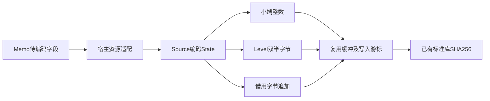
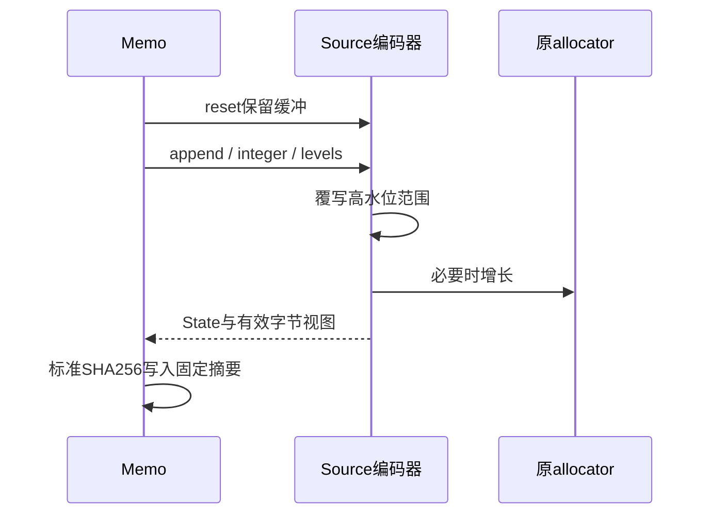

# Memo 字节编码状态自举

## Intent：最终目标

将 Memo 编码缓冲的生命周期、整数小端编码与三位 Level 打包迁入 Source，
保留原有字节协议、容量复用、缓存键和错误行为。Memo 完整协议迁移继续进行，
本职责不等于 Memo 或整体自举完成。

## Data：可用证据

阶段起点559794e9已经完整提交推送。旧memo.zig通过ArrayList缓存编码缓冲，
整数写入栈数组后appendSlice，Level计数为u32，每字节两个三位值，低高半字节
按原顺序组合，奇数末项高半字节为零。

确认现有Tuple的普通Native ABI为指针返回；直接把SHA256结果改为固定Tuple
仍需要稳定存储，不能以类型变化宣称零分配。暂保已有std.crypto最终哈希，
先迁移独立字节编码职责，不新增哈希专用桥或修改外部ABI。该结论修正了最初
准备直接增加摘要返回函数的路径。

## Edges：边界与限制

- 不新增语法、测试用例或专用运行库，使用现有State值表示、loop和数组方法。
- Source拥有buffer和写入游标，reset仅重置游标，保留高水位缓冲及增长容量。
- 不能让每个整数或Level额外创建临时数组；借用输入按原物理字节读取。
- Native保留调用方allocator、摘要最终写入、HashMap资源和未迁移协议调度；
  这些依赖必须继续明示，不以Source文件数量宣称完整自举。
- 实现后对真实编码字节、恢复、持久缓存与成本验收；退化时保留迁移并优化。
- 阶段收口时将全部未提交内容一起验收、提交并推送。

## Answer：交付与成功标准

Source中append、integer和levels分别是内聚的集合算法，create/reset负责
编码状态生命周期。算法内部循环及字节组合保留在ZX，不为凑RX标签拆成表达式。
宿主适配器只传递原生资源、借用视图和State，seed保留旧编码作为引导路径。

当前实现已接入正式generated_analysis路径。Source的levels计数先narrow到u32，
保持旧长度约束；packed Level借用原单字节布局并取低三位。init/reset在零容量
allocator下执行，Source的State返回不经过普通指针ABI的装箱分配。

## 正确性验收

引导构建和最终Source引导构建均17/17步骤通过。正式CLI使用最终Source候选
作为stage0构建，28/28步骤通过，日志为memo-encoding-cli-build.log。首轮适配曾将未定型匿名结构
交给columns.borrow，造成enum literal/指针形状错误；改为从实际executeState
签名推导Input并按类型构造实参，未放宽columns兼容性检查。

为共享level_modulus曾尝试将其移至带默认函数的level/const；额外函数影响
独立比较单元的只读作用域及连续记录布局，构建被类型检查拒绝。最终保持原
const导出及比较单元边界，新编码器直接显式导入该常量，没有复制裸值或改变ABI。
这些失败不计为通过，也未提交失败方案。

最终Source输入为138入口、2137模块、1902函数。阶段1候选与最终候选生成的
2181份产物逐字节一致；旧工具对相同当前输入也生成完全相同的2181份产物。
去除缓存封套的编译器身份后，新旧完整Memo载荷6048020字节逐字节一致，包含
协议魔数、全部摘要键和记录内容，SHA256为
37c136d3a79bf80db1c0c220fc43b3ab4d078a9cb0aca0d73749a018f627b4cf。

原有函数分析、持久缓存及生成运行时检查102/102步骤、49/49测试通过。未新增
用例。缓存跨工具、真实Source语义编辑及恢复分别2181/2180/2181份产物与
独立冷生成一致；固定真实Source克隆的初始、warm、编辑、恢复、append和
append恢复六组结果各2155份均与冷生成一致。

主要证据位于/tmp/zxc-function-levels，前缀memo-encoding：
final-fixedpoint-comparison.json、final-before-comparison.json、
final-memo-comparison.json、cross-cache-comparisons.json、
resident-comparisons.json、regressions-fixed.log和source-bootstrap-final.log。

## 成本与自查

三组同输入交错测量，使用sort-reuse-candidate作为阶段前工具，最终使用
memo-encoding-candidate；测量时没有并行构建和探针。冷CPU中位数
5.42→5.42秒，墙钟1264.269→1262.326毫秒；常驻四次编辑/恢复的CPU中位数
2.97→2.95秒，墙钟1139.720→1133.885毫秒。产物均一致。

冷RSS中位数646234112→660209664字节，约+2.2%；样本范围分别为
643661824–662683648及652017664–663666688，存在重叠，不能宣称内存改善。
因这一上浮，实际实现并测量过独立编码arena；该对照的before RSS中位数自身
已升至658440192，after为658866176，且一次after墙钟出现3043.755毫秒离群。
CPU中位数均5.40秒。该尝试没有证明隔离带来稳定收益，未保留额外arena；Source
编码迁移全量保留。原始isolated报告保留，不能用它替代最终实现的数据或删掉离群值。

生成代码复核表明，State缓冲以exclusive传入整数编码及Level循环，不会在调用
边界被无条件降级；zxRenew只在缓冲未独占时复制，覆盖高水位范围直接写入，
只在增长分支申请容量。尚未单独取得每个真实调用的allocator计数，不能将静态
生成形态核对夸大为全调用零分配的动态证明。RSS波动仍应结合后续固定输入趋势
追踪，本阶段仅证明CPU/墙钟中位数没有明显退化。

固定累计锚点ca03eb0011e3efd13221e1baefca7fcc10a1da77及历史CPU4.11秒继续
保留；当前输入增长，不能直接相减作为同输入累计差值，容差不按阶段重置。
Memo的字段选择、HashMap排序/资源、恢复、持久化与最终哈希适配仍包含Native，
完整协议及整体自举尚未完成。下一职责需继续迁移协议编排，而非将这些Native
依赖当作已自举的实现。

## 交付核对

本次diff包含5个生成入口、7份Source编码文件、宿主适配器、原Memo消费改动和
本交接文档。格式与git diff检查通过，未引入运行时层、模板或测试用例。
最终Native源码已恢复到原allocator方案，对应已通过的49项既有检查；不以
未保留的独立arena候选作为最终性能或正确性证据。阶段完成后统一提交全部
变更并推送，检查本地与远程同步。仍需继续完整Memo协议与传递依赖迁移。
