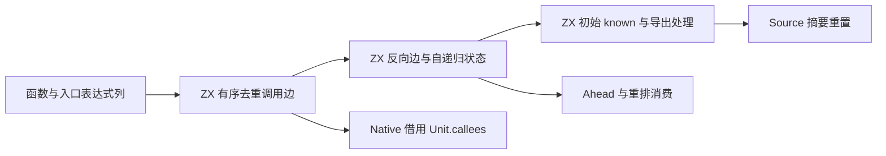

# 调用拓扑与初始可知性的自举迁移

## Intent：最终目标

将所有权分析的调用边、反向调用者、初始 known 与自递归状态迁入 RX/ZX，
移除正式 Native 路径中的对应规则，保持分析访问顺序和单写者语义。

## Data：可用证据

9eb6792a 已迁移摘要存储与生命周期。Root 仍逐表达式收集并去重 Call 目标，
逐 Unit 追加反向边，并将存在调用者且未导出的函数标记为 known。
Ahead 每次请求还在 Native 中扫描自边。现有 Expressions 列可直接借用，
Source 已支持数组更新、循环、map 元组返回与短路谓词，无须新增语言语法。

## Edges：边界与限制

按 kinds/payloads 的表达式顺序收集，仅识别 Call，保留首次调用顺序与自边；
不直接扫描可能存在陈旧 payload 的 call_functions，不增加 Task 或 contract 边。
外部函数没有 Unit，入口位于函数数量索引；入口可成为 caller，但不是 callee。
保持当前逐行查重算法，不为每个函数分配整张 seen 表。
反向边按 caller 索引顺序生成；known 对 exported 统一清除，自递归用于 Ahead 排除。

Source 拥有邻接表与标记；Native 仅投影元数据、建立 Unit 并借用返回数组。
必须检查生成产物的内外层数组更新，不能把不可见的逐次复制当作迁移成本。
旧 Native 算法仅留作 seed。Root 调度、Memo、Work 和 Ahead 宿主仍为过渡依赖。
Work 的持久增长容量与 Ahead 的 CAS/acquire/release 是后续等价迁移的前置能力，
本阶段不通过专用桥或额外复制绕过这些缺口。

## Answer：交付与成功标准

交付真实 RX 拓扑构建编排、ZX 边与状态算法、Native 数据适配及原有消费点接线。
使用既有函数分析、缓存和调用链检查，不新增测试或放宽断言。
核对完整阶段生成产物与缓存编辑/恢复一致；隔离测受影响的完整生成路径，
保留固定累计锚点 ca03eb0011e3efd13221e1baefca7fcc10a1da77 和全部不利样本。
完成职责后英文 commit 并 push。采用 IDEA 框架记录证据与剩余原生依赖，
本阶段完成不能替代整体自举闭包及最终性能验收。

## 实现中发现的前置能力缺口

第一轮生成已证实：反向邻接表的外层更新直接写入，但内层 push 生成
zxReserve(..., false)，每次复制旧行。原因不是业务写法，而是嵌套 List 元素
存储时仅保留 .items，读取时重新包装为 .storage=.plain，容量头信息丢失。
不能把这种成本变化视为自举迁移的正常代价，也不换用另一个图算法绕过。

正在补齐私有嵌套 List 的通用表示：复用已有 StateList，保留 items 与 storage；
公开/native ABI 仍为普通嵌套 slice，通过现有元素转换框架转换描述符，不复制
内层单元。元素写入和读出都保守将 exclusive 降为 shared：当前槽分析只为
整个 List 分配一个槽，不能证明两个动态索引内的行没有别名。Header 足以允许
frontier append，独占标记不能无证明地保留。

通用生成器在动态状态携带 header 时检查增长前沿，初始 plain 行仍先分配。
同步独立与共享类型、View 查询、布局身份以及后端缓存指纹；保持原错误边界，
检查新增描述符转换与 OOM 的实际联动。既有回归覆盖不可变数组、嵌套别名、
聚合循环、缓存、native reference 与 OOM，未添加新测试。

调用边收集必须在快捷缓存验证前完成；反向图和 known 原本在快捷返回后构建，
因此保留两个 RX 入口，避免缓存快捷路径增加无用构图工作。这是原执行顺序的
保留，不把底层接线分拆为独立交付。

### 前置能力的验收与成本收敛

全量私有嵌套表示曾通过下一阶段编译，但真实自编译时反复转换只读矩阵，
采样窗口记录到严重内存增长，进程最终退出 137。此实现未提交，也不将其
视为可交付能力。对应既有检查 888/890 通过，两项原本零分配的槽查询因
隐式矩阵转换而 OutOfMemory；保留原断言，不能给查询增加 allocator 规避。

修复为按使用需求选择元素状态存储：Source 扫描实际的内层 append/concat
索引访问，为对应矩阵类型保留描述符；只读矩阵继续使用原 ABI 元素表示。
标记沿上层 List 传播，布局身份包含该事实。Native 仅消费 Source 产生的标记。
当前先覆盖可直接验证的 Index 增长目标；其他未证明的目标继续保守复制，
不无条件授予 Header 或 Exclusive。这是静态生成选择，不加入运行时类型分派。

三项新语法要求已另记《循环返回管道闭包与条件列表》，本修复收口后依次实现。

## 最终验收与自我复核

已贯通 Source 调用边、自递归、反向边与 known，Native Unit/Memo/Trace/
settle/demand/Ahead 均消费 Source 结果。缓存 shortcut 仍跳过反向图构建。
元素状态存储选择规则与布局身份也由 Source 实现；Native seed 保留旧路径，
正式 Native 适配器仅转换列与借用视图。未新增测试或改变现有断言。

既有验收 250/250 步、890/890 项通过，覆盖不可变数组、聚合循环、native
reference 传递、缓存所有权、字段所有权、嵌套缓冲与函数分析；此前两个
零分配查询 OOM 已消除。123 个入口、2073 个模块连续阶段生成的 2096 个文件
完全一致。跨版本缓存、合法语义编辑与恢复分别对照 2096/2095/2096 个文件通过。

隔离交替三组：CPU 迁移前 5.12/5.11/5.11s，当前 5.11/5.11/5.11s，
中位数均为 5.11s；墙钟中位数 1183.69 → 1176.14ms；
峰值 RSS 中位数 635568128 → 635174912 字节，样本区间重叠。
六套计时产物分别与各自固定版本的 2096 个文件比较全部一致。
生成表示有意改变，不能要求迁移前后文本相同；阶段不动点与既有语义检查
共同验证这部分变化。没有按计时结果筛样或重置固定累计锚点。

证据位于 /tmp/zxc-function-levels/：nested-demand-fixedpoint23.json、
nested-demand-cache-comparisons.json、nested-demand-paired-results.json、
nested-demand-paired-_-comparison.json、nested-demand-checks.log。
失败原型与采样保留 nested-view-_，不将其混作最终版本证据。

局限：直接 Index 增长访问以外的元素状态需求尚未推广；因此仍会保守复制，
不宣称已解决所有嵌套数组的性能问题。Root 调度、Work 持久队列、Memo/Ahead
和平台资源管理继续迁移，整个自举闭包未完成。历史锚点 CPU 约 4.11s，
当前约 5.11s，累计性能差距仍未消除，不能宣称最终性能门禁通过。
