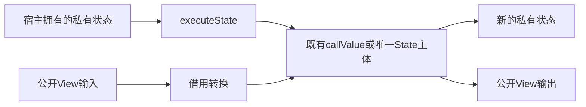
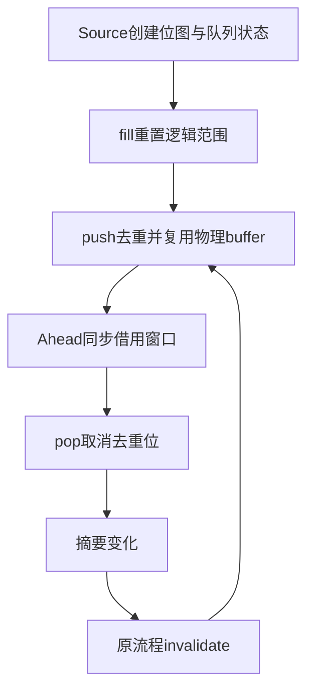

# 跨宿主状态入口与工作队列自举

## Intent：最终目标

以通用生成入口保留私有列表的容量及四态所有权，再将唯一性分析的完整FIFO、
去重位图与重置职责迁入RX/ZX。保留顺序、首匹配、错误和零拷贝成本模型，
不新增专用队列桥、语言语法或运行库。

## Data：可用证据

当前Work在root.zig内维护ArrayList、head和queued。fill保留容量，清除去重位，
push去重，pop取消对应标记；Ahead仅同步读取队列窗口，不持有借用。
executeValue通过公开View入站和出站，丢弃私有storage信息；不能据此平移状态。
上一阶段993cd0e1补齐plain/owned/shared/exclusive，相关所有权、借用和容量检查
通过，2115份阶段产物一致，固定累计性能差距仍未解决。

functionValue已有私有输入及输出能力，但按represented输出决定进入State。
库的普通无Store导出已规范为单次Call。仅当参数和结果均不需要normalize、
renew或所有权裁剪时，直接引用既有callValue；其余入口保留完整State主体。
仅输入有状态、输出scalar/void不属于本阶段状态移交入口，不能虚报支持。

## Edges：边界与限制

executeState仅对可用值入口、有私有状态输出且不启动Task的入口生成。宿主线性
移交传入状态，不保留旧可写副本继续消费；只读借用在调用返回前结束。借用的
普通ABI/View仍恢复为plain，不能伪造owned/exclusive；内部别名裁剪继续有效。
复杂入口复用同一State主体，executeValue仅做View转换并调用一次；契约、错误、
context、io与process实参按原签名衔接。普通executeIn与既有公开类型保持契约。

Work保留物理已初始化buffer与逻辑head/tail，满足head≤tail≤buffer.length。
fill清除位图并重置逻辑长度，复用旧buffer；push先覆写保留槽，达到高水位才增长。
不得读取未初始化容量；queued的创建、修改和所有权均由Source负责。
requeue仍先invalidate再push，失败与OOM传播不隐藏。Native只投影元数据、
保存生成状态并调用，不保留第二份队列规则。

## Answer：交付与成功标准

先贯通生成入口、库资格、facade与缓存，再集中验收通用能力；之后完整迁移Work。
使用实际队列消费、既有所有权/缓存/容量/错误检查，不新增用例或放宽预算。
集中核对生成产物、不动点、缓存编辑/恢复及受影响路径成本；固定ca03eb0历史
基线保留，不能逐阶段重新领取容差。完整职责完成后提交推送全部未提交内容。

## 通用入口实现与审查

已贯通入口资格、executeState生成、库元数据与facade导出；生成缓存升级到v68。
facade改由genz结构化声明和统一printer输出，不为新符号扩展源码拼接。
有状态输出且无Task的值入口可用，不能把此资格推广为所有输入状态均可迁移。

单Call别名必须保留原包装的真实语义：参数与结果均无normalize/renew，且
ownership.needsClip均为false。否则生成完整executeState主体，executeValue
仅做View边界转换并调用一次；复用既有资格算法，不另猜transfers位含义。
审查修正了最初仅看单Call形状就直接别名的风险，尚未观察到运行错误。

首轮实际生成中83个入口具备executeState，全部通过资格后引用原callValue；
其余入口不暴露状态移交能力。下一阶段编译成功，2115份生成产物完全一致。
这些证据验证入口生成与阶段稳定性，不代表Work已经迁移或所有权成本已达标。

## Work下一步边界

保留现有分析级scratch arena以覆盖所有settle/demand/planned阶段，统一释放
Source状态；不能对带header的StateList.items调用旧ArrayList.deinit。
Ahead同步消费窗口，可逐值转换u64索引，不将切片强转为平台相关的usize。

executeState保留descriptor仍不等于零复制：静态计划可能对Input插入normalize，
现growth.normalize无条件reserve(false)。下一步需审查真实Work产物；若存在
该复制，补齐经过所有权裁剪的通用动态物化复用，再验收Source消费。增长旧块
在arena中的驻留量也必须计入成本，不能因结果正确就视为等价迁移。

## 本阶段验收与自我复核

- 既有test-library-link、test-value-return、test-reverse-ownership、
  test-context-borrow以ReleaseSmall执行，命令退出0，36项Node检查均无失败；
  没有新增测试用例。reverse容量检查保持2048/16384项分别24672/196704字节。
- 下一阶段编译通过；state-entry-fixedpoint.json记录2115份产物完全一致。
- v67→v68缓存、语义编辑、恢复分别与冷生成2115/2114/2115份产物一致，
  详见state-entry-v68-cache-comparisons.json。
- 三轮交替、同一manifest、各自冷缓存：CPU中位5.37→5.36秒，墙钟
  1241.59→1245.99毫秒。RSS中位649101312→654065664字节，样本区间
  有重叠，不能宣称内存改善。该结果没有可辨的CPU或墙钟退化；不是累计
  性能达标证据。固定ca03eb0历史CPU4.11秒仍保留，累计差距未消除。
- 全部2115份产物中1906份不变，209份预期变化恰为83份公有入口新增
  函数别名、125份facade结构化重印和1份文件清单；没有函数主体变化。

完整日志与JSON位于/tmp/zxc-function-levels，前缀state-entry；这些临时证据
不提交。本阶段仅完成通用状态入口；复杂入口由既有executeValue回归覆盖，
当前125入口均未触发复杂State主体路径，不能虚报其在自举中的真实消费。
Work仍是Native实现，队列的实际零复制、arena驻留与累计性能留待后续迁移。
