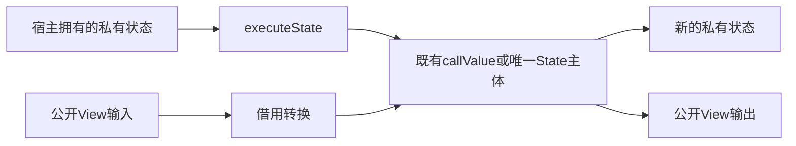
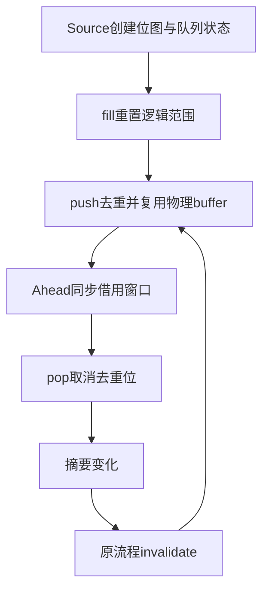

# 跨宿主状态入口与工作队列自举

## Intent：最终目标

以通用生成入口保留私有列表的容量及四态所有权，再将唯一性分析的完整FIFO、
去重位图与重置职责迁入RX/ZX。保留顺序、首匹配、错误和零拷贝成本模型，
不新增专用队列桥、语言语法或运行库。

## Data：可用证据

当前Work在root.zig内维护ArrayList、head和queued。fill保留容量，清除去重位，
push去重，pop取消对应标记；Ahead仅同步读取队列窗口，不持有借用。
executeValue通过公开View入站和出站，丢弃私有storage信息；不能据此平移状态。
上一阶段993cd0e1补齐plain/owned/shared/exclusive，相关所有权、借用和容量检查
通过，2115份阶段产物一致，固定累计性能差距仍未解决。

functionValue已有私有输入及输出能力，但按represented输出决定进入State。
库的普通无Store导出已规范为单次Call。仅当参数和结果均不需要normalize、
renew或所有权裁剪时，直接引用既有callValue；其余入口保留完整State主体。
仅输入有状态、输出scalar/void不属于本阶段状态移交入口，不能虚报支持。

## Edges：边界与限制

executeState仅对可用值入口、有私有状态输出且不启动Task的入口生成。宿主线性
移交传入状态，不保留旧可写副本继续消费；只读借用在调用返回前结束。借用的
普通ABI/View仍恢复为plain，不能伪造owned/exclusive；内部别名裁剪继续有效。
复杂入口复用同一State主体，executeValue仅做View转换并调用一次；契约、错误、
context、io与process实参按原签名衔接。普通executeIn与既有公开类型保持契约。

Work保留物理已初始化buffer与逻辑head/tail，满足head≤tail≤buffer.length。
fill清除位图并重置逻辑长度，复用旧buffer；push先覆写保留槽，达到高水位才增长。
不得读取未初始化容量；queued的创建、修改和所有权均由Source负责。
requeue仍先invalidate再push，失败与OOM传播不隐藏。Native只投影元数据、
保存生成状态并调用，不保留第二份队列规则。

## Answer：交付与成功标准

先贯通生成入口、库资格、facade与缓存，再集中验收通用能力；之后完整迁移Work。
使用实际队列消费、既有所有权/缓存/容量/错误检查，不新增用例或放宽预算。
集中核对生成产物、不动点、缓存编辑/恢复及受影响路径成本；固定ca03eb0历史
基线保留，不能逐阶段重新领取容差。完整职责完成后提交推送全部未提交内容。

## 通用入口实现与审查

已贯通入口资格、executeState生成、库元数据与facade导出；生成缓存升级到v68。
facade改由genz结构化声明和统一printer输出，不为新符号扩展源码拼接。
有状态输出且无Task的值入口可用，不能把此资格推广为所有输入状态均可迁移。

单Call别名必须保留原包装的真实语义：参数与结果均无normalize/renew，且
ownership.needsClip均为false。否则生成完整executeState主体，executeValue
仅做View边界转换并调用一次；复用既有资格算法，不另猜transfers位含义。
审查修正了最初仅看单Call形状就直接别名的风险，尚未观察到运行错误。

首轮实际生成中83个入口具备executeState，全部通过资格后引用原callValue；
其余入口不暴露状态移交能力。下一阶段编译成功，2115份生成产物完全一致。
这些证据验证入口生成与阶段稳定性，不代表Work已经迁移或所有权成本已达标。

## Work下一步边界

保留现有分析级scratch arena以覆盖所有settle/demand/planned阶段，统一释放
Source状态；不能对带header的StateList.items调用旧ArrayList.deinit。
Ahead同步消费窗口，可逐值转换u64索引，不将切片强转为平台相关的usize。

executeState保留descriptor仍不等于零复制：静态计划可能对Input插入normalize，
现growth.normalize无条件reserve(false)。下一步需审查真实Work产物；若存在
该复制，补齐经过所有权裁剪的通用动态物化复用，再验收Source消费。增长旧块
在arena中的驻留量也必须计入成本，不能因结果正确就视为等价迁移。

## 通用入口阶段验收与自我复核（32c712e0）

- 既有test-library-link、test-value-return、test-reverse-ownership、
  test-context-borrow以ReleaseSmall执行，命令退出0，36项Node检查均无失败；
  没有新增测试用例。reverse容量检查保持2048/16384项分别24672/196704字节。
- 下一阶段编译通过；state-entry-fixedpoint.json记录2115份产物完全一致。
- v67→v68缓存、语义编辑、恢复分别与冷生成2115/2114/2115份产物一致，
  详见state-entry-v68-cache-comparisons.json。
- 三轮交替、同一manifest、各自冷缓存：CPU中位5.37→5.36秒，墙钟
  1241.59→1245.99毫秒。RSS中位649101312→654065664字节，样本区间
  有重叠，不能宣称内存改善。该结果没有可辨的CPU或墙钟退化；不是累计
  性能达标证据。固定ca03eb0历史CPU4.11秒仍保留，累计差距未消除。
- 全部2115份产物中1906份不变，209份预期变化恰为83份公有入口新增
  函数别名、125份facade结构化重印和1份文件清单；没有函数主体变化。

完整日志与JSON位于/tmp/zxc-function-levels，前缀state-entry；这些临时证据
不提交。32c712e0仅完成通用状态入口；复杂入口由既有executeValue回归覆盖，
当前125入口均未触发复杂State主体路径，不能虚报其在自举中的真实消费。
Work仍是Native实现，队列的实际零复制、arena驻留与累计性能留待后续迁移。

## Work状态迁移实现

上一轮完成通用入口32c712e0；本轮将实际FIFO与去重位图迁入work目录。
创建、push和pop为内聚集合操作，使用单函数Module；fill由RX连接reset和seed，
把重置与初始入队的阶段关系留在编排中。Source维护buffer、queued、head、tail。

Native work.zig仅拥有arena及生成状态，调用四个executeState入口，同步暴露
Ahead所需借用窗口；不保留去重、入队、出队规则。移交后替换旧状态，宿主不再
消费旧描述符。旧算法位于work/seed.zig，仅在generated_analysis关闭时选择。
Ahead使用u64索引窗口，逐值转为usize，不复制或强转整个数组；invalidate仍在
push之前，所有新增可达OOM按原错误出口传播。

首版push/pop使用do/while(false)单次状态更新；生成审查发现pop会削弱未修改
buffer的资格，导致后续push可能复制。它们已改用现有array.with及对象展开，
直接表达不可变更新。不是补新语法，也不以专用Native操作绕过Source状态。

实际产物中push/pop不再生成zxRenew或qualified裁剪；fill仅在循环入口续容，
复用既有zxRenew的exclusive动态检查。此前关于renew必然复制的推测被当前
生成器实现推翻：normalize仍会在with目标与append结果插入无条件复制，实际消费已触发。
不能仅凭静态检查认定成本完成，仍以真实阶段、回归与同输入性能对照收口。

### normalize成本缺口与修复

第二次审查深入到zxReserve，发现仅检查zxRenew与qualified不足以证明无复制。
push对buffer.with、append结果及queued.with，pop对queued.with均有无条件
normalize。保留迁移，修正通用生成：先以原IR消费transfer资格clip，绑定一次
描述符，再严格检查exclusive；满足时复用原items，否则仍分配header副本。
owned不冒充header，缺失transfer位按旧复制路径。transfer.qualify基于原IR
与Sites/并发事实，不使用normalized/renewed，因此不存在复制后事实反证
复制前许可的循环。输出仍满足header+unique要求，长度不变；append继续由
原frontier检查保护。缓存版本v69，需重新覆盖实际成本与所有权回归。

首次常规回归还发现Fill私有参数在另一类型布局下按值传递，宿主不能固定
假设其为指针；适配层已依实际函数签名选择传参，与既有lifecycle保持一致。

### 阶段与缓存证据

旧Work生成的work-simple-stage与真实Source Work生成的work-stage2，2132份
产物完全一致，证明此次队列语义平移未改变计划结果。normalize修复后，
work-normalize-stage与work-final-stage再次2132份完全一致，包含实际优化后
队列消费路径。已有相同生成树不重复构建。

v68→v69缓存与冷生成2132份一致；合法语义编辑后2131份一致；恢复后2132份
一致。对照在独立源码副本执行，不修改仓库消费输入。证据位于/tmp下
work-equivalence.json、work-final-fixedpoint.json和
work-final-v69-cache-comparisons.json。

### 首轮性能失败与缺失消费事实

10组既有回归通过，52项Node检查无失败；但独立三轮交替计时未通过：CPU中位
5.34→5.38秒，RSS约645.6→913.5MB。保留迁移继续定位，不能按单次微小增量
忽略累计问题。work-final-paired-results.json保留失败原始证据。

实际产物显示，append后的tuple投影执行normalize时，transfer.selected没有
为该表达式生成资格位；新clip保守地将exclusive降为shared，所以每次append
仍复制全部buffer。修复selected的初始映射：在原有等长扫描中标记所有
normalize/renew表达式，再沿原qualify计算消费资格；不额外添加全表扫描，
不依据函数名/文件名特判。输出fingerprint升级v70，唯一性memo语义域v12，
使既有计划重新计算。需要重新核对产物、共享别名和实际成本后才能提交。

## Work阶段最终验收与自我复核

- Work的状态、FIFO、去重位图和重置逻辑已在RX/ZX中，正式generated_analysis
  路径调用四个executeState。Native只持有资源、移交状态和借用窗口；旧规则
  仅供seed选择。Ahead与整个唯一性分析调度仍是Native，不能宣称整体自举完成。
- 最终10组既有回归全部退出0，52项Node检查无失败：field-facts、loop-columns、
  multiple-append、module-generation、field-ownership、reverse-ownership、
  context-borrow、nested-buffer、borrowed-call-views、iterate-buffer。
  未新增用例；包含共享别名、混合对象、迭代、OOM清理及原有容量预算。
- 最终work-proof-stage与work-proof-stage2共2132份完全一致；v68→v70缓存、
  语义编辑、恢复分别与同输入冷生成2132/2131/2132份一致。此前v69证据不能
  代替最终版本，已经补齐新事实下的检查。
- 三轮交替、相同129入口manifest、独立冷缓存：CPU原始
  before[5.34,5.36,5.34]、after[5.31,5.51,5.33]秒，中位5.34→5.33秒；
  墙钟中位1238.24→1215.44ms，RSS中位648036352→643563520字节。
  5.51秒样本保留，没有删除后重算。最终没有可辨的阶段时间退化，消除了
  首轮约268MB额外RSS；不能把0.01秒当作稳定优化收益。
- 同输入前后2132份产物中2109份不变，变化为22个函数和1份文件清单；
  类型与公开接口不变。变化由normalize条件复用及消费资格初始化引起。

当前固定ca03eb0及历史4.11秒CPU证据未重置；最终5.33秒仍未消除历史累计
差距，且历史125入口与本次129入口不能直接作严格成本等式。整体目标继续，
下一步应定位剩余自有语义及累计成本，不因本职责通过而将全目标标为完成。

本轮的纠偏是实际成本证据推动的两次修复：先找到normalize无条件复制，再
找到其表达式缺少transfer资格。静态看zxRenew或类型保留都不足以证明零复制，
必须沿实际reserve路径和消费资格核对。保留失败证据，迁移没有撤回；最终
入口归属、产物、不动点、缓存、行为和成本分别验收，避免用一项代替全部。

临时证据前缀为/tmp/zxc-function-levels/work-proof，回归日志为
work-transfer-checks.log；不提交生成产物和日志。交付时提交全部工作区变更，
包含本文件和所有新增Source、seed、宿主接线，推送后确认干净且无未推送提交。

最终逐项审查22个函数差异：14个移除缺失transfer造成的多余降级，5个添加
normalize的exclusive条件复用，3个非selected函数仅多绑定/局部块且仍复制。
其他是临时变量编号变化，没有额外业务字段、条件、调用或错误路径变更。
