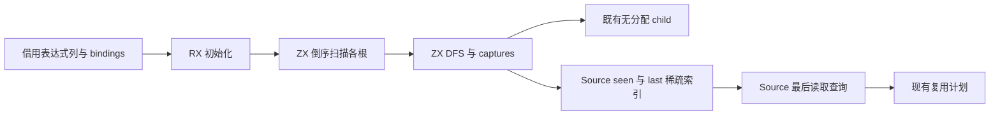
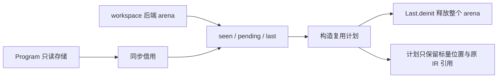

# 作用域最后读取状态自举

## Intent：最终目标

将 scope/reads.collect 的倒序根遍历、共享 seen、最后读取位置和查询迁入 RX/ZX，
保留原遍历顺序与稀疏哈希成本；补齐可增长整数索引后直接消费，不新增专用语义桥。

## Data：可用证据

起点 7db0a7f2，工作区干净。原实现使用两个稀疏 HashMap 和一个可复用栈。
core/expression_table/child 已提供与 Native Children 相同顺序的无分配索引读取器；
ExpressionTable 可以通过现有 columns.pointer 借用。现有字节键索引仅为有界容量，
不能直接当作可增长整数索引，也不能逐节点分配整数编码字节。

## Edges：边界与限制

- 保留从 result 向 bindings 倒序扫描，seen 在所有根之间共享。
- Reference 和 Task captures 首次登记位置；captures 必须先于 children 处理。
- children 按索引递增压栈、LIFO 弹出；不创建每节点的 children 数组。
- Source 自己持有 keys/buckets/positions；Native 不重建 HashMap，不做全表快照。
- 索引采用开放寻址、动态扩容与重哈希，摊销常数查找；seen 不分配无用 values 列。
- 临时表与结果统一由 Last 持有短生命周期 arena，后端为实际 workspace；在复用
  计划构造完成后释放，不挂在整个 Lower 的长期 arena 上。
- 初始 seed 保留旧算法，既有规则和固定性能基线不重置；不新增测试用例。

## Answer：交付格式与成功标准

交付完整 Source collect 与 lookup、通用整数索引、零复制 Native 输入适配。
贯通调用方并核对生成所有权、现有行为、阶段自编译和受影响性能后统一提交推送。

## 实现与成本核对

新增 core/integer/index，使用稠密 keys 与开放寻址 buckets；桶保存键列索引，
max_u32 只表示空桶，键本身允许完整 u32 值域。插入前校验键数可用 u32 表示，
以 75% 最大负载和二倍容量重哈希，重复键直接返回已有位置，不扩容。
seen 只持有该索引；last 另有平行 positions 列，首次登记后不覆盖。

RX 连接 initialize 与 scan；scan 是倒序 roots 算法，walk 是 DFS，captures 和
record 分别负责捕获登记与首胜规则。expand 逐项调用既有 child，不分配 children
数组；pending 跨根复用，同一 seen 覆盖整次分析。

Native 仅通过 columns.pointer 借用完整表达式描述符，bindings.values 直接借用。
Source 收集结束后通过 executeValue 发布只读 Last 切片视图，随后仅 get，不再
更新；因此剥离 storage 不会使后续更新退化。get 的公共 ABI 栈描述符仅在同步
调用期间存在，内部以零容量 allocator 执行并只返回标量位置。

Last 自己持有以 lowering.workspace 为后端的 arena，收集失败由 errdefer 释放，
成功后在 reuse.create 构造计划结束时释放。Source 的 seen、pending 和 last 均在
同一短期区域；构造出的复用计划不引用这些表，只保留位置判断和原 IR 数据。
初始 seed 的原 HashMap 算法继续保留，allocator/deinit 同样使用 workspace 配对。

生成形态确认 keys 使用 zxReserve(..., true)，buckets 直接写槽，没有每次整表
复制。首次实现中 grow 每 rehash 一个键会装箱新的 Index 描述符；依据实际产物
将循环改为只持有 buckets、probe 接收平铺视图，消除了这项逐键装箱。grow 最终
只返回一次 Index；insert 每个新键的 Index 描述符，以及扩容路径的返回值装箱
仍存在，如实纳入成本，不宣称零分配。

## 阶段与现有检查

执行跨至 2026-11-07，沿开工文档持续收口，未另建重复阶段。

- 初始 seed → Source：37/37 构建步骤通过。
- Source 再生成：19/19 通过；消除重哈希装箱后，由 Source 再生成最终工具，
  19/19 通过。性能测量使用最终 Source 生成本体。
- 两代 Source 工具对当前相同 153 入口、2334 模块、2075 函数文件输入生成
  2385 个文件，只有 .zxc-inputs 工具身份标记不同。
- compiler：21/21 步骤，372/372 检查通过。
- function-analysis、value-return、function-updates、zx-tasks：354/354 步骤，
  636/636 个直接 Zig 检查通过；相应 Node 驱动的现有运行检查也通过。
- 最终 16 个 Source 文件 fmt/lint 通过；未新增或放宽测试。

## 性能与产物

两侧工具本体均由 Source 生成，本轮运行也使用 Source 分析／生成。固定 Zig
0.17.0、ReleaseSmall、原冻结输入和缓存边界；构建与检查完成后隔离四轮交替。
首轮保留在原始数据中，以下为后三轮中位：

| 指标     | 前           | 后           |
| -------- | ------------ | ------------ |
| CPU      | 5.32 秒      | 5.28 秒      |
| 墙钟     | 1.18 秒      | 1.18 秒      |
| 峰值 RSS | 495,648,768B | 483,835,904B |

峰值中位下降 11,812,864B，约 2.4%。旧工具四轮约
499.1/494.9/499.3/495.6MB，新约 485.9/492.5/479.0/483.8MB，每轮均较低。
本次同时把分析工作表改为短期 workspace arena，不能把全部差额单独归于哈希布局。
CPU 差额 -0.04 秒较小，不宣称显著加速；最终仍低于固定约 5.34 秒基线。近期
5.31→5.30→5.31→5.29→5.31→5.28 秒，无持续增长，不重置累计基线。

冻结输入仍为 141 入口、2220 模块、1982 函数，2268 个产物仅身份标记不同。
目标代码字节一致，不重复测量目标程序速度；未重测无关完整冷构建，也不将生成器
RSS 收益解释为 Zig 后端构建峰值已经解决。

原始命令、工具哈希、全部样本、产物及检查日志位于忽略目录
.zig-cache/cold-build-analysis/scope-reads，摘要见 runtime-comparison.json、
fixedpoint-result.json 和 source-checks-final.log。

## 自我复核与剩余边界

collect 与 lookup 的规则和稀疏状态均已迁移，Native 不重建 HashMap；正式路径
不再调用旧 collect 或 Children 迭代器。公开描述符、切片和 backing 生命周期
分别核对，不以生成器会优化为由忽略实际装箱。

整数索引保持摊销哈希复杂度，但物理布局、负载比例、描述符和生命周期与 Native
HashMap 不完全相同；受影响性能与完整产物已验收，后续趋势仍沿固定基线观察。
当前索引用于插入和只读查询，不宣称已经提供删除语义或通用全功能 Map。

scope/reuse 的候选判定、positions 表、名字恢复和发射，以及 Lower 其他缓存和
AST 存储仍为 Native；完整自举没有完成。后续继续迁移这些职责，不能把本阶段
的状态迁移和产物不动点当作最终依赖闭包已经纯 Source。
